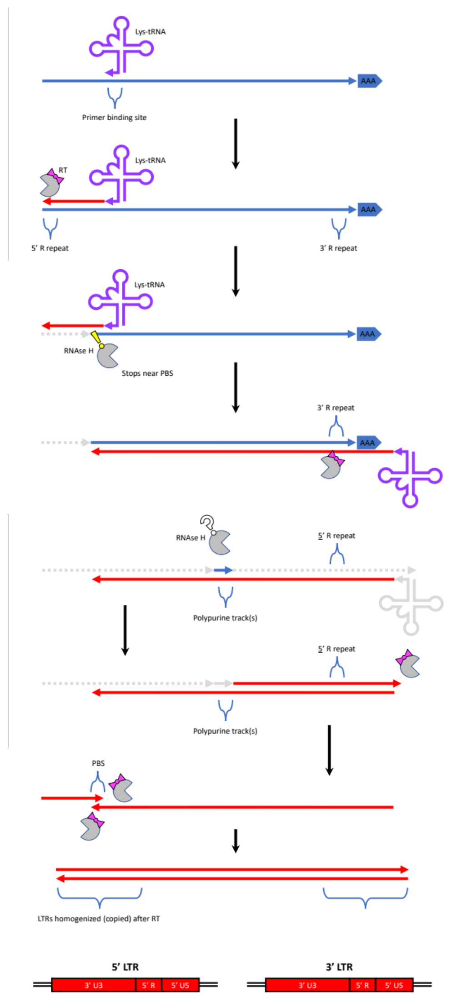
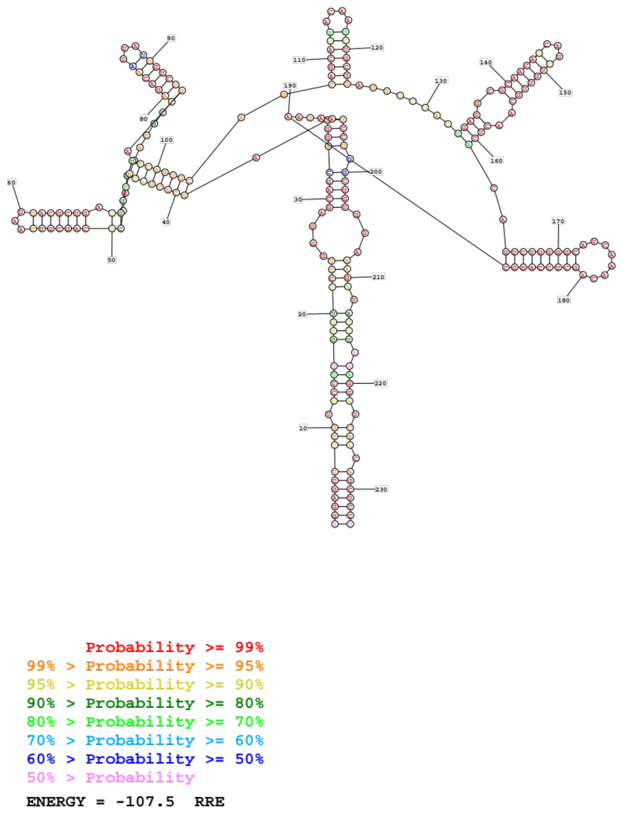
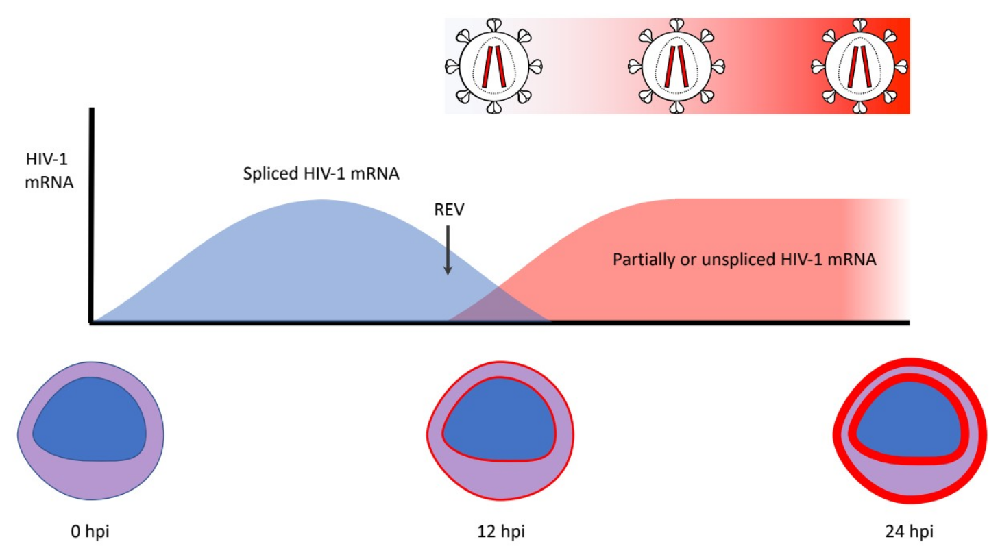
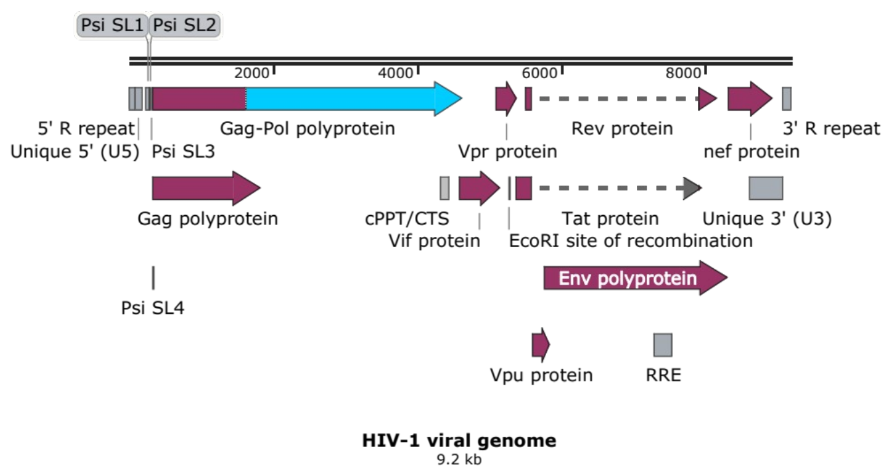
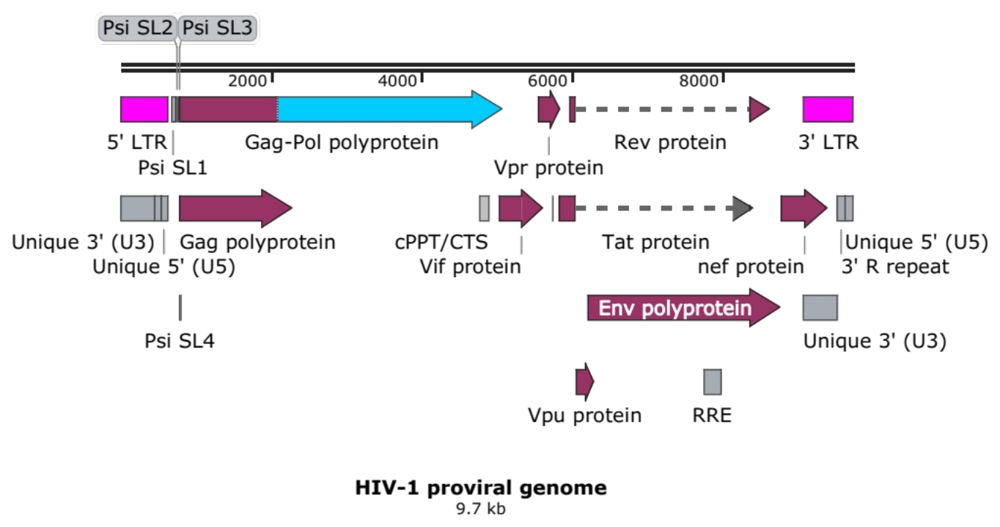
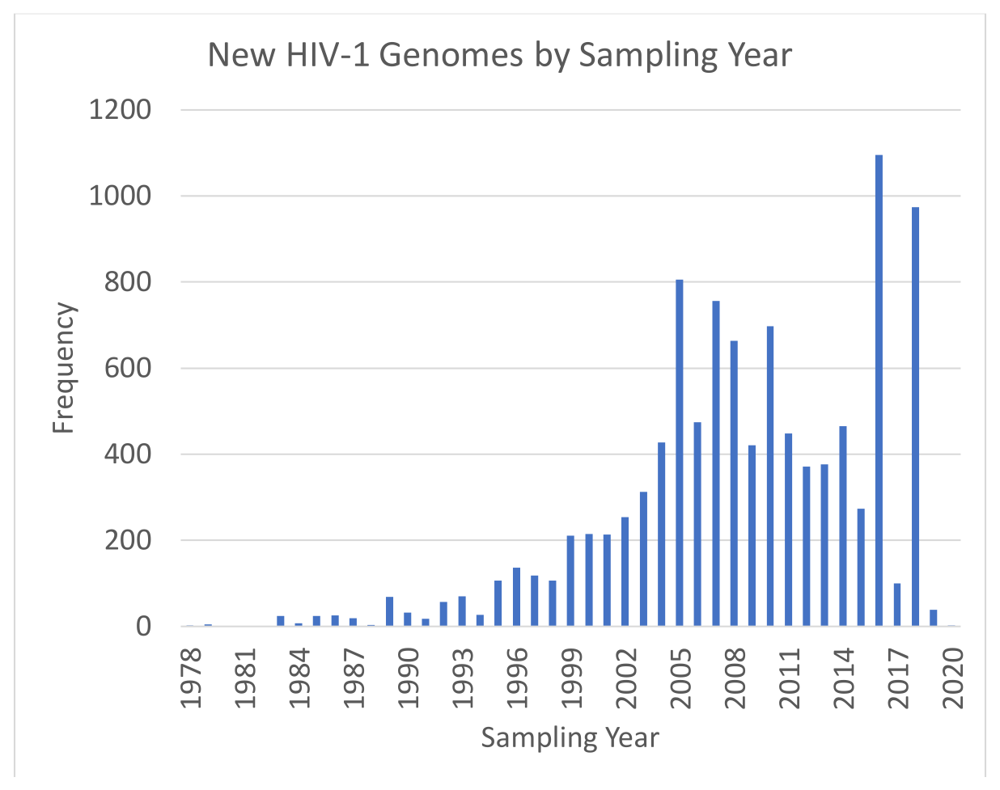

# Chapter 1: What we ~~know~~ believe about HIV

## Abstract

Chapter 1 of *HIV Informatics* introduces select information about the known biology of the human immunodeficiency virus type 1 (HIV-1). All discussions of HIV in this dissertation pertain to HIV-1, unless otherwise specified. Also included is a brief discussion of acquired immunodeficiency syndrome (AIDS). Details of clinical management and psychosocial determinants of health (Ghosn et al. 2018) for people living with HIV/AIDS (PLWHA) or at risk of acquiring HIV fall outside the scope of this dissertation and are not discussed.

## AIDS, and the discovery of HIV

The first reported cases of acquired immunodeficiency syndrome (AIDS) came as a short case report describing opportunistic infections that seemed out of place (CDC 1981). Five young male patients all identified as “homosexual” had multiple opportunistic infections usually only seen in immunocompromised patients. Their infections included *<u>P</u>neumocystis <u>c</u>arinii* <u>p</u>neumonia (PCP[^1]) (Walzer et al. 1974), oral mucosal candidiasis, and cytomegalovirus (CMV) infections. These patients were believed to be immunocompromised due to lowered immune cell function, in absence of any obvious primary cause (e.g., a hematological cancer which might have directly affected immune cells). These 5 young men would unfortunately not be the last. AIDS soon appeared in heterosexual populations including but not limited to Haitian immigrants in New York, hemophiliacs, patients receiving blood-derived products, babies from mothers who would occasionally develop AIDS too. Patterns of spread were beginning to emerge with each new case report.

The Editorial Note at the end of the first case report hypothesized that these men had an acquired cause of immune disfunction (CDC 1981). But with AIDS patients susceptible to so many pathogens, which one was the causative agent? It is helpful to understand how microbiologists went about proving an infectious agent was pathogenic. This was done by observing Koch’s Postulates. Koch’s Postulates, developed by Robert Koch, set the gold standard for establishing a microbiological etiology for infection and disease, summarized in a seminar prepared by Stanley Falkow in 1988 (Falkow 2004)). These included: 1.) the agent occurs in every individual with disease, and 2.) is not seen in healthy individuals, and 3.) the agent, when cultured, can recapitulate infection and disease in healthy individuals exposed to the agent. Originally based on Koch’s work with tuberculosis and anthrax, these postulates were later expanded to encompass non-bacterial pathogens, including viruses. For initial studies of suspected deadly pathogens, *in vitro* cell-culture infection models and *in vivo* disease models non-human infection models were acceptable surrogates to human studies which were not possible because of ethical reasons (e.g., the Nuremberg Code). During the early days of the AIDS epidemic, clinical samples from AIDS and pre-AIDS patients were the first sources of early material harboring potential AIDS-causing agent(s).

The race was on to find the causative agent(s) of AIDS. Two important papers came out in the same issue of the journal *Science* on May 20, 1983. One from the Americans led by Robert Gallo at the National Cancer Center, and another from a group of French researchers at the Pasteur Institute. The Americans who had recently discovered Human T-Cell Leukemia Virus (HTLV-1) identified HTLV-1 in an AIDS patient (Gallo et al. 1983). This led them to believe that an HTLV-like virus might be the cause of AIDS. The French group provided strong evidence at the time that the virus they had found, which they called lymphadenopathy-associated virus (LAV), was not HTLV (Barré-Sinoussi et al. 1983). Then in 1984 four Science papers by Gallo and collaborators identified an HTLV-like virus in AIDS patients, and in patients at risk of AIDS who would later contract AIDS (termed pre-AIDS patients) (Popovic et al. 1984) (Sarngadharan et al. 1984) (Schüpbach et al. 1984) (Gallo et al. 1984). They believed this was a new virus, HTLV-III. However it was in fact HIV-1. The Americans were not the first to isolate HIV-1 (Cohen and Enserink 2008), but they did provide strong evidence that HIV-1 was the causative agent of AIDS (Marx 1984).

The World Health Organization maintains statistics for HIV globally (<https://www.who.int/data/gho/data/themes/hiv-aids>). To date, 76 million people have contracted HIV, and 33 million people have died from HIV/AIDS. At the end of 2019, there were 38 million people living with HIV/AIDS (PLWHA). This represents the global prevalence of HIV. Africa remains most severely affected, accounting for more than two-thirds of HIV cases globally, with 1 in every 25 adults (3.7%) living with HIV. The number of new HIV cases in 2019 was 1.7 million. In the US, HIV stats are maintained by the Department of Health & Human Services and supported by the Minority HIV/AIDS Fund on HIV.gov (https://www.hiv.gov/hiv-basics/overview/data-and-trends/statistics). About 1.2 million people were living with HIV in the US, and there were an estimated 36,400 new HIV infections in 2018.

The United Nations currently has a “90-90-90” strategy with the following goals to end the AIDS epidemic. By 2020, 1.) at least 90% of PLWHA will know their HIV status, 2.) at least 90% of PLWHA will receive sustained combined antiretroviral therapy (cART), and 3.) 90% of PLWHA on cART will achieve viral suppression (UNAIDS). An important paradigm shift to facilitate 90-90-90 is test and treat, where people at risk of acquiring HIV are diagnosed if positive and are then linked to care (Ghosn et al. 2018). PLWHA are living longer thanks to earlier diagnosing and better medications (Lohse and Obel 2016; Samji et al. 2013). This has paradoxically led to PLWH having increased risk of having non-AIDS comorbidities such as cardiovascular disease and cancer (Ghosn et al. 2018), and renal disease (Wyatt and Klotman 2016), among others.

## HIV replication cycle

This section summarizes the HIV replication cycle, and wrote it considering several review sources, including ViralZone (Swiss South Africa Joint Research Programme. n.d.) (<https://viralzone.expasy.org/5096>), the HIV InSite Knowledgebase (University of California, San Francisco) (<http://hivinsite.ucsf.edu/InSite?page=KB>), and the book *HIV and the Pathogenesis of AIDS* by Jay A. Levy (Levy 2007).

### HIV virion

We begin arbitrarily with the HIV virion. Mature HIV-1 virion particles are membrane-bound, with embedded viral glycoprotein gp120, and a non-covalently associated embedded viral protein gp41 (together called the HIV glycoprotein complex). Host proteins such as ICAM-1 are known to co-occur and are believed to contribute to cell tropism by interacting with target cell integrins. The HIV membrane is sensitive to detergent, desiccation, and changes in temperature, salt, and pH deviating from host physiology, rendering individual virions fragile compared to non-enveloped viruses. These weaknesses have been explored with microbicide development but have so far not been effective at reducing HIV transmission.

Interior to the virion membrane, mature particles are believed to contain HIV protease-cleaved HIV gene products, two full-length unspliced HIV-1 mRNA viral genome equivalents, and rarely host RNAs. Well-characterized major cleavage products (mature peptides, or GenBank record tag “mat_peptide”) from Gag polyprotein include the structural proteins: capsid protein (p17; CA), matrix protein (p24; MA), and nucleocapsid (NC; p7). Minor cleavage products include p1, p2, p6. Cleavage products from the Gag-Pol polyprotein include those (except p6) with Gag-Pol transframe peptide, protease (PR; aspartic peptidase), p51 subunit of reverse transcriptase, and p66 subunit of reverse transcriptase with p15 RNAse H domain, and p31 integrase. A ribosomal frame shift occurs near the end of p1 and the beginning of p6 which causes a shift from gag[^2] to pol reading frame, enabling the pol segment of Gag-Pol to be expressed instead of Gag. The Pol polyprotein is not believed to occur independently of Gag (which excludes Pol) or Gag-Pol. The HIV accessory proteins Vif, Vpr, Vpu, Rev, and Nef are also found in HIV virions. Accessory viral proteins are not essential for viral replication. They are reviewed in greater detail below.

Each mature virion is commonly modeled as having two copies of full-length unspliced HIV-1 (+)-sense coding mRNA. This is believed to be a direct transcript from full-length replication-competent HIV-1 provirus. There is some evidence that diploidy need not be essential, or at least need not be tied to reverse transcription (Jones, Allan, and Temin 1994; Panganiban and Fiore 1988; van Wamel and Berkhout 1998). Another interpretation of the above is that virion diploidy is not essential, which leaves room for aneuploidy via stochastic packaging of viral mRNAs. The HIV genome, reference genomes, and gene models are discussed later in this dissertation.

### HIV tropism (pre-entry)

The mechanism of viral tropism, or how virions select cells to first attach to and then infect after entry, is well-studied. It is divided into roughly two kinds of tropism: receptor-mediated and receptor-independent. Receptor-mediated tropism includes interactions between HIV glycoprotein complexes, mediated by gp120, first binding to attachment receptors such as CD4 (Maddon et al. 1986), a major host-expressed HIV receptor. Host ICAM-1 on the HIV virion membrane may also interact with target cell integrins such as LFA1 (https://viralzone.expasy.org/247). Cells expressing CD4 include T-lymphocytes (“T cells”), macrophages, dendritic cells (https://viralzone.expasy.org/247). Other adhesion receptors and some of the cells which express them include: DC-SIGN expressed by dendritic cells (da Silva, Segat, and Crovella 2011); CLEC4M (also known as L-SIGN) expressed by liver sinusoidal endothelial cells and cells in the lymph node (probably dendritic cells) (da Silva et al. 2011); heparan sulfate expressed by many cell types (Crublet et al. 2008).

Subsequent entry via membrane fusion is mediated by interaction between gp41 and with host cell-expressed co-receptors such as CCR5 (R5) and CXCR4 (X4). One hypothesized mechanism for entry is clathrin-mediated endocytosis (<https://viralzone.expasy.org/957?outline=all_by_species>), although there is some evidence that this is not the only mechanism HIV-1 may use for entry (Permanyer, Ballana, and Esté 2010). After attachment of gp120 to CD4 or ICAM-1 to integrins, gp41 mediates fusion between virion and target cell membranes. The fusion inhibitor enfuvirtide (also called T-20) works by interfering with gp41 conformational changes necessary for membrane fusion (Arts et al. 2012) (Zhang et al. 2018). An important point to consider which limits the applicability of fusion inhibitors clinically is that HIV tropism often shifts during infection. This shift may have important prognostic consequence; X4-tropic trains are often seen later in the natural course of HV infection, and are considered worse (Verhofstede, Nijhuis, and Vandekerckhove 2012). Receptor-independent infection occurs by cytopathic effects such as HIV-mediated syncytia formed between cells infected with CXCR4-tropic HIV and neighboring cells.

Several CD4- cell types have also been found to be susceptible to HIV infection *in vitro* (Table 3.8 (Levy 2007)). These included: fetal astrocytes, brain-derived capillary endothelial cells, brain microglia (which will be revisited in **Chapter 8**), NK cells, primary skin fibroblasts fetal adrenal cells, follicular dendritic cells, hepatic sinusoidal endothelial cells, trophoblast cells, cervical epithelial cell lines. Cancer cell lines such as the following have also been shown to be susceptible to infection independently of CD4 expression: the SK-N-Mc neuroblastoma cell line, the HOS osteosarcoma cell line, the RD rhabdomyosarcoma cell line, hepatocellular carcinoma cells, bowel adenocarcinoma cells. *In vivo* studies suggested that bowel epithelium, renal epithelium, dental pulp fibroblasts, astrocytes and oligodendrocytes (which will be revisit in **Chapter 8**) were all susceptible to HIV. The number of tissues purported to support various stages of HIV replication is ever growing. These reservoirs can be sources of low-level viral replication and re-seeding after discontinuation of antiviral therapy, and represent an important challenge to achieving a sterilizing cure (Fletcher et al. 2014) (Lorenzo-Redondo et al. 2016) (Ghosn et al. 2018). A sterilizing cure would mean elimination of HIV from the body and no need to continued antiviral therapy, as opposed to a functional cure which we have currently when HIV medications are given to patients earlier to prevent HIV replication and subsequent immune dysregulation. Despite promising gene therapy results to change expression of HIV co-receptors by introducing Δ32 mutations into the CCR5 co-receptors of allogenic hematopeotic stem cells in the context of separately indicated bone marrow transplants, there currently remains no sterilizing cure for HIV infection.

### Post-entry

Within 40 minutes of fusion (Swiss South Africa Joint Research Programme. n.d.), encapsidated viral mRNA is transported to the nucleus via dynein along microtubules (Gaudin et al. 2013; McDonald et al. 2002). Premature capsid destabilization (e.g., Cyp A inhibition, CPSF6 (Lee et al. 2010), Mx2 (Goujon et al. 2013), and TRIM5α expression in some non-human primates (Nakayama and Shioda 2010)) may lead to abortive infection. This exposes viral mRNA prematurely in the infected cell, stimulating host cell antiviral response. Appropriately timed uncoating delivers the RT complex (discussed below) to the nucleus for import, protecting nascent HIV cDNA from host antiviral sensors (Ambrose and Aiken 2014).

### Reverse transcription

The process of HIV-1 reverse transcription (RT) is well-studied, reviewed in (Hu and Hughes 2012) and at ViralZone (SIB Swiss Institute of Bioinformatics n.d.) (Add mobile elements III). Briefly, HIV-1 RT’s RNA-dependent DNA polymerase activity is primed by a lysine tRNA binding to the primer-binding site (PBS) in the forward/coding/(+)-sense mRNA in the reverse/reverse-complimentary/(-)-sense orientation (**[Chapter 1 Figure 2](#figure-2): HIV-1 reverse transcription and LTR homogenization**). RT synthesizes the reverse-complimentary cDNA from the PBS to the end of the 5’ R repeat and reaches a minus strand strong stop. RNAse H activity from the p66 subunit of RT degrades the complimentary RNA in the RNA-DNA heteroduplex. The first strand transfer occurs when the synthesized cDNA finds complimentary R sequence at the 3’ end. The template, assumed to be the full-length unspliced genome, is copied by RT. RT RNAse H activity degrades most of the remaining HIV mRNA, except for essential sequences called poly-purine tracks (PPTs). These regions exhibit marginal resistance to initial RNAse H activity. Second strand synthesis by RT is primed by the remaining PPT(s). Once the positive strand strong stop occurs, the PPT(s) give way to RT RNAse H activity. The Lys-tRNA primer is also degraded. A second strand transfer occurs, this time leveraging the PBS (instead of the R). Both cDNA strands are then finished by RT’s DNA-dependent DNA polymerase activity.

<figure markdown="1" id="figure-2" class="book-figure">

{ loading=lazy }

<figcaption markdown="1">

**Chapter 1 Figure 2: HIV-1 reverse transcription and LTR homogenization.**

Homogenization is not exactly copying. It is a (3’ U3)-(5’ R)-(5’ U5) duplication. Consider replacing “copying” with “(3’ U3)-(5’ R)-(5’ U5) duplication”. Adapted from (SIB Swiss Institute of Bioinformatics n.d.).

</figcaption>
</figure>

RT happens on microfilaments in the in the RT complex (RTC) (Greene and Peterlin 2006) and is believed to occur within 8-12 hours post-infection of a host cell (Iordanskiy et al. 2006). HIV cDNA is detectable within 4 hours post infection (hpi) (Hu and Hughes 2012). RT inhibitors exist in two broad classes nucleoside/nucleotide reverse transcriptase inhibitors (NRTI) and non-nucleoside/nucleotide reverse transcriptase inhibitors (NNRTI) (Arts et al. 2012). NRTIs are incorporated by RT into the nascent cDNA strands, leading to chain termination. NNRTIs also inhibit RT, however they do so by allosterically binding outside of RT active site, ultimately inhibiting RT activity. RT is the most error-prone step in HIV replication. Once the first strand of cDNA is made, it is vulnerable to cytidine deamination by host APOBECs (Salter, Bennett, and Smith 2016), which are often packaged in the virion (SIB Swiss Institute of Bioinformatics n.d.). The HIV accessory protein Vif, also known as viral infectivity factor or p23, inhibits APOBECs’ antiviral activity (Swiss South Africa Joint Research Programme. n.d.) (Barraud et al. 2008). RT completion is marked by double-stranded cDNA with identical LTRs. The template HIV genomic mRNA is presumably degraded. Distinguishing between primary HIV mRNAs (from either HIV molecular clones used to transfect virus-producing cells like human embryonic kidney 293T cells OR from reactivated HIV-infected cell lines), reverse-transcribed HIV cDNAs and/or secondary HIV mRNA from “infected” cells was a challenge prior to this dissertation. It was unknown how much primary HIV mRNAs contributed to HIV gene expression signatures in newly infected cells.

### Integration and entry into latency

Once RT is completed, the pre-integration complex (PIC) containing double-stranded cDNA is transported into the nucleus. Once inside the nucleus, but before integration, the HIV accessory protein Vpr (viral protein R, p15) inhibits antiviral responses like SMC5/6 complex compaction of viral cDNA designed to silence expression from foreign DNA (Dupont et al. 2021). Methylation of HIV cDNA represses further HIV transcription until the methylation is reversed (reviewed (Ruelas and Greene 2013)).

During integration, the HIV cDNA ends are terminally processed by HIV integrase (Hu pharma review) (Arts et al. 2012) (Lesbats, Engelman, and Cherepanov 2016). Following end processing, strand transfer is the limiting factor of HIV integration and establishment of the HIV provirus. Subsequently, HIV proviral mRNA expression may occur, or expression may be silenced as is the case when HIV enters viral latency. Integration inhibitors (Arts et al. 2012) are a newer class of anti-HIV drugs that have become important first line agents used in current combination treatments. Raltegravir was the first FDA-approved integrase inhibitor. These drugs work by inhibiting strand transfer. HIV integration into the host genome, viral latency, and subsequent immune evasion remain the most challenging roadblocks of HIV biology preventing attainment of sterilizing cure (Ghosn et al. 2018). Integrase inhibitors will be discussed in more detail in the “HIV pharmacotherapy” section below.

Discuss unintegrated.. (Meyerhans et al. 2003)

### Viral reactivation is exit from latency

The natural triggers for HIV reactivation, or exit from latency, remain poorly understood. This is in part due to technical limitations studying infected cells once transcription is turned on. For example, virus-producing cell lifespan is shortened to about 2 days (Wei et al. 1995). *In vitro* studies have found reactivation agents can stimulate HIV mRNA expression (Shirakawa et al. 2013). Pharmacological latency reversal has been explored as a treatment targeting the HIV reservoirs (Ghosn et al. 2018). Agents evaluated included vorinostat (Archin et al. 2012) (Elliott et al. 2014), panobinostat, disulfiram, or romidepsin (Søgaard et al. 2015), or with interleukin 7 (IL-7). Unfortunately, these failed to decrease HIV reservoirs (Ghosn et al. 2018). When paired with a functional immune system, latency reversal is an important part of the “shock and kill” strategy to purge the body’s HIV reservoirs (Katlama et al. 2013) (Deeks et al. 2016) (Bullen et al. 2014) (Ghosn et al. 2018).

### HIV mRNA expression

HIV mRNA expression begins with transcriptional initiation, which is often abortive. This has been studied extensively from the HIV proviral promoter, located in the U3 portion of the 5’ long terminal repeat (LTR). Host RNA polymerase II is recruited to the 5’ LTR. This process is facilitated when the 5’ LTR DNA is unmethylated. HIV-1 encodes a transactivating factor, Tat, which binds to the TAR element. The TAR element is an RNA hairpin located within the 5’ R repeat. TAR is part of the transcription start site and is present in all complete HIV mRNAs (Nguyen Quang et al. 2020; Ocwieja et al. 2012; Purcell and Martin 1993). The predominant form of Tat protein is believed to be the result of doubly spliced HIV, where two large introns are excised: 1.) the first large intron which would otherwise code for Gag and Gag-Pol, and 2.) the second large intron which would otherwise code for Vpu and Env. An important first functional switch is believed to occur when enough spliced HIV mRNA is made to produce enough Tat. Tat greatly enhances HIV transcription.

Transcriptional initiation is followed by transcriptional elongation, which enables the transcription of full-length unspliced (FLUS) HIV mRNA. Processing of proviral mRNAs is believed to follow the conventions of other host genes. Five prime (5’) capping occurs, followed by intermittent splicing of introns of varying sizes. Splicing is believed to be co-transcriptional. If an intron is skipped, it is retained. Gag and Gag-Pol polyproteins are believed to be the products of unspliced HIV mRNA. When an intron containing gag-pol is spliced out, HIV accessory proteins are favored, occasionally with Vpu and Env polyproteins. This stage is commonly called singly spliced HIV. HIV proteins Tat and Rev are produced when an intron containing vpu and env are spliced out (commonly referred to as “multiply spliced”). Some reports suggested that Tat and Rev are made from different mRNAs. Another product of multiply spliced HIV is Nef. Spliced HIV-1 mRNAs are believed to be the preferred isoforms, however, and **importantly, the exact rules governing HIV splicing remained undefined prior to this dissertation.**

The functions of some of HIV-1’s proteins are known. The product of env, Env/gp160, is a polyprotein which will eventually become the HIV virion envelop glycoprotein, composed of proteolytic cleavage products gp120 and gp41. During Env/gp160 translation, a signal peptide locates Env/gp160 to the lumen of the Golgi, while maintaining Env/gp160’s membrane interaction. Env/gp160 is eventually processed into gp120 and gp41 by host proteases. Gp120 and gp41 eventually make their way onto the surface of infected cells expressing HIV mRNA.

Parallel processes disrupt the host cell plasma membrane protein complex *milieux*. For example, Vpu and Nef are known to inhibit the cycling of host CD4 (Tokarev and Guatelli 2011), possibly contributing to decreased CD4 function. Nef was shown to downregulate major histocompatibility class I (MHC-I) expression in the HIV-infected cells (Dirk et al. 2016). This contributes to immune system evasion, which is a barrier to proviral elimination.

Another HIV accessory protein viral protein R (Vpr) inhibits the cell cycle, causing it to stop at G2/M. This is believed to facilitate proviral gene expression by ensuring the presence of host factors normally present later in the cell cycle. Vpr has also been posited to help HIV redress some of the DNA damage induced by host APOBECs. This latter activity is believe to be due to Vpr’s preferential binding to host uracil DNA glycosylase 2 (UNG2) and more recently single-strand-selective monofunctional uracil-DNA glycosylase 1 (SMUG1), which leads to preferential incorporation of these host enzymes in HIV virions (Schröfelbauer et al. 2005). As mentioned previously, Vpr has also been show to prevent HIV cDNA silencing (Dupont et al. 2021).

**[Chapter 1 Figure 5](#figure-5): HIV-1 NL4-3 Rev Response Element**). Rev binding to the RRE facilitates the nuclear export of HIV mRNAs containing the env intron/vpu-env segment. This is believed to be an important step to increase the availability of full-length unspliced (FLUS) HIV mRNAs for packaging into virions forming at the host cell plasma membrane (**[Chapter 1 Figure 6](#figure-6): HIV-1 mRNA expression, Rev switch, virion production**).During viral reactivation, a second functional switch occurs when the concentration of HIV Rev protein increases past a certain threshold. Rev is an essential HIV protein that binds to a conserved 2º structure located between the gp120 and gp41 segments of the env intron (my new annotation: vpu-env segment). This Rev Response Element (RRE) is an essential structural feature of the HIV RNA genome (

<figure markdown="1" id="figure-5" class="book-figure">

{ loading=lazy }

<figcaption markdown="1">

**Chapter 1 Figure 5: HIV-1 NL4-3 Rev Response Element (RRE).**

</figcaption>
</figure>

<figure markdown="1" id="figure-6" class="book-figure">

{ loading=lazy }

<figcaption markdown="1">

**Chapter 1 Figure 6: HIV-1 mRNA expression, Rev switch, virion production.**

[^1]: Note: *Pneumocystis carinii* was renamed *Pneumocystis jiroveci* Frenkel 1999 (Stringer et al. 2002), and the disease *<u>P</u>neumo<u>c</u>ystis <u>p</u>neumonia* retains the acronym PCP, but with nuanced different meaning.

[^2]: For clarity, I follow the following convention for HIV genes and their products. HIV genes described before my dissertation are usually written in lower case (e.g., gag). Genes are stretches of nucleic acid which may code for a protein product. Non-coding nucleic acids include but are not limited to promoters in circularized cDNA and/or linear integrated proviral DNA sequences and RNA segments, which may exhibit secondary (2º) structure. These non-coding elements have names which follow sentence case (e.g., long terminal repeats (LTRs)). HIV protein products are written capitalized but not in all-caps (e.g., Gag). Note that gene definitions evolve with time. See text discussion about the gag-pol gene and how its ribosomal frameshift site enables translation of previously described Gag and Gag-Pol products.

</figcaption>
</figure>

Once there is enough FLUS HIV mRNA, Gag and Gag-Pol polyproteins coordinate recruitment of FLUS HIV mRNA to the site of virion assembly at the host plasma membrane. Accessory factors from the host which may be concurrently packaged into nascent HIV virion include host Lys-tRNA, Lysil-tRNA synthetase (LysRS), and Cyclophilin A (CypA). Cyclophilin A (CypA) is believed to stabilize the HIV virion capsid.

### HIV polyproteins in host cells and immature virions

The products of HIV mRNA expression are HIV structural polyproteins Gag (GenBank locus_tag: “HIV1gp2”) and Gag-Pol (locus_tag: “HIV1gp1”), as well as accessory proteins Vif (locus_tag: “HIV1gp3”), Vpr (locus_tag: “HIV1gp4”), Tat (locus_tag: “HIV1gp5”), Rev (locus_tag: “HIV1gp6”), Vpu (locus_tag: “HIV1gp7”), envelope precursor Env/gp160 (locus_tag: “HIV1gp8”), and lastly Nef (locus_tag: “HIV1gp9”). These are occasionally cleaved by several host proteases (for example, gp160 is cleaved into gp120 and gp41 by furin). However, the HIV structural polyproteins are believed to remain intact at least until they are packaged into nascent virion. Antisense protein (ASP) from the asp gene (locus_tag: “HIV1gp10”) is a 10th HIV-1 protein-coding gene has been proposed in the antisense orientation overlapping Env.

Gag polyprotein protein concentration is about 10-20x higher than Gag-Pol. Gag-Pol is the product of a ribosomal frame shift occurring near a T homopolymer at the end of the region encoding p7 nucleocapsid (Source: LANL HIV Sequence Database). The result of this frameshift is that there is a one-out-of-ten or one-out-of-twenty chance that the ribosome slips, resulting in a Gag polyprotein shifted into the Pol reading frame to produce Gag-Pol. Importantly, the Gag-Pol open reading frame concludes as it crosses into overlapping Vif sequence. Gag-Pol and Vif are in distinct reading frames. **Prior to this dissertation, additional splicing of the Gag-Pol was unknown.** Protease inhibitors are an important class of antiretrovirals that helped to break HIV’s unchecked rampage in the late ‘90s (Arts et al. 2012). They were quickly paired with NRTI/NNRTIs in early antiretroviral therapy (ART) regimens and remain mainstays in HIV treatment regimens globally. These work by preventing virion maturation.

### Virion assembly

As Rev expression increases, it shifts the balance from more spliced HIV mRNAs like Tat/Rev/Nef-encoding mRNAs to less spliced products like Vif/Vpr-, Vpu/Env-, and Gag-Pol-encoding mRNAs reaching the cytoplasm (Felber, Drysdale, and Pavlakis 1990). These longer mRNAs are believed to be preferentially packaged into virion production zones at the infected cell’s plasma membrane. These interactions are mediated by the NC domain of Gag (D’Souza and Summers 2005; El Meshri et al. 2015). RNA hairpins in the 5’ end of the virus are believed to mediate HIV dimer “kissing,” or pairing of two HIV genome copies for incorporation into virion (Paillart et al. 1996). The process of Gag shell assembly takes about 10 minutes (Jouvenet, Bieniasz, and Simon 2008). Budding, or pinching off, of Gag-HIV gRNA complexes which will form immature virion, occurs within about 15 minutes later (Ivanchenko et al. 2009).

### Virion maturation

Budding virion progresses through a maturation process that is incompletely understood. However, it is believed that HIV protease spontaneously activates, and subsequently cleaves the HIV polyproteins into their final forms. This brings about p17, p24, p1, p2, p7, p6 from Gag, as well as p17, p24, p1, p2, p7, the Gag-Pol transframe peptide, PR, p55 and p61 RT, and p31 IN from Gag-Pol.

## The HIV-1 genome

**[Chapter 1 Figure 4](#figure-4): HIV-1 viral genome**). DNA basing (ACGT) is often preferred to RNA basing (ACGU); a holdover from older bioinformatics tools. **Spliced HIV** **mRNAs are considered sub-genomic, and** **were** **not included in genome reference materials** **prior to this dissertation.**All the previously mentioned HIV parts are encoded by the HIV genome. The HIV-1 genome used to be more commonly modeled as a 9.7 kb proviral sequence (**[Chapter 1 Figure 3](#figure-3): HIV-1 proviral genome**), but now is most often modeled as an approximately 9.2 kilobase-long (kb) full-length unspliced (FLUS) mRNA entity (

<figure markdown="1" id="figure-4" class="book-figure">

{ loading=lazy }

<figcaption markdown="1">

**Chapter 1 Figure 4: HIV-1 viral genome.**

**Figure made in SnapGene.**

</figcaption>
</figure>

<figure markdown="1" id="figure-3" class="book-figure">

{ loading=lazy }

<figcaption markdown="1">

**Chapter 1 Figure 3: HIV-1 proviral genome.**

**Figure made in SnapGene.**

</figcaption>
</figure>

The two main HIV-1 reference genomes are K03455 and NC_001802. Both are based on HXB2, cloned from one of the earliest clinical isolates of HIV-1 (reviewed in (Gener et al. 2021). The Los Alamos National Laboratory’s HIV Sequence Database uses K03455 (Abfalterer et al. 2018). K03455 is represented in GenBank as K03455.1. This reference is organized as a proviral sequence, with full-length 5’ and 3’ LTRs.

**[Chapter 1 Figure 1](#figure-1): New HIV-1 Genomes by Sampling Year**) and are also made available through the HIV Sequence Database The National Center for Biotechnology Information (NCBI) and National Library of Medicine (NLM) at the US National Institutes of Health (NIH) maintains a slightly different HIV-1 reference, the RefSeq entry for HIV NC_001802.1. NC_001802.1 differs from K03455.1 in two ways. K03455.1 is a proviral reference model and includes full-length LTRs. NC_001802.1 is modeled after HIV mRNA, and as such maintains an R-U5-HIV-U3-R structure. NC_001802.1 also has a point mutation in the HIV gene body (between the divided LTRs) (Gener and Kimata 2019). Breaking up the LTRs as 5’ leader and 3’ terminal segments is beneficial for short-read HIV sequencing. In addition to the main references, additional group and subgroup references are available. Full-length HIV-1 genomes are continually deposited into GeneBank ((Abfalterer et al. 2018). Obtaining HIV information from HIV sequencing is a major topic and will be discussed later in this dissertation.

<figure markdown="1" id="figure-1" class="book-figure">

{ loading=lazy }

<figcaption markdown="1">

**Chapter 1 Figure 1: New HIV-1 Genomes by Sampling Year.**

Source: LANL HIV Sequence Database. Figure made in Excel.  

</figcaption>
</figure>

### Information conservation across the HIV genome

Others have noted differences in relative information conservation across the HIV genome. Different parts are believed to be under different selective pressures. For example, essential enzyme activities are known to make up the most conserved loci in the HIV genome. As such, these are under strong negative selection. Conversely, hypervariable regions occur at variable loops, V1-V5 in gp160/gp120. These areas are under pressure to change to evade the hosts humoral immune system (strong positive selection).

## HIV-1 pharmacotherapy

The previous text in this chapter described select antiretroviral therapy (ART) agents and their mechanisms of action in isolation. However, it is important to understand the historical progress made developing each drug, as well as how each has been used in combination with other HIV medications (Arts et al. 2012).

There have been four major revolutions in HIV/AIDS therapy since the causative agent of AIDS was given a name (Ghosn et al. 2018). The advent of protease inhibitors (PIs) in 1996 heralded the first revolution in HIV/AIDS care. PIs were tried in combination with one and then two nucleoside analogue reverse transcriptase (NRTI) inhibitors. This combination therapy was called highly active antiretroviral therapy (HAART) and improved the prognosis of PLWHA which had previously otherwise been grim (Palella et al. 1998).

Riding the wave of effective viral suppression, observational studies (Donnell et al. 2010; Montaner et al. 2010; Quinn et al. 2000; Rodger et al. 2016) culminating in the HPTN 052 study (Cohen et al. 2011, 2016; Cohen, Gamble, and McCauley 2020) supported the extensibility of a new cART (multiple ART medicines with improved toxicity profiles physically combined into fewer pills) to both keep HIV+ people healthier longer, while decreasing their chance of transmission if viral suppression was achieved (Bavinton et al. 2018; Cohen et al. 2016; Rodger et al. 2019). In the HPTN 052 study, HIV serodiscordant couples (couples in which one partner had HIV, while the other did not) had a 96% reduction in the risk of HIV transmission (Cohen et al. 2016; Rodger et al. 2016). In the United States, ART is currently recommended for all patients with HIV regardless of viral load or CD4 count **(level of evidence AI “A1”)**  (Dube MP. , Stein JH. 2018).

Prior to the third revolutionary step, patients with HIV had been left to wait until their immune systems had nearly failed. The rationalizations behind waiting included few available HIV medications earlier in the HIV pandemic, worry about developing drug resistance, and high cost of HIV medications. Earlier initiation of ART demonstrated the benefit of starting ART before 500 vs at 350 (Lundgren et al. 2015; O’Connor et al. 2017). Additional studies on the pathogenicity of related SIV seeding in rhesus monkeys (Whitney et al. 2014) and HIV seeding in humans (Abrahams et al. 2019; Henrich et al. 2017; Pankau et al. 2020) soon after infection justified limiting HIV spread within a patient’s body as early as possible. The added benefit of eliminating HIV transmission when viral loads are undetectable made rapid treatment initiation after HIV diagnosis – also known as test and treat (Garnett and Baggaley 2009) – the standard-of-care globally (Saag et al. 2018). A promising outcome of earlier ART initiation includes earlier ART recipients having more rapid decay in reservoir size over time (Massanella et al. 2021).

<u>IN</u>tegrase <u>S</u>trand <u>T</u>ransfer <u>I</u>nhibitors (INSTIs) are currently a mainstay of many clinical guidelines (Ghosn et al. 2018). INSTIs are often first-line in the US, while in the European Union and France, INSTIs are among first-line agents, including tenofovir disoproxil fumarate or tenofovir alafenamide (NRTIs) plus either rilpivirine (an NNRTI) or boosted darunavir (a ritonavir-boosted protease inhibitor). The WHO recommends an NNRTI-based strategy of tenofovir disoproxil fumarate plus emtricitabine (or lamivudine) plus efavirenz; dolutegravir or low-dose efavirenz are alternatives (World Health Organization 2016). The global trend favors the use of INSTIs (Ghosn et al. 2018). As such, it remains vitally important to anticipate how integrase resistance might develop.

A fourth revolution came as a shift in thinking about patients with HIV to include people at risk of acquiring HIV. Those at risk include people with occupational exposure, exposure after intimate partner violence, and exposure after other high-risk activities. High-risk activities included injection drug use or sex with PLWH before it was known that virally suppressed PLWHA were not high-risk sexual contacts for their serodiscordant sexual partners. Post-exposure prophylaxis (PEP) was developed based on medications at low risk of drug resistance and quick bioavailability. Taken within 72 hours of potential exposure to HIV, cART such as emtricitabine and tenofovir protected against establishment of HIV infections (US Public Health Service 2017).

Insights from treatment as prevention (www.cdc.gov/hiv/risk/art/index.html) and PEP (www.cdc.gov/hiv/risk/pep/index.html) were extended to trials giving people at risk of acquiring HIV access to ART prophylactically PrEP (www.cdc.gov/hiv/risk/prep/index.html), before becoming infected with HIV.

### HIV-1 drug resistance

Once HIV enters the body and establishes a persistent reservoir, the current best outcome for a patient is to achieve a functional cure with antiretroviral therapy (ART). The goal of ART is to achieve an undetectable HIV viral load. This is because decreased viral load is associated with improved immune function, as well as improved non-AIDS complications of HIV. While acquiring drug resistance can impact HIV viral fitness (Lloyd, Kent, and Winnall 2014), such resistance readily occurs in the context of no/inadequate ART or ART interruptions. As drugs against HIV started to come out in the early 90s, drug resistance began to develop. Earlier ART regimens were monotherapies, such as with zidovudine (AZT) alone. These were insufficient to prevent intrahost HIV replication and evolution. Drug resistance in 12 countries across the developing world is higher than 10% (Mega 2019). More worrisome still are reports of extensive multidrug resistant HIV in patients who have not used ART previously (Raymond et al. 2020).

## References

Abfalterer, Werner, Elena E. Giori, Will Fischer, Peter Hraber, Jennifer Macke, James J. Szinger, Kshitij Wagh, and Hyejin Yoon. 2018. “HIV Sequence Compendium 2018.” *Los Alamos National Laboratory HIV Sequence Database*.

Abrahams, Melissa-Rose, Sarah B. Joseph, Nigel Garrett, Lynn Tyers, Matthew Moeser, Nancie Archin, Olivia D. Council, David Matten, Shuntai Zhou, Deelan Doolabh, Colin Anthony, Nilu Goonetilleke, Salim Abdool Karim, David M. Margolis, Sergei Kosakovsky Pond, Carolyn Williamson, and Ronald Swanstrom. 2019. “The Replication-Competent HIV-1 Latent Reservoir Is Primarily Established near the Time of Therapy Initiation.” *Science Translational Medicine* 11(513):eaaw5589.

Ambrose, Zandrea and Christopher Aiken. 2014. “HIV-1 Uncoating: Connection to Nuclear Entry and Regulation by Host Proteins.” *Virology* 454–455:371–79.

Archin, N. M., A. L. Liberty, A. D. Kashuba, S. K. Choudhary, J. D. Kuruc, A. M. Crooks, D. C. Parker, E. M. Anderson, M. F. Kearney, M. C. Strain, D. D. Richman, M. G. Hudgens, R. J. Bosch, J. M. Coffin, J. J. Eron, D. J. Hazuda, and D. M. Margolis. 2012. “Administration of Vorinostat Disrupts HIV-1 Latency in Patients on Antiretroviral Therapy.” *Nature* 487(7408):482–85.

Arts, Eric J., Daria J. Hazuda, Editors Frederic D. Bushman, Gary J. Nabel, and Ronald Swanstrom. 2012. “HIV-1 Antiretroviral Drug Therapy.” *Cold Spring Harbor Perspectives in Medicine* 2(a007161):1–23.

Barraud, Pierre, Jean-Christophe Paillart, Roland Marquet, and Carine Tisné. 2008. “Advances in the Structural Understanding of Vif Proteins.” *Current HIV Research* 6(2):91–99.

Barré-Sinoussi, F., J. C. Chermann, F. Rey, M. T. Nugeyre, S. Chamaret, J. Gruest, C. Dauguet, C. Axler-Blin, F. Vézinet-Brun, C. Rouzioux, W. Rozenbaum, and L. Montagnier. 1983. “Isolation of a T-Lymphotropic Retrovirus from a Patient at Risk for Acquired Immune Deficiency Syndrome (AIDS).” *Science (New York, N.Y.)* 220(4599):868–71.

Bavinton, Benjamin R., Angie N. Pinto, Nittaya Phanuphak, Beatriz Grinsztejn, Garrett P. Prestage, Iryna B. Zablotska-Manos, Fengyi Jin, Christopher K. Fairley, Richard Moore, Norman Roth, Mark Bloch, Catherine Pell, Anna M. McNulty, David Baker, Jennifer Hoy, Ban Kiem Tee, David J. Templeton, David A. Cooper, Sean Emery, Anthony Kelleher, and Andrew E. Grulich. 2018. “Viral Suppression and HIV Transmission in Serodiscordant Male Couples: An International, Prospective, Observational, Cohort Study.” *The Lancet. HIV* 5(8):e438–47.

Bullen, C. Korin, Gregory M. Laird, Christine M. Durand, Janet D. Siliciano, and Robert F. Siliciano. 2014. “New Ex Vivo Approaches Distinguish Effective and Ineffective Single Agents for Reversing HIV-1 Latency in Vivo.” *Nature Medicine* 20(4):425–29.

CDC. 1981. “Pneumocystis Pneumonia--Los Angeles.” *MMWR. Morbidity and Mortality Weekly Report* 30(21):250–52.

Cohen, Jon and Martin Enserink. 2008. “Nobel Prize in Physiology or Medicine. HIV, HPV Researchers Honored, but One Scientist Is Left Out.” *Science (New York, N.Y.)* 322(5899):174–75.

Cohen, Myron S., Ying Q. Chen, Marybeth McCauley, Theresa Gamble, Mina C. Hosseinipour, Nagalingeswaran Kumarasamy, James G. Hakim, Johnstone Kumwenda, Beatriz Grinsztejn, Jose H. S. Pilotto, Sheela V Godbole, Suwat Chariyalertsak, Breno R. Santos, Kenneth H. Mayer, Irving F. Hoffman, Susan H. Eshleman, Estelle Piwowar-Manning, Leslie Cottle, Xinyi C. Zhang, Joseph Makhema, Lisa A. Mills, Ravindre Panchia, Sharlaa Faesen, Joseph Eron, Joel Gallant, Diane Havlir, Susan Swindells, Vanessa Elharrar, David Burns, Taha E. Taha, Karin Nielsen-Saines, David D. Celentano, Max Essex, Sarah E. Hudelson, Andrew D. Redd, and Thomas R. Fleming. 2016. “Antiretroviral Therapy for the Prevention of HIV-1 Transmission.” *The New England Journal of Medicine* 375(9):830–39.

Cohen, Myron S., Ying Q. Chen, Marybeth McCauley, Theresa Gamble, Mina C. Hosseinipour, Nagalingeswaran Kumarasamy, James G. Hakim, Johnstone Kumwenda, Beatriz Grinsztejn, Jose H. S. Pilotto, Sheela V Godbole, Sanjay Mehendale, Suwat Chariyalertsak, Breno R. Santos, Kenneth H. Mayer, Irving F. Hoffman, Susan H. Eshleman, Estelle Piwowar-Manning, Lei Wang, Joseph Makhema, Lisa A. Mills, Guy de Bruyn, Ian Sanne, Joseph Eron, Joel Gallant, Diane Havlir, Susan Swindells, Heather Ribaudo, Vanessa Elharrar, David Burns, Taha E. Taha, Karin Nielsen-Saines, David Celentano, Max Essex, and Thomas R. Fleming. 2011. “Prevention of HIV-1 Infection with Early Antiretroviral Therapy.” *The New England Journal of Medicine* 365(6):493–505.

Cohen, Myron S., Theresa Gamble, and Marybeth McCauley. 2020. “Prevention of HIV Transmission and the HPTN 052 Study.” *Annual Review of Medicine* 71:347–60.

Crublet, Elodie, Jean-Pierre Andrieu, Romain R. Vivès, and Hugues Lortat-Jacob. 2008. “The HIV-1 Envelope Glycoprotein Gp120 Features Four Heparan Sulfate Binding Domains, Including the Co-Receptor Binding Site.” *The Journal of Biological Chemistry* 283(22):15193–200.

D’Souza, Victoria and Michael F. Summers. 2005. “How Retroviruses Select Their Genomes.” *Nature Reviews. Microbiology* 3(8):643–55.

Deeks, Steven G., Sharon R. Lewin, Anna Laura Ross, Jintanat Ananworanich, Monsef Benkirane, Paula Cannon, Nicolas Chomont, Daniel Douek, Jeffrey D. Lifson, Ying-Ru Lo, Daniel Kuritzkes, David Margolis, John Mellors, Deborah Persaud, Joseph D. Tucker, Françoise Barre-Sinoussi, Galit Alter, Judith Auerbach, Brigitte Autran, Dan H. Barouch, Georg Behrens, Marina Cavazzana, Zhiwei Chen, Éric A. Cohen, Giulio Maria Corbelli, Serge Eholié, Nir Eyal, Sarah Fidler, Laurindo Garcia, Cynthia Grossman, Gail Henderson, Timothy J. Henrich, Richard Jefferys, Hans-Peter Kiem, Joseph McCune, Keymanthri Moodley, Peter A. Newman, Monique Nijhuis, Moses Supercharger Nsubuga, Melanie Ott, Sarah Palmer, Douglas Richman, Asier Saez-Cirion, Matthew Sharp, Janet Siliciano, Guido Silvestri, Jerome Singh, Bruno Spire, Jeffrey Taylor, Martin Tolstrup, Susana Valente, Jan van Lunzen, Rochelle Walensky, Ira Wilson, and Jerome Zack. 2016. “International AIDS Society Global Scientific Strategy: Towards an HIV Cure 2016.” *Nature Medicine* 22(8):839–50.

Dirk, Brennan S., Emily N. Pawlak, Aaron L. Johnson, Logan R. Van Nynatten, Rajesh A. Jacob, Bryan Heit, and Jimmy D. Dikeakos. 2016. “HIV-1 Nef Sequesters MHC-I Intracellularly by Targeting Early Stages of Endocytosis and Recycling.” *Scientific Reports* 6(1):37021.

Donnell, Deborah, Jared M. Baeten, James Kiarie, Katherine K. Thomas, Wendy Stevens, Craig R. Cohen, James McIntyre, Jairam R. Lingappa, and Connie Celum. 2010. “Heterosexual HIV-1 Transmission after Initiation of Antiretroviral Therapy: A Prospective Cohort Analysis.” *Lancet (London, England)* 375(9731):2092–98.

Dube MP. , Stein JH., Aberg JA. 2018. “Panel on Antiretroviral Guidelines for Adults and Adolescents. Guidelines for the Use of Antiretroviral Agents in Adults and Adolescents with HIV.” *Department of Health and Human Services* 40(Build 29393).

Dupont, Liane, Stuart Bloor, James C. Williamson, Sergio Martínez Cuesta, Raven Shah, Ana Teixeira-Silva, Adi Naamati, Edward J. D. Greenwood, Stefan G. Sarafianos, Nicholas J. Matheson, and Paul J. Lehner. 2021. “The SMC5/6 Complex Compacts and Silences Unintegrated HIV-1 DNA and Is Antagonized by Vpr.” *Cell Host & Microbe* 1–14.

Elliott, Julian H., Fiona Wightman, Ajantha Solomon, Khader Ghneim, Jeffrey Ahlers, Mark J. Cameron, Miranda Z. Smith, Tim Spelman, James McMahon, Pushparaj Velayudham, Gregor Brown, Janine Roney, Jo Watson, Miles H. Prince, Jennifer F. Hoy, Nicolas Chomont, Rémi Fromentin, Francesco A. Procopio, Joumana Zeidan, Sarah Palmer, Lina Odevall, Ricky W. Johnstone, Ben P. Martin, Elizabeth Sinclair, Steven G. Deeks, Daria J. Hazuda, Paul U. Cameron, Rafick-Pierre Sékaly, and Sharon R. Lewin. 2014. “Activation of HIV Transcription with Short-Course Vorinostat in HIV-Infected Patients on Suppressive Antiretroviral Therapy.” *PLoS Pathogens* 10(10):e1004473.

Falkow, Stanley. 2004. “Molecular Koch’s Postulates Applied to Bacterial Pathogenicity — a Personal Recollection 15 Years Later.” *Nature Reviews Microbiology* 2(1):67–72.

Felber, B. K., C. M. Drysdale, and G. N. Pavlakis. 1990. “Feedback Regulation of Human Immunodeficiency Virus Type 1 Expression by the Rev Protein.” *Journal of Virology* 64(8):3734–41.

Fletcher, Courtney V, Kathryn Staskus, Stephen W. Wietgrefe, Meghan Rothenberger, Cavan Reilly, Jeffrey G. Chipman, Greg J. Beilman, Alexander Khoruts, Ann Thorkelson, Thomas E. Schmidt, Jodi Anderson, Katherine Perkey, Mario Stevenson, Alan S. Perelson, Daniel C. Douek, Ashley T. Haase, and Timothy W. Schacker. 2014. “Persistent HIV-1 Replication Is Associated with Lower Antiretroviral Drug Concentrations in Lymphatic Tissues.” *Proceedings of the National Academy of Sciences of the United States of America* 111(6):2307–12.

Gallo, R. C., S. Z. Salahuddin, M. Popovic, G. M. Shearer, M. Kaplan, B. F. Haynes, T. J. Palker, R. Redfield, J. Oleske, and B. Safai. 1984. “Frequent Detection and Isolation of Cytopathic Retroviruses (HTLV-III) from Patients with AIDS and at Risk for AIDS.” *Science (New York, N.Y.)* 224(4648):500–503.

Gallo, R. C., P. S. Sarin, E. P. Gelmann, M. Robert-Guroff, E. Richardson, V. S. Kalyanaraman, D. Mann, G. D. Sidhu, R. E. Stahl, S. Zolla-Pazner, J. Leibowitch, and M. Popovic. 1983. “Isolation of Human T-Cell Leukemia Virus in Acquired Immune Deficiency Syndrome (AIDS).” *Science (New York, N.Y.)* 220(4599):865–67.

Garnett, Geoffrey P. and Rebecca F. Baggaley. 2009. “Treating Our Way out of the HIV Pandemic: Could We, Would We, Should We?” *Lancet (London, England)* 373(9657):9–11.

Gaudin, Raphaël, Bruna Cunha de Alencar, Nathalie Arhel, and Philippe Benaroch. 2013. “HIV Trafficking in Host Cells: Motors Wanted!” *Trends in Cell Biology* 23(12):652–62.

Gener, Alejandro R. and Jason T. Kimata. 2019. “Full-Coverage Native RNA Sequencing of HIV-1 Viruses.” *BioRxiv* 845610.

Gener, Alejandro R., Wei Zou, Brian T. Foley, Deborah P. Hyink, and Paul E. Klotman. 2021. “Reference Plasmid PHXB2_D Is an HIV-1 Molecular Clone That Exhibits Identical LTRs and a Single Integration Site Indicative of an HIV Provirus.” *BioRxiv* 611848.

Ghosn, Jade, Babafemi Taiwo, Soraya Seedat, Brigitte Autran, and Christine Katlama. 2018. “HIV (Seminar Lancet 2018).” *The Lancet* 392(10148):685–97.

Goujon, Caroline, Olivier Moncorgé, Hélène Bauby, Tomas Doyle, Christopher C. Ward, Torsten Schaller, Stéphane Hué, Wendy S. Barclay, Reiner Schulz, and Michael H. Malim. 2013. “Human MX2 Is an Interferon-Induced Post-Entry Inhibitor of HIV-1 Infection.” *Nature* 502(7472):559–62.

Greene, Warner C. and B. Matija Peterlin. 2006. “Molecular Insights Into HIV Biology.” *HIV InSite Knowledge Base Chapter*. Retrieved June 9, 2021 (http://hivinsite.ucsf.edu/InSite?page=kb-00&doc=kb-02-01-01).

Henrich, Timothy J., Hiroyu Hatano, Oliver Bacon, Louise E. Hogan, Rachel Rutishauser, Alison Hill, Mary F. Kearney, Elizabeth M. Anderson, Susan P. Buchbinder, Stephanie E. Cohen, Mohamed Abdel-Mohsen, Christopher W. Pohlmeyer, Remi Fromentin, Rebecca Hoh, Albert Y. Liu, Joseph M. McCune, Jonathan Spindler, Kelly Metcalf-Pate, Kristen S. Hobbs, Cassandra Thanh, Erica A. Gibson, Daniel R. Kuritzkes, Robert F. Siliciano, Richard W. Price, Douglas D. Richman, Nicolas Chomont, Janet D. Siliciano, John W. Mellors, Steven A. Yukl, Joel N. Blankson, Teri Liegler, and Steven G. Deeks. 2017. “HIV-1 Persistence Following Extremely Early Initiation of Antiretroviral Therapy (ART) during Acute HIV-1 Infection: An Observational Study.” *PLoS Medicine* 14(11):e1002417.

Hu, Wei-Shau and Stephen H. Hughes. 2012. “HIV-1 Reverse Transcription.” *Cold Spring Harbor Perspectives in Medicine* 2(10).

Iordanskiy, Sergey, Reem Berro, Maria Altieri, Fatah Kashanchi, and Michael Bukrinsky. 2006. “Intracytoplasmic Maturation of the Human Immunodeficiency Virus Type 1 Reverse Transcription Complexes Determines Their Capacity to Integrate into Chromatin.” *Retrovirology* 3:4.

Ivanchenko, Sergey, William J. Godinez, Marko Lampe, Hans-Georg Kräusslich, Roland Eils, Karl Rohr, Christoph Bräuchle, Barbara Müller, and Don C. Lamb. 2009. “Dynamics of HIV-1 Assembly and Release.” *PLOS Pathogens* 5(11):e1000652.

Jones, J. S., R. W. Allan, and H. M. Temin. 1994. “One Retroviral RNA Is Sufficient for Synthesis of Viral DNA.” *Journal of Virology* 68(1):207–16.

Jouvenet, Nolwenn, Paul D. Bieniasz, and Sanford M. Simon. 2008. “Imaging the Biogenesis of Individual HIV-1 Virions in Live Cells.” *Nature* 454(7201):236–40.

Katlama, Christine, Steven G. Deeks, Brigitte Autran, Javier Martinez-Picado, Jan van Lunzen, Christine Rouzioux, Michael Miller, Stefano Vella, Joern E. Schmitz, Jeffrey Ahlers, Douglas D. Richman, and Rafick P. Sekaly. 2013. “Barriers to a Cure for HIV: New Ways to Target and Eradicate HIV-1 Reservoirs.” *Lancet (London, England)* 381(9883):2109–17.

Lee, KyeongEun, Zandrea Ambrose, Thomas D. Martin, Ilker Oztop, Alok Mulky, John G. Julias, Nick Vandegraaff, Joerg G. Baumann, Rui Wang, Wendy Yuen, Taichiro Takemura, Kenneth Shelton, Ichiro Taniuchi, Yuan Li, Joseph Sodroski, Dan R. Littman, John M. Coffin, Stephen H. Hughes, Derya Unutmaz, Alan Engelman, and Vineet N. KewalRamani. 2010. “Flexible Use of Nuclear Import Pathways by HIV-1.” *Cell Host & Microbe* 7(3):221–33.

Lesbats, Paul, Alan N. Engelman, and Peter Cherepanov. 2016. “Retroviral DNA Integration.” *Chemical Reviews* 116(20):12730–57.

Levy, Jay A. 2007. *HIV and the Pathogenesis of AIDS*. 3rd ed. Washington: ASM Press.

Lloyd, Sarah B., Stephen J. Kent, and Wendy R. Winnall. 2014. “The High Cost of Fidelity.” *AIDS Research and Human Retroviruses* 30(1):8–16.

Lohse, Nicolai and Niels Obel. 2016. “Update of Survival for Persons With HIV Infection in Denmark.” *Annals of Internal Medicine* 165(10):749–50.

Lorenzo-Redondo, Ramon, Helen R. Fryer, Trevor Bedford, Eun-Young Kim, John Archer, Sergei L. Kosakovsky Pond, Yoon-Seok Chung, Sudhir Penugonda, Jeffrey Chipman, Courtney V Fletcher, Timothy W. Schacker, Michael H. Malim, Andrew Rambaut, Ashley T. Haase, Angela R. McLean, and Steven M. Wolinsky. 2016. “Persistent HIV-1 Replication Maintains the Tissue Reservoir during Therapy.” *Nature* 530(7588):51–56.

Lundgren, Jens D., Abdel G. Babiker, Fred Gordin, Sean Emery, Birgit Grund, Shweta Sharma, Anchalee Avihingsanon, David A. Cooper, Gerd Fätkenheuer, Josep M. Llibre, Jean-Michel Molina, Paula Munderi, Mauro Schechter, Robin Wood, Karin L. Klingman, Simon Collins, H. Clifford Lane, Andrew N. Phillips, and James D. Neaton. 2015. “Initiation of Antiretroviral Therapy in Early Asymptomatic HIV Infection.” *The New England Journal of Medicine* 373(9):795–807.

Maddon, P. J., A. G. Dalgleish, J. S. McDougal, P. R. Clapham, R. A. Weiss, and R. Axel. 1986. “The T4 Gene Encodes the AIDS Virus Receptor and Is Expressed in the Immune System and the Brain.” *Cell* 47(3):333–48.

Marx, J. L. 1984. “Strong New Candidate for AIDS Agent.” *Science* 224(4648):475 LP – 477.

Massanella, Marta, Rachel A. Bender Ignacio, Javier R. Lama, Amélie Pagliuzza, Sayan Dasgupta, Ricardo Alfaro, Jessica Rios, Carmela Ganoza, Delia Pinto-Santini, Trupti Gilada, Ann Duerr, and Nicolas Chomont. 2021. “Long-Term Effects of Early Antiretroviral Initiation on HIV Reservoir Markers: A Longitudinal Analysis of the MERLIN Clinical Study.” *The Lancet Microbe* 2(5):e198–209.

McDonald, David, Marie A. Vodicka, Ginger Lucero, Tatyana M. Svitkina, Gary G. Borisy, Michael Emerman, and Thomas J. Hope. 2002. “Visualization of the Intracellular Behavior of HIV in Living Cells.” *The Journal of Cell Biology* 159(3):441–52.

Mega, Emiliano Rodríguez. 2019. “Alarming Surge in Drug-Resistant HIV Uncovered.” *Nature*.

El Meshri, Salah Edin, Denis Dujardin, Julien Godet, Ludovic Richert, Christian Boudier, Jean Luc Darlix, Pascal Didier, Yves Mély, and Hugues de Rocquigny. 2015. “Role of the Nucleocapsid Domain in HIV-1 Gag Oligomerization and Trafficking to the Plasma Membrane: A Fluorescence Lifetime Imaging Microscopy Investigation.” *Journal of Molecular Biology* 427(6 Pt B):1480–94.

Meyerhans, Andreas, Tanja Breinig, Jean-Pierre Vartanian, and Simon Wain-Hobson. 2003. “Forms and Function of Intracellular HIV DNA.” Pp. 14–21 in *The Human Retroviruses and AIDS 2003 Compendium*, edited by T. Leitner, F. Brian, B. Hahn, P. Marx, F. McCutchan, J. W. Mellors, S. Wolinsky, and B. Korber.

Montaner, Julio S. G., Viviane D. Lima, Rolando Barrios, Benita Yip, Evan Wood, Thomas Kerr, Kate Shannon, P. Richard Harrigan, Robert S. Hogg, Patricia Daly, and Perry Kendall. 2010. “Association of Highly Active Antiretroviral Therapy Coverage, Population Viral Load, and Yearly New HIV Diagnoses in British Columbia, Canada: A Population-Based Study.” *Lancet (London, England)* 376(9740):532–39.

Nakayama, Emi E. and Tatsuo Shioda. 2010. “Anti-Retroviral Activity of TRIM5 Alpha.” *Reviews in Medical Virology* 20(2):77–92.

Nguyen Quang, Nam, Sophie Goudey, Emmanuel Ségéral, Ammara Mohammad, Sophie Lemoine, Corinne Blugeon, Margaux Versapuech, Jean Christophe Paillart, Clarisse Berlioz-Torrent, Stéphane Emiliani, and Sarah Gallois-Montbrun. 2020. “Dynamic Nanopore Long-Read Sequencing Analysis of HIV-1 Splicing Events during the Early Steps of Infection.” *Retrovirology* 17(1):1–24.

O’Connor, Jemma, Michael J. Vjecha, Andrew N. Phillips, Brian Angus, David Cooper, Beatriz Grinsztejn, Gustavo Lopardo, Satyajit Das, Robin Wood, Aimee Wilkin, Hartwig Klinker, Pacharee Kantipong, Karin L. Klingman, David Jilich, Elbushra Herieka, Eileen Denning, Ibrahim Abubakar, Fred Gordin, and Jens D. Lundgren. 2017. “Effect of Immediate Initiation of Antiretroviral Therapy on Risk of Severe Bacterial Infections in HIV-Positive People with CD4 Cell Counts of More than 500 Cells per ΜL: Secondary Outcome Results from a Randomised Controlled Trial.” *The Lancet. HIV* 4(3):e105–12.

Ocwieja, Karen E., Scott Sherrill-Mix, Rithun Mukherjee, Rebecca Custers-Allen, Patricia David, Michael Brown, Susana Wang, Darren R. Link, Jeff Olson, Kevin Travers, Eric Schadt, and Frederic D. Bushman. 2012. “Dynamic Regulation of HIV-1 MRNA Populations Analyzed by Single-Molecule Enrichment and Long-Read Sequencing.” *Nucleic Acids Research* 40(20):10345–55.

Paillart, Jean-christophe, Eugene Skripkin, Bernard Ehresmann, Chantal Ehresmann, and Roland Marquet. 1996. “A Loop-Loop ‘Kissing’ Complex Is the Essential Part of the Dimer Linkage of Genomic HIV-1 RNA.” *Biochemistry* 93(May):5572–77.

Palella, F. J. Jr, K. M. Delaney, A. C. Moorman, M. O. Loveless, J. Fuhrer, G. A. Satten, D. J. Aschman, S. D. Holmberg, and HIV Outpatient Study Investigators. 1998. “Declining Morbidity and Mortality among Patients with Advanced Human Immunodeficiency Virus Infection.” *The New England Journal of Medicine* 338(13):853–60.

Panganiban, A. T. and D. Fiore. 1988. “Ordered Interstrand and Intrastrand DNA Transfer during Reverse Transcription.” *Science (New York, N.Y.)* 241(4869):1064–69.

Pankau, Mark D., Daniel B. Reeves, Elias Harkins, Keshet Ronen, Walter Jaoko, Kishor Mandaliya, Susan M. Graham, R. Scott McClelland, Frederick A. Matsen Iv, Joshua T. Schiffer, Julie Overbaugh, and Dara A. Lehman. 2020. “Dynamics of HIV DNA Reservoir Seeding in a Cohort of Superinfected Kenyan Women.” *PLoS Pathogens* 16(2):e1008286–e1008286.

Permanyer, Marc, Ester Ballana, and José A. Esté. 2010. “Endocytosis of HIV: Anything Goes.” *Trends in Microbiology* 18(12):543–51.

Popovic, M., M. G. Sarngadharan, E. Read, and R. C. Gallo. 1984. “Detection, Isolation, and Continuous Production of Cytopathic Retroviruses (HTLV-III) from Patients with AIDS and Pre-AIDS.” *Science (New York, N.Y.)* 224(4648):497–500.

Purcell, Damian F. J. and Malcolm A. Martin. 1993. “Alternative Splicing of Human Immunodeficiency Virus Type 1 MRNA Modulates Viral Protein Expression , Replication , and Infectivity.” 67(11):6365–78.

Quinn, T. C., M. J. Wawer, N. Sewankambo, D. Serwadda, C. Li, F. Wabwire-Mangen, M. O. Meehan, T. Lutalo, R. H. Gray, and Rakai Project Study Group. 2000. “Viral Load and Heterosexual Transmission of Human Immunodeficiency Virus Type 1.” *The New England Journal of Medicine* 342(13):921–29.

Raymond, Stéphanie, Marie Piffaut, Jonathan Bigot, Michelle Cazabat, Brigitte Montes, Kevin Bertrand, Guillaume Martin-Blondel, Jacques Izopet, and Pierre Delobel. 2020. “Sexual Transmission of an Extensively Drug-Resistant HIV-1 Strain.” *The Lancet HIV* 7(8):e529–30.

Rodger, Alison J., Valentina Cambiano, Tina Bruun, Pietro Vernazza, Simon Collins, Olaf Degen, Giulio Maria Corbelli, Vicente Estrada, Anna Maria Geretti, Apostolos Beloukas, Dorthe Raben, Pep Coll, Andrea Antinori, Nneka Nwokolo, Armin Rieger, Jan M. Prins, Anders Blaxhult, Rainer Weber, Arne Van Eeden, Norbert H. Brockmeyer, Amanda Clarke, Jorge Del Romero Guerrero, Francois Raffi, Johannes R. Bogner, Gilles Wandeler, Jan Gerstoft, Felix Gutiérrez, Kees Brinkman, Maria Kitchen, Lars Ostergaard, Agathe Leon, Matti Ristola, Heiko Jessen, Hans-Jürgen Stellbrink, Andrew N. Phillips, and Jens Lundgren. 2019. “Risk of HIV Transmission through Condomless Sex in Serodifferent Gay Couples with the HIV-Positive Partner Taking Suppressive Antiretroviral Therapy (PARTNER): Final Results of a Multicentre, Prospective, Observational Study.” *Lancet (London, England)* 393(10189):2428–38.

Rodger, Alison J., Valentina Cambiano, Tina Bruun, Pietro Vernazza, Simon Collins, Jan van Lunzen, Giulio Maria Corbelli, Vicente Estrada, Anna Maria Geretti, Apostolos Beloukas, David Asboe, Pompeyo Viciana, Félix Gutiérrez, Bonaventura Clotet, Christian Pradier, Jan Gerstoft, Rainer Weber, Katarina Westling, Gilles Wandeler, Jan M. Prins, Armin Rieger, Marcel Stoeckle, Tim Kümmerle, Teresa Bini, Adriana Ammassari, Richard Gilson, Ivanka Krznaric, Matti Ristola, Robert Zangerle, Pia Handberg, Antonio Antela, Sris Allan, Andrew N. Phillips, and Jens Lundgren. 2016. “Sexual Activity Without Condoms and Risk of HIV Transmission in Serodifferent Couples When the HIV-Positive Partner Is Using Suppressive Antiretroviral Therapy.” *JAMA* 316(2):171–81.

Ruelas, Debbie S. and Warner C. Greene. 2013. “An Integrated Overview of HIV-1 Latency.” *Cell* 155(3):519–29.

Saag, Michael S., Constance A. Benson, Rajesh T. Gandhi, Jennifer F. Hoy, Raphael J. Landovitz, Michael J. Mugavero, Paul E. Sax, Davey M. Smith, Melanie A. Thompson, Susan P. Buchbinder, Carlos Del Rio, Joseph J. Jr Eron, Gerd Fätkenheuer, Huldrych F. Günthard, Jean-Michel Molina, Donna M. Jacobsen, and Paul A. Volberding. 2018. “Antiretroviral Drugs for Treatment and Prevention of HIV Infection in Adults: 2018 Recommendations of the International Antiviral Society-USA Panel.” *JAMA* 320(4):379–96.

Salter, Jason D., Ryan P. Bennett, and Harold C. Smith. 2016. “The APOBEC Protein Family: United by Structure, Divergent in Function.” *Trends in Biochemical Sciences* 41(7):578–94.

Samji, Hasina, Angela Cescon, Robert S. Hogg, Sharada P. Modur, Keri N. Althoff, Kate Buchacz, Ann N. Burchell, Mardge Cohen, Kelly A. Gebo, M. John Gill, Amy Justice, Gregory Kirk, Marina B. Klein, P. Todd Korthuis, Jeff Martin, Sonia Napravnik, Sean B. Rourke, Timothy R. Sterling, Michael J. Silverberg, Stephen Deeks, Lisa P. Jacobson, Ronald J. Bosch, Mari M. Kitahata, James J. Goedert, Richard Moore, and Stephen J. Gange. 2013. “Closing the Gap: Increases in Life Expectancy among Treated HIV-Positive Individuals in the United States and Canada.” *PloS One* 8(12):e81355.

Sarngadharan, M. G., M. Popovic, L. Bruch, J. Schüpbach, and R. C. Gallo. 1984. “Antibodies Reactive with Human T-Lymphotropic Retroviruses (HTLV-III) in the Serum of Patients with AIDS.” *Science (New York, N.Y.)* 224(4648):506–8.

Schröfelbauer, Bärbel, Qin Yu, Samantha G. Zeitlin, and Nathaniel R. Landau. 2005. “Human Immunodeficiency Virus Type 1 Vpr Induces the Degradation of the UNG and SMUG Uracil-DNA Glycosylases.” *Journal of Virology* 79(17):10978–87.

Schüpbach, J., M. Popovic, R. V Gilden, M. A. Gonda, M. G. Sarngadharan, and R. C. Gallo. 1984. “Serological Analysis of a Subgroup of Human T-Lymphotropic Retroviruses (HTLV-III) Associated with AIDS.” *Science (New York, N.Y.)* 224(4648):503–5.

Shirakawa, Kotaro, Leonard Chavez, Shweta Hakre, Vincenzo Calvanese, and Eric Verdin. 2013. “Reactivation of Latent HIV by Histone Deacetylase Inhibitors.” *Trends in Microbiology* 21(6):277–85.

SIB Swiss Institute of Bioinformatics. n.d. “SsRNA(RT) Replication/Transcription.” *ViralZone*. Retrieved June 14, 2021 (https://viralzone.expasy.org/1937).

da Silva, Ronaldo Celerino, Ludovica Segat, and Sergio Crovella. 2011. “Role of DC-SIGN and L-SIGN Receptors in HIV-1 Vertical Transmission.” *Human Immunology* 72(4):305–11.

Søgaard, Ole S., Mette E. Graversen, Steffen Leth, Rikke Olesen, Christel R. Brinkmann, Sara K. Nissen, Anne Sofie Kjaer, Mariane H. Schleimann, Paul W. Denton, William J. Hey-Cunningham, Kersten K. Koelsch, Giuseppe Pantaleo, Kim Krogsgaard, Maja Sommerfelt, Remi Fromentin, Nicolas Chomont, Thomas A. Rasmussen, Lars Østergaard, and Martin Tolstrup. 2015. “The Depsipeptide Romidepsin Reverses HIV-1 Latency In Vivo.” *PLoS Pathogens* 11(9):e1005142.

Stringer, James R., Charles B. Beard, Robert F. Miller, and Ann E. Wakefield. 2002. “A New Name for &lt;em&gt;Pneumocystis&lt;/Em&gt; from Humans and New Perspectives on the Host-Pathogen Relationship.” *Emerging Infectious Disease Journal* 8(9):891.

Swiss South Africa Joint Research Programme. n.d. “HIV Replication Cycle.” *ViralZone*. Retrieved June 9, 2021 (https://viralzone.expasy.org/5096).

Tokarev, Andrey and John Guatelli. 2011. “Misdirection of Membrane Trafficking by HIV-1 Vpu and Nef: Keys to Viral Virulence and Persistence.” *Cellular Logistics* 1(3):90–102.

US Public Health Service. 2017. *Preexposure Prophylaxis for the Prevention of HIV Infection in the United States - 2017 Update Clinical Practice Guideline*.

Verhofstede, Chris, Monique Nijhuis, and Linos Vandekerckhove. 2012. “Correlation of Coreceptor Usage and Disease Progression.” *Current Opinion in HIV and AIDS* 7(5):432–39.

Walzer, P. D., D. P. Perl, D. J. Krogstad, P. G. Rawson, and M. G. Schultz. 1974. “Pneumocystis Carinii Pneumonia in the United States. Epidemiologic, Diagnostic, and Clinical Features.” *Annals of Internal Medicine* 80(1):83–93.

van Wamel, J. L. and B. Berkhout. 1998. “The First Strand Transfer during HIV-1 Reverse Transcription Can Occur Either Intramolecularly or Intermolecularly.” *Virology* 244(2):245–51.

Wei, Xiping, Sajal K. Ghosh, Maria E. Taylor, Victoria A. Johnson, Emilio A. Emini, Paul Deutsch, Jeffrey D. Lifson, Sebastian Bonhoeffer, Martin A. Nowak, Beatrice H. Hahn, Michael S. Saag, and George M. Shaw. 1995. “Viral Dynamics in Human Immunodeficiency Virus Type 1 Infection.” *Nature* 373(6510):117–22.

Whitney, James B., Alison L. Hill, Srisowmya Sanisetty, Pablo Penaloza-MacMaster, Jinyan Liu, Mayuri Shetty, Lily Parenteau, Crystal Cabral, Jennifer Shields, Stephen Blackmore, Jeffrey Y. Smith, Amanda L. Brinkman, Lauren E. Peter, Sheeba I. Mathew, Kaitlin M. Smith, Erica N. Borducchi, Daniel I. S. Rosenbloom, Mark G. Lewis, Jillian Hattersley, Bei Li, Joseph Hesselgesser, Romas Geleziunas, Merlin L. Robb, Jerome H. Kim, Nelson L. Michael, and Dan H. Barouch. 2014. “Rapid Seeding of the Viral Reservoir Prior to SIV Viraemia in Rhesus Monkeys.” *Nature* 512(7512):74–77.

World Health Organization. 2016. *Consolidated Guidelines on the Use of Antiretroviral Drugs for Treating and Preventing HIV Infection: Recommendations for a Public Health Approach.* 2nd ed. Geneva, Geneva: World Health Organization.

Wyatt, Christina M. and Paul E. Klotman. 2016. “HIV-Associated Nephropathy (HIVAN).” *UpToDate* 1–21.

Zhang, Xiujuan, Yuanmei Zhu, Hao Hu, Senyan Zhang, Pengfei Wang, Huihui Chong, Jinsheng He, Xinquan Wang, and Yuxian He. 2018. “Structural Insights into the Mechanisms of Action of Short-Peptide HIV-1 Fusion Inhibitors Targeting the Gp41 Pocket.” *Frontiers in Cellular and Infection Microbiology* 8:51.
