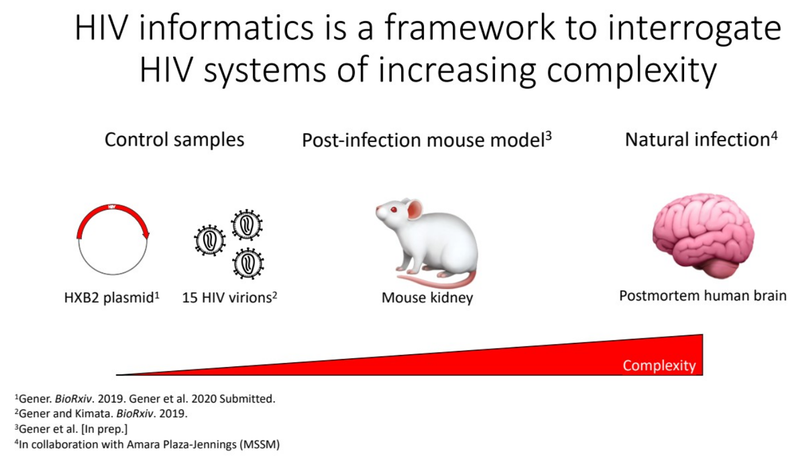
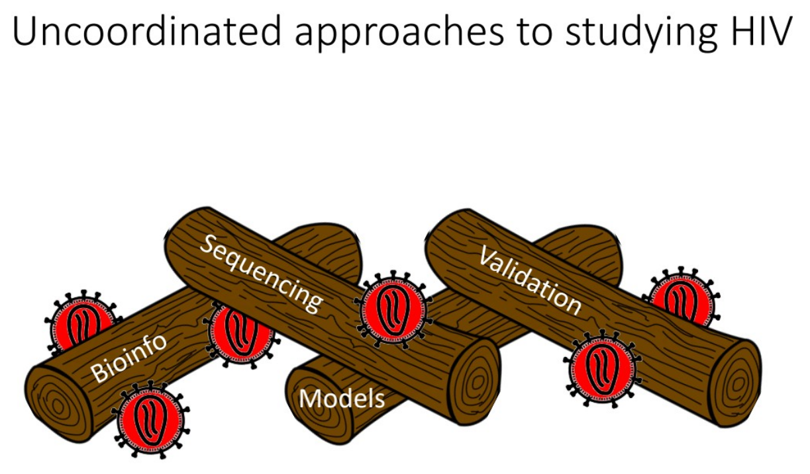
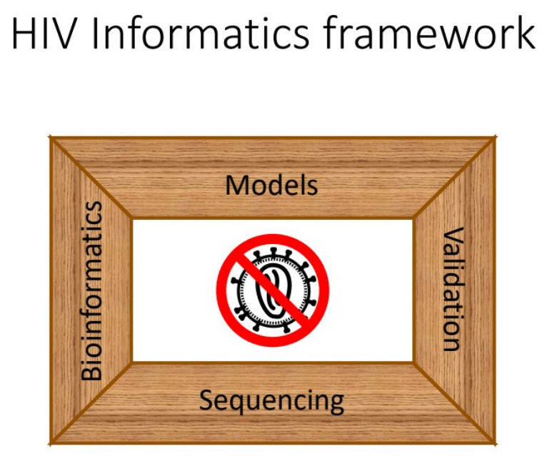
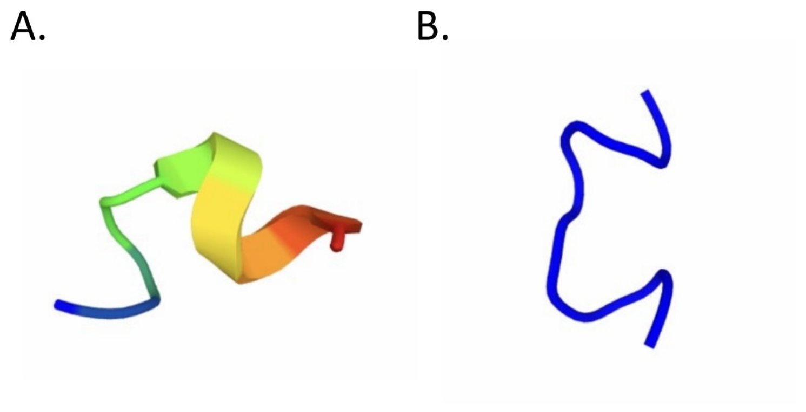

# Chapter 3: HIV Informatics is a framework to advance the study of HIV

## Abstract

We kept HIV/AIDS in check over the past 40 years by continuing to learn about HIVs: the previously unknown viruses found to cause AIDS. In **Chapter 1** we saw how HIV information in the nucleic acid space shifts between HIV RNA in the HIV virion and HIV-infected cells to HIV DNA as unintegrated cDNA and integrated provirus. We also saw how the number of HIV sequences has grown, and how drugs were developed based on sequencing of one of the first HIV-1 isolates HXB2 and/or on *in vitro* work with a closely related synthetic HIV-1 lab strain NL4-3. In **Chapter 2** we saw that HIV tests were eventually designed to detect HIV in clinical samples. Experimental model systems (some reviewed briefly in Chapter 2) were developed to push progress without the need to wait for more human HIV cases. Cell culture systems predominated, and then animal models were developed. A major take-home from these first two chapters is that progress has been directly tied to being able to extract HIV information from relevant systems, to dissect the parts of the virus, and to study these in culture. Later sequencing studies supported putative molecular HIV targets.

People living with HIV AIDS (PLWHA) are living longer thanks in part to their HIV treatments (Alejandro R Gener 2021). The HIV/AIDS research community has since dissected *presumably* all the functional parts of the HIV genome by isolating parts with available molecular cloning and sequencing methods. However, despite all this progress, general problems remain to be solved by the HIV research community. New methods revealed HIV establishes itself in multiple tissues with unknown long-term health consequences. It remains unclear to what extent findings in model systems are relevant to human health. Drug resistance is an emerging problem for people at risk of acquiring HIV or with problems getting access to and/or staying linked to care. Therefore, there remains a need to continue the study of HIV to anticipate its effects on human health and to counter its natural abilities to evolve resistance to current treatments.

Past progress was made by separate groups working in parallel. However, after 35+ years we still do not have a vaccine for HIV. We still do not have a sterilizing cure to flush HIV from HIV patients’ bodies without risking viral reactivation and secondary drug resistance. While these goals are *not* the subject of this dissertation work, the study of HIV as a means of achieving these goals *is*. Now that we have better tools and analytical methods to describe sequence heterogeneity, it serves to reason that it is important to revisit past assumptions about HIV, and to develop more comprehensive approaches to recover HIV information (little “i”) from HIV samples. **Chapter 3** introduces HIV Informatics (big “I”), a new framework to approach HIV information in the context of HIV sequence variability across HIV’s diverse forms with the goal of enabling investigators and clinicians to maximize the information gained from their assays.

~~  
~~

## Introduction

To satisfy Koch’s Postulates was to isolate a putatively pathogenic organism in sick and only sick individuals, to grow this organism under standardized conditions, and then to reinfect healthy hosts with these putative disease-causing organisms. Viruses including HIV are not technically organisms because they are not alive. Instead, they are replicative sets of genes which depend on infecting permissive cells to enable their full replication cycle. As such, Koch’s Postulates were problematic for HIV/AIDS. At the time AIDS was noticed and a putative virus identified, it remained unknown which cell types could maintain HIV in culture.

Early work in 1983 provided some evidence that a new reverse-transcribing virus might have been the primary cause of AIDS (Barré-Sinoussi et al. 1983; Gallo et al. 1983). Thankfully, experimentation on humans with lethal infectious agents was precluded by research community members observing contemporary bioethical norms (E.g. Nuremberg Code). With a virus as a likely culprit, a goal was to describe the complete genome of a representativ AIDS virus isolate, possibly one of the ones already growing in one of the first few labs studying putative AIDS viruses (e.g., LAV, HTLV-III, BRU, etc.). This would have served to enable diagnostic tests for the virus in people, to screen blood-derived products, and to possibly develop anti-AIDS virus medications. Researchers tried to stabilize HIV with available molecular techniques, including using lambdaphage to some success (Hahn et al. 1984). An HIV-1 isolate was finally stabilized as a provirus plasmid clone pHXB-2D (Fisher et al. 1985). Freezing HIV as DNA as opposed to propagating it over successive passages prevented HIV’s rapid evolution in culture, facilitating HIV’s study. This event enabled labs around the world to study parts of the virus, to develop diagnostic tests, and most importantly for HIV, to develop targeted pharmaceuticals after initial trial and error (National Institute of Allergy and Infectiour Disease 2018).

An assumption before beginning my dissertation work was that we had described all relevant parts of the HIV genome, including the HIV genome’s organization. At the time it was reasonable to believe we had described all the relevant parts of HIV. What’s more, we had drugs that worked. We eventually achieved over the first 30 years of HIV/AIDS research a functional cure for HIV. We can prevent people with HIV from becoming AIDS patients by diagnosing HIV sooner, linking patients to care sooner, and keeping them engaged in care. We even treat people exposed to HIV prophylactically with post-exposure prophylaxis (PEP) and treat people at risk of acquiring HIV with antiretroviral therapy in the form of preexposure prophylaxis (PrEP). However, stepping back from the field’s progress, these gains were made with now quite dated methods. HIV drug resistance is an emerging problem in undiagnosed people and when people have difficulty adhering to their therapy. It remains vital to anticipate HIV’s adaptability. To best ensure success, we must make sure we understand HIV biology maximally, focusing on the known parts of the virus which we believe we have resolved, while being open to new knowledge from overlooked viral features.

We now know that most reverse-transcribing viruses like HIV exhibit high sequence variability (Menéndez-Arias 2009). This presents the HIV research community with unique challenges which were only recently able to be addressed. One challenge with the traditional approach to genome sequencing is made especially apparent when trying to describe heterogeneous HIV genomes between and within patients. In a kind of genomic (as opposed to molecular) Koch’s postulates, investigators would strive to describe the genome of a first representative organism or viral isolate. They would do this by sequencing a sample with available methods, and then use *de novo* genome assembly methods to build a new genome. This would be the organism’s (or virus’) genome **sequencing** project, and the result would hopefully be at least one reference genome. Once this singular reference genome was available, all subsequent sequencing experiments and other molecular biology methods would be based on the foundation of this reference. These subsequent experiments are sometimes called **resequencing**, where samples are sequenced and then mapped to a preexisting reference. However, that approach tacitly ignores biological variability between individuals. An interesting point to note is that many scientists unfamiliar with the progress of genomics often fail to distinguish between sequencing and resequencing experiments. The result of these failures serves to obscure the biological variability between the samples being sequenced, such as HIV viruses between patients, or HIV virions within a given patient. An example of how HIV information is ignored for simplicity’s sake is how HIV drugs have been designed. These are often based on crystal structures of HIV isolates, such as from HXB2 or NL4-3. Drugs are not designed with HIV heterogeneity in mind, with unknown clinical consequences.

## HIV information as a knowledge set

As with any modern science, the study of HIV carries with it an easy to overlook epistemological dilemma. While we have learned a lot about HIV, how do we know if what we know about HIV is both true and comprehensive. How do we know whether that is all that is to be known about a given aspect of HIV? If knowledge is a justified true belief, what can we make of HIV information? This can be abstracted as a set described by a US public servant and unlikely philosophical reference, the late Donald Rumsfeld. He proposed a set of three kinds of information: known knowns, known unknowns, and unknown unknowns. I adapt these divisions for HIV below.

### HIV’s known knowns

The HIV literature is assumed to be true. In practice there are limitations to this unlikely possibility. It is impractical for any scientist studying HIV to know everything ever published about HIV. Modern seekers of HIV information are limited by their bandwidth but aided by the experience and the expertise of others who have studied HIV longer. Ancillary sciences, such as other virologies, bioinformatics, animal genetics provide support for rough frameworks to think about how HIV might interact with the human body. Besides the shear amount of information, past information was acquired through the lenses of lower-throughput methods which effectively limited their scope.

### HIV’s known unknowns

Current HIV researchers have prioritized certain areas to test hypotheses. Priorities include Cure Science, and HIV Vaccines. For example, some of us think vaccines may work to protect against contracting HIV, but we don’t yet know which vaccine(s) will work, or whether the sequence heterogeneity inherent to the HIV replication cycle preclude HIV from ever having an efficacious vaccine. While we don’t know exactly why past vaccines have failed, we can measure improvement with progressive iterations of development. Current vaccines in trials are better than the first HIV vaccines. This is in part due to integrating knowledge about HIV virion structure, requirements of host cells for antigen presentation, and other improvements in vaccine development.

### HIV’s unknown unknowns

These includes areas such as HIV weak spots which are unknown to HIV scientists and clinicians. They might constitute the next therapeutic avenues for antiretroviral treatment, or redress systemic limitations which had not been previously appreciated. These are easy to see in hindsight. For example, the cost of HIV medications was untenable for use in the developing world, but subsequent partnerships between pharmaceutical companies and governments to guarantee access to lower- and middle-income countries to affordable antiretroviral therapies. Before we knew HIV had druggable targets, AIDS patients were at the mercy of clinical empiricism, which cost millions of lives. With current therapeutic progress, focus has logically shifted from finding treatments that work to identifying people living with undiagnosed HIV/AIDS (PLWHA), and getting medicines out to PLWHA to prevent onset of AIDS and non-AIDS HIV-associated diseases. However, there are still 40 million PLWHA. Drug resistance is a perpetually emergent problem (Raymond et al. 2020). These raise the questions: what else is there to HIV biology? What did we miss? What can be improved?

While practitioners of the modern scientific method may pride themselves as empirical agents, in practice much of modern science is steeped in tradition and serendipity. Referencing big names and faithfully believing dogma are two areas where modern science falls short of ideal. In practice, this often translates to assumptions that are rarely challenged. A quirk of the modern scientific method is the constant evolution of technologies to aid scientists’ pursuit of knowledge. With new methods, it often pays to revisit past experiments, and the assumptions we take for granted. Because of HIV’s many nuances, it remains important to implement new approaches considering prior knowledge, and ideally identifying assumptions to retest for validity. With that, HIV Informatics is a framework unifying HIV models, nucleic acid (re)sequencing, bioinformatics, and validation to maximize the HIV information gained from assays.

## Bioinformatics

The US National Human Genome Research Institute (NHGRI) defines bioinformatics as a subdiscipline overlapping biology and computer science. Bioinformatics deals with the acquisition, storage, analysis, and dissemination of biological data. Bioinformaticians use and/or develop computer programs for a range of applications, and establishing evolutionary relationships. Such relationships can provide insights into biological functions of whole genes, or parts of genes called domains (protein) or features/elements (nucleic acids). The most common forms of such data are sequences of biopolymers deoxyribonucleic acid and ribonucleic acid (DNA and RNA) and proteins, which are first determined and subsequently stored in a variety of data file formats in large publicly accessible databases. An analogy for bioinformatics is determining the linguistic rules of genomes.

For the study of HIV, the availability of an HIV reference genome allowed for the molecular definition of this pathogen, and catalyzed subsequent dissection by molecular cloning, *in vitro* and *in vivo* functional studies on identified viral proteins, and identification of new antiviral agents for most if not all the identified steps in the HIV replication cycle. We now have a functional cure for HIV comprised of validated combinations of the above HIV drugs thanks to informed studies after the isolation of the pathogen, genome sequencing, and information dissemination to the broader scientific community. This required the input of thousands of investigators, including many of the forerunners of HIV bioinformaticians. Work is ongoing.

HIV’s genomic content fluctuates between RNA as in HIV virions and DNA as linear cDNA in the preintegration complexes, circularized unintegrated cDNA, and integrated DNA in HIV proviruses (reviewed in the introduction of Chapter 7 (Alejandro R. Gener 2021)). This can be simplified as two analyte targets: HIV DNA and HIV RNA. Of the two, DNA is generally more stable because of fewer environmental DNAses, and has been easier to work with in the lab. Until recently, one of the most common ways to recover HIV information from RNA samples with HIV sequence had been to use commercially prepared recombinant reverse transcriptase in reverse transcription kits to make relatively more stable HIV cDNA, often paired with polymerase chain reaction to amplify regions of interest. This is unfortunately called RNA-seq, despite not actually sequencing HIV RNA. In the case of proviral integration, the most common approaches generate DNA amplicons. So, a common bottleneck for recovering information from HIV samples has been DNA sequencing (DNA-seq).

HIV information is stored in different places for different purposes. Primary sequencing data with associated metadata is available in the Short-Read Archive (SRA) at the US National Center for Biotechnology Information/National Library of Medicine/National Institutes of Health (NCBI/NLM/NIH). Processed data is available in GEO, with some functional overlap with SRA. Other NCBI databases include GenBank for primary assembled and annotated nucleic acid and peptide sequence, RefSeq for expert-curated assembled and annotated genomes. A new database, the Third-Party Annotation database stores sequences based on previously available sequence entries with the addition of new changes or annotations that are evidence-based. The European Nucleotide Archive (ENA) serves a similar purpose, by providing functional redundancy with NCBI resources. In the case of HIV there is also the Los Alamos National Laboratory’s HIV Databases, including the HIV Sequence Database, and HIV Molecular Immunology Database. While RefSeq entries are generally considered to be a gold standard set of reference genomes, the HIV Sequence Database is viewed as the gold standard for HIV genomics. Large funding organizations and a growing number of journals often require investigators to establish a data-sharing plan to ensure that data generated in the pursuit of publicly funded research is deposited permanently in accessible forms to enable rigor and reproducibility in research. These databases are where public data are stored.

After the first HIV strains were isolated and grown in culture, one of these was cloned and sequenced as a reference genome (Fisher et al. 1985). To determine how conserved HIV sequences were to each other, more and more sequences have been collected over time (See figure in **Chapter 1**). Tangential to the need to molecularly dissect the parts of HIV, it became apparent that HIV information could be used to follow HIV transmission. This was useful information for public health measures. These two branches of HIV informatics (virology and molecular epidemiology) have only recently fused in the form of HIV genotyping assays, thanks in large part to: 1.) cheaper sequencing, 2.) better bioinformatics support, 3.) validated clinical assays.

## Sequencing vs. Resequencing

Biomolecule sequencing can be roughly divided into nucleic acid and protein sequencing (Shendure et al. 2017). Of the two nucleic acids, the development of DNA sequencing methods came first. These methods were used to define and grow the genome space of species ranging from precellular reproductive entities like viruses, viroids, and organelles to members of the known kingdoms of life.

Priority for genome sequencing projects came by identifying presumably representative organisms and defining a presumably representative genome. Because of limitations of earlier methods, the genomic material of multiple individuals was usually pooled to provide enough physical material to generate libraries for sequencing. This is called ensemble sequencing. Before cheaper higher throughput methods were available, larger genomes were sometimes built as patchworks of multiple individuals (for example, the original human genome draft).

**DNA sequencing**

The goal of genome sequencing projects was to provide as a deliverable at least one representative reference genome for a species. For smaller genomes, such as HIV, this was provided as HXB2 (K03455.1) and the RefSeq entry NC-001802.1. This is complicated by a lack of cloned HXB2 as a plasmid for use making HXB2 virus preparations. In part, that was due to known errors in the sequence which prevented more efficient replication. Comparative genomics using early HIV-1 sequences lead to the development of the currently most widely used HIV-1 lab strain, NL4-3 (Gener et al. 2021).

Interrogation of HIV in the nucleic acid space is usually bound by a reference genome. This is problematic with natural infections (as we’ll see in Chapter 9). A previous solution was to amplify env or pol, but at the expense of biasing results. You cannot see what fails to amplify.

## Models (models of HIV genome at different stages of replication, my graphical abstract slide)

Many of the assumptions about models used to study HIV are based on historical methods used and/or lack of additional observational validation after the advent of newer methods.

#### The HIV genome is generally modeled in two forms: virus and provirus.

In **Chapter 1** I covered that most HIV investigators think of mature HIV virions as being diploid, having two copies of coding/forward/positive/sense mRNA. This mRNA is polyadenylated near the end of the 3’ R. I described the genomic organization of HIV virion in **Chapter 1** Figure. The HIV sequence database uses a proviral representation of the HIV-1 HXB2 genome, Genbank:K03455.1. The RefSeq entry for HIV uses a viral representation of the HIV-1 HXB2 genome, RefSeq:NC_001802.1. There is no standard format for displaying HIV genomes or for annotating HIV information content.

#### The total number of HIV-1’s protein-coding genes has been assumed to be solved as 10.

Most HIV investigators will agree that there are at least 9 protein-coding HIV-1 genes. These are gag, pol, vif, vpr, vpu, env, nef, tat, rev. Tat and Rev are considered spliced as their mature forms. Some of the genes encode larger open reading frames (ORFs) encoding polyproteins which exhibit distinct forms between cells newly expressing HIV mRNA and immature virion, and mature virion which includes proteolytically cleaved final forms. The HIV polyproteins are cleaved by viral protease (Gag and Pol), or by host proteases (Env). Gag is cleaved by HIV protease into p17, p24, p7, p1, p2, p6. Pol is cleaved by HIV protease into protease/aspartyl peptidase (PR), p51 subunit of reverse transcriptase, p66 subunit of reverse transcriptase with an RNAse H domain, and integrase (IN). Env is cleaved by host proteases into gp120 and gp41. A 10th protein-coding HIV-1 gene was proposed in 1988 (Miller 1988), and further studies provided evolutionary information supporting its emergence as a recent regularly seen protein product in certain M group B subgroup HIV-1s (Cassan et al. 2016).

Newer interpretations of the organization of HIV genome consider Gag and Gag-Pol instead of Gag and Pol, as Pol has not been shown to be able to be made as a primary translation product. Gag-Pol is instead made from a frameshift that adds Pol-encoded amino acids prematurely onto the end of Gag at a ribosomal slippage site.

##### Physical HIV virus models

NL4-3 is the most common lab strain of HIV-1 (Gener et al. 2021). If a virus’ replication machinery maintained perfect sequence fidelity, as in a carbon-copy of each viral genome between generations, then it would make sense to use the virus produced after infection for subsequent infections. However, HIV RT is highly error prone. Repeating virus replications using stock from primary infected cells would generate progressively divergent viruses with each subsequent generation. Therefore, HIV is not normally maintained as a virus stock. It is maintained in a stabilized form as a plasmid or molecular clone, pNL4-3. Other stabilized HIV strains each have their own HIV-encoded plasmids.

##### Cell lines

A limiting factor for the study of HIV early on was the availability of cell lines able to sustain HIV viral replication. One requirement of these first cell models was the need to be susceptible to HIV infection. Primary human patient and/or donor-derived peripheral blood mononuclear cells (PBMCs) were used to study transient infection. PBMCs are enriched for CD4+ T cells, which were among the first tissues used to study HIV. They were a prime target, as CD4+ T cell depletion was identified early in the study of the pathogenesis of HIV-associated immune deficiency. Early in the study of HIV, the study of CD4 pathogenesis took precedence. Later, macrophages were identified to be a susceptible to HIV

A problem with infecting primary cells is that cells would last only about 2 days once viral replication was activated (Wei et al. 1995). This isn’t unique to primary cells, but it precluded the use of establishing cell lines stably expressing HIV mRNAs and proteins. That said, some latently infected cell lines were created. Notable examples include U1 Jurkat and ACTH2 cells.

Eventually, several animal models were generated to study chronically infected tissues. These animals had similar development to human tissues, and could recapitulate gross disease as in the case of the Tg26 HIV transgenic mouse (Dickie et al. 1991). However, these mice lacked human immune systems, and so their utility studying HIV’s effects on the immune system were limited. For immune system studies, non-human primates were employed to varying degrees of success. Lastly, samples from natural infections were incidentally available. These samples are harder to come by with the advent of improved standards of care for people living with HIV/AIDS.

## Validation

If science is the empirical pursuit of knowledge, and knowledge is justified true believe, then the resources we use in our experiments can be considered propositions. The validity of an experiment which uses reagents is directly tied to the truthfulness of the state of such reagents. For example, if a sample of HIV-1 is defective, and a scientist uses the defective reagent with a new pharmaceutical compound they are testing for antiviral activity, the result of an inhibition assay might suggest incorrectly that the test compound has antiviral activity. Instead, in this example, the defective virus contributed to a false result. There are many reagents that are used routinely across biomedical science. Some reagents, such as those organized by the AIDS Reagent Program (ARP), are unique to HIV.

To mitigate potentially expensive mistakes, funding agencies like the NIH now require that key reagents be validated. This means that investigators should not simply trust the source of their reagents. In practice, this level of validation in not always implemented.

Ways HIV reagents are validated are from the manufacturers, and ideally once in the receiving lab. Reagents should also regularly be tested for performance, because some reagents (for example, molecular biology enzymes) may be compromised after years of freeze-thaws. As mentioned above, the ARP is one place where HIV researchers can go to for validated resources. That said, resources validation is not perfect. As we will see in Chapter 5 of this dissertation, key reagents can exhibit marked variability. Forms of validation for HIV include plasmid maps and sequences if a plasmid or virus stock is involved. If the reagent is an antibody, example immunoblots may be provided in good-faith. The current gold standard for plasmid validation is plasmid sequencing and assembly, often provided by a sequencing core at Center for Computational & Integrative Biology DNA Core at Massachusetts General Hospital. Addgene is a newer molecular biology repository which maintains some HIV-related plasmids and lentiviruses.

Tangential to reagent validation, it is important to Cross-validate findings in one related system to another. For example, results in one system should be consistent in others. If viruses derived from NL4-3 may behave the same, then this similarity should be able to be observed if true (as we will see in Chapter 8).

## Cautionary tales

The following are examples of how HIV information may be misconstrued.

*Antibodies against consensus sequences*

An example of what can go wrong with HIV information is illustrated by the availability of antibodies designed against **HIV consensus sequences**. Consensus sequences summarize the nucleic or amino acid sequence information. They are made after aligning multiple sequences to each other, and as such their accuracy are dependent on the algorithm(s) used to perform the multisequence alignment, as well as the accuracy and number of input sequences. A limitation for multisequence alignment includes poor ability to handle structural variants. An important, often overlooked, detail is that consensus sequences are NEVER real. Using a consensus sequence in place of a directly observed observation like an **HIV genome assembly** from a patient runs the risk of erasing variant linkage information between variants in the sequence and propagating an assumption about a sequence’s identity that is not true. It is rarely appropriate to use HIV consensuses in place of HIV isolates, directly assembled genomes. In practice, genome assembly may resemble the consensus process. However, each assembly is made relative to a given patient and/or sample. Consensus sequences can summarize information across thousands or more sequences, and a s consequence much sequence information is lost.

Antibodies are soluble B-cell receptors which are expressed in most mammals such as humans and mice after exposure to an immunogenic antigen. Of the 4 macromolecules, proteins are most likely to stimulate immune responses, and are thus immunogenic. Epitopes are the physical structure, often a short ~10 amino acid sequence, that an antibody binds to. Specific binding occurs when an antibody recognizes an epitope that was used to immunize the producer animal (e.g., a mouse). These kinds of interactions are generally specific. However, off-target binding may bind to similar shapes with distinct peptide sequences. Generally, sequence divergence beyond 1-2 amino acids is not well-tolerated, and target recognition may suffer. There are notable examples of single amino acid changes drastically decreasing binding affinity between targets. A classic example is taught in immunology courses: hen egg-whit lysozyme and antibody D1.3 (Murphy, Travers, and Walport 2008).

The most common lab strain of HIV-1 is NL4-3, with Nef protein sequence:

&gt;HIV-1_NL4-3_nef

MGGKWSKSSVIGWPAVRERMRRAEPAADGVGAVSRDLEKHGAITSSNTAANNAACAWLEAQEEEEVGFPVTPQVPLRPMTYKAAVDLSHFLKEKGGLEGLIHSQRRQDILDLWIYHTQGYFPDWQNYTPGPGVRYPLTFGWCYKLVPVEPDKVEEANKGENTSLLHPVSLHGMDDPEREVLEWRFDSRLAFHH**VARELHPEY<u>FKNC\*</u>**

Antibodies against Nef have been used to measure Nef protein levels across many different assays. Inspection of HIV-1 Nef antibodies available through the AIDS Reagent program revealed four HIV-1 Nef monoclonal antibodies. One of those, JR6 (ab42358, Abcam), was a mouse monoclonal antibody made from "ARELHPEYYKD". This is also called clone 01-009. Abcam cites 9 papers that have used this antibody (Lee et al. 2018):

Table : Select anti-Nef (JR6) publications

| **Reference**            | **PubMed ID** | **Virus**              | **Epitope matches?** |
|--------------------------|---------------|------------------------|----------------------|
| (Lee et al. 2018)        | 29331674      | Patient-derived        | No                   |
| (Lee et al. 2016)        | 27211553      | Patient-derived        | No                   |
| (Lee et al. 2013)        | 23317503      | Patient-derived, NL4-3 | No, Yes              |
| (Kjerrström et al. 2001) | 11352667      | HXB3 GenBank:X03188    | Yes                  |
| (Collings et al. 1999)   | 10519935      | BRU GenBank:K02013.1   | Yes                  |
| (Ranki et al. 1995)      | 8527071       | Patient-derived        | No                   |
| (Saito et al. 1994)      | Paywall!      | Paywall!               | Paywall!             |

Source: Abcam.

Consensus antibodies might have utility in clinical samples where one does not know what the input HIV-1 Nef sequence may be, necessitating a fuzzy match. This remains a predominant method employed for detecting HIV proteins in patient-derived and/or clinical samples. However, use of an antibody distinct from the target in an experimental system is not advised. It is unclear whether the sources citing the use of this antibody we able to correctly identify Nef in their NL4-3 samples using antibodies against “ARELHPEYYKD”. See predicted structures of NL4-3 and Consensus epitopes for comparison (**[Figure 4](#figure-4): Nef epitopes**).

<figure markdown="1" id="figure-1" class="book-figure">

{ loading=lazy }

<figcaption markdown="1">

**Chapter 3 Figure 1: HIV Informatics is a framework to interrogate HIV systems of increasing complexity.**

(Mouse work deferred for dissertation/defense).

</figcaption>
</figure>

<figure markdown="1" id="figure-2" class="book-figure">

{ loading=lazy }

<figcaption markdown="1">

**Chapter 3 Figure 2: Uncoordinated approaches to studying HIV.**

</figcaption>
</figure>

<figure markdown="1" id="figure-3" class="book-figure">

{ loading=lazy }

<figcaption markdown="1">

**Chapter 3 Figure 3: HIV Informatic framework.**

</figcaption>
</figure>

<figure markdown="1" id="figure-4" class="book-figure">

{ loading=lazy }

<figcaption markdown="1">

**Chapter 3 Figure 4: Nef epitopes.**

Figure generated with PEP-FOLD3, <https://bioserv.rpbs.univ-paris-diderot.fr/services/PEP-FOLD3/>.

</figcaption>
</figure>

<figure markdown="1" id="figure-5" class="book-figure">

<figcaption markdown="1">

**Chapter 3 Figure 5: Discrepancies between nef gene/Nef protein sequences in reference genome accessions.**

&gt;HIV-1_NL4-3_Nef

MGGKWSKSSVIGWPAVRERMRRAEPAADGVGAVSRDLEKHGAITSSNTAANNAACAWLEAQEEEEVGFPVTPQVPLRPMTYKAAVDLSHFLKEKGGLEGLIHSQRRQDILDLWIYHTQGYFPDWQNYTPGPGVRYPLTFGWCYKLVPVEPDKVEEANKGENTSLLHPVSLHGMDDPEREVLEWRFDSRLAFHH**VARELHPEY<u>FKNC\*</u>**

&gt;HIV-1_HXB2_nef

MGGKWSKSSVIGWPTVRERMRRAEPAADRVGAASRDLEKHGAITSSNTAATNAACAWLEAQEEEEVGFPVTPQVPLRPMTYKAAVDLSHFLKEKGGLEGLIHSQRRQDILDLWIYHTQGYFPD\*

Yellow = common between HIV-1 M B NL4-3 Nef and HIV-1 M B HXB2 Nef. Bold is portion in NL4-3 that is recognized by some c-terminal antibodies. The underlined portion is the difference between NL4-3 and HIV-1 M B Consensus (LANL HIV Database). Recall from Chapter 1 that NL4-3 is supposed to be a simple chimera between NY5 and LAV. For historical reasons, it’s difficult to distinguish between HXB2, IIIB, BRU, and LAV. These are treated nearly synonymously. Unfortunately, with the exception of pHXB2_D which we revalidated, these other strains do not exist as replication-competent plasmids for additional validation.

</figcaption>
</figure>

A search in LANL HIV Sequence Database for HIV-1/SIVcpz Nef returned 25 sequences. (Alignment type: Consensus/Ancestral; Year: 2004; Organism: HIV-1/SIVcpz; DNA/Protein: Protein; Region: nef; Subtype: ALL; Format: FASTA; Alignment ID: 104CP5; Number of sequences: 25. Accessed on 7/15/21.) Of those, 7 contained “ARELHPEYYKD”. This is believed to be identical to ARP-1539 (6.2). ARP-1539 was made using the HIV-1 M B subtype consensus, and ARP claims that the antibody exhibits activity against A, B, and C subtype Nefs. However, there is considerable heterogeneity of Nef protein sequences Across those subtypes. Other Nef antibodies include:

- ARP-709, HIV-1 IIIB Nef (AE6) “VARELHPEYFKNC”. Per ARP, “The critical binding residue ARP-709 is the "N" in the IIIB C-terminal "YFKNC" sequence. This antibody does not react with HIV-1 SF2 nef.” This suggests that the c-terminal sequence is important for epitope recognition and antibody function.

- ARP-1124, (AG11) has the same epitope as ARP-709.

- ARP-3689 (EH1) “MARELHPEYYKDC”. Per ARP, “ARP-3689 recognizes SF2 and BRU Nef by radioimmunoprecipitation, western blot, and immunofluorescence assay.”

While ARP-709, ARP-1124, ARP-3689 have c-termini identical to NL4-3 Nef, they differ in their n-termini. However, they are closer matches to NL4-3.

While antibody behavior can be idiosyncratic, it remains best practice when possible to pair antibodies made from a given peptide epitope with matching sequences. For example, let’s consider some historical work in the Klotman lab. The antibody used in the following papers is alright:

Husain, Mohammad, Vivette D. D’Agati, John Cijiang He, Mary E. Klotman, and Paul E. Klotman. 2005. “HIV-1 Nef Induces Dedifferentiation of Podocytes in Vivo: A Characteristic Feature of HIVAN.” *AIDS (London, England)*19(April):1975–80.

Lu, Ting Chi, John Cijiang He, Zhao Hui Wang, Xiaobei Feng, Tomoko Fukumi-Tominaga, Nan Chen, Jin Xu, Ravi Iyengar, and Paul E. Klotman. 2008. “HIV-1 Nef Disrupts the Podocyte Actin Cytoskeleton by Interacting with Diaphanous Interacting Protein.” *Journal of Biological Chemistry* 283(13):8173–82.

Those used an epitope like HIV1 nef Antibody (2H12; 01-007) (MA1-71505, ThermoFisher). Per ThermoFisher, “This antibody reacts with HIV-1 Nef, B and C subtypes, BRU, IIIB, and HAN strains.” BRU (and HTLV-III) is for the most part the same as HXB2, and the 3' end of NL4-3 is HXB2.

### Check your genome references, carefully!

Interestingly, the genome entry for HXB2, K03455.1 has a different nef/Nef sequence compared to pNL4-3 (see ). We sequenced verified NL4-3 constructs as plasmids and mouse transgenes (Gener et al. 2021), and we can confirm pNL4-3 nef/Nef is distinct from HXB2, despite historical evidence suggesting they should be identical. Goes to show that it remains important to not assume identity of key reagents!!!

### HIV drugs designed against reference strains, ignoring real world variability

HIV drug discovery originally came about by trial and error. Recombinant proteins were made from early HIV clones. A search of “HIV-1” on July 15, 2021 in the Research Collaboratory for Structural Bioinformatics Protein Databank (RCSB PDB) (Berman et al. 2000) returned 3646 structures. Per depositor-provided metadata, most HIV structure entries are from NY5 (n=81), HXB2 (n=125), BH10 (n=160), BRU (n=55), ARV2/SF2 (n=53), unspecified, or unspecified human immunodeficiency (n=56), human immunodeficiency virus 1 (1781). Most are HIV-1 M group B subclade/subgroup strains. NY5 is the 5’ half of NL4-3. While most HIV infections are with HIV-1 M B viruses, the availability of these limited structures has biased the implementation of rational design for the development of HIV therapeutics.

## References

Barré-Sinoussi, F., J. C. Chermann, F. Rey, M. T. Nugeyre, S. Chamaret, J. Gruest, C. Dauguet, C. Axler-Blin, F. Vézinet-Brun, C. Rouzioux, W. Rozenbaum, and L. Montagnier. 1983. “Isolation of a T-Lymphotropic Retrovirus from a Patient at Risk for Acquired Immune Deficiency Syndrome (AIDS).” *Science (New York, N.Y.)* 220(4599):868–71.

Berman, Helen M., John Westbrook, Zukang Feng, Gary Gilliland, T. N. Bhat, Helge Weissig, Ilya N. Shindyalov, and Philip E. Bourne. 2000. “The Protein Data Bank.” *Nucleic Acids Research* 28(1):235–42.

Cassan, Elodie, Anne-Muriel Arigon-Chifolleau, Jean-Michel Mesnard, Antoine Gross, and Olivier Gascuel. 2016. “Concomitant Emergence of the Antisense Protein Gene of HIV-1 and of the Pandemic.” *Proceedings of the National Academy of Sciences - PNAS* 113(41):11537–42.

Collings, A., J. Pitkänen, M. Strengell, M. Tähtinen, A. Lagerstedt, K. Hakkarainen, V. Ovod, G. Sutter, M. Ustav, E. Ustav, A. Männik, A. Ranki, P. Peterson, and K. Krohn. 1999. “Humoral and Cellular Immune Responses to HIV-1 Nef in Mice DNA-Immunised with Non-Replicating or Self-Replicating Expression Vectors.” *Vaccine* 18(5–6):460–67.

Dickie, Peter, James Felser, Michael Eckhaus, Joseph Bryant, Jonathan Silver, Nancy Marinos, and Abner L. Notkins. 1991. “HIV-Associated Nephropathy in Transgenic Mice Expressing HIV-1 Genes.” *Virology* 109–19. Retrieved February 11, 2016 (http://ac.els-cdn.com/0042682291907595/1-s2.0-0042682291907595-main.pdf?\_tid=8f811f10-d10c-11e5-82e8-00000aacb35e&acdnat=1455228938_33d4226549c6410971ced1c4c3573a44).

Fisher, Amanda G., Enrico Collalti, Lee Ratner, Robert C. Gallo, and Flossie Wong-Staal. 1985. “A Molecular Clone of HTLV-III with Biological Activity.” *Nature* 316(6025):262–65.

Gallo, R. C., P. S. Sarin, E. P. Gelmann, M. Robert-Guroff, E. Richardson, V. S. Kalyanaraman, D. Mann, G. D. Sidhu, R. E. Stahl, S. Zolla-Pazner, J. Leibowitch, and M. Popovic. 1983. “Isolation of Human T-Cell Leukemia Virus in Acquired Immune Deficiency Syndrome (AIDS).” *Science (New York, N.Y.)* 220(4599):865–67.

Gener, Alejandro R. 2021. “Chapter 7 - Advancing HIV Informatics in the RNA Space: HIV Virion MRNA.” Baylor College of Medicine.

Gener, Alejandro R. 2021. “Editorial Commentary on ‘the Other Side of Screening: Predictors of Treatment and Follow-up for Anal Precancers in a Large Health System.’” *AIDS* 35(In press.).

Gener, Alejandro R., Wei Zou, Brian T. Foley, Deborah P. Hyink, and Paul E. Klotman. 2021. “Reference Plasmid PHXB2_D Is an HIV-1 Molecular Clone That Exhibits Identical LTRs and a Single Integration Site Indicative of an HIV Provirus.” *BioRxiv* 611848.

Hahn, Beatrice H., George M. Shaw, Suresh K. Arya, Mikulas Popovic, Robert C. Gallo, and Flossie Wong-Staal. 1984. “Molecular Cloning and Characterization of the HTLV-III Virus Associated with AIDS.” *Nature* 312(5990):166–69.

Kjerrström, A., J. Hinkula, G. Engström, V. Ovod, K. Krohn, R. Benthin, and B. Wahren. 2001. “Interactions of Single and Combined Human Immunodeficiency Virus Type 1 (HIV-1) DNA Vaccines.” *Virology* 284(1):46–61.

Lee, J. H., C. Ostalecki, Z. Zhao, T. Kesti, H. Bruns, B. Simon, T. Harrer, K. Saksela, and A. S. Baur. 2018. “HIV Activates the Tyrosine Kinase Hck to Secrete ADAM Protease-Containing Extracellular Vesicles.” *EBioMedicine* 28:151–61.

Lee, Jung-Hyun, Stephan Schierer, Katja Blume, Jochen Dindorf, Sebastian Wittki, Wei Xiang, Christian Ostalecki, Nina Koliha, Stefan Wild, Gerold Schuler, Oliver T. Fackler, Kalle Saksela, Thomas Harrer, and Andreas S. Baur. 2016. “HIV-Nef and ADAM17-Containing Plasma Extracellular Vesicles Induce and Correlate with Immune Pathogenesis in Chronic HIV Infection.” *EBioMedicine* 6:103–13.

Lee, Jung-Hyun, Sebastian Wittki, Tanja Bräu, Florian S. Dreyer, Kirsten Krätzel, Jochen Dindorf, Ian C. D. Johnston, Stefanie Gross, Elisabeth Kremmer, Reinhard Zeidler, Ursula Schlötzer-Schrehardt, Mathias Lichtenheld, Kalle Saksela, Thomas Harrer, Gerold Schuler, Maurizio Federico, and Andreas S. Baur. 2013. “HIV Nef, Paxillin, and Pak1/2 Regulate Activation and Secretion of TACE/ADAM10 Proteases.” *Molecular Cell* 49(4):668–79.

Menéndez-Arias, Luis. 2009. “Mutation Rates and Intrinsic Fidelity of Retroviral Reverse Transcriptases.” *Viruses* 1(3):1137–65.

Miller, R. H. 1988. “Human Immunodeficiency Virus May Encode a Novel Protein on the Genomic DNA plus Strand.” *Science (New York, N.Y.)* 239(4846):1420–22.

Murphy, Kenneth, Paul Travers, and Maek Walport. 2008. “3-9 Antigen-Antibody Interactions Involve a Variety of Forces.” Pp. 121–22 in *Janeway’s Immunobiology*. New York: Garland Science.

National Institute of Allergy and Infectiour Disease. 2018. “Antiretroviral Drug Discovery and Development.” Retrieved (https://www.niaid.nih.gov/diseases-conditions/antiretroviral-drug-development).

Ranki, A., M. Nyberg, V. Ovod, M. Haltia, I. Elovaara, R. Raininko, H. Haapasalo, and K. Krohn. 1995. “Abundant Expression of HIV Nef and Rev Proteins in Brain Astrocytes in Vivo Is Associated with Dementia.” *AIDS (London, England)* 9(9):1001–8.

Raymond, Stéphanie, Marie Piffaut, Jonathan Bigot, Michelle Cazabat, Brigitte Montes, Kevin Bertrand, Guillaume Martin-Blondel, Jacques Izopet, and Pierre Delobel. 2020. “Sexual Transmission of an Extensively Drug-Resistant HIV-1 Strain.” *The Lancet HIV* 7(8):e529–30.

Saito, Y., L. R. Sharer, L. G. Epstein, J. Michaels, M. Mintz, M. Louder, K. Golding, T. A. Cvetkovich, and B. M. Blumberg. 1994. “Overexpression of Nef as a Marker for Restricted HIV-1 Infection of Astrocytes in Postmortem Pediatric Central Nervous Tissues.” *Neurology* 44(3 Pt 1):474–81.

Shendure, Jay, Shankar Balasubramanian, George M. Church, Walter Gilbert, Jane Rogers, Jeffery A. Schloss, and Robert H. Waterston. 2017. “DNA Sequencing at 40: Past, Present and Future.” *Nature* 550(7676):345–53.

Wei, Xiping, Sajal K. Ghosh, Maria E. Taylor, Victoria A. Johnson, Emilio A. Emini, Paul Deutsch, Jeffrey D. Lifson, Sebastian Bonhoeffer, Martin A. Nowak, Beatrice H. Hahn, Michael S. Saag, and George M. Shaw. 1995. “Viral Dynamics in Human Immunodeficiency Virus Type 1 Infection.” *Nature* 373(6510):117–22.
