# Chapter 5: Advancing HIV informatics in the DNA space

## Chapter abstract

In **Chapter 5**, we sought to evaluate long- and short-read DNA-seq methods for recovering information from control HIV samples: 1.) a plasmid believed to contain the reference plasmid of HIV-1 HXB2, and 2.) a plasmid known to contain sequences based on NL4-3, the most common lab strain of HIV. The main text of this chapter is formatted as a manuscript in its current form that is in the process of being transferred for peer-review. It is available online as a preprint:

**Gener, Alejandro R.,** Wei Zou, Brian T. Foley, Deborah P. Hyink, and Paul E. Klotman. 2021. “Reference Plasmid PHXB2_D Is an HIV-1 Molecular Clone That Exhibits Identical LTRs and a Single Integration Site Indicative of an HIV Provirus.” *BioRxiv* 611848.

In this work, I evaluated 2nd (Illumina) and 3rd generation (Oxford Nanopore) nucleic acid sequencing platforms to define the reference clone for HXB2, the reference strain of HIV-1. I validated the clone as a *bona fide* provirus, enabling its future use by investigators. In so doing, I was the first to cover an HIV provirus in its entirety in a single read, and first to unambiguously define a complete HIV haplotype with long-read DNA-seq (as opposed to quasispecies or partial gene model-based haplotypes from short-read DNA-seq).

## Reference plasmid pHXB2_D is an HIV-1 molecular clone with identical LTRs and one integration site indicative of an HIV-1 provirus

Alejandro R. Gener1,2,3,4\*, Wei Zou5, Brian T. Foley6, Deborah P. Hyink2

1Integrative Molecular and Biomedical Sciences Program, Baylor College of Medicine, Houston, Texas, USA

2Margaret M. and Albert B. Alkek Department of Medicine, Nephrology, Baylor College of Medicine, Houston, Texas, USA

3Department of Genetics, MD Anderson Cancer Center, Houston, Texas, USA

4School of Medicine, Universidad Central del Caribe, Bayamón, Puerto Rico, USA

5Division of Infectious Diseases, the 1st Affiliated Hospital of Nanchang University, Nanchang, Jiangxi, China

6Theoretical Biology and Biophysics Group T-6, Los Alamos National Laboratory, Los Alamos, New Mexico, USA

\*Corresponding author: Alejandro R. Gener

One Baylor Plaza

Mail Stop 710

Houston, Texas, 77030, USA

9045715562

<gener@bcm.edu> ; <itspronouncedhenner@gmail.com>

**Keywords:** HIV-1, reagent verification, nanopore DNA sequencing, provirus, plasmid, sequence variability, resequencing, LTR phasing

### Abstract

Sequence-verified molecular clones of HIV-1 reference HXB2 were thought lost. We sought to verify the identity of plasmid pHXB2_D, believed to contain a full-length copy of HIV-1 HXB2 model provirus, and a control plasmid pNL4-3_gag-pol(del1443-4553)\_EGFP. We compared long- and short-read DNA sequencing, evaluating sample variability with resequencing (sequencing and mapping to reference) and de novo viral genome assembly. We obtained full-length HIV-1 and plasmid backbone with flanking host sequences supporting a single HXB2 integration event. We discovered 20 single nucleotide variants in pHXB2_D compared to reference HXB2, verified by short-read DNA sequencing. Contrary to the reference sequence, pHXB2_D had identical LTRs. No variants were detected in the HIV-1 segments of pNL4-3_gag-pol(del1443-4553)\_EGFP, which retained distinct LTRs. Nanopore sequencing performed as expected, phasing LTRs, and covering full-length HIV. The discovery of variants in a reference plasmid demonstrates the need for sequence verification moving forward, in line with calls from funding agencies for reagent verification. These results illustrate the utility of long-read DNA sequencing to advance the study of HIV at single integration site resolution.

### Introduction

Much of what we know about human acquired immunodeficiency syndrome (AIDS) came after isolating the causative agent, the human immunodeficiency virus type 1 (HIV-1), and describing the viral genome information content. The HIV-1 isolate HXB2, also known as HTLV-III and HIV-1LAI or LAV/BRU (Barré-Sinoussi et al. 1983; Wain-Hobson et al. 1991), was the first full-length replication-competent HIV genome sequenced (Ratner et al. 1985). Derivative clones commonly called “HXB2” are still used for *in vitro* infection assays, including RNA (almost always cDNA (Gener and Kimata 2019)) sequencing (**[Figure 1A](#figure-1)** and **Supplemental** **[Table 1](#table-1)**). Despite the availability of the HXB2 HIV-1 reference sequence (Ratner et al. 1985), no sequence is available for any complete and readily available HXB2 clone.

<figure markdown="1" id="figure-1" class="book-figure">

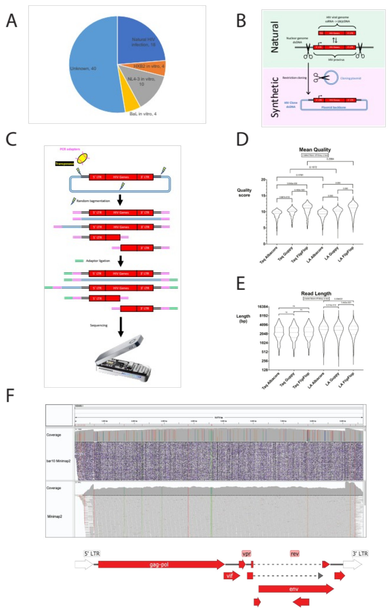{ loading=lazy }

<figcaption markdown="1">

**Figure 1: HIV information in pHXB2_D is recovered by long-read sequencing and mapping.**

**Figure 1A: HXB2 is still a commonly used resource.** It is the reference HIV-1 genome, derived from one of the earliest clinical isolates. While older HIV samples are occasionally rediscovered, they are not made routinely available to researchers. All public HIV-1 RNA-seq datasets were obtained from the NCBI SRA with the following search phrase: “HIV-1” AND “RNA-seq”. Metadata from these 2527 runs (number current as of 7/21/2020) were used to make a pie chart summary.

**Figure 1B: HIV sequence sources.** HIV information comes from three main sources: proviruses (HIV sandwiched between two assumedly identical full-length long terminal repeats (LTRs)), unspliced HIV mRNAs (also known as viral genomes) starting from the transcription start site and ending in the 3’ LTR (Gener and Kimata 2019), and engineered proviruses recovered in their entirety or stitched together from multiple isolates like NL4-3 (Adachi et al. 1986).

**Figure 1C: ONT library prep pipeline.** Tagmentation cleaves double-stranded DNA, ligating barcoded PCR adapters (magenta). PCR-adapted DNA may be amplified. After amplification and cleanup, ONT sequencing adapters (green) are ligated. Barcoded samples may be pooled and sequenced.

**Figure 1D: Newer basecallers increase read mean quality.** Median (big dash) and quartiles (little dash). Effect of enzyme version was not statistically significant.

**Figure 1E: Read stats with different callers/aligners.** Median (big dash) and quartiles (little dash). Read lengths increase with higher fidelity Taq.

**Figure 1F: Sequencing coverage with long- vs. short-read single-end 150 bp (trimmed to 142 bp) DNA sequencing.** Long-read sequencing covers ambiguously mappable areas missed by short-read in HXB2 reference GenBank:K03455.1 (**Supplemental Figures 3D,3E**), but at the expense of accuracy near homopolymers longer than about 4 nucleobases (**Supplemental Figure 5**). Short-read mapping fails at repetitive elements longer than their read lengths (**Supplemental Figures 3D,3E**). Long read Minimap2 settings: map-ont -k15. Short read Minimap2 settings: Short reads without splicing (-k21 -w11 --sr -F800 -A2 -B8 -O12,32 -E2,1 -r50 -p.5 -N20 -f1000,5000 -n2 -m20 -s40 -g200 -2K50m --heap-sort=yes --secondary=no) (sr).

</figcaption>
</figure>

<figure markdown="1" id="table-1" class="book-table">

<figcaption markdown="1">

**Table 1: Summary of pHXB2 sample divergence from reference HXB2.**

Coverage numbers vary by input (albacore, guppy, FlipFlop basecalled FASTQ) and mapping method (Minimap2 vs. BWA-MEM). This information is provided as Supplemental Digital Content. Base-1 (first base is numbered 1, 2nd 2, etc.), relative to HXB2, Genbank:K03455.1. Changed base represented as upper-case. Annotated as codon if in protein-coding region. No deletions or insertions were predicted from manual inspection or supported by short-read sequencing. Abbreviations, ASP: antisense protein, RRE: rev-response element, NA: not applicable. Syn: synonymous mutation. Non: non-synonymous mutation. Stop: stop codon/non-sense mutation. LTR: long terminal repeat. RT: reverse transcriptase. IN: integrase. LANL: Los Alamos National Laboratory HIV Sequence Database. Data from three separate sequencing experiments on the same plasmid sample support these 20 sites. Note site 1-8 variants in 5’LTR have been previously reported (LANL), albethey ambiguously. These may also be incorrectly annotated as variants in nef.

</figcaption>

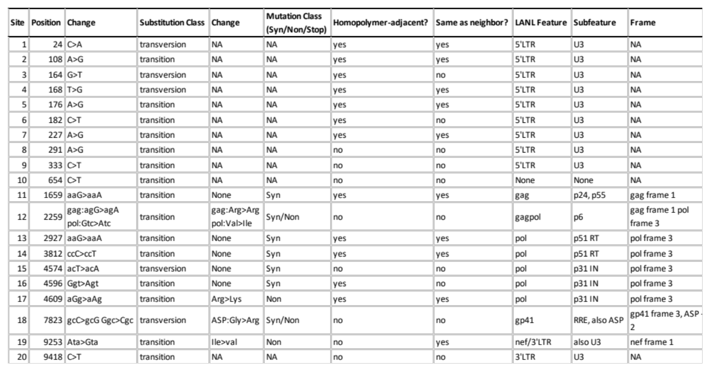{ loading=lazy }
</figure>

HIV clones were originally made by digesting DNA from infected host cells with non-cutter restriction enzymes sparing HIV-1 sequence followed by ligation into an *E. coli* plasmid cloning vector (**[Figure 1B](#figure-1)**), allowing for low-error propagation (Shaw et al. 1984). Trace flanking host sequences were retained. These clones became available before tractable sequencing methods permitted routine sequence verification. As such, it was uncommon to sequence them. While funding agencies now require investigators to include in their proposals plans to validate their key reagents, these funders tend to leave the process up to investigators and may not always follow up on whether a given reagent is ever actually validated or revalidated between changes of hand. Investigators do not regularly validate their clones, in part because there is no universally accepted standard. Instead, a common practice is to assume a given clone, often kindly gifted from a colleague, is as reported. As such, we often do not truly know what we have been working with for 35+ years.

Making sense of the information from HIV sequencing experiments is complicated by many factors, including the cycling that all orterviruses (Krupovic et al. 2018) undergo between two major states (as infectious virion RNA and integrated proviral DNA **[Figure 1B](#figure-1)**), repetitive viral sequences like long terminal repeats (LTRs), non-integrated forms (Graf et al. 2011), rarity of integration events *in vivo* (reviewed in (Ito et al. 2017)), and alternative splicing of viral mRNAs (Cuesta et al. 2016). Short-read DNA sequencing provides some information, but analyses require high coverage and/or extensive effort (non-exhaustive examples (Bruner et al. 2019; Wymant et al. 2018)). These factors limit the ability to assign variants to specific loci within each provirus, as well as at the proviral integration site(s) (reviewed in (Pinzone and O’Doherty 2018)). Despite progress in the HIV DNA (Einkauf et al. 2019) and HIV RNA (Bonsall et al. 2018), (Banin et al. 2019), (Nguyen Quang et al. 2020), spaces, researchers have yet to observe the genome of HIV-1 as complete full-length provirus of integrated HIV DNA in a single read, hindering locus-specific studies. Complete here is defined from the beginning of the HIV 5’ LTR to the end of the 3’ LTR ([Figure 1B](#figure-1)). To this end, current long-read DNA sequencing clearly surpasses the limitations of read length of leading next-generation/short-read sequencing platforms. Here we used the MinION sequencer to sequence unknown HIV-1 plasmid pHXB2_D and a control known plasmid pNL4-3_gag-pol(del1443-4553)\_EGFP in a pilot study focusing on coverage acquisition (as opposed to full-length sequencing), with the goal of evaluating the technology for future applications.

### Methods

#### HIV-1 plasmids

A plasmid, “pHXB2_D” (alternate names pHXB2, pHXB-2D), believed to contain the HIV-1 reference strain HXB2 (Fisher et al. 1985) was acquired from the NIH AIDS Reagent and Reference Program (ARP) via BioServe. pHXB2_D was believed to be a molecular clone (likely a restriction product of HXB2 proviral DNA inserted into an unknown cloning plasmid backbone) from one of the earliest clinical “HXB2” HIV-1 isolates. At the time of this work, it was unknown whether this plasmid was ever sequence-verified before or after the reference sequence for HXB2 was deposited.

The provenance of pNL4-3_gag-pol(del1443-4553)\_EGFP, a reporter construct of pNL4-3 with a gag-pol deletion between base 1443 and 4553 is known. HIV-1 NL4-3 (pNL4-3) was a fusion of NY5 and LAV/HXB2 plasmids (Adachi et al. 1986) that to our knowledge are not readily available. pEVd1443 (Dickie et al. 1991) was a deletion construct made from pNL4-3 used to make several HIV-1 transgenic animals, including the FVB/N-Tg(HIV)26Aln/PkltJ (The Jackson Laboratory stock No: 022354) “Tg26” mouse. The deletion in pEVd1443 was made by SphI cutting between base 1443 and 1444 with binding site 1443-1448 and cutting at a BalI site at 4551-4556 with blunt cutting between 4553 and 4554. The EGFP cassette includes additional sequence upstream and downstream of EGFP coding sequence. SphI and BalI may still be used to excise EGFP cassette. A reporter construct was designed mimicking the pEVd1443 deletion: pNL4-3: ΔG/P-EGFP (Husain 2002). Dr. Wei Zou rederived pNL4-3: ΔG/P-EGFP at BCM (Li et al. 2018). Both constructs (plasmid and mouse) retained parts of gag and pol, with limited effects on protein-coding capacity, such as expression of p17 (Curreli et al. 2013). Bioinformatic resources do not regularly include non-ASCII characters such as “Δ”, occasionally converting these to the word “delta”. “Δ/delta” are historical abstractions away from wanting to convey a deletion relative to a sequence’s reference. Using Addgene naming conventions, we suggest pNL4-3_gag-pol(del1443-4553)\_EGFP to replace the previous name pNL4-3: ΔG/P-EGFP for clarity.

#### HIV-1 reference sequences

The reference sequence of HXB2 is from the National Center for Biotechnology Information (NCBI), Genbank accession number K03455.1. It runs from the beginning of the 5’ LTR to the end of the 3’ LTR, and is 9,719 bp. This is similar to another HIV-1 reference that NCBI uses, AF033819.3. This is a 9,181 base HXB2-like sequence that starts at the 97 bp repeat in the 5’LTR, continues with the 5’UTR (U5), extends past the 3’UTR (U3) to the end of the 97 bp repeat in 3’LTR, with one SNV at the *vpu* start codon aTg to aCg at position AF033819.3:560 or K03455.1:6063. The reference sequence of NL4-3 is as a plasmid with accession number AF324493.1. It runs from the beginning of the 5’ LTR to the end of the 3’ LTR, spanning 9,709 bp, and includes plasmid backbone with total length 14,825 bp.

#### Long-read DNA sequencing

A plasmid containing HXB2 was sequence-verified with long-read nanopore sequencing on a MinION Mk1B (Oxford Nanopore Technologies (ONT), Oxford, United Kingdom). Unless otherwise noted, reagents and software were obtained from ONT. Briefly, stock plasmid was diluted to 5 ng final amount in ultrapure water (as two samples) and processed with Rapid PCR Barcoding kit SQK-RPB004 along with 10 other barcoded samples (not discussed further in this manuscript) following ONT protocol RPB_9059_V1_REVA_08MAR2018 (**[Figure 1C](#figure-1)**), <https://store.nanoporetech.com/us/sample-prep/rapid-pcr-barcoding-kit.html>. Two DNA polymerases were evaluated (barcode 10 used high-fidelity LA (for “long amplicon”) Taq (Takara); barcode 11 Taq (Sigma-Aldrich). Libraries were loaded onto a MinION flow cell version R9.4.1 and a 48-hour sequencing run was completed with MinKNOW (version 1.10.11). Residual reads from subsequent runs were pooled for final analyses. Long read data for pNL4-3_gag-pol(del1443-4553)\_EGFP was generated in other barcoded experiments (not shown).

Raw data was basecalled (converted from FAST5 to FASTQ format) with Albacore version 2.3.4 (older basecaller), Guppy version 2.3.1 (current official at time of work), and FlipFlop (Guppy development config). Mapping to reference was done with Minimap2 (Li 2018) and BWA-MEM (Li and Durbin 2010), implemented in Galaxy (usegalaxy.org) (Afgan et al. 2016). Alignments (.bam and .bai files) were visualized in the Integrative Genomics Viewer (Robinson et al. 2011) unless otherwise noted. For *de novo* assembly, demultiplexed basecalled reads were fed into Canu version 1.8 (Walenz et al. 2017). Genome size was estimated to be 16 Kb from agarose gel of undigested, but naturally degraded linearized pHXB2_D (data not shown). SnapGene version 4.3.4 was used to manually annotate contigs from Canu. Blastn (NCBI) was used to identify unknown regions of pHXB2_D. Polishing was performed on ONT-only assemblies with Medaka (<https://github.com/nanoporetech/medaka>), in Galaxy. Medaka models: r941_min_fast_g303, r941_min_high_g303, r941_min_high_g330. Inference batch size (-b) = 100. The final pHXB2_D assembly and other full-length HIV clones from the ARP were aligned to the most recent human reference genome (hg38) with Minimap2 in Galaxy with the following parameters: Long assembly to reference mapping (-k19 -w19 -A1 -B19 -O39,81 -E3,1 -s200 -z200 --min-occ-floor=100).

#### Statistics

Two-tailed Mann-Whitney U tests were used to compare distributions in long-read data. P-values are reported over brackets delineating relevant comparisons. Calculations and graphing were done with GraphPad Prism for macOS version 8.0.2.

#### Short-read DNA sequencing

pHXB2_D and control pNL4-3_gag-pol(del1443-4553)\_EGFP were provided as 35 ul at ~63 ng/ul to the Center for Computational & Integrative Biology DNA Core at Massachusetts General Hospital, an external DNA sequencing core specializing in high-throughput next generation (short-read) plasmid sequencing and assembly. Neither HXB2/pNL4-3 reference sequences nor pHXB2_D/pNL4-3_gag-pol(del1443-4553)\_EGFP draft assemblies (from this work) were provided to core staff at the time of sequencing so that testing would remain masked. While the core’s exact library prep is proprietary, multiplexed library prep and 150 single-end ILMN sequencing were most likely performed on a MiSeq with platform-specific reagents (V2 chemistry, per their website) and barcoding. Data was returned as FASTQ. FASTQC (Andrews n.d.) was used in Galaxy for in-house data quality control, and read lengths were all 142 bp per this tool. Mapping as above.

#### Sequence comparisons

We used MAFFT v7.475 (Katoh, Rozewicki, and Yamada 2017; Katoh and Standley 2013) to compare the LTR sequences of pHXB2_D and HXB2, and pNL4-3 and pNL4-3_gag-pol(del1443-4553)\_EGFP. For cladistics, we used BLAST at HIV-DB (<https://www.hiv.lanl.gov/content/sequence/BASIC_BLAST/basic_blast.html>) to find other HXB2-like genomes. The top 50 BLAST hits included many sequences of pNL4-3 clones. pNL4-3 is an artificial recombinant of the NY5 clone with LAV and/or the HXB2 clone (Adachi et al. 1986). The recombination point is marked by an EcoRI restriction site. We then made a multi-sequence alignment with the final pHXB2_D assembly, the top BLAST hits, and the HIV-1 M group subtype reference set using GeneCutter (<https://www.hiv.lanl.gov/content/sequence/GENE_CUTTER/cutter.html>), and built the maximum likelihood tree using IQ-tree (<https://www.hiv.lanl.gov/content/sequence/IQTREE/iqtree.html>). pNL4-3_gag-pol(del1443-4553)\_EGFP was not included in the above trees because of absence of divergence from pNL4-3 sequences outside of the EGFP cassette.

### Results

#### Read length and LTR phasing

Viewing mapped data from both pHXB2_D ONT experiments in IGV, the long reads had median read lengths &gt;2000 bp, (**[Figure 1E](#figure-1))** clearly covering each LTR (**[Figure 1F](#figure-1), [Supplemental Figures 1](#supplemental-figure-1)**, **3**). This unambiguously enabled LTR phasing by physically linking each LTR to its respective location. Long reads &lt;700 bp and short reads collapsed into one of either LTR (**[Figure 1F](#figure-1), [Supplemental Figures 3D](#supplemental-figure-3d),3E**). Mappers BWA-MEM and Minimap2 were chosen based on their ability to handle long and short reads. Other mappers were not evaluated. BWA-MEM mapped more ambiguously, piling partially mapped reads between each LTR; Minimap2 mapped with higher fidelity to reference without splitting reads. Coverage as sequencing depth was higher and more even from the higher fidelity LA Taq library (**[Supplemental Figure 1](#supplemental-figure-1)**). pNL4-3 was believed to have distinct LTRs because it was a synthetic recombinant. The higher variant density in NL4-3 LTRs enabled mapping and phasing from short-read data only (**[Supplemental Figure 2](#supplemental-figure-2)**).

#### Single nucleotide variants (SNVs)

We counted 20 single nucleotide variants (SNVs) in this reference clone of HXB2 (**[Table 1](#table-1), [Supplemental Table 3](#supplemental-table-3), [Supplemental Figure 3E](#supplemental-figure-3e)**). These mismatches were seen in all Canu assemblies (**[Supplemental Figures 4A](#supplemental-figure-4a),4B**), verified in IGV and/or SnapGene, and were orthogonally verified by short-read sequencing performed by the external core given masked samples (**[Supplemental Figure 3E](#supplemental-figure-3e)**). These mismatches represent a ~0.21% divergence from reference HXB2 K03455.1 (20/9719), which was assumed to have perfect identity or 0% divergence. Transitions were more common (14/20) (**[Table 1](#table-1)**), coinciding with a previous report of increased transitions over transversions in infection models, because transversions are more likely to be deleterious to viral replication (i.e.: to cause protein-coding changes) (Lyons and Lauring 2017). Indeed, almost half (9/20) of the observed SNVs occurred in protein-coding regions, even though 92% of HXB2 is coding (791/9719). Of those 9 SNVs in protein-coding regions, 4 caused non-synonymous mutations. One of those occurs in a region overlapping both gag and pol regions, however only pol exhibited a non-synonymous change from valine to isoleucine in p6, at base 2259 relative to HXB2. Other non-synonymous variants occurred at base 4609 (in p31 integrase, arginine to lysine), base 7823 (in ASP antisense protein, glycine to arginine), and base 9253 (in nef, isoleucine to valine). 11/20 SNVs were in LTRs (see **Supplemental Figure** **3** for counting based on mapping); 8/20 of these would have been missed with mapping-only variant calling or consensus. The longest HIV-mapping read (**[Figure 2](#figure-2)**) phased 16/20 SNVs (failed at sites 2,8,10,12, **[Table 1](#table-1)**). pNL4-3_gag-pol(del1443-4553)\_EGFP did not have HIV-1 or plasmid backbone variants supported by long and short reads outside of the EGFP cassette.

<figure markdown="1" id="figure-2" class="book-figure">

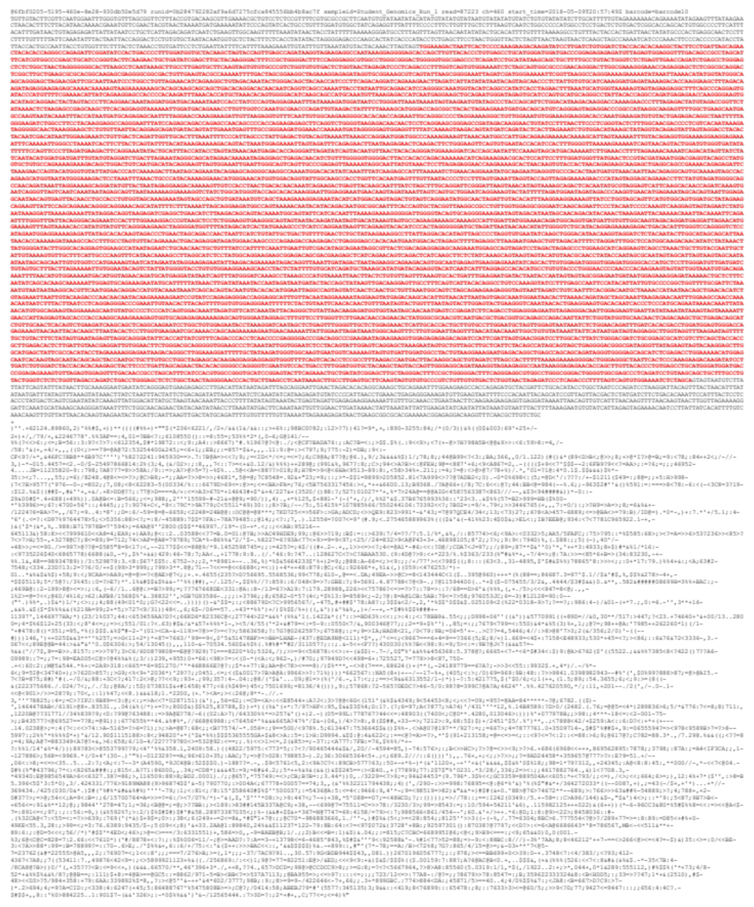{ loading=lazy }

<figcaption markdown="1">

**Figure 2: Longest read containing complete full-length HIV-1 reference HXB2.**

The 5th longest read in the barcode 10 set (read ID 6fbf0205-5195-460e-8e28-930db50e5d79) contained full-length HIV-1. Query (full read) blastn against HIV (taxid:11676) returned 92.95% identity to HIV-1, complete genome (GenBank:AF033819.3). Limiting query to HXB2 (red) blastn against Nucleotide collection nr/nt returned 100% coverage and 93.02% identity to HIV-1 HXB2. This read was 11,487 bases long, with mean quality score 11.984396. Basecalled using Guppy 2.3.1 with FlipFlop config.

</figcaption>
</figure>

#### Assembling HIV-1 plasmids

We assembled the previously undefined plasmid pHXB2_D (**[Supplemental Figures 4A](#supplemental-figure-4a),4B**). Canu’s final output was a set of contiguous DNA sequences (contigs) as FASTA files. A consequence of assembling plasmid sequences with this tool was partial redundancy at contig ends (**[Supplemental Figure 4C](#supplemental-figure-4c))**. Manual end-trimming of contigs was performed in SnapGene based on an estimated length of 16 kb. Top blastn hits from barcode 10/LA Taq pHXB2 basecalled with FlipFlop were as follows: for the main backbone with origin of replication and antibiotic selection cassette for cloning, shuttle vector pTB101-CM DNA, complete sequence (based on pBR322), from 4352-8340; for the upstream element (relative to 5’ LTR), Homo sapiens chromosome 3 clone RP11-83E7 map 3p, complete sequence from 58,052 to 59,165; for the downstream element, cloning vector pNHG-CapNM from 10,204 to 11,666. Other identified elements included Enterobacteria phage SP6, complete sequence from 39,683 to 39,966. This was identified as the SP6 promoter, per SnapGene’s “Detect common features” feature. Identities of query to HXB2 and hits were all approximately 99%. The MGH CCIB DNA Core’s proprietary *de novo* UltraCycler v1.0 assembler (Brian Seed and Huajun Wang, unpublished) was able to assemble both 5’ and 3’ LTRs with short-read data only but may have collapsed SNVs into an artificial single consensus. Long-read mapping and assembly (and polished assemblies) orthogonally validated LTRs and supported a single HIV-1 HXB2_D haplotype (**[Supplemental Figure 4](#supplemental-figure-4a),6**). A final LTR-phased and annotated assembly leveraging short and long reads is provided as pHXB2_D Genbank:MW079479 (embargoed until publication). Importantly, for pHXB2_D, each LTR was identical, which is distinct from the current HXB2 (K03455.1) (**[Figure 3A](#figure-3a)**). Compared to pNL4-3_gag-pol(del1443-4553)\_EGFP Genbank:MW928609 (embargoed until publication) , each LTR was distinct, but identical to pNL4-3’s distinct 5’ and 3’ LTRs (AF324493.1) (**[Figures 3B](#figure-3b),6**).

<figure markdown="1" id="figure-3a" class="book-figure">

<figcaption markdown="1">

**Figure 3A: pHXB2_D (GenBank Accession MW079479) has identical LTRs, resolving likely errors in HXB2 (K03455.1).**

CLUSTAL format alignment by MAFFT (v7.475)

K03455.1_5LTR  tggaagggctaattcactcccaacgaagacaagatatccttgatctgtggatctaccaca

MW079479_5LTR   tggaagggctaattcactcccaaagaagacaagatatccttgatctgtggatctaccaca

MW079479_3LTR tggaagggctaattcactcccaaagaagacaagatatccttgatctgtggatctaccaca

K03455.1_3LTR  tggaagggctaattcactcccaaagaagacaagatatccttgatctgtggatctaccaca

                \*\*\*\*\*\*\*\*\*\*\*\*\*\*\*\*\*\*\*\*\*\*\* \*\*\*\*\*\*\*\*\*\*\*\*\*\*\*\*\*\*\*\*\*\*\*\*\*\*\*\*\*\*\*\*\*\*\*\*

K03455.1_5LTR  cacaaggctacttccctgattagcagaactacacaccagggccagggatcagatatccac

pHXB2_D_5LTR   cacaaggctacttccctgattagcagaactacacaccagggccaggggtcagatatccac

MW079479_3LTR cacaaggctacttccctgattagcagaactacacaccagggccaggggtcagatatccac

K03455.1_3LTR  cacaaggctacttccctgattagcagaactacacaccagggccaggggtcagatatccac

                \*\*\*\*\*\*\*\*\*\*\*\*\*\*\*\*\*\*\*\*\*\*\*\*\*\*\*\*\*\*\*\*\*\*\*\*\*\*\*\*\*\*\*\*\*\*\*.\*\*\*\*\*\*\*\*\*\*\*\*

K03455.1_5LTR  tgacctttggatggtgctacaagctagtaccagttgagccagagaagttagaagaagcca

pHXB2_D_5LTR   tgacctttggatggtgctacaagctagtaccagttgagccagataaggtagaagaggcca

MW079479_3LTR tgacctttggatggtgctacaagctagtaccagttgagccagataaggtagaagaggcca

K03455.1_3LTR  tgacctttggatggtgctacaagctagtaccagttgagccagataagatagaagaggcca

                \*\*\*\*\*\*\*\*\*\*\*\*\*\*\*\*\*\*\*\*\*\*\*\*\*\*\*\*\*\*\*\*\*\*\*\*\*\*\*\*\*\*\* \*\*\* \*\*\*\*\*\*\*.\*\*\*\*

K03455.1_5LTR  acaaaggagagaacaccagcttgttacaccctgtgagcctgcatggaatggatgacccgg

pHXB2_D_5LTR   ataaaggagagaacaccagcttgttacaccctgtgagcctgcatgggatggatgacccgg

MW079479_3LTR ataaaggagagaacaccagcttgttacaccctgtgagcctgcatgggatggatgacccgg

K03455.1_3LTR  ataaaggagagaacaccagcttgttacaccctgtgagcctgcatgggatggatgacccgg

                \*.\*\*\*\*\*\*\*\*\*\*\*\*\*\*\*\*\*\*\*\*\*\*\*\*\*\*\*\*\*\*\*\*\*\*\*\*\*\*\*\*\*\*\*\*.\*\*\*\*\*\*\*\*\*\*\*\*\*

K03455.1_5LTR  agagagaagtgttagagtggaggtttgacagccgcctagcatttcatcacatggcccgag

pHXB2_D_5LTR   agagagaagtgttagagtggaggtttgacagccgcctagcatttcatcacgtggcccgag

MW079479_3LTR agagagaagtgttagagtggaggtttgacagccgcctagcatttcatcacgtggcccgag

K03455.1_3LTR  agagagaagtgttagagtggaggtttgacagccgcctagcatttcatcacgtggcccgag

                \*\*\*\*\*\*\*\*\*\*\*\*\*\*\*\*\*\*\*\*\*\*\*\*\*\*\*\*\*\*\*\*\*\*\*\*\*\*\*\*\*\*\*\*\*\*\*\*\*\*.\*\*\*\*\*\*\*\*\*

K03455.1_5LTR  agctgcatccggagtacttcaagaactgctgacatcgagcttgctacaagggactttccg

pHXB2_D_5LTR   agctgcatccggagtacttcaagaactgctgatatcgagcttgctacaagggactttccg

MW079479_3LTR agctgcatccggagtacttcaagaactgctgatatcgagcttgctacaagggactttccg

K03455.1_3LTR  agctgcatccggagtacttcaagaactgctgacatcgagcttgctacaagggactttccg

                \*\*\*\*\*\*\*\*\*\*\*\*\*\*\*\*\*\*\*\*\*\*\*\*\*\*\*\*\*\*\*\*.\*\*\*\*\*\*\*\*\*\*\*\*\*\*\*\*\*\*\*\*\*\*\*\*\*\*\*

K03455.1_5LTR  ctggggactttccagggaggcgtggcctgggcgggactggggagtggcgagccctcagat

pHXB2_D_5LTR   ctggggactttccagggaggcgtggcctgggcgggactggggagtggcgagccctcagat

MW079479_3LTR ctggggactttccagggaggcgtggcctgggcgggactggggagtggcgagccctcagat

K03455.1_3LTR  ctggggactttccagggaggcgtggcctgggcgggactggggagtggcgagccctcagat

                \*\*\*\*\*\*\*\*\*\*\*\*\*\*\*\*\*\*\*\*\*\*\*\*\*\*\*\*\*\*\*\*\*\*\*\*\*\*\*\*\*\*\*\*\*\*\*\*\*\*\*\*\*\*\*\*\*\*\*\*

K03455.1_5LTR  cctgcatataagcagctgctttttgcctgtactgggtctctctggttagaccagatctga

pHXB2_D_5LTR   cctgcatataagcagctgctttttgcctgtactgggtctctctggttagaccagatctga

MW079479_3LTR cctgcatataagcagctgctttttgcctgtactgggtctctctggttagaccagatctga

K03455.1_3LTR  cctgcatataagcagctgctttttgcctgtactgggtctctctggttagaccagatctga

                \*\*\*\*\*\*\*\*\*\*\*\*\*\*\*\*\*\*\*\*\*\*\*\*\*\*\*\*\*\*\*\*\*\*\*\*\*\*\*\*\*\*\*\*\*\*\*\*\*\*\*\*\*\*\*\*\*\*\*\*

K03455.1_5LTR  gcctgggagctctctggctaactagggaacccactgcttaagcctcaataaagcttgcct

pHXB2_D_5LTR   gcctgggagctctctggctaactagggaacccactgcttaagcctcaataaagcttgcct

MW079479_3LTR gcctgggagctctctggctaactagggaacccactgcttaagcctcaataaagcttgcct

K03455.1_3LTR  gcctgggagctctctggctaactagggaacccactgcttaagcctcaataaagcttgcct

                \*\*\*\*\*\*\*\*\*\*\*\*\*\*\*\*\*\*\*\*\*\*\*\*\*\*\*\*\*\*\*\*\*\*\*\*\*\*\*\*\*\*\*\*\*\*\*\*\*\*\*\*\*\*\*\*\*\*\*\*

K03455.1_5LTR  tgagtgcttcaagtagtgtgtgcccgtctgttgtgtgactctggtaactagagatccctc

pHXB2_D_5LTR   tgagtgcttcaagtagtgtgtgcccgtctgttgtgtgactctggtaactagagatccctc

MW079479_3LTR tgagtgcttcaagtagtgtgtgcccgtctgttgtgtgactctggtaactagagatccctc

K03455.1_3LTR  tgagtgcttcaagtagtgtgtgcccgtctgttgtgtgactctggtaactagagatccctc

                \*\*\*\*\*\*\*\*\*\*\*\*\*\*\*\*\*\*\*\*\*\*\*\*\*\*\*\*\*\*\*\*\*\*\*\*\*\*\*\*\*\*\*\*\*\*\*\*\*\*\*\*\*\*\*\*\*\*\*\*

K03455.1_5LTR  agacccttttagtcagtgtggaaaatctctagca

pHXB2_D_5LTR   agacccttttagtcagtgtggaaaatctctagca

MW079479_3LTR agacccttttagtcagtgtggaaaatctctagca

K03455.1_3LTR  agacccttttagtcagtgtggaaaatctctagca

                \*\*\*\*\*\*\*\*\*\*\*\*\*\*\*\*\*\*\*\*\*\*\*\*\*\*\*\*\*\*\*\*\*\*

</figcaption>
</figure>

<figure markdown="1" id="figure-3b" class="book-figure">

<figcaption markdown="1">

**Figure 3B: pNL4-3_gag-pol(del1443-4553)\_EGFP (MW928609) has distinct LTRs, consistent with pNL4-3 (AF324493.1).**

CLUSTAL format alignment by MAFFT (v7.475)

AF324493.1_5LTR tggaagggctaatttggtcccaaaaaagacaagagatccttgatctgtggatctaccaca

MW928609_5LTR tggaagggctaatttggtcccaaaaaagacaagagatccttgatctgtggatctaccaca

AF324493.1_3LTR tggaagggctaattcactcccaaagaagacaagatatccttgatctgtggatctaccaca

MW928609_3LTR tggaagggctaattcactcccaaagaagacaagatatccttgatctgtggatctaccaca

\*\*\*\*\*\*\*\*\*\*\*\*\*\*.. \*\*\*\*\*\*\*.\*\*\*\*\*\*\*\*\* \*\*\*\*\*\*\*\*\*\*\*\*\*\*\*\*\*\*\*\*\*\*\*\*\*

AF324493.1_5LTR cacaaggctacttccctgattggcagaactacacaccagggccagggatcagatatccac

MW928609_5LTR cacaaggctacttccctgattggcagaactacacaccagggccagggatcagatatccac

AF324493.1_3LTR cacaaggctacttccctgattggcagaactacacaccagggccaggggtcagatatccac

MW928609_3LTR cacaaggctacttccctgattggcagaactacacaccagggccaggggtcagatatccac

\*\*\*\*\*\*\*\*\*\*\*\*\*\*\*\*\*\*\*\*\*\*\*\*\*\*\*\*\*\*\*\*\*\*\*\*\*\*\*\*\*\*\*\*\*\*\*.\*\*\*\*\*\*\*\*\*\*\*\*

AF324493.1_5LTR tgacctttggatggtgcttcaagttagtaccagttgaaccagagcaagtagaagaggcca

MW928609_5LTR tgacctttggatggtgcttcaagttagtaccagttgaaccagagcaagtagaagaggcca

AF324493.1_3LTR tgacctttggatggtgctacaagctagtaccagttgagccagataaggtagaagaggcca

MW928609_3LTR tgacctttggatggtgctacaagctagtaccagttgagccagataaggtagaagaggcca

\*\*\*\*\*\*\*\*\*\*\*\*\*\*\*\*\*\* \*\*\*\*.\*\*\*\*\*\*\*\*\*\*\*\*\*.\*\*\*\*\* \*.\*\*\*\*\*\*\*\*\*\*\*\*\*

AF324493.1_5LTR atgaaggagagaacaacagcttgttacaccctatgagccagcatgggatggaggacccgg

MW928609_5LTR atgaaggagagaacaacagcttgttacaccctatgagccagcatgggatggaggacccgg

AF324493.1_3LTR ataaaggagagaacaccagcttgttacaccctgtgagcctgcatggaatggatgaccctg

MW928609_3LTR ataaaggagagaacaccagcttgttacaccctgtgagcctgcatggaatggatgaccctg

\*\*.\*\*\*\*\*\*\*\*\*\*\*\* \*\*\*\*\*\*\*\*\*\*\*\*\*\*\*\*.\*\*\*\*\*\* \*\*\*\*\*\*.\*\*\*\*\* \*\*\*\*\* \*

AF324493.1_5LTR agggagaagtattagtgtggaagtttgacagcctcctagcatttcgtcacatggcccgag

MW928609_5LTR agggagaagtattagtgtggaagtttgacagcctcctagcatttcgtcacatggcccgag

AF324493.1_3LTR agagagaagtgttagagtggaggtttgacagccgcctagcatttcatcacgtggcccgag

MW928609_3LTR agagagaagtgttagagtggaggtttgacagccgcctagcatttcatcacgtggcccgag

\*\*.\*\*\*\*\*\*\*.\*\*\*\* \*\*\*\*\*.\*\*\*\*\*\*\*\*\*\*\* \*\*\*\*\*\*\*\*\*\*\*.\*\*\*\*.\*\*\*\*\*\*\*\*\*

AF324493.1_5LTR agctgcatccggagtactacaaagactgctgacatcgagctttctacaagggactttccg

MW928609_5LTR agctgcatccggagtactacaaagactgctgacatcgagctttctacaagggactttccg

AF324493.1_3LTR agctgcatccggagtacttcaagaactgctgacatcgagcttgctacaagggactttccg

MW928609_3LTR agctgcatccggagtacttcaagaactgctgacatcgagcttgctacaagggactttccg

\*\*\*\*\*\*\*\*\*\*\*\*\*\*\*\*\*\* \*\*\*..\*\*\*\*\*\*\*\*\*\*\*\*\*\*\*\*\*\* \*\*\*\*\*\*\*\*\*\*\*\*\*\*\*\*\*

AF324493.1_5LTR ctggggactttccagggaggtgtggcctgggcgggactggggagtggcgagccctcagat

MW928609_5LTR ctggggactttccagggaggtgtggcctgggcgggactggggagtggcgagccctcagat

AF324493.1_3LTR ctggggactttccagggaggcgtggcctgggcgggactggggagtggcgagccctcagat

MW928609_3LTR ctggggactttccagggaggcgtggcctgggcgggactggggagtggcgagccctcagat

\*\*\*\*\*\*\*\*\*\*\*\*\*\*\*\*\*\*\*\*.\*\*\*\*\*\*\*\*\*\*\*\*\*\*\*\*\*\*\*\*\*\*\*\*\*\*\*\*\*\*\*\*\*\*\*\*\*\*\*

AF324493.1_5LTR gctacatataagcagctgctttttgcctgtactgggtctctctggttagaccagatctga

MW928609_5LTR gctacatataagcagctgctttttgcctgtactgggtctctctggttagaccagatctga

AF324493.1_3LTR gctgcatataagcagctgctttttgcctgtactgggtctctctggttagaccagatctga

MW928609_3LTR gctgcatataagcagctgctttttgcctgtactgggtctctctggttagaccagatctga

\*\*\*.\*\*\*\*\*\*\*\*\*\*\*\*\*\*\*\*\*\*\*\*\*\*\*\*\*\*\*\*\*\*\*\*\*\*\*\*\*\*\*\*\*\*\*\*\*\*\*\*\*\*\*\*\*\*\*\*

AF324493.1_5LTR gcctgggagctctctggctaactagggaacccactgcttaagcctcaataaagcttgcct

MW928609_5LTR gcctgggagctctctggctaactagggaacccactgcttaagcctcaataaagcttgcct

AF324493.1_3LTR gcctgggagctctctggctaactagggaacccactgcttaagcctcaataaagcttgcct

MW928609_3LTR gcctgggagctctctggctaactagggaacccactgcttaagcctcaataaagcttgcct

\*\*\*\*\*\*\*\*\*\*\*\*\*\*\*\*\*\*\*\*\*\*\*\*\*\*\*\*\*\*\*\*\*\*\*\*\*\*\*\*\*\*\*\*\*\*\*\*\*\*\*\*\*\*\*\*\*\*\*\*

AF324493.1_5LTR tgagtgctcaaagtagtgtgtgcccgtctgttgtgtgactctggtaactagagatccctc

MW928609_5LTR tgagtgctcaaagtagtgtgtgcccgtctgttgtgtgactctggtaactagagatccctc

AF324493.1_3LTR tgagtgcttcaagtagtgtgtgcccgtctgttgtgtgactctggtaactagagatccctc

MW928609_3LTR tgagtgcttcaagtagtgtgtgcccgtctgttgtgtgactctggtaactagagatccctc

\*\*\*\*\*\*\*\*. \*\*\*\*\*\*\*\*\*\*\*\*\*\*\*\*\*\*\*\*\*\*\*\*\*\*\*\*\*\*\*\*\*\*\*\*\*\*\*\*\*\*\*\*\*\*\*\*\*\*

AF324493.1_5LTR agacccttttagtcagtgtggaaaatctctagca

MW928609_5LTR agacccttttagtcagtgtggaaaatctctagca

AF324493.1_3LTR agacccttttagtcagtgtggaaaatctctagca

MW928609_3LTR agacccttttagtcagtgtggaaaatctctagca

\*\*\*\*\*\*\*\*\*\*\*\*\*\*\*\*\*\*\*\*\*\*\*\*\*\*\*\*\*\*\*\*\*\*

</figcaption>
</figure>

#### Provenance of pHXB2_D

To determine whether pHXB2_D was an isolated provirus (as opposed to a cDNA clone), the pHXB2_D assembly was aligned to the current human reference hg38, returning a single complete insertion site on 3p24.3 (**[Figure 4A](#figure-4a), [Supplemental Table 2](#supplemental-table-2)**). As expected, our pNL4-3_gag-pol(del1443-4553)\_EGFP had homology arms from two chromosomes (**[Figures 4B](#figure-4b),6, [Supplemental Table 2](#supplemental-table-2)**). We sought to put our pHXB2_D assembly into context of other HXB2-like references available (**[Figure 5](#figure-5)**). pHXB2_D (red) clusters closely with HXB2 reference (K03455.1) and related clone sequences (green). pNL4-3 clones in blue. The LTR-masked HIV-spanning segment of pHXB2_D is most homologous to B.FR.1983.DM461230 and B.FR.1983.CS793683, which are identical except for areas in nef and a GFP insertion (verified by blastn). This finding suggests they were from the same stock. HIV-1 M group subtype reference set (HIV Sequence Database) was added to put HXB2s and pNL4-3 clones into perspective. HXB2 (believed to be a complete isolate) and NL4-3 (synthetic clone based on two early isolates (Adachi et al. 1986)) are examples of HIV type 1 (HIV-1), group M, subgroup B.

<figure markdown="1" id="figure-4a" class="book-figure">

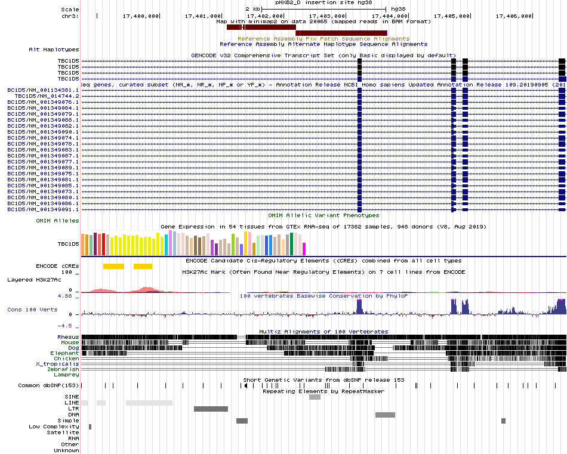{ loading=lazy }

<figcaption markdown="1">

**Figure 4A: HXB2 integration site.**

**HXB2 integration site; Figure 4B: NL4-3 integration sites**

Figure 4A: pHXB2_D’s, and therefore HXB2’s, integration site is unambiguously singular (falls outside of annotated repeat), and in the same orientation (minus strand relative to hg38) as target gene TBC1D5. Alignment quality is 60 for both homology arms (**Supplemental Table 2**). Features captured by homology arms in pHXB2_D and other clones verified as proviruses in the present study are consistent with HIV-1 integration behavior (Lucic et al. 2018). Visualized in UCSC Genome Browser (Kent et al. 2002). Figure 4B: pNL4-3_gag-pol(del1443-4553)\_EGFP’s, and therefore NL4-3’s, integration sites fall on annotated repeats, the longer reads help to locate both sites. Alignment quality is 60 for both homology arms (**Supplemental Table 2**). These integration sites would likely be missed by any method leveraging reads shorter than the homology arms.

</figcaption>
</figure>

<figure markdown="1" id="figure-4b" class="book-figure">

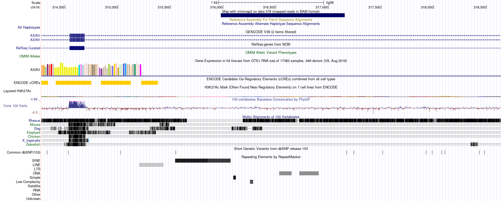{ loading=lazy }

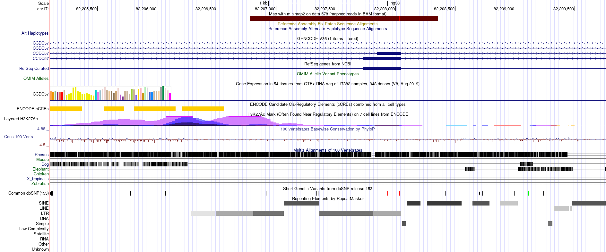{ loading=lazy }

<figcaption markdown="1">

**Figure 4B: NL4-3 integration sites.**

</figcaption>
</figure>

<figure markdown="1" id="figure-5" class="book-figure">

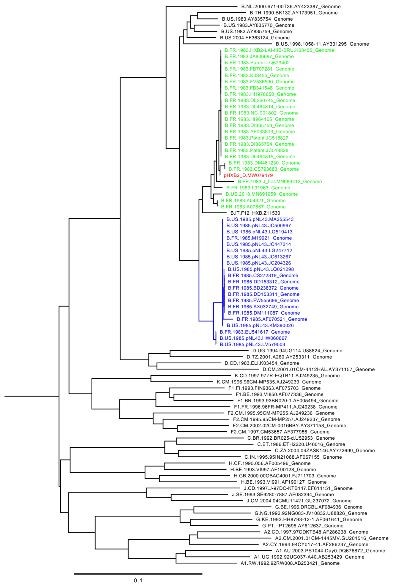{ loading=lazy }

<figcaption markdown="1">

**Figure 5: pHXB2_D provenance and top 50 neighbors.**

</figcaption>
</figure>

#### ONT read variability

As previously reported (Loman, Quick, and Simpson 2015), per-read variability in ONT data was higher near homopolymers (runs of the same base) (**[Supplemental Figure 5A](#supplemental-figure-5)**). For the datasets generated in the present study, homopolymers were counted and classified as continuous or an unbroken run of a given nucleobase vs. discontinuous or broken run of a given nucleobase (**[Supplemental Figures 5B](#supplemental-figure-5),5D,5F,5H**). A/T (2 hydrogen bonds; 2H) and G/C (3 hydrogen bonds; 3H) were evaluated. Because runs longer than 4 or 5 were rare in these datasets, it was impossible to evaluate longer homopolymers. A simple calculation Abs(Δ)=Abs(#homopolymersreference - \#homopolymersassembly) helped to evaluate the performance of basecallers, such that better basecallers had smaller Abs(Δ) (**[Supplemental Figures 5C](#supplemental-figure-5),5E,5G,5I,5K**). At the level of consensus made from sequences mapped to reference HXB2, homopolymers contributed few, if any, obvious errors. A special case of homopolymer, dimer runs, was noted to cause persistent errors regardless of ONT basecaller (**[Supplemental Figures 5J](#supplemental-figure-5j),5K**). While dips occurred at certain points near homopolymers, the consensus did not change much at the sequencing depth used in this study for either barcoded pHXB2_D samples (**[Supplemental Figures 1](#supplemental-figure-1),3,4**). Another interpretation is that homopolymers tend to seem truncated with ONT, with more reads in support of shorter homopolymers. Canu assemblies showed basecaller-dependent variability (**[Supplemental Table 3](#supplemental-table-3)**). That said, newer basecallers tended to produce fewer and smaller per-read truncations. Assemblies without polishing did not correct all homopolymer truncations (**[Supplemental Figure 4A](#supplemental-figure-4a)**). Polishing assemblies tended to correct these toward the final pHXB2_D assembly (**[Supplemental Figures 4B](#supplemental-figure-4b),6**). Data from polished ONT-only assemblies and short-read sequencing do not support the truncations (gaps relative to reference) suggested by unpolished ONT-only assemblies, representing a known current limitation of ONT. These are not the same as the 20 SNVs supported by BOTH long- and short-read sequencing performed in this study. The ratio of per-read deletions to per-read insertions (DEL/INS) was much higher for SNVs occurring at homopolymers and near the same base, and this difference was maintained between all basecallers used (**[Supplemental Figure 5L](#supplemental-figure-5)**). These changes created more problematic (longer) homopolymers. Read quality (**[Figure 1D](#figure-1)**) did not differ much between lower and higher fidelity Taq libraries.

### Discussion

This work represents the first instance of complete and unambiguous sequencing of HIV-1 provirus as plasmid and contributed to the identification of single nucleotide variants which may not have been easily determined using other sequencing modalities, illustrating the importance of validating molecular reagents in their entirety, and with complementary approaches. Nanopore sequencing surpassed the read length limitations of traditional sequencing modalities used for HIV such as Sanger sequencing and sequencing-by-synthesis by at least two orders of magnitude. Sequencing-by-synthesis range was &lt;150 bases (bp) long in most reported HIV sequencing experiments, but up to 500 bp for either Illumina (ILMN). Sanger sequencing and chain termination sequencing-related methods are typically &lt;1,000 bp. Other long-read DNA sequencing technologies such as PacBio’s zero-mode waveguide DNA sequencing were not evaluated in this work, but in principle would be interchangeable for nanopore sequencing. Paired-end sequencing as either DNA-seq or RNA-seq was not evaluated in this work, but has shown promise phasing LTRs in our hands (A. Gener et al. 2020; A. R. Gener et al. 2020; Alejandro R. Gener et al. 2020).

#### First complete pass over all HIV information in reference plasmid pHXB2_D

HIV provirus is believed to occur naturally as one or a few copies of reverse-transcribed DNA forms integrated into the host nuclear genome. Depending on where integration occurs, local GC or AT content might cause problems for detecting integrants with PCR. HIV also has conserved transitions from areas of higher GC content (~60%) to content approximating average human GC content (~40%). To limit PCR sequencing bias and to accommodate for the potential heterogeneity of HIV sequences, we fractionated whole sample directly with tagmentation provided in the Rapid PCR-Barcoding kit (ONT), as opposed to PCR-barcoding select amplicons. Tagmentation in this work used transposon-mediated cleavage and ligation of barcode adapters for later PCR amplification. A consequence of this fractionation was a distribution of reads (**[Figure 1E](#figure-1)**) shorter than longer reads reported elsewhere for ONT experiments (Payne et al. 2018). Based on this distribution and the level of coverage, it was expected that HIV might be covered from end to end, but this would have been exceptional. That said, an example is presented here (**[Figure 2](#figure-2)**). The provirus status of pHXB2_D is supported by recovery of both upstream and downstream homology arms which map to a single human integration site.

#### Long reads enable LTR phasing and HIV haplotype definition

We created 6 assemblies for pHXB2_D from ONT-only data (**[Supplemental Figure 4](#supplemental-figure-4a)**), each with a common set of 20 SNVs (11 in LTRs), and final assemblies (a single HIV-1 HXB2_D haplotype; a single HIV-1 NL4-3_gag-pol(Δ1443-4553)\_EGFP haplotype) leveraging long- and short-read data. The external core’s *de novo* assembly pipeline identified the same 20 SNVs, and variants in the LTRs were supported by ONT unambiguously. That the core’s assembler was able to phase LTR variants in these samples may have been because the samples had high amounts of the same upstream and downstream sequences because of coming from one plasmid. The core’s assembler thus may have had additional sequencing information at the edges of HXB2, helping it to map deeper into each LTR. This approach would likely fail in samples with multiple integrations, such as in various animal models of HIV disease (Rosenstiel et al. 2009), which have unknown upstream and downstream sequences, or in samples from natural human infection, which is well known to exhibit multiple pseudo-random integration sites between cells (Kvaratskhelia et al. 2014; Marini et al. 2015), but with mostly single integration events per cell (Ito et al. 2017). Inverse PCR (iPCR) is an alternative method (Ochman, Gerber, and Hartl 1988) with its own issues (e.g., PCR biases, HIV concatemers, host repeats). While current PCR reagents have extended the range of what can be seen with iPCR, current approaches are likewise limited by long DNA extraction methods, sample amount, and remain to be optimized. If coverage is sufficient (≥10 reads in non-homopolymers and non-dimer runs), long-read sequencing can provide linked variant information to individual integration sites. Identical 5’ and ‘3 LTRs (**[Figure 3](#figure-3a)**) in the context of a single integration event (**[Figure 4A](#figure-4a)**) support this integrant being a *bona fide* provirus (Hu and Hughes 2012). Other proviruses also had identical LTR pairs (**[Supplemental Table 2](#supplemental-table-2)**). Technical limitations such as PCR errors before earlier sequencing may explain the variability in the HXB2 reference LTRs. These were sequenced at a time before paired-end 150 or long-read DNA-seq were available to phase LTRs, raising the possibility that these LTRs were incorrectly annotated by depositors assuming identity and copy-and-pasting the sequence of one LTR for both without being able to unambiguously resolve each LTR.

#### Mutations in a reference HIV-1 plasmid illustrate the need for reagent verification

Up until 2020, HIV had been the most studied human pathogen, but HIV reagents are not routinely re(verified). The pHXB2_D sequenced was allegedly a reference plasmid, with unknown divergence between the published reference HXB2. Three independent experiments were: two long-read with PCR-barcoded libraries made with regular and long-amplicon Taq master mixes, one short-read. These yielded at least 20 single nucleotide variants in pHXB2_D which differed from the HXB2 reference sequence (**[Table 1](#table-1), [Supplemental Figure 3](#supplemental-figure-3a)**), which were also concordant across the three basecallers used (**[Supplemental Table 3](#supplemental-table-3)**) and are therefore not PCR errors. By leveraging long reads with the MinION, we were able to find mutations in highly repetitive LTRs relative to HXB2 Genbank:K03455.1 which are often assumed (but until now never proven) to be identical (**[Table 1](#table-1)**, **[Figure 1](#figure-1)**, **[Supplemental Figures 1](#supplemental-figure-1), 3E**), as well as mutations in protein-coding regions (**[Table 1](#table-1)**). We were also able to confirm that the backbone of this plasmid is from pSP62 (Fisher et al. 1985), a pBR322 derivative with the SP6 promoter (Green, Maniatis, and Melton 1983), aiding in the continued use of this important reagent, and illustrating the need of full-length reagent validation moving forward. We suggest that all clinical reagents (e.g., vectors) be sequence-verified at the level of single-molecule sequencing as standard quality control to protect against sample heterogeneity.

#### Improvement in ONT basecallers over time

Albacore, Guppy, and FlipFlop basecallers were compared. Each produced reads of similar length distributions relative to polymerase used, while Guppy and FlipFlop produced improved and best performance relative to quality score distributions (**[Figure 1D](#figure-1)**). Interestingly, while read length distributions were affected by fidelity of polymerases evaluated in this work, mean quality distributions were not. This is important because of the differences in cost between higher fidelity Taq and classic Taq enzymes. That said, higher fidelity LA Taq produced much higher coverage compared to Taq (**Supplemental** **[Figure 1](#figure-1)**). In consideration of library prep, choice of enzyme used should be based on the desired read-length distribution and coverage. Regarding read mapping, the increase in mean quality score between these basecallers improved overall mapping, in part by facilitating demultiplexing, resulting in approximately ~10% increases number of reads in barcoded libraries before mapping, in other words a shift in reads from unclassified to a given barcode. FlipFlop tended to handle homopolymers better than previous basecallers (**[Supplemental Figures 5](#supplemental-figure-5),6**). Homopolymers in HXB2 tended to exhibit apparent deletions near 5’ ends of homopolymers. These appeared arbitrarily upstream due to technical artifact from mapping. However, because consensus was conserved, and because short-read data lacks INDELS at these sites, it was unlikely that any of these homopolymer deletions are real in these experiments. Here consensus was defined as at least 80% of called bases at a given position were identical to reference. Dimer runs – stretches of repeating 2-mers (pronounced “two-mers”) – proved challenging regardless of basecaller. Mapping as above may be used to aid in manually calling these when they occur. Albacore is currently deprecated, and current versions of Guppy now incorporate a version of FlipFlop called Guppy High-ACcuracy (HAC). Guppy HAC and subsequence versions were not evaluated in this work. Polishing is becoming standard practice for processing assemblies from ONT data because it redresses most homopolymer errors propagated into long-read-only assemblies. The best manually finished and polished contig had 1 error out of 16,722 bases, illustrating the utility of ONT hardware when paired with burgeoning software.

### Conclusions

HIV informatics, the study of HIV sequence information, has been limited by the common assumption that sequence fidelity exists between reference genomes available in sequence databases and similarly named HIV clones. Modern DNA sequencing methods, such as long- and short-read sequencing, are available to redress this issue. Long-read sequencing fills in gaps left behind by short-read interrogation of HIV-1. Current limitations of the approaches used in the present work to study HIV are 1.) the cost of long-read sequencing, regardless of platform, compared to the cheaper short reads from sequencing-by-synthesis, 2.) long DNA extraction methods in diseased tissue, and 3.) the lower per-base accuracy (low-mid 90’s with ONT vs. 98-99% with ILMN or newer PacBio HiFi), including difficulty near homopolymers and dimer runs (**[Supplemental Figure 5](#supplemental-figure-5)**). A nontrivial but redressable limitation is availability of personnel trained to prepare sequencing libraries, to run sequencing, and to analyze results. As the price of long-read sequencing decreases, hardware and software used in basecalling and library protocols improve, and with the advent of more user-friendly tools, the cost of obtaining usable data from long reads will become negligible compared to the ability to answer historically intractable questions. This work raises the possibility of being able to detect at least some recombination events, in a reference-free manner requiring only the comparison of LTRs from the same integrants (**[Figure 6](#figure-6)**). We suggest that pHXB2_D and pNL4-3 constructs may be used as negative and positive controls for the development of such screens. While other HIV reference proviral clones were reported to have identical LTR pairs, this remains to be tested in other clones, since other clones were generated with shorter sequencing methods. For example, pNL4-3_gag-pol(del1443-4553)\_EGFP had distinct LTRs as a plasmid. However, if an NL4-3 virus is made from pNL4-3, the LTR sequences would homogenize to pNL4-3’s 3’ LTR sequence. Future work will include optimizing DNA extraction protocols with the goal of capturing higher-coverage fuller glimpses of each HIV proviral integration site in *in vivo* HIV models and patient samples. This work has broad implications for all cells infected by both integrating and non-integrating viruses, and for the characterization of targeted regions in the genome which may be recalcitrant to previous sequencing methods. Long-read sequencing is an important emerging tool defining the post-scaffold genomic era, allowing for the characterization of anatomical landmarks of hosts and pathogens at the genomic scale.

<figure markdown="1" id="figure-6" class="book-figure">

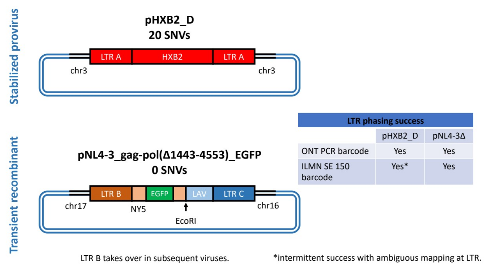{ loading=lazy }

<figcaption markdown="1">

**Figure 6: Summary of long- vs. short-read mapping by ability to phase LTRs.**

</figcaption>
</figure>

### Declarations

**List of Abbreviations**

> HIV-1, human immunodeficiency virus.
>
> PCR, polymerase chain reaction.
>
> ONT, Oxford Nanopore Technologies; nanopore sequencing.
>
> RNA-seq, usually refers to cDNA sequencing, unless otherwise specified (e.g., native RNA-seq is not cDNA sequencing).
>
> cDNA, reverse-transcribed “copy” DNA from single-stranded RNA templates. cDNA is usually double-stranded DNA.
>
> DNA-seq, DNA sequencing.
>
> EGFP, enhanced green fluorescent protein.
>
> LTR, long terminal repeat.
>
> R, R repeat (a 97bp region in the LTR).
>
> STEM, science, technology, engineering, math.
>
> DNA, deoxyribonucleic acid.
>
> RNA, ribonucleic acid.
>
> LA, Long Amplicon.
>
> SNV, single nucleotide variant.
>
> AIDS, human acquired immunodeficiency syndrome.
>
> mRNA, messenger RNA. These are usually 5’ capped and polyadenylated in human tissues.
>
> BCM, Baylor College of Medicine.
>
> IGV, Integrative Genomics Viewer.
>
> bp, bases long.
>
> Kb, kilobases long.
>
> ASP, antisense protein.
>
> MGH CCIB, Center for Computational & Integrative Biology DNA Core at Massachusetts General Hospital.
>
> 2H, two hydrogen bonds, as in A-T, A-U.
>
> 3H, three hydrogen bonds, as in G-C.
>
> iPCR, inverse PCR.
>
> INDELS, insertions and/or deletions.
>
> ILMN, Illumina short-read DNA sequencing-by-synthesis.
>
> HiFi, High-fidelity.
>
> Abs(), absolute value.
>
> RRE, rev-response element.
>
> LANL, Los Alamos National Laboratory.

**Ethics Approval**

This work did not include human or animal subjects. Nanopore libraries for this work were prepared in their entirety by ARG in a Biosafety Level 2 laboratory on main campus at Baylor College of Medicine (BCM). Nanopore sequencing was completed between April and May of 2018 as two of several control experiments included in the Student Genomics pilot run (**Supplemental Information**). Short-read sequencing was completed in April 2019.

**Consent to publish**

All authors give their consent to publish the current work, pending peer review and acceptance.

**Availability of data and materials.**

The sequence for pHXB2_D will be made available after publication with GenBank accession number MW079479 (embargoed until publication). We suggest this as a replacement for K03455.1 since MW079479 will have phased LTRs. pNL4-3_gag-pol(del1443-4553)\_EGFP is deposited as accession number (MW928609). Both plasmids will be made available to the community through the AIDS Reagent Program. Sequencing data will be deposited into GEO. **Available additional files:** Albacore basecalled barcode 10, Guppy basecalled barcode 10, FlipFlop basecalled barcode 10, Albacore basecalled barcode 11, Guppy basecalled barcode 11, FlipFlop basecalled barcode 11, Minimap2 and BWA-MEM alignments (.bam and .bai), Clipboards from points of interest (verified SNVs; n=20), .dna files of contigs (n=6), MGH data (raw + contig), Supplemental Tables, Supplemental Figures.

**Competing interests**

ARG received travel bursaries from Oxford Nanopore Technologies (ONT). The present work was completed independently of ONT. Other authors declare no conflicts of interest.

**Funding**

This work was funded in part by institutional support from Baylor College of Medicine; the Human Genome Sequencing Center at Baylor College of Medicine; private funding by Bob Ostendorf, CEO of East Coast Oils, Inc., Jacksonville, Florida; ARG’s own private funding, including Student Genomics (manuscripts in prep). Compute resources from the Computational and Integrative Biomedical Research Center at BCM (“sphere” cluster managed by Dr. Steven Ludtke) and the Department of Molecular and Human Genetics at BCM (“taco” cluster managed by Mr. Tanner Beck and Dr. Charles Lin) greatly facilitated the completion of this work. ARG has also received the PFLAG of Jacksonville scholarship for multiple years.

**Authors’ contributions**

ARG conceived of this project, performed experiments, analyzed results, and drafted the manuscript. WZ rederived pNL4-3_gag-pol(del1443-4553)\_EGFP. All authors discussed data and edited the manuscript. ARG and PK provided funding.

**Acknowledgements**

As part of a summer bioinformatics internship in the Paul E. Klotman Laboratory at Baylor College of Medicine, Akash Naik supervised by ARG performed *in silico* mapping analyses/experiments, generated and/or aided in the synthesis of **[Supplemental Figure 4](#supplemental-figure-4a)**, and assisted in writing relevant portions, discussing, and editing this manuscript. During a second summer internship with American Physician Scientists Association Virtual Summer Research Program, the following students were supervised by ARG helped to create **[Figure 1A](#figure-1)** and **[Supplemental Table 1](#supplemental-table-1)**: Yini Liang, Kirk Niekamp, Maliha Jeba, Delmarie M. Rivera Rodríguez. Orthogonal sequence verification was performed as a service by staff at the Center for Computational & Integrative Biology DNA Core at Massachusetts General Hospital, Boston, MA, USA.

We would like to thank the staff at the DNA Core for their exceptional services, including expert analyses and rapid turnaround time. We would like to thank Drs. Steven Richards, Qingchang Meng and the staff of the Human Genome Sequencing Center Research (HGSC) and Development (R&D) team for their earlier support in nanopore adoption. We would like to thank the team at Oxford Nanopore Technologies for their timely improvements and continued R&D. I would also like to thank Ms. Taneasha Monique Washington (current) and former members of the Paul E. Klotman lab, Dr. Gokul C. Das and Alexander Batista. I would like to thank Dr. Alana Canupp and the late Dr. Jim Maruniak for their early interest in my scientific development, and for the passion that they show in everything that they do.

### References

Adachi, A., H. E. Gendelman, S. Koenig, T. Folks, R. Willey, A. Rabson, and M. A. Martin. 1986. “Production of Acquired Immunodeficiency Syndrome-Associated Retrovirus in Human and Nonhuman Cells Transfected with an Infectious Molecular Clone.” *Journal of Virology* 59(2):284–91.

Afgan, Enis, Dannon Baker, Marius van den Beek, Daniel Blankenberg, Dave Bouvier, Martin Čech, John Chilton, Dave Clements, Nate Coraor, Carl Eberhard, Björn Grüning, Aysam Guerler, Jennifer Hillman-Jackson, Greg Von Kuster, Eric Rasche, Nicola Soranzo, Nitesh Turaga, James Taylor, Anton Nekrutenko, and Jeremy Goecks. 2016. “The Galaxy Platform for Accessible, Reproducible and Collaborative Biomedical Analyses: 2016 Update.” *Nucleic Acids Research* 44(W1):W3–10.

Andrews, S. n.d. “FastQC A Quality Control Tool for High Throughput Sequence Data.”

B, Chevreux, Wetter T, and Suhai S. n.d. “Genome Sequence Assembly Using Trace Signals and Additional Sequence Information.” *Computer Science and Biology: Proceedings of the German Conference on Bioinformatics (GCB)* 99:45–56.

Banin, Andrew N., Michael Tuen, Jude S. Bimela, Marcel Tongo, Paul Zappile, Alireza Khodadadi-Jamayran, Aubin J. Nanfack, Josephine Meli, Xiaohong Wang, Dora Mbanya, Jeanne Ngogang, Adriana Heguy, Phillipe N. Nyambi, Charles Fokunang, and Ralf Duerr. 2019. “Development of a Versatile, Near Full Genome Amplification and Sequencing Approach for a Broad Variety of HIV-1 Group M Variants.” *Viruses* 11(4):317.

Bankevich, Anton, Sergey Nurk, Dmitry Antipov, Alexey A. Gurevich, Mikhail Dvorkin, Alexander S. Kulikov, Valery M. Lesin, Sergey I. Nikolenko, Son Pham, Andrey D. Prjibelski, Alexey V Pyshkin, Alexander V Sirotkin, Nikolay Vyahhi, Glenn Tesler, Max A. Alekseyev, and Pavel A. Pevzner. 2012. “SPAdes: A New Genome Assembly Algorithm and Its Applications to Single-Cell Sequencing.” *Journal of Computational Biology* 19(5):455–77.

Barré-Sinoussi, F., J. C. Chermann, F. Rey, M. T. Nugeyre, S. Chamaret, J. Gruest, C. Dauguet, C. Axler-Blin, F. Vézinet-Brun, C. Rouzioux, W. Rozenbaum, and L. Montagnier. 1983. “Isolation of a T-Lymphotropic Retrovirus from a Patient at Risk for Acquired Immune Deficiency Syndrome (AIDS).” *Science (New York, N.Y.)* 220(4599):868–71.

Bonsall, D., T. Golubchik, B. Kosloff, M. Limbada, M. de Cesare, A. Schaap, M. Hall, C. Wymant, G. Macintyre-Cockett, A. Brown, M. A. Ansari, S. Floyd, R. Hayes, H. Ayles, S. Fidler, and C. Fraser. 2018. “THAA0101 - HIV Genotyping and Phylogenetics in the HPTN 071 (PopART) Study: Validation of a High-Throughput Sequencing Assay for Viral Load Quantification, Genotyping, Resistance Testing and High-Resolution Transmission Networking.” P. Oral Abstract in *22nd International AIDS Conference (AIDS2018)*.

Bruner, Katherine M., Zheng Wang, Francesco R. Simonetti, Alexandra M. Bender, Kyungyoon J. Kwon, Srona Sengupta, Emily J. Fray, Subul A. Beg, Annukka A. R. Antar, Katharine M. Jenike, Lynn N. Bertagnolli, Adam A. Capoferri, Joshua T. Kufera, Andrew Timmons, Christopher Nobles, John Gregg, Nikolas Wada, Ya-Chi Ho, Hao Zhang, Joseph B. Margolick, Joel N. Blankson, Steven G. Deeks, Frederic D. Bushman, Janet D. Siliciano, Gregory M. Laird, and Robert F. Siliciano. 2019. “A Quantitative Approach for Measuring the Reservoir of Latent HIV-1 Proviruses.” *Nature* 566(7742):120–25.

Cock, Peter J. A., Björn A. Grüning, Konrad Paszkiewicz, and Leighton Pritchard. 2013. “Galaxy Tools and Workflows for Sequence Analysis with Applications in Molecular Plant Pathology” edited by G. Lazo. *PeerJ* 1:e167.

Cuccuru, Gianmauro, Massimiliano Orsini, Andrea Pinna, Andrea Sbardellati, Nicola Soranzo, Antonella Travaglione, Paolo Uva, Gianluigi Zanetti, and Giorgio Fotia. 2014. “Orione, a Web-Based Framework for NGS Analysis in Microbiology.” *Bioinformatics* 30(13):1928–29.

Cuesta, Isabel, Ana Mari, Antonio Ocampo, Celia Miralles, Sonia Pérez-castro, and Michael M. Thomson. 2016. “Sequence Analysis of In Vivo -Expressed HIV-1 Spliced RNAs Reveals the Usage of New and Unusual Splice Sites by Viruses of Different Subtypes.” 1–24.

Curreli, Sabrina, Selvi Krishnan, Marvin Reitz, Yanto Lunardi-Iskandar, Mark K. Lafferty, Alfredo Garzino-Demo, Davide Zella, Robert C. Gallo, and Joseph Bryant. 2013. “B Cell Lymphoma in HIV Transgenic Mice.” *Retrovirology* 10:92.

Dickie, Peter, James Felser, Michael Eckhaus, Joseph Bryant, Jonathan Silver, Nancy Marinos, and Abner L. Notkins. 1991. “HIV-Associated Nephropathy in Transgenic Mice Expressing HIV-1 Genes.” *Virology* 109–19. Retrieved February 11, 2016 (http://ac.els-cdn.com/0042682291907595/1-s2.0-0042682291907595-main.pdf?\_tid=8f811f10-d10c-11e5-82e8-00000aacb35e&acdnat=1455228938_33d4226549c6410971ced1c4c3573a44).

Einkauf, Kevin B., Xu G. Yu, Mathias Lichterfeld, Kevin B. Einkauf, Guinevere Q. Lee, Ce Gao, Radwa Sharaf, Xiaoming Sun, Stephane Hua, Samantha M. Y. Chen, Chenyang Jiang, Xiaodong Lian, Fatema Z. Chowdhury, Eric S. Rosenberg, Tae-wook Chun, Jonathan Z. Li, and Xu G. Yu. 2019. “Intact HIV-1 Proviruses Accumulate at Distinct Chromosomal Positions during Prolonged Antiretroviral Therapy Find the Latest Version : Intact HIV-1 Proviruses Accumulate at Distinct Chromosomal Positions during Prolonged Antiretroviral Therapy.” 129(3):988–98.

Fisher, Amanda G., Enrico Collalti, Lee Ratner, Robert C. Gallo, and Flossie Wong-Staal. 1985. “A Molecular Clone of HTLV-III with Biological Activity.” *Nature* 316(6025):262–65.

Gener, A., Y. Fan, G. C. Das, W. Zhang, D. P. Hyink, C. He, and P. E. Klotman. 2020. “PEA0011 - Insights from HIV-1 Transgene Insertions in the Murine Model of HIV-Associated Nephropathy.” in *23rd International AIDS Conference (AIDS2020)*. Vol. ePoster.

Gener, A. R., T. Washington, D. Hyink, and P. Klotman. 2020. “3264 - The Multiple HIV-1 Transgenes in the Murine Model of HIV-Associated Nephropathy Fail to Segregate as Expected.” P. ePoster in *American Society of Human Genetics Annual Meeting*.

Gener, Alejandro R. 2019. “Full-Coverage Sequencing of HIV-1 Provirus from a Reference Plasmid.” *BioRxiv* 611848.

Gener, Alejandro R. and Jason T. Kimata. 2019. “Full-Coverage Native RNA Sequencing of HIV-1 Viruses.” *BioRxiv* 845610.

Gener, Alejandro R., Yini Liang, Maliha Jeba, Delmarie M. Rivera Rodríguez, Kirk Niekamp, Lawrence Tan, Ashwarya S. Devason, Mayra Aucapina, Akash Naik, Taneasha Washington, Ying Fan, Gokul C. Das, Weijia Zhang, John Cijiang He, Deborah P. Hyink, and Paul E. Klotman. 2020. “P39 - Insights from Comprehensive Transcript Models of HIV-1.” P. ePoster in *Genome Informatics 2020*.

Graf, Erin H., Angela M. Mexas, Jianqing J. Yu, Farida Shaheen, Megan K. Liszewski, Michele Di Mascio, Stephen A. Migueles, Mark Connors, and Una O’Doherty. 2011. “Elite Suppressors Harbor Low Levels of Integrated HIV DNA and High Levels of 2-LTR Circular HIV DNA Compared to HIV+ Patients on and off HAART.” *PLoS Pathogens* 7(2).

Green, M. R., T. Maniatis, and D. A. Melton. 1983. “Human Beta-Globin Pre-MRNA Synthesized in Vitro Is Accurately Spliced in Xenopus Oocyte Nuclei.” *Cell* 32(3):681–94.

Hu, Wei-Shau and Stephen H. Hughes. 2012. “HIV-1 Reverse Transcription.” *Cold Spring Harbor Perspectives in Medicine* 2(10).

Husain, M. 2002. “HIV-1 Nef Induces Proliferation and Anchorage-Independent Growth in Podocytes.” *Journal of the American Society of Nephrology* 13(7):1806–15.

Ito, Yusuke, Azaria Remion, Alexandra Tauzin, Keisuke Ejima, Shinji Nakaoka, Yoh Iwasa, Shingo Iwami, and Fabrizio Mammano. 2017. “Number of Infection Events per Cell during HIV-1 Cell-Free Infection.” *Scientific Reports* 7(1):6559.

Katoh, Kazutaka, John Rozewicki, and Kazunori D. Yamada. 2017. “MAFFT Online Service: Multiple Sequence Alignment, Interactive Sequence Choice and Visualization.” *Briefings in Bioinformatics* 20(4):1160–66.

Katoh, Kazutaka and Daron M. Standley. 2013. “MAFFT Multiple Sequence Alignment Software Version 7: Improvements in Performance and Usability.” *Molecular Biology and Evolution* 30(4):772–80.

Kent, W. James, Charles W. Sugnet, Terrence S. Furey, Krishna M. Roskin, Tom H. Pringle, Alan M. Zahler, and and David Haussler. 2002. “The Human Genome Browser at UCSC.” *Genome Research* 12(6):996–1006.

Krupovic, Mart, Jonas Blomberg, John M. Coffin, Indranil Dasgupta, Hung Fan, Andrew D. Geering, Robert Gifford, Balázs Harrach, Roger Hull, Welkin Johnson, Jan F. Kreuze, Dirk Lindemann, Carlos Llorens, Ben Lockhart, Jens Mayer, Emmanuelle Muller, Neil E. Olszewski, Hanu R. Pappu, Mikhail M. Pooggin, Katja R. Richert-Pöggeler, Sead Sabanadzovic, Hélène Sanfaçon, James E. Schoelz, Susan Seal, Livia Stavolone, Jonathan P. Stoye, Pierre-Yves Teycheney, Michael Tristem, Eugene V Koonin, and Jens H. Kuhn. 2018. “Ortervirales: New Virus Order Unifying Five Families of Reverse-Transcribing Viruses.” *Journal of Virology* 92(12):e00515-18.

Kvaratskhelia, Mamuka, Amit Sharma, Ross C. Larue, Erik Serrao, and Alan Engelman. 2014. “Molecular Mechanisms of Retroviral Integration Site Selection.” *Nucleic Acids Research* 42(16):gku769-.

Li, Heng. 2018. “Minimap2: Pairwise Alignment for Nucleotide Sequences.” *Bioinformatics* 34(18):3094–3100.

Li, Heng and Richard Durbin. 2010. “Fast and Accurate Long-Read Alignment with Burrows – Wheeler Transform.” 26(5):589–95.

Li, Huilin, Weijia Zhang, Fang Zhong, Gokul C. Das, Yifan Xie, Zhengzhe Li, Weijing Cai, Gengru Jiang, Jae Choi, Mohamad Sidani, Deborah P. Hyink, Kyung Lee, Paul E. Klotman, and John Cijiang He. 2018. “Epigenetic Regulation of RCAN1 Expression in Kidney Disease and Its Role in Podocyte Injury.” *Kidney International* 94(6):1160–76.

Loman, Nicholas J., Joshua Quick, and Jared T. Simpson. 2015. “A Complete Bacterial Genome Assembled de Novo Using Only Nanopore Sequencing Data.” *Nature Methods* 12(8):733–35.

Lucic, Bojana, Heng-Chang Chen, Maja Kuzman, Eduard Zorita, Julia Wegner, Vera Minneker, Vassilis Roukos, Wei Wang, Raffaele Fronza, Manfred Schmidt, Monsef Benkirane, Ralph Stadhouders, Kristian Vlahovicek, Guillaume J. Filion, and Marina Lusic. 2018. “Spatially Clustered Loci with Multiple Enhancers Are Frequent Targets of HIV-1.” *BioRxiv*.

Lyons, Daniel M. and Adam S. Lauring. 2017. “Evidence for the Selective Basis of Transition-to-Transversion Substitution Bias in Two RNA Viruses.” *Molecular Biology and Evolution* 34(12):3205–15.

Marini, Bruna, Attila Kertesz-Farkas, Hashim Ali, Bojana Lucic, Kamil Lisek, Lara Manganaro, Sandor Pongor, Roberto Luzzati, Alessandra Recchia, Fulvio Mavilio, Mauro Giacca, and Marina Lusic. 2015. “Nuclear Architecture Dictates HIV-1 Integration Site Selection.” *Nature* 521:227–33.

Nguyen Quang, Nam, Sophie Goudey, Emmanuel Ségéral, Ammara Mohammad, Sophie Lemoine, Corinne Blugeon, Margaux Versapuech, Jean-Christophe Paillart, Clarisse Berlioz-Torrent, Stéphane Emiliani, and Sarah Gallois-Montbrun. 2020. “Dynamic Nanopore Long-Read Sequencing Analysis of HIV-1 Splicing Events during the Early Steps of Infection.” *Retrovirology* 17(1):25.

Ochman, H., A. S. Gerber, and D. L. Hartl. 1988. “Genetic Applications of an Inverse Polymerase Chain Reaction.” *Genetics* 120(3):621–23.

Payne, Alexander, Nadine Holmes, Vardhman Rakyan, and Matthew Loose. 2018. “Whale Watching with BulkVis: A Graphical Viewer for Oxford Nanopore Bulk Fast5 Files.” *BioRxiv* 312256.

Peng, Yu, Henry C. M. Leung, S. M. Yiu, and Francis Y. L. Chin. 2010. “IDBA – A Practical Iterative de Bruijn Graph De Novo Assembler BT - Research in Computational Molecular Biology.” Pp. 426–40 in, edited by B. Berger. Berlin, Heidelberg: Springer Berlin Heidelberg.

Pinzone, Marilia Rita and Una O’Doherty. 2018. “Measuring Integrated HIV DNA Ex Vivo and in Vitro Provides Insights about How Reservoirs Are Formed and Maintained.” *Retrovirology* 15(1):1–12.

Ratner, L., W. Haseltine, R. Patarca, K. J. Livak, B. Starcich, S. F. Josephs, E. R. Doran, J. A. Rafalski, E. A. Whitehorn, and K. Baumeister. 1985. “Complete Nucleotide Sequence of the AIDS Virus, HTLV-III.” *Nature* 313(6000):277–84.

Robinson, James T., Helga Thorvaldsdóttir, Wendy Winckler, Mitchell Guttman, Eric S. Lander, Gad Getz1, and Jill P. Mesirov1. 2011. “Integrative Genomics Viewer.” *Nat Biotechnol* 29(1):24–26.

Rosenstiel, Paul, Ali Gharavi, Vivette D’Agati, and Paul Klotman. 2009. “Transgenic and Infectious Animal Models of HIV-Associated Nephropathy.” *Journal of the American Society of Nephrology : JASN* 20(11):2296–2304.

Shaw, G. M., B. H. Hahn, S. K. Arya, J. E. Groopman, R. C. Gallo, and F. Wong-Staal. 1984. “Molecular Characterization of Human T-Cell Leukemia (Lymphotropic) Virus Type III in the Acquired Immune Deficiency Syndrome.” *Science (New York, N.Y.)* 226(4679):1165–71.

Wain-Hobson, S., J. P. Vartanian, M. Henry, N. Chenciner, R. Cheynier, S. Delassus, L. P. Martins, M. Sala, M. T. Nugeyre, and D. Guétard. 1991. “LAV Revisited: Origins of the Early HIV-1 Isolates from Institut Pasteur.” *Science (New York, N.Y.)* 252(5008):961–65.

Walenz, Brian P., Sergey Koren, Nicholas H. Bergman, Adam M. Phillippy, Jason R. Miller, and Konstantin Berlin. 2017. “Canu: Scalable and Accurate Long-Read Assembly via Adaptive k -Mer Weighting and Repeat Separation.” *Genome Research* 27(5):722–36.

Warren, René L., Granger G. Sutton, Steven J. M. Jones, and Robert A. Holt. 2007. “Assembling Millions of Short DNA Sequences Using SSAKE.” *Bioinformatics* 23(4):500–501.

Wymant, Chris, François Blanquart, Tanya Golubchik, Astrid Gall, Margreet Bakker, Daniela Bezemer, Nicholas J. Croucher, Matthew Hall, Mariska Hillebregt, Swee Hoe Ong, Oliver Ratmann, Jan Albert, Norbert Bannert, Jacques Fellay, Katrien Fransen, Annabelle Gourlay, M. Kate Grabowski, Barbara Gunsenheimer-Bartmeyer, Huldrych F. Günthard, Pia Kivelä, Roger Kouyos, Oliver Laeyendecker, Kirsi Liitsola, Laurence Meyer, Kholoud Porter, Matti Ristola, Ard van Sighem, Ben Berkhout, Marion Cornelissen, Paul Kellam, Peter Reiss, and Christophe Fraser. 2018. “Easy and Accurate Reconstruction of Whole HIV Genomes from Short-Read Sequence Data with Shiver.” *Virus Evolution* 4(1):1–13.

### Supplemental Information

#### Data exploration with long- and short-read mapping

To assemble pHXB2_D, we tried the following short read assemblers on short-read data from the external core: IDBA (Peng et al. 2010), MIRA (B, T, and S n.d.; Cock et al. 2013), SPAdes (Bankevich et al. 2012), and SSAKE (Cuccuru et al. 2014; Warren et al. 2007). These were chosen as a convenience because they were already stably implemented in Galaxy (specifically usegalaxy.eu). Of these, SSAKE produced discontinuous assemblies with default parameters. The discontinuous contigs did however map to the core’s assembly (not shown).

#### Enabling STEM outreach

This work was performed as two control experiments with identically prepared libraries for a STEM outreach initiative, Student Genomics (Gener, et al., manuscript in prep). Given the constraints of the Student Genomics pilot, a rapid sequencing kit with tagmentation (explained below) with PCR barcoding was used to pool samples for ONT sequencing, with the consequence of fragmenting plasmid DNA more than what would have been ideal for capturing full-length HIV. That said, these controls could have been just as easily replaced by any samples/experiments benefiting from long-read sequencing at moderate-to-high coverage.

### Supplemental Tables

<figure markdown="1" id="supplemental-table-1" class="book-table">

<figcaption markdown="1">

**Supplemental Table 1: HXB2 is still a common HIV clone.**

See **Supplemental Digital Content.**

See also **Figure 1A**.

</figcaption>
</figure>

<figure markdown="1" id="supplemental-table-2" class="book-table">

<figcaption markdown="1">

**Supplemental Table 2: HIV provirus clones.**

See **Supplemental Digital Content.**

Of the HIV clones available through ARP, the table represents the only validated proviruses with both upstream and downstream homology arms mapping to the same integration sites. pNL4-3 is included as a known chimera with two integration half-sites. Other clones were made with cDNA cloning, usually TA cloning (per ARP entries). Note: Reference hg38. Aligner: minimap2 with "Long Assembly" mapping settings. All homology arms had Alignment quality = 60. Upstream = host plus strand; independent of integration orientation. Coordinates reported from UCSC. ARP = NIH AIDS Reagent and Reference Program. IS = integration site.

</figcaption>
</figure>

<figure markdown="1" id="supplemental-table-3" class="book-table">

<figcaption markdown="1">

**Supplemental Table 3: Variation in assemblies at the feature level.**

Assembled with Canu. NA denotes features which may not have matched exactly, but which were collapsed with adjacent features to facilitate counting. Variants called manually by mapping assemblies over HXB2 features with SnapGene.

</figcaption>

|                   | Mismatches |       |          |          |       |          | Gaps (INDEL) |       |          |          |       |          |
|-------------------|------------|-------|----------|----------|-------|----------|--------------|-------|----------|----------|-------|----------|
|                   | Taq        |       |          | LA Taq   |       |          | Taq          |       |          | LA Taq   |       |          |
|                   | Albacore   | Guppy | FlipFlop | Albacore | Guppy | FlipFlop | Albacore     | Guppy | FlipFlop | Albacore | Guppy | FlipFlop |
| 5' LTR            | NA         | 9     | 9        | 9        | 9     | 9        | NA           | NA    | 0        | 2        | 0     | 0        |
| gag               | 2          | 2     | 2        | 2        | 2     | 2        | 12           | 10    | 9        | 9        | 8     | 8        |
| 5' LTR+ψ          | 10         | 10    | ΝΑ       | ΝΑ       | ΝΑ    | ΝΑ       | 5            | 2     | ΝΑ       | ΝΑ       | ΝΑ    | ΝΑ       |
| pol               | 7          | 6     | 6        | 6        | 6     | 6        | 26           | 22    | 9        | 18       | 11    | 10       |
| vif               | 0          | 0     | 0        | 0        | 0     | 0        | 3            | 3     | 2        | 3        | 1     | 1        |
| vpr               | 0          | 0     | 0        | 0        | 0     | 0        | 1            | 1     | 1        | 0        | 0     | 0        |
| tat               | 2          | 1     | 1        | 1        | 1     | 1        | 10           | 6     | 3        | 7        | 4     | 5        |
| rev               | 2          | 1     | 1        | 1        | 1     | 1        | 10           | 7     | 4        | 7        | 4     | 5        |
| vpu               | 1          | 0     | 0        | 0        | 0     | 0        | 0            | 0     | 0        | 0        | 0     | 0        |
| gp160             | 2          | 1     | 1        | 1        | 1     | 1        | 11           | 7     | 4        | 8        | 4     | 5        |
| nef               | 1          | 1     | 1        | 1        | 1     | 1        | 3            | 2     | 2        | 3        | 2     | 1        |
| 3' LTR            | 2          | 2     | NA       | NA       | NA    | NA       | 2            | 0     | NA       | NA       | NA    | NA       |
| nef+3' LTR        | NA         | 2     | 2        | 2        | 2     | 2        | NA           | 2     | 2        | 5        | 2     | 1        |
| HXB2              | 22         | 20    | 20       | 20       | 20    | 20       | 61           | 46    | 28       | 47       | 27    | 25       |
| Downstream bridge | 0          | 0     | 0        | 0        | 0     | 0        | 4            | 5     | 1        | 2        | 1     | 1        |
| pBR322-related    | 0          | 0     | 0        | 0        | 0     | 0        | 19           | 19    | 13       | 18       | 19    | 15       |
| Upstream bridge   | 2          | 2     | 3        | 2        | 2     | 2        | 8            | 6     | 5        | 7        | 7     | 3        |
</figure>

### Supplemental Figures

<figure markdown="1" id="supplemental-figure-1a" class="book-figure">

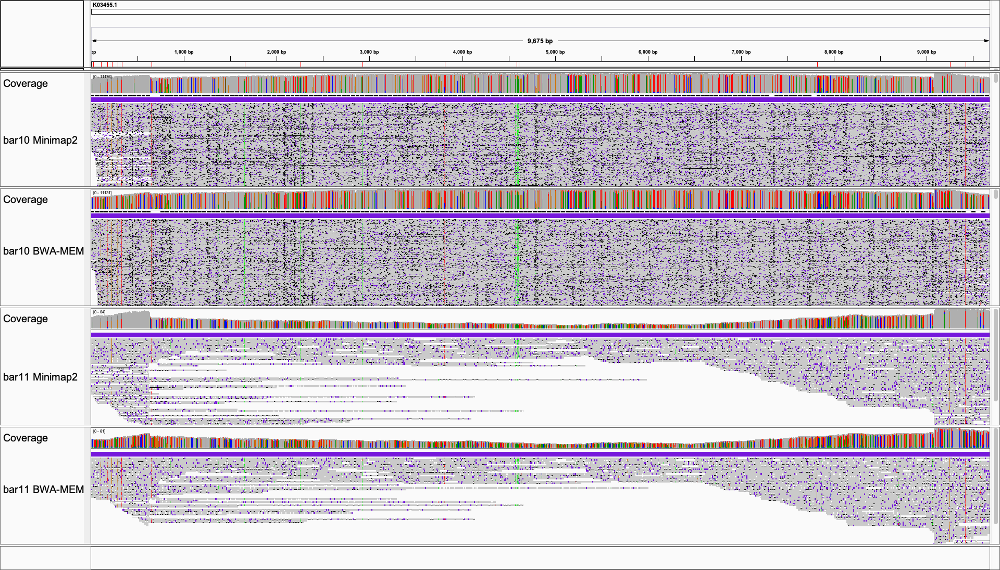{ loading=lazy }

<figcaption markdown="1">

**Supplemental Figure 1A: Unbiased nanopore DNA sequencing coverage over HXB2 depends on DNA polymerase and mapper. ONT basecaller = Albacore (worst).**

</figcaption>
</figure>

<figure markdown="1" id="supplemental-figure-1b" class="book-figure">

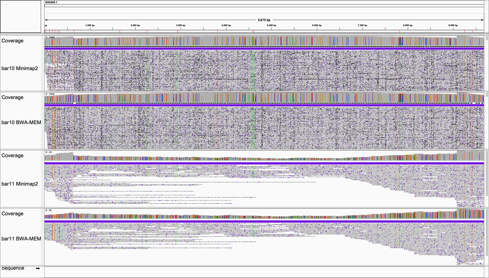{ loading=lazy }

<figcaption markdown="1">

**Supplemental Figure 1B: Unbiased nanopore DNA sequencing coverage over HXB2 depends on DNA polymerase and mapper. ONT basecaller = Guppy.**

</figcaption>
</figure>

<figure markdown="1" id="supplemental-figure-1c" class="book-figure">

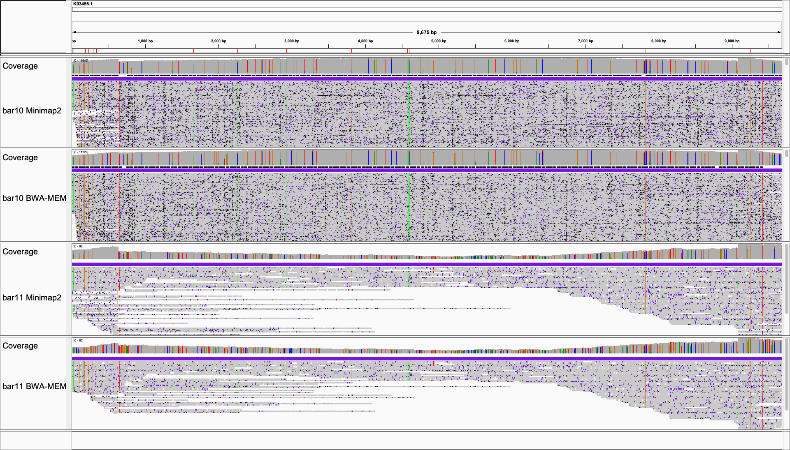{ loading=lazy }

<figcaption markdown="1">

**Supplemental Figure 1C: Unbiased nanopore DNA sequencing coverage over HXB2 depends on DNA polymerase and mapper. ONT basecaller = FlipFlop (best).**

</figcaption>
</figure>

<figure markdown="1" id="supplemental-figure-1" class="book-figure">

<figcaption markdown="1">

**Supplemental Figure 1: Unbiased nanopore DNA sequencing coverage over HXB2 depends on DNA polymerase and mapper.**

Top two Coverage and Alignment panels from barcoded library 10 (bar10 = LA Taq). Bottom two from Barcode 11 (bar11 = Taq). Minimap2 and BWA-MEM were used to map reads basecalled with Albacore (worst), Guppy, or FlipFlop (best) to HXB2. Color-coding: Red below genome scale marks 20 SNVs across the HIV segment of pHXB2_D. Purple is an insertion in a given read relative to reference. White is either a deletion in a given read or space between two aligned reads. Gray in alignment field means base same as reference, and in coverage field means major allele is at least 95% the same as reference. Per-read “insertions” and “deletions” do not necessarily represent true insertions or deletions actually present in the sample, because each read is likely an imperfect independent observation. Automated assembly followed by manual consensus building converts these overlapping reads into approximations of the ground truth. “Unbiased” refers to not amplifying a given region (e.g., pol) before ligating ONT sequencing adapters. In the present approach, the tagmentation process randomly cuts DNA, creating ~2000 bp pieces. Tagmented DNA is then amplified based on tagmentation adapters.

</figcaption>
</figure>

<figure markdown="1" id="supplemental-figure-2" class="book-figure">

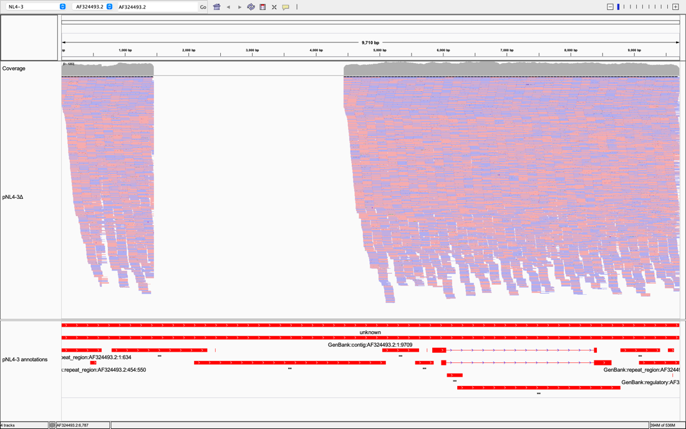{ loading=lazy }

<figcaption markdown="1">

**Supplemental Figure 2: Reads map well to HIV-1 NL4-3 segment of pNL4-3 assembly because NL4-3 LTRs are distinct.**

</figcaption>
</figure>

<figure markdown="1" id="supplemental-figure-3a" class="book-figure">

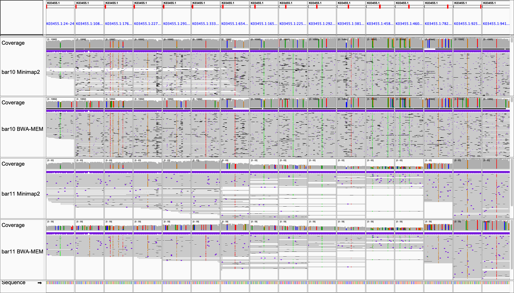{ loading=lazy }

<figcaption markdown="1">

**Supplemental Figure 3A: HIV single nucleotide variants (SNVs) in pHXB2_D. ONT basecaller = Albacore (worst).**

</figcaption>
</figure>

<figure markdown="1" id="supplemental-figure-3b" class="book-figure">

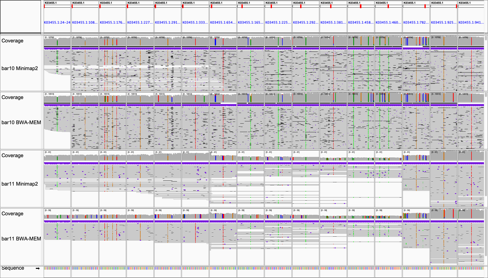{ loading=lazy }

<figcaption markdown="1">

**Supplemental Figure 3B: HIV single nucleotide variants (SNVs) in pHXB2_D. ONT basecaller = Guppy.**

</figcaption>
</figure>

<figure markdown="1" id="supplemental-figure-3c" class="book-figure">

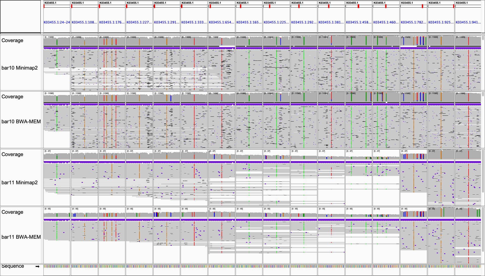{ loading=lazy }

<figcaption markdown="1">

**Supplemental Figure 3C: HIV single nucleotide variants (SNVs) in pHXB2_D. ONT basecaller = FlipFlop (best).**

</figcaption>
</figure>

<figure markdown="1" id="supplemental-figure-3d" class="book-figure">

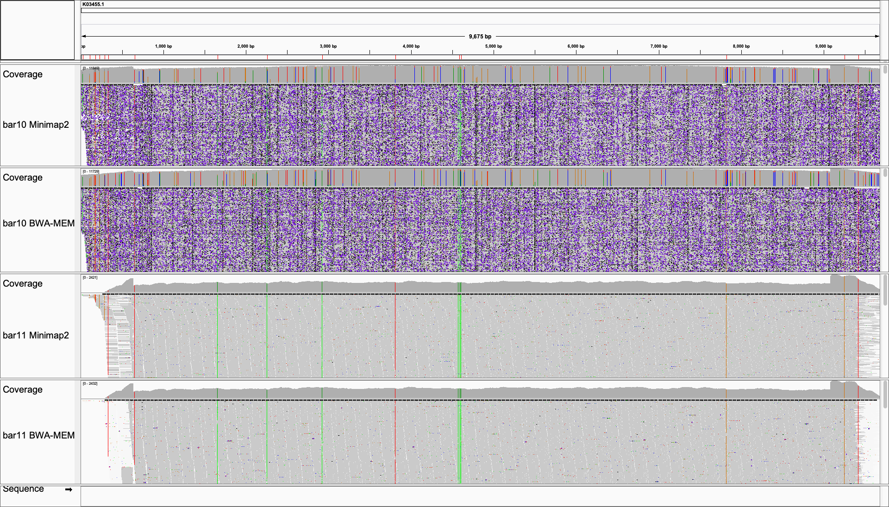{ loading=lazy }

<figcaption markdown="1">

**Supplemental Figure 3D: HIV single nucleotide variants (SNVs) in pHXB2_D, long vs. short reads (HIV genome).**

</figcaption>
</figure>

<figure markdown="1" id="supplemental-figure-3e" class="book-figure">

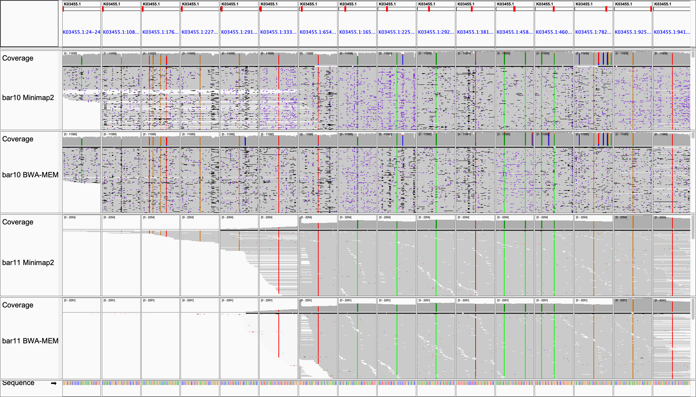{ loading=lazy }

<figcaption markdown="1">

**Supplemental Figure 3E: HIV single nucleotide variants (SNVs) in pHXB2_D, long vs. short reads (20 SNV-focused).**

**HIV single nucleotide variants (SNVs) in pHXB2_D, long vs. short reads (SNV-focused).**

**Supplemental Figure 3A: HIV single nucleotide variants (SNVs) in pHXB2_D.** ONT basecaller = Albacore (worst). Gray indicates per-base consensus accuracy ≥ 80%. These alignments are the noisiest (less gray and most divergent from reference) between Supplemental Figures 3A, 3B, and 3C.

**Supplemental Figure 3B: HIV single nucleotide variants (SNVs) in pHXB2_D.** ONT basecaller = Guppy.

**Supplemental Figure 3C: HIV single nucleotide variants (SNVs) in pHXB2_D.** ONT basecaller = FlipFlop (best). These alignments are the least noisy (most gray and like reference) between Supplemental Figures 3A, 3B, and 3C.

**Supplemental Figure 3D: HIV single nucleotide variants (SNVs) in pHXB2_D, long vs. short reads (HIV genome).** Long reads outperform short reads at HIV-1 LTRs. ONT basecaller = FlipFlop. Short read as single-end 150, clipped to 142, provided by external core. Mappers = Minimap2 (better), BWA-MEM.

</figcaption>
</figure>

<figure markdown="1" id="supplemental-figure-4a" class="book-figure">

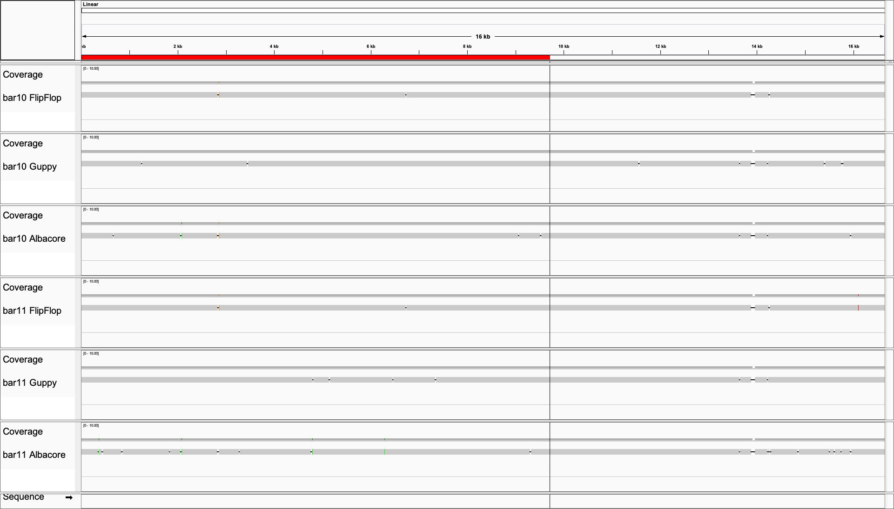{ loading=lazy }

<figcaption markdown="1">

**Supplemental Figure 4A: Assembling pHXB2_D from long reads only, varying basecaller and polymerase.**

Each pane (n=6) summarizes the results of contig curation. Divergence from reference decreases with newer basecallers, and with long amplicon DNA polymerase (Sigma-Aldrich Taq vs. LA Taq by Takara). Errors in assembly occurred at homopolymers (most often deletions not visible at this resolution; see **Supplemental Figure 6**), dimer or trimer runs. bar10 = LA Taq library. bar11 = Taq library. pHXB2_D Genbank:MW079479. Best contigs presented, manually curated to match pHXB2_D coordinates. Note LTRs (beginning and terminal 634 bp of red bar) are resolved in almost all assemblies. See **Supplemental Table 3** for differences between assemblies and the reference (left red). Plasmid backbone (right) differences are not reported.

</figcaption>
</figure>

<figure markdown="1" id="supplemental-figure-4b" class="book-figure">

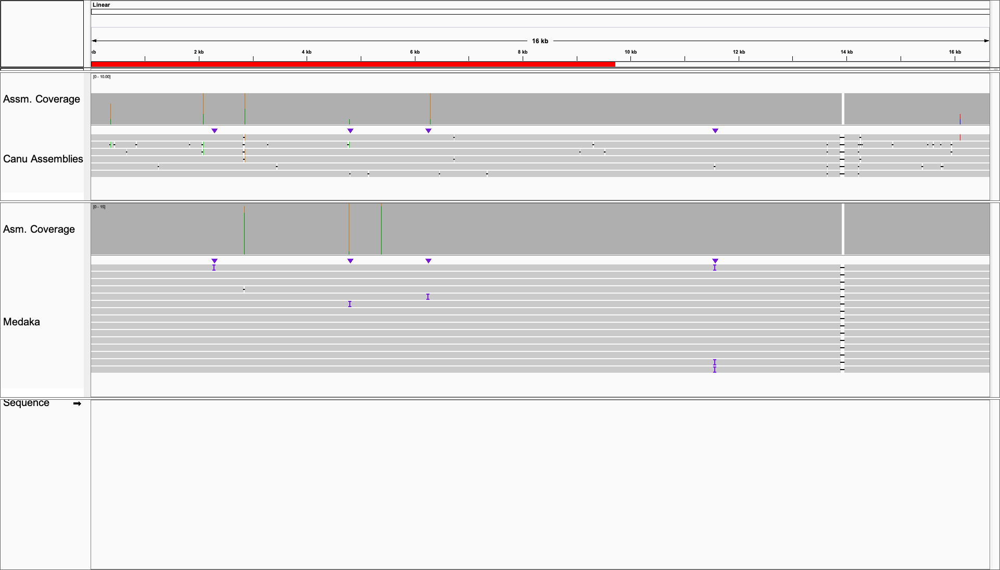{ loading=lazy }

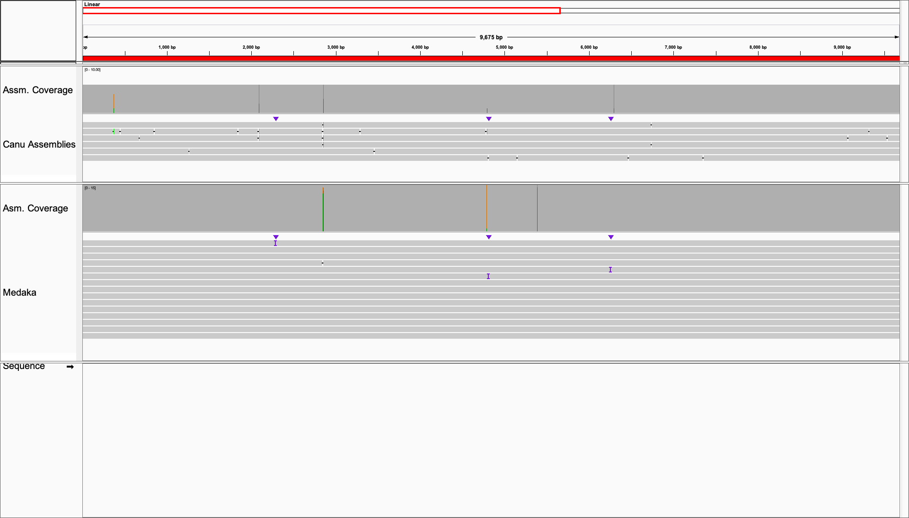{ loading=lazy }

<figcaption markdown="1">

**Supplemental Figure 4B: ONT errors corrected by polishing ONT-only assemblies.**

Assemblies polished with Medaka (ONT). Top: pHXB2_D genome. Bottom: HIV-only segment. The best polished assembly had one error in the entire plasmid (1 error out of 16,722 bases), with a corresponding consensus accuracy of 99.99402%. This happened to be in HIV segment (HIV-1 between position 1 and 9719; 1 error out of 9719 bases ), with corresponding accuracy of 99.989711%. Note the conserved 52 bp gap in the backbone of pHXB2_D was redundant sequence included in the short-read assembly from the core. It was not supported by long-read data, and therefor was validated as a technical artifact from the core’s pipeline. Reference: short-read assembly. LTRs (beginning and terminal 634 bp of red bar) are resolved in polished assemblies.

</figcaption>
</figure>

<figure markdown="1" id="supplemental-figure-4c" class="book-figure">

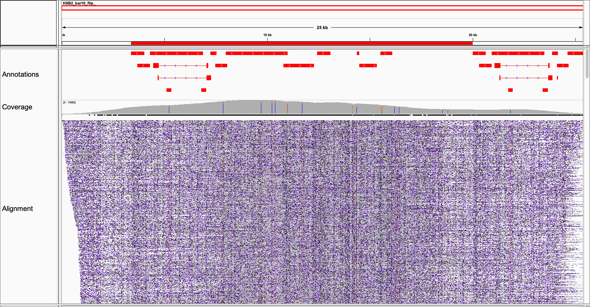{ loading=lazy }

<figcaption markdown="1">

**Supplemental Figure 4C: Mappability of long reads over contigs during assembly quality control.**

Coverage depends on context. Abrupt changes in coverage from terminal regions of HXB2 (**Figure 1F, Supplemental Figures 1 and 3)** were artifacts from supplying mappers with an HIV reference without a plasmid backbone. Long reads from barcode 10 (LA Taq) mapped with minimap2 (Li 2018) and “reference” contig from assembly (Canu v1.8) with basecalled data (FlipFlop). Stripes in this figure are not SNVs. They represent technical variability at homopolymers. Assemblies were manually curated to start with 5’ LTR in the sense orientation, leaving the plasmid backbone on the left. Because there were not real insertions in the HIV segment, the HIV coordinates are the same as HXB2 (both 9719 bp long). Compare with 52 bp technical artifact from the core’s short read assembly in **Supplemental Figure 4A, 4B**.

</figcaption>
</figure>

<figure markdown="1" id="supplemental-figure-5" class="book-figure">

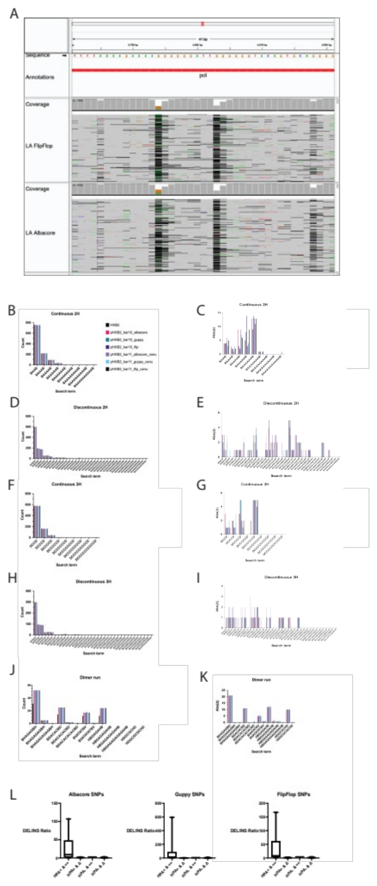{ loading=lazy }

<figcaption markdown="1">

**Supplemental Figure 5: Homopolymers and dimer runs are ONT artifacts in unpolished assemblies.**

**Supplemental Figure 5A: A set of homopolymer tracks from HXB2 plasmid.** Alignments with BWA-MEM shown from FlipFlop (top) and Albacore (bottom) basecalled reads. Mapping is pre-assembly.

**Supplemental Figure 5B: Continuous 2H counts in unpolished assemblies.** 2H = A or T homodimers.

</figcaption>
</figure>

##### Supplemental Figure 5C: Continuous 2H Absolute Difference.

###### Supplemental Figure 5D: Discontinuous 2H counts in unpolished assemblies.

<figure markdown="1" id="supplemental-figure-5e" class="book-figure">

<figcaption markdown="1">

**Supplemental Figure 5E: Discontinuous 2H Absolute Difference.**

**Supplemental Figure 5F: Continuous 3H counts in unpolished assemblies.** 3H = C or G homodimers.

</figcaption>
</figure>

###### Supplemental Figure 5G: Continuous 3H Absolute Difference.

###### Supplemental Figure 5H: Discontinuous 3H counts in unpolished assemblies.

###### Supplemental Figure 5I: Discontinuous 3H Absolute Difference.

<figure markdown="1" id="supplemental-figure-5j" class="book-figure">

<figcaption markdown="1">

**Supplemental Figure 5J: Dimer run counts in unpolished assemblies.**

**Supplemental Figure 5K: Dimer run Absolute Difference.** Dimer runs as pairs are the most problematic, with runs as triplets being resolvable by ONT.

**Supplemental Figure 5L: The ratio of deletions to insertions is higher at mismatches both adjacent to homopolymers and similar to neighbor bases.** Box plot shows median (“x” is mean) and quartile ranges. Y-axis is ratio. HPA: homopolymer-adjacent. ==: same as neighbor base. Δ: different than neighbor base. Higher coverage (above ~10) usually makes up for current error profile. Above true for Albacore, Guppy, and FlipFlop.

</figcaption>
</figure>

<figure markdown="1" id="supplemental-figure-6" class="book-figure">

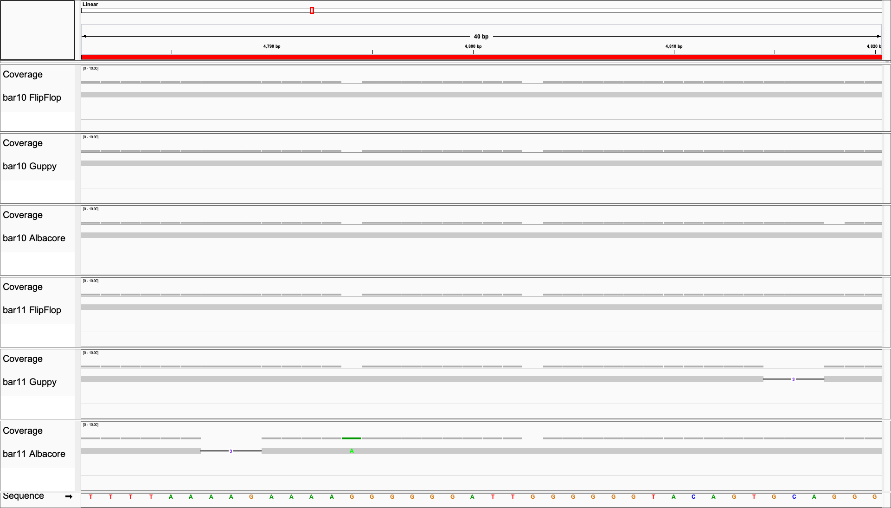{ loading=lazy }

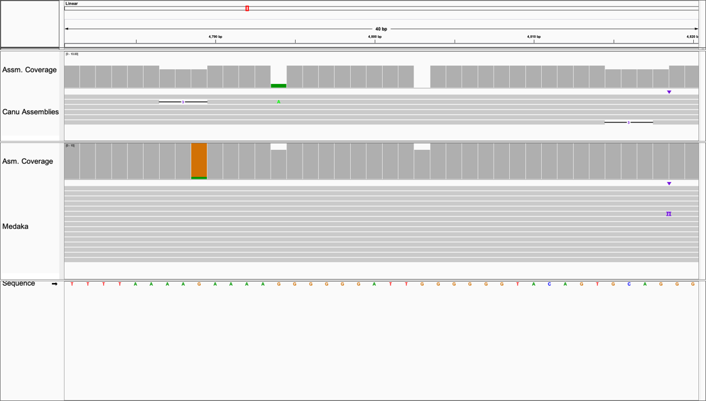{ loading=lazy }

<figcaption markdown="1">

**Supplemental Figure 6: Assembly partially resolved homopolymers, which are improved by polishing.**

Top: Six ONT-only assemblies. Bottom: polished ONT-only assemblies, varying Medaka models. Deletions at 5’ of G homopolymers were not corrected, regardless of basecaller or Taq isoform. Note that polishing was not performed. IGV window is Linear:4,781-4,820. Bottom: polishing canu assemblies with medaka abrogated most ONT artifacts. Best medaka setting tested: r941_min_high_g330.

</figcaption>
</figure>
