# Chapter 6: Advancing HIV informatics in the RNA space: HIV mRNA models

## Chapter abstract

Previously, in **Chapter 5** we used HIV Informatics to explore control samples of HIV DNA as plasmids. We found 20 variants in pHXB2_D, the only known physical copy of *the* HIV-1 reference genome HXB2. We were able to easily phase HXB2 and NL4-3 LTRs when sequencing reads were longer than these proviral repetitive elements.

**Chapter 6** explores HIV in the RNA space, and reports important advances made possible by revisiting HIV-1 with HIV-1 Informatics. This chapter includes a defined **HIV-1 mRNA atlas** based on reanalysis of the highest-quality NL4-3 dataset. NL4-3 is the most common lab strain of HIV-1 and is an important backbone for common lentiviral vectors. The 3’ half is historically related to HXB2 and/or LAV. This atlas is currently unpublished, however I have been working with collaborators at the Los Alamos National Laboratory’s HIV Sequence Database and the National Library of Medicine, National Center for Biotechnology Information, National Institutes of Health to integrate HIV-1 mRNA models into existing HIV-1 RefSeq record, as well as GenBank. We presented this work recently:

A. R. Gener, D. P. Hyink, P. E. Klotman, J. T. Kimata. 2021. “A-LB-IAS2021-02444 - HIV-1 segmentation-based transcript models define 5' Untranslated Region (UTR) and Open Reading Frame (ORF) Classes, elucidate total viral protein-coding capacity, and are summarized by a new HIV-1 mRNA naming convention.” P. ePoster in *24th International AIDS Conference (AIDS2021)*. July 17-20, 2021.

A. R. Gener, D. P. Hyink, P. E. Klotman, J. T. Kimata. “HIV-1 transcript models supported by long-read sequencing bridge viral and proviral genomic states.” London Calling 2021, London, UK. May 19-21, 2021.

We collaborated on evaluating closely related simian immunodeficiency viruses (SIVs) for similar new ORFs with the help of Dr. Brian T Foley.

## An HIV-1 NL4-3 mRNA Atlas

**Alejandro R. GENER1,2,3,4\*, Brian T. FOLEY5, Deborah P. HYINK2, Jason T. KIMATA6**

1Integrative Molecular and Biomedical Sciences Program, Graduate School of Biomedical Sciences, Baylor College of Medicine, Houston, Texas, USA

2Margaret M. and Albert B. Alkek Department of Medicine, Nephrology, Baylor College of Medicine, Houston, Texas, USA

3Department of Genetics, MD Anderson Cancer Center, Houston, Texas, USA

4School of Medicine, Universidad Central del Caribe, Bayamón, Puerto Rico, USA

5Theoretical Biology and Biophysics Group T-6, Los Alamos National Laboratory, Los Alamos, New Mexico, USA

6Department of Molecular Virology and Microbiology, Baylor College of Medicine, Houston, Texas, USA

\* Correspondence:  
Alejandro R. Gener

<gener@bcm.edu> ; <itspronouncedhenner@gmail.com>

Keywords: HIV-1, NL4-3, nanopore, transcript modeling, transcript profiling, SIV

### Abstract

As an obligate human pathogen, the human immunodeficiency virus type 1 (HIV-1) may be considered a model human genomic locus. Previous attempts at defining the transcriptional landscape of cells infected with HIV-1 prioritized collecting splice sites over identifying all relevant HIV-1 splice isoforms. Lack of HIV-1 transcript models hindered transcript profiling: the accurate measurement of HIV-1 mRNA abundance. Here we describe a tractable method to model HIV-1 NL4-3 isoforms from public high-quality long-read (cDNA-ONT) datasets. We discovered 15 new HIV-1 open reading frames (ORFs), encoding new putative HIV-1 proteins. New ORFs retained start/stop codons and relative synonymous codon usage compared to the 10 previously described HIV-1 NL4-3 ORFS and were conserved across all human HIV-1s and most gorilla and chimpanzee simian immunodeficiency (SIVs). Insights from high-quality long-read HIV-1 datasets informed the generalizability of our plug-and-play bespoke and general HIV-1 transcript models to enable transcript profiling. We propose new untranslated region (UTR) and ORF classes to describe the most seen HIV-1 transcripts to define the transcriptional landscape of HIV-1, and we introduce a new locus segmentation nomenclature anchored on most common splice donors/acceptors to eliminate prior intron/exon ambiguity and focus attention on newly discovered HIV-1 protein candidates.

### Introduction

The HIV-1 transcriptional landscape is poorly defined. The two main sources for information about the HIV-1 genome are the Los Alamos National Laboratory HIV Sequence Database and the National Center for Biotechnology Information. As of June 8th, 2021, these important repositories included sequence information from amplicons, occasionally near full-length assembled genomes, and occasionally gene model annotations in reference strains (Alejandro R Gener et al. 2021). Besides full-length unspliced HIV, isoform information is not recorded in LANL or NCBI. No resource exists to enable HIV isoform quantification from predominantly available short-read RNA-seq, or new longer read RNA-seqs.

A consequence of the lack of isoform information in these two main repositories is the propagation of assumptions about HIV-1 mRNAs. While some HIV researchers recognize that HIV mRNAs are polycistronic (they contain the open reading frame of more than one protein), HIV mRNAs are commonly believed to express only a single gene product (Hope and Trono 2000). Several points of evidence argue against the single gene product simplification. Eukaryotic mRNAs may be polycistronic (Blumenthal 1998). Eukaryotic viral mRNAs may be polycistronic (e.g. coronavirus (Liu et al. 1991), human papillomavirus (Remm, Remm, and Ustav 1999). Specific to HIV-1, HIV-1 is a eukaryotic virus with high ORF density. Previously, Schwartz et al. described mono- and multicistronic HIV-1 expression in in vitro transcription and transfection studies (Schwartz, Felber, and Pavlakis 1992). HIV-1 bicistronic transcription was extended for Vpu/Env (S Schwartz et al. 1990) (Guatelli, Gingeras, and Richman 1990) (Borg et al. 1999) (Krummheuer et al. 2007), and Tat and Rev/Nef (Schwartz et al. 1992). These studies were limited by low fidelity PCR reagents, and low throughput cloning which involved chance isolation of cDNA products and success of subsequent cloning. Today it remains common to ignore protein-coding capacity to focus on limited set of transcripts. HIV-1 transcript space was partially defined by using semiquantitative reverse transcription PCR (RT-PCT) (Purcell and Martin 1993). The resulting HIV-1 transcript classification methods focused on first open reading frame (ORF) (Purcell and Martin 1993).

Newer work continued to defined scope of HIV mRNAs (Ocwieja et al. 2012), (Nguyen Quang et al. 2020). However, these approaches, while sensitive, have served to limit the study of HIV by being too sensitive, indiscriminately picking up low-abundance isoforms. For example, the theoretical isoform space modeled by a given intron or exon’s expression may be modeled as 2^n = \# possible isoforms. From a piece of RNA with 1 splice donor and one splice acceptor, one can have 3 parts, or segments. In that case, one would have 2^3 = 8 possible isoforms. Constitutive isoforms may be discounted from the exponent. In the case of HIV-1 NL4-3 below, an early source claimed up to ~20 segments (Purcell and Martin 1993). If random, 2^20=1,048,576 exon combinations are possible. There were believed to be 3 constitutive exons. 20-3=17. 2^17=131,072 possible HV-1 NL4-3 isoforms. (One could forgive researchers at the time for not following up ono so many potential isoforms!) Besides the enumeration of biologically relevant HIV isoforms, the complicated splicing seen in HIV challenges common splicing nomenclature. Exon nomenclature is confusing in the case of complicated splicing seen in HIV. Sometimes an exon is coding, sometimes it is not. Sometimes an exon is spliced out. As such, and despite historical preferences for naming certain introns like the gag-pol intron or the tat/rev intron, such naming loses utility once revisiting the splicing that earlier investigators started to catalogue.

Lastly, smaller non-coding exons in HIV-1 were never explored for putative protein-coding capacity. Other retroviruses also have small “noncoding” exons (e.g., simian immunodeficiency virus SIVMAC (Colombini et al. 1989) (Viglianti, Sharma, and Mullins 1990) and visna virus (a sheep retrovirus) (Davis and Clements 1989) were known to exhibit smaller non-coding exons (Stefan Schwartz et al. 1990). Both SIVs and HIV have small allegedly non-coding exons. SIVs have been proposed to original source of prototype HIVs (Alluri 2018; Foley et al. 2016) As such, it remains unknown what splice variants mean for HIV-1 protein coding capacity and viral fitness. **We sought to explicitly define HIV-1 mRNAs by identifying the highest quality datasets and developing a tractable bioinformatics approach for transcript modeling.** Our goal was to develop a pipeline which may be used to develop more HIV mRNA models (transcript modeling), as well as used to estimate HIV mRNA abundance (transcript profiling).

### Methods

#### Transcript Modeling and Profiling

Data from Nguyen et al. 2020 was used to build HIV-1 transcript models. CD4+ T cells and/or PBMCs infected with VSVG-pseudotyped HIV-1 NL4-3 were sequenced with PCR-barcoded cDNA nanopore sequencing. Reads from CD4+ T cells were aligned with minimap2 -splice (Li 2018). As a quality control measure, variability was assessed visually in the Integrative Genomics Viewer (Robinson et al. 2011). Mapped reads lacked obvious single nucleotide variants. Mapped reads as BAM were fed into StringTie (Kovaka et al. 2019; Pertea et al. 2015), default settings + long reads and -f 0.0001. StringTie was repeated with -merge and -f 0.0001 and -i. MSTRG1, MSTRG3, MSTRG4 were artifacts. MSTRG.2 was a high-confidence real set as .gtf.

GffRead (Pertea and Pertea 2020) was used to convert pNL4-3 sequence GenBank:AF324493.2 into synthetic transcripts encoded in DNA space or “ACGT” for subsequent annotation. pNL4-3 was used instead of a *de novo* assembly because the input sequences were nearly identical to input virus, which is expected when using virion prepared from pseudotyped HIV plasmid mRNA (model *in vitro* HIV infection system). The starting point of each mRNA model was trimmed to 5’ R, and 3’ R was manually added due to likely technical drop off from mostly polyA reads. The final set of curated merged isoforms model the most frequent HIV-1 transcripts seen in CD4+ T cells and/or PBMCs infected by pseudotyped NL4-3. StringTie output before -merge includes transcript quantification. Merged models were used to perform transcript profiling by repeating StringTie with these new models.

ORFs were interrogated with multisequence alignments (MSAs) with SnapGene version 5.3.2 and MAFFT online server (Katoh, Rozewicki, and Yamada 2017) was used to generate MSAs with L-INS-i; neighbor-joining trees were made with Jukes Cantor selected (default settings). Trees were visualized with Dendroscope version 3.7.4.

#### Conservation

Relative synonymous codon usage (RSCU) was calculated on the CAIcal server: <http://genomes.urv.es/CAIcal/>. SnapGene includes a proprietary BLOSUM matrix implementation.

#### Protein prediction

3D protein predictions were done with trRosetta (Yang et al. 2020). The size limit of trRosetta is 1000 amino acids.

### Results

### UTR class definitions

We defined 40 isoforms. There were 39 complete isoforms, defined as having both R’ elements. One UTR classification (UTR17) system includes 17 distinct 5’ untranslated regions (UTR), designated UTR Class A-Q. UTRs are structural features of HIV-1 genomic mRNAs. UTR Classes are related, but distinct, from the open reading frames they contain, as evinced by most classes having at least two isoform members. This is because there may be additional splicing beyond the leading 5’ UTR. As such, ORF Classification was elaborated to capture this additional information. Figure key:

- Preserved gene model segments are maroon.

- New proteins are red.

- GC content displayed above sequence scale black above feature annotations.

Another UTR classification may be based on UTR extending into the segment with the first predicted ORF. This would collapse UTR B, C, and O, while preserving other UTR17 classes.

### UTR Class A 5UTR+ψSL1-4 (n=11)

5UTR+ψSL1-4

- MSTRG.2.4

- MSTRG.2.16

- MSTRG.2.32

- MSTRG.2.33

- MSTRG.2.38

- MSTRG.2.34

- MSTRG.2.37

- MSTRG.2.31

- MSTRG.2.35

- MSTRG.2.36

- MSTRG.2.40

Minimal 5’ UTR segment <u>underlined</u>:

&gt;Class_A_MSTRG.2.4_5UTR+ψSL1-4

<u>GGGUCUCUCUGGUUAGACCAGAUCUGAGCCUGGGAGCUCUCUGGCUAACUAGGGAACCCACUGCUUAAGCCUCAAUAAAGCUUGCCUUGAGUGCUCAAAGUAGUGUGUGCCCGUCUGUUGUGUGACUCUGGUAACUAGAGAUCCCUCAGACCCUUUUAGUCAGUGUGGAAAAUCUCUAGCAGUGGCGCCCGAACAGGGACUUGAAAGCGAAAGUAAAGCCAGAGGAGAUCUCUCGACGCAGGACUCGGCUUGCUGAAGCGCGCACGGCAAGAGGCGAGGGGCGGCGACUG</u>GUGAGUACGCCAAAAAUUUUGACUAGCGGAGGCUAGAAGGAGAGAGAUGGGUGCGAGAGCGUCGGUA

<figure markdown="1" id="figure-1" class="book-figure">

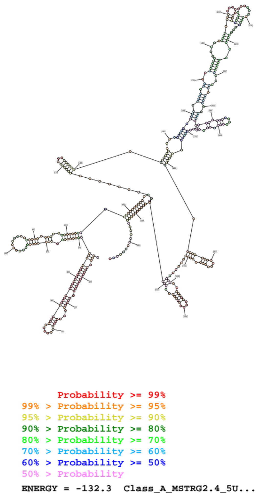{ loading=lazy }

<figcaption markdown="1">

**Figure 1: UTR (A) predicted UTR RNA 2º structure.**

</figcaption>
</figure>

<figure markdown="1" id="figure-2" class="book-figure">

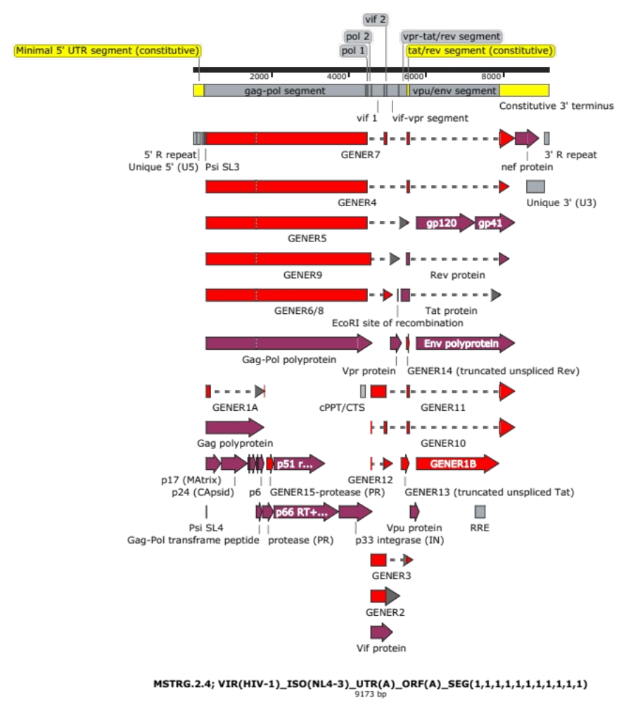{ loading=lazy }

<figcaption markdown="1">

**Figure 2: MSTRG.2.4 (unspliced HIV-1 NL4-3 with new ORFs).**

(Alejandro R. Gener et al. 2021)

Compare with **Table 1: HIV-1 NL4-3 transcript models, segment content, UTR and ORF classes, proposed naming convention**. New HIV-1 NL4-3 segments with HIV gene models, new ORFs encode new putative proteins. Yellow segments are constitutively expressed. They are always present in completed HIV-1 transcripts. Note that open reading frame (ORF) prediction in SnapGene (below black reference scale) fails to detect known spliced ORFs of tat and rev. Tat and rev are coded on top of each other in different reading frames. Note 3’ R is homogenized to 5’ position. This occurs after NL4-3 re-infects cells. Virus from primary NL4-3 culture will have a mixture of 5’ R.

Most ORFs with introns above are not expected to be expressed from full-length unspliced HIV-1 mRNA unless additionally spliced. For example, the protein product(s) expected from MSTRG.2.4 in absence of additional splicing are Gag and Gag-Pol (the original Gag-Pol).

IMPORTANT NOTE: GENER1A, GENER1B, and GENER15 were ultimately removed from the latest version of the HIV-1 NL4-3 mRNA Atlas. The current version of the Atlas (v1.1) does not include incomplete mRNA models or their predicted protein products.

</figcaption>
</figure>

<figure markdown="1" id="figure-3" class="book-figure">

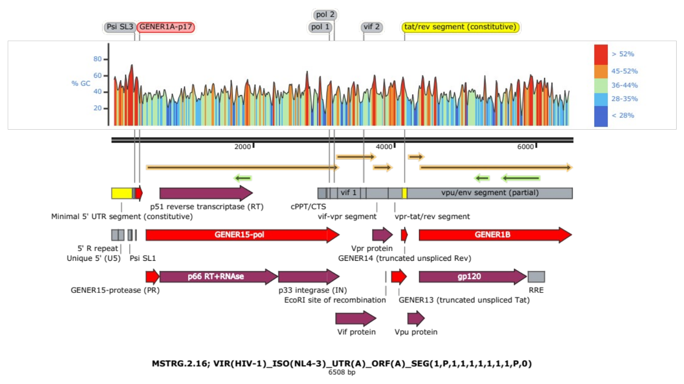{ loading=lazy }

<figcaption markdown="1">

**Figure 3: MSTRG.2.16 (GENER1A, GENER1B, GENER13, GENER14, GENER15).**

(Alejandro R. Gener et al. 2021)

HIV-1 NL4-3 new ORF GENER1A. Env is also truncated at the C-terminus (GENER1B). This construct is incomplete (lacks 5’ and 3’ R) and would not be able to integrate via integrase.

GENER1A encodes for a truncated p17. This protein would end prematurely on the c-terminus relative to the p17 from HIV protease (PR)-cleavage of gag polyprotein. It retains the rest of pol proteins (PR, RT, RT+RNAse, IN).

GENER1A has first 103 bases similar to p17-coding bases but note that subsequent additions might not be in-frame.

See MSTRG.2.5 for GENER13 and GENER14.

IMPORTANT NOTE: GENER1A, GENER1B, and GENER15 were ultimately removed from the latest version of the HIV-1 NL4-3 mRNA Atlas. The current version of the Atlas (v1.1) does not include incomplete mRNA models or their predicted protein products.

</figcaption>
</figure>

<figure markdown="1" id="figure-4" class="book-figure">

<figcaption markdown="1">

**Figure 4: GENER1A-p17 amino acid sequence.**

&gt;HIV-1_NL4-3_GENER1A-p17

MGARASVLSGGELDKWEKIRLRPGGKKQYKLKHIGGN\*

&gt;HIV-1_NL4-3_Gag_p17

MGARASVLSGGELDRWEKIRLRPGGKKKYKLKHIVWASRELERFAVNPGLLETSEGCRQILGQLQPSLQTGSEELRSLYNTVATLYCVHQRIEIKDTKEALDKIEEEQNKSKKKAQQAAADTGHSNQVSQNY

(Alejandro R. Gener et al. 2021)

FASTA naming convention below: virus_strain_orf-protein. Green amino acids are conserved. Fuchsia are new. +1 frame.

</figcaption>
</figure>

<figure markdown="1" id="figure-5" class="book-figure">

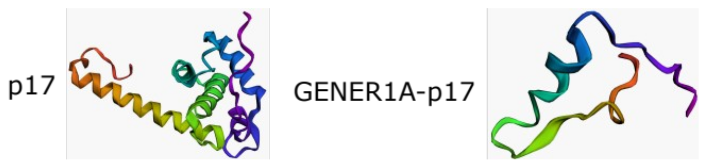{ loading=lazy }

<figcaption markdown="1">

**Figure 5: GENER1A-p17 predicted protein structure.**

(Alejandro R. Gener et al. 2021)

</figcaption>
</figure>

<figure markdown="1" id="figure-6" class="book-figure">

<figcaption markdown="1">

**Figure 6: GENER15-Protease amino acid sequence.**

&gt;HIV-1_NL4-3_GENER15-Protease

MNLPGRWKPKMIGGIGGFIKVRQYDQILIEICGHKAIGTVLVGPTPVNIIGRNLLTQIGCTLNF

&gt;HIV-1_NL4-3_Gag-Pol-Protease

PQITLWQRPLVTIKIGGQLKEALLDTGADDTVLEEMNLPGRWKPKMIGGIGGFIKVRQYDQILIEICGHKAIGTVLVGPTPVNIIGRNLLTQIGCTLNF

(Alejandro R. Gener et al. 2021)

FASTA naming convention below: virus_strain_orf-protein. Yellow amino acids are conserved. +1 frame.

</figcaption>
</figure>

<figure markdown="1" id="figure-7" class="book-figure">

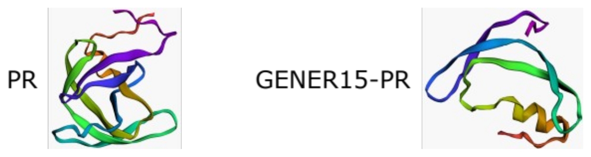{ loading=lazy }

<figcaption markdown="1">

**Figure 7: GENER15-Protease a predicted protein structure.**

(Alejandro R. Gener et al. 2021)

</figcaption>
</figure>

<figure markdown="1" id="figure-8" class="book-figure">

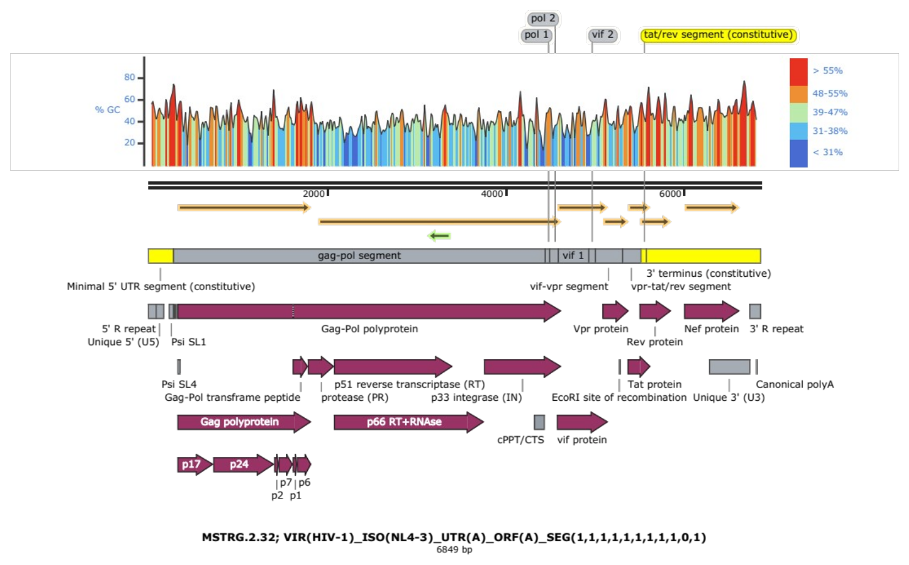{ loading=lazy }

<figcaption markdown="1">

**Figure 8: MSTRG.2.32.**

(Alejandro R. Gener et al. 2021)

</figcaption>
</figure>

<figure markdown="1" id="figure-9" class="book-figure">

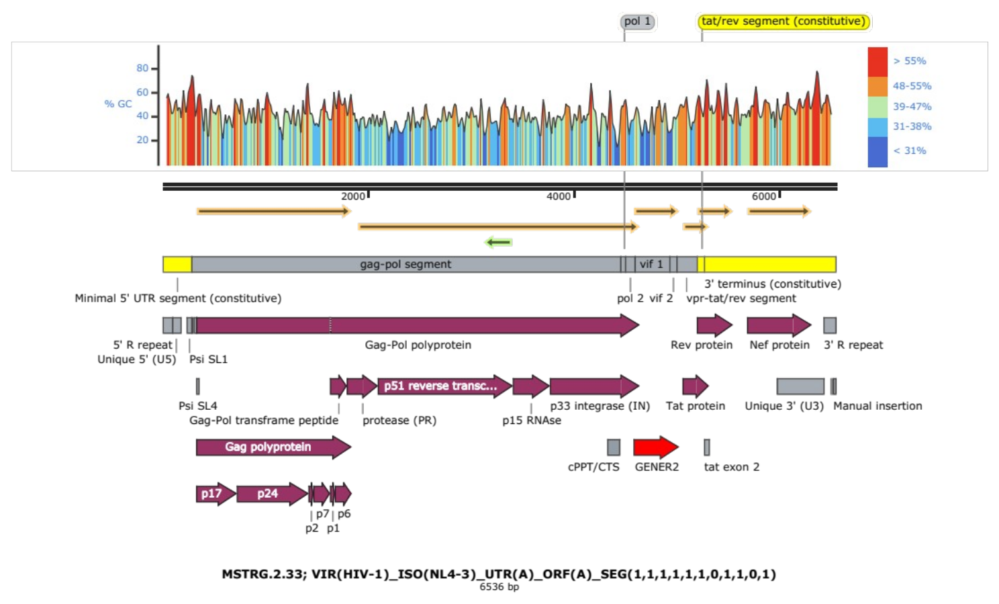{ loading=lazy }

<figcaption markdown="1">

**Figure 9: MSTRG.2.33 (GENER2).**

(Alejandro R. Gener et al. 2021)

</figcaption>
</figure>

<figure markdown="1" id="figure-10" class="book-figure">

<figcaption markdown="1">

**Figure 10: GENER2 amino acid sequence.**

&gt;HIV-1_NL4-3_GENER2

MENRWQVMIVWQVDRMRINTWKRLVKHHMYISRKAKDWFYRHHYESTNPKISSEVHIPLGDAKLVITTYWGLHTGERDWHLGQGVSIEWRKKRYSTQVDPDLADQLIHLHYFDCFSESAIRNTILGRIVSPRCEYQAGHNKNWVST\*

&gt;HIV-1_NL4-3_Vif

MENRWQVMIVWQVDRMRINTWKRLVKHHMYISRKAKDWFYRHHYESTNPKISSEVHIPLGDAKLVITTYWGLHTGERDWHLGQGVSIEWRKKRYSTQVDPDLADQLIHLHYFDCFSESAIRNTILGRIVSPRCEYQAGHNKVGSLQYLALAALIKPKQIKPPLPSVRKLTEDRWNKPQKTKGHRGSHTMNGH\*

(Alejandro R. Gener et al. 2021)

FASTA naming convention below: virus_strain_orf-protein. Green amino acids are conserved. Fuchsia are new. +1 frame. GENER2 is a truncated vif with a novel c-terminus.

</figcaption>
</figure>

<figure markdown="1" id="figure-11" class="book-figure">

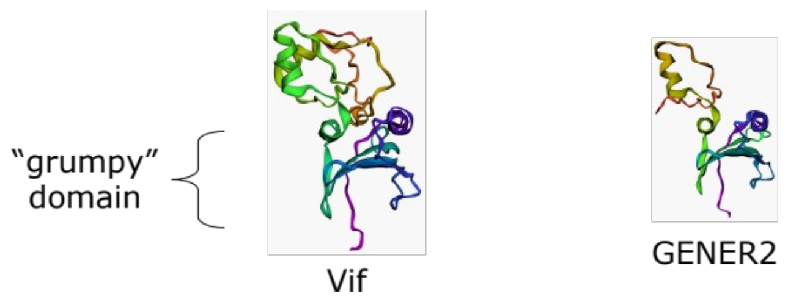{ loading=lazy }

<figcaption markdown="1">

**Figure 11: GENER2 predicted protein structure.**

(Alejandro R. Gener et al. 2021)

</figcaption>
</figure>

<figure markdown="1" id="figure-12" class="book-figure">

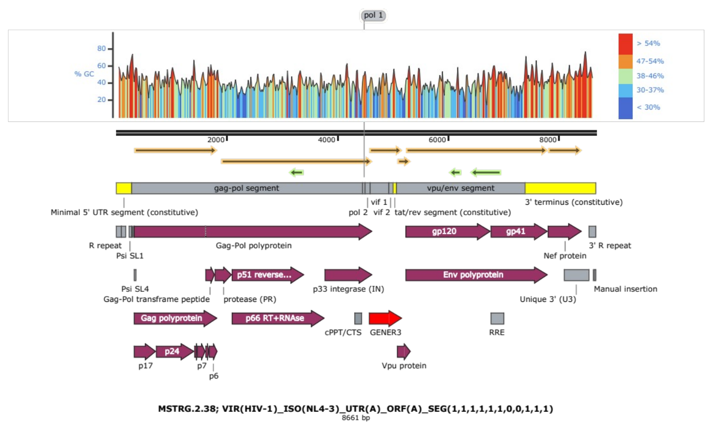{ loading=lazy }

<figcaption markdown="1">

**Figure 12: MSTRG.2.38 (GENER3).**

(Alejandro R. Gener et al. 2021)

GENER3 is a vif fusion to a new c-terminus.

</figcaption>
</figure>

<figure markdown="1" id="figure-13" class="book-figure">

<figcaption markdown="1">

**Figure 13: GENER3 amino acid sequence.**

&gt;HIV-1_NL4-3_GENER3

MENRWQVMIVWQVDRMRINTWKRLVKHHMYISRKAKDWFYRHHYESTNPKISSEVHIPLGDAKLVITTYWGLHTGERDWHLGQGVSIEWRKKRYSTQVDPDLADQLIHLHYFDCFSESAIRNTILGRIVSPRCEYQAGHNKEEAETATKSSSEQSDSSSFSIKAVSSTCNATYNSSNSSISSSNNNSNSCVVHSNHRI\*

&gt;HIV-1_NL4-3_Vif

MENRWQVMIVWQVDRMRINTWKRLVKHHMYISRKAKDWFYRHHYESTNPKISSEVHIPLGDAKLVITTYWGLHTGERDWHLGQGVSIEWRKKRYSTQVDPDLADQLIHLHYFDCFSESAIRNTILGRIVSPRCEYQAGHNKVGSLQYLALAALIKPKQIKPPLPSVRKLTEDRWNKPQKTKGHRGSHTMNGH\*

&gt;HIV-1_NL4-3_Tat

MEPVDPRLEPWKHPGSQPKTACTNCYCKKCCFHCQVCFMTKALGISYGRKKRRQRRRAHQNSQTHQASLSKQPTSQSRGDPTGPKE\*

(Alejandro R. Gener et al. 2021)

FASTA naming convention below: virus_strain_orf-protein. Green amino acids are conserved. Fuchsia are new. +1 frame.

</figcaption>
</figure>

<figure markdown="1" id="figure-14" class="book-figure">

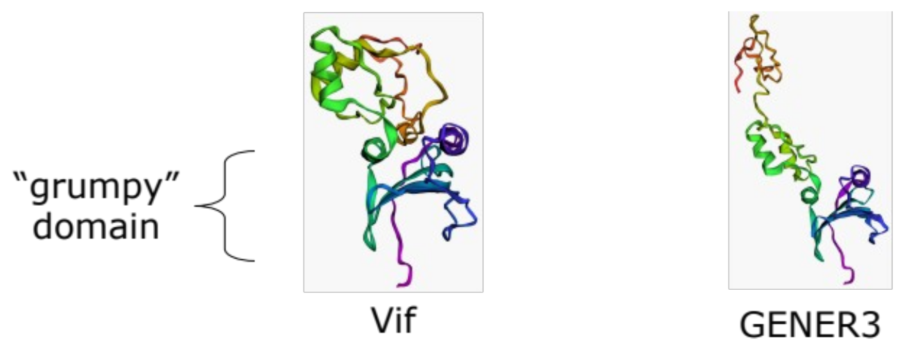{ loading=lazy }

<figcaption markdown="1">

**Figure 14: GENER3 predicted protein structure.**

(Alejandro R. Gener et al. 2021)

</figcaption>
</figure>

<figure markdown="1" id="figure-15" class="book-figure">

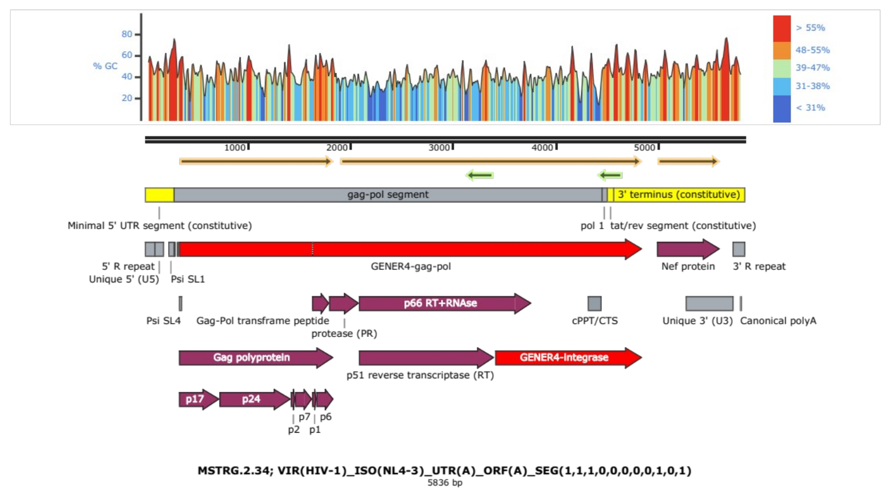{ loading=lazy }

<figcaption markdown="1">

**Figure 15: MSTRG.2.34 (GENER4) IN-rev-long.**

(Alejandro R. Gener et al. 2021)

GENER4 is a *gag-pol-rev* fusion. IN interrupted at @209|210, fused with most of *rev*.

</figcaption>
</figure>

<figure markdown="1" id="figure-16" class="book-figure">

<figcaption markdown="1">

**Figure 16: GENER4 amino acid sequence.**

&gt;HIV-1_NL4-3_GENER4-Gag-Pol

<u>MGARASVLSGGELDKWEKIRLRPGGKKQYKLKHIVWASRELERFAVNPGLLETSEGCRQILGQLQPSLQTGSEELRSLYNTIAVLYCVHQRIDVKDTKEALDKIEEEQNKSKKKAQQAAADTGNNSQVSQNYPIVQNLQGQMVHQAISPRTLNAWVKVVEEKAFSPEVIPMFSALSEGATPQDLNTMLNTVGGHQAAMQMLKETINEEAAEWDRLHPVHAGPIAPGQMREPRGSDIAGTTSTLQEQIGWMTHNPPIPVGEIYKRWIILGLNKIVRMYSPTSILDIRQGPKEPFRDYVDRFYKTLRAEQASQEVKNWMTETLLVQNANPDCKTILKALGPGATLEEMMTACQGVGGPGHKARVLAEAMSQVTNPATIMIQKGNFRNQRKTVKCFNCGKEGHIAKNCRAPRKKGCWKCGKEGHQMKDCTERQAN</u>FFREDLAFPQGKAREFSSEQTRANSPTRRELQVWGRDNNSLSEAGADRQGTVSFSFPQITLWQRPLVTIKIGGQLKEALLDTGADDTVLEEMNLPGRWKPKMIGGIGGFIKVRQYDQILIEICGHKAIGTVLVGPTPVNIIGRNLLTQIGCTLNFPISPIETVPVKLKPGMDGPKVKQWPLTEEKIKALVEICTEMEKEGKISKIGPENPYNTPVFAIKKKDSTKWRKLVDFRELNKRTQDFWEVQLGIPHPAGLKQKKSVTVLDVGDAYFSVPLDKDFRKYTAFTIPSINNETPGIRYQYNVLPQGWKGSPAIFQCSMTKILEPFRKQNPDIVIYQYMDDLYVGSDLEIGQHRTKIEELRQHLLRWGFTTPDKKHQKEPPFLWMGYELHPDKWTVQPIVLPEKDSWTVNDIQKLVGKLNWASQIYAGIKVRQLCKLLRGTKALTEVVPLTEEAELELAENREILKEPVHGVYYDPSKDLIAEIQKQGQGQWTYQIYQEPFKNLKTGKYARMKGAHTNDVKQLTEAVQKIATESIVIWGKTPKFKLPIQKETWEAWWTEYWQATWIPEWEFVNTPPLVKLWYQLEKEPIIGAETFYVDGAANRETKLGKAGYVTDRGRQKVVPLTDTTNQKTELQAIHLALQDSGLEVNIVTDSQYALGIIQAQPDKSESELVSQIIEQLIKKEKVYLAWVPAHKGIGGNEQVDKLVSAGIRKVL**FLDGIDKAQEEHEKYHSNWRAMASDFNLPPVVAKEIVASCDKCQLKGEAMHGQVDCSPGIWQLDCTHLEGKVILVAVHVASGYIEAEVIPAETGQETAYFLLKLAGRWPVKTVHTDNGSNFTSTTVKAACWWAGIKQEFGIPYNPQSQGVIESMNKELKKIIGQVRDQAEHLKTAVQMAVFIHNFKRKGGIGGYSAGERIVDIIATDIQTKELQKQITKIQNFRVYYRDSRDPVWKGPAKLLWKGRSGDSDEELIRTVRLIKLLYQSNPPPNPEGTRQARRNRRRRWRERQRQIHSISERILSTYLGRSAEPVPLQLPPLERLTLDCNEDCGTSGTQGVGSPQILVESPTVLESGTKE****\***

&gt;HIV-1_NL4-3_Gag-Pol

<u>MGARASVLSGGELDKWEKIRLRPGGKKQYKLKHIVWASRELERFAVNPGLLETSEGCRQILGQLQPSLQTGSEELRSLYNTIAVLYCVHQRIDVKDTKEALDKIEEEQNKSKKKAQQAAADTGNNSQVSQNYPIVQNLQGQMVHQAISPRTLNAWVKVVEEKAFSPEVIPMFSALSEGATPQDLNTMLNTVGGHQAAMQMLKETINEEAAEWDRLHPVHAGPIAPGQMREPRGSDIAGTTSTLQEQIGWMTHNPPIPVGEIYKRWIILGLNKIVRMYSPTSILDIRQGPKEPFRDYVDRFYKTLRAEQASQEVKNWMTETLLVQNANPDCKTILKALGPGATLEEMMTACQGVGGPGHKARVLAEAMSQVTNPATIMIQKGNFRNQRKTVKCFNCGKEGHIAKNCRAPRKKGCWKCGKEGHQMKDCTERQAN</u>FFREDLAFPQGKAREFSSEQTRANSPTRRELQVWGRDNNSLSEAGADRQGTVSFSFPQITLWQRPLVTIKIGGQLKEALLDTGADDTVLEEMNLPGRWKPKMIGGIGGFIKVRQYDQILIEICGHKAIGTVLVGPTPVNIIGRNLLTQIGCTLNFPISPIETVPVKLKPGMDGPKVKQWPLTEEKIKALVEICTEMEKEGKISKIGPENPYNTPVFAIKKKDSTKWRKLVDFRELNKRTQDFWEVQLGIPHPAGLKQKKSVTVLDVGDAYFSVPLDKDFRKYTAFTIPSINNETPGIRYQYNVLPQGWKGSPAIFQCSMTKILEPFRKQNPDIVIYQYMDDLYVGSDLEIGQHRTKIEELRQHLLRWGFTTPDKKHQKEPPFLWMGYELHPDKWTVQPIVLPEKDSWTVNDIQKLVGKLNWASQIYAGIKVRQLCKLLRGTKALTEVVPLTEEAELELAENREILKEPVHGVYYDPSKDLIAEIQKQGQGQWTYQIYQEPFKNLKTGKYARMKGAHTNDVKQLTEAVQKIATESIVIWGKTPKFKLPIQKETWEAWWTEYWQATWIPEWEFVNTPPLVKLWYQLEKEPIIGAETFYVDGAANRETKLGKAGYVTDRGRQKVVPLTDTTNQKTELQAIHLALQDSGLEVNIVTDSQYALGIIQAQPDKSESELVSQIIEQLIKKEKVYLAWVPAHKGIGGNEQVDKLVSAGIRKVLFLDGIDKAQEEHEKYHSNWRAMASDFNLPPVVAKEIVASCDKCQLKGEAMHGQVDCSPGIWQLDCTHLEGKVILVAVHVASGYIEAEVIPAETGQETAYFLLKLAGRWPVKTVHTDNGSNFTSTTVKAACWWAGIKQEFGIPYNPQSQGVIESMNKELKKIIGQVRDQAEHLKTAVQMAVFIHNFKRKGGIGGYSAGERIVDIIATDIQTKELQKQITKIQNFRVYYRDSRDPVWKGPAKLLWKGEGAVVIQDNSDIKVVPRRKAKIIRDYGKQMAGDDCVASRQDED\*

&gt;HIV-1_NL4-3_Rev

MAGRSGDSDEELIRTVRLIKLLYQSNPPPNPEGTRQARRNRRRRWRERQRQIHSISERILSTYLGRSAEPVPLQLPPLERLTLDCNEDCGTSGTQGVGSPQILVESPTVLESGTKE\*

(Alejandro R. Gener et al. 2021)

FASTA naming convention below: virus_strain_orf-protein. Green and Yellow amino acids are conserved. Fuchsia are new. +1 frame. Conserved region in Gag *underlined*. GENER4-integrase in **bold**.

</figcaption>
</figure>

<figure markdown="1" id="figure-17" class="book-figure">

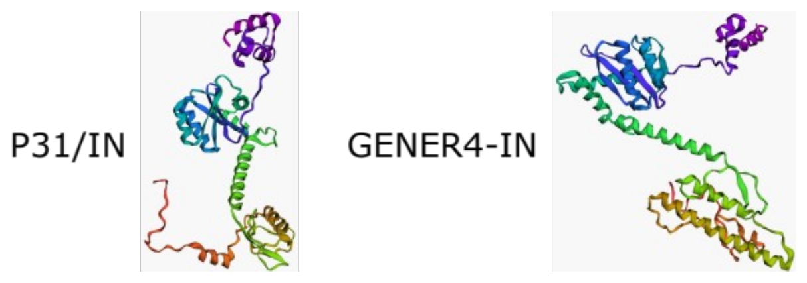{ loading=lazy }

<figcaption markdown="1">

**Figure 17: GENER4-integrase predicted protein structure.**

(Alejandro R. Gener et al. 2021)

</figcaption>
</figure>

<figure markdown="1" id="figure-18" class="book-figure">

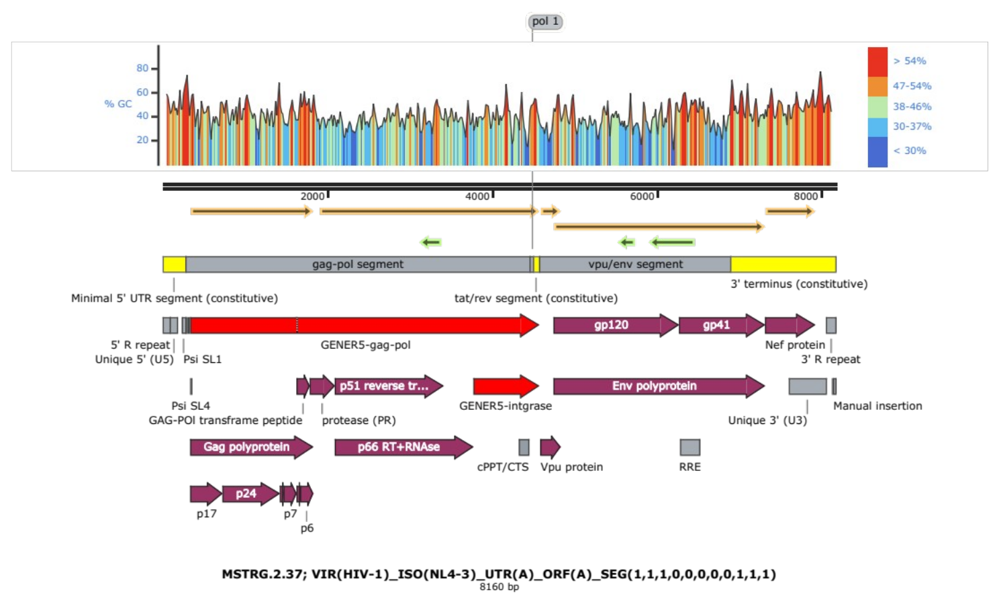{ loading=lazy }

<figcaption markdown="1">

**Figure 18: MSTRG.2.37 (GENER5) IN-rev-short.**

(Alejandro R. Gener et al. 2021)

GENER5 is a gag-pol-tat/rev fusion like GENER4 in this document. IN interrupted at @209|210, fused with an in-frame segment of rev, and small novel C-terminus.

</figcaption>
</figure>

<figure markdown="1" id="figure-19" class="book-figure">

<figcaption markdown="1">

**Figure 19: GENER5-Gag-Pol amino acid sequence.**

**GENER5 amino acid sequence.**

&gt;HIV-1_NL4-3_GENER5-Gag-Pol

<u>MGARASVLSGGELDKWEKIRLRPGGKKQYKLKHIVWASRELERFAVNPGLLETSEGCRQILGQLQPSLQTGSEELRSLYNTIAVLYCVHQRIDVKDTKEALDKIEEEQNKSKKKAQQAAADTGNNSQVSQNYPIVQNLQGQMVHQAISPRTLNAWVKVVEEKAFSPEVIPMFSALSEGATPQDLNTMLNTVGGHQAAMQMLKETINEEAAEWDRLHPVHAGPIAPGQMREPRGSDIAGTTSTLQEQIGWMTHNPPIPVGEIYKRWIILGLNKIVRMYSPTSILDIRQGPKEPFRDYVDRFYKTLRAEQASQEVKNWMTETLLVQNANPDCKTILKALGPGATLEEMMTACQGVGGPGHKARVLAEAMSQVTNPATIMIQKGNFRNQRKTVKCFNCGKEGHIAKNCRAPRKKGCWKCGKEGHQMKDCTERQAN</u>FFREDLAFPQGKAREFSSEQTRANSPTRRELQVWGRDNNSLSEAGADRQGTVSFSFPQITLWQRPLVTIKIGGQLKEALLDTGADDTVLEEMNLPGRWKPKMIGGIGGFIKVRQYDQILIEICGHKAIGTVLVGPTPVNIIGRNLLTQIGCTLNFPISPIETVPVKLKPGMDGPKVKQWPLTEEKIKALVEICTEMEKEGKISKIGPENPYNTPVFAIKKKDSTKWRKLVDFRELNKRTQDFWEVQLGIPHPAGLKQKKSVTVLDVGDAYFSVPLDKDFRKYTAFTIPSINNETPGIRYQYNVLPQGWKGSPAIFQCSMTKILEPFRKQNPDIVIYQYMDDLYVGSDLEIGQHRTKIEELRQHLLRWGFTTPDKKHQKEPPFLWMGYELHPDKWTVQPIVLPEKDSWTVNDIQKLVGKLNWASQIYAGIKVRQLCKLLRGTKALTEVVPLTEEAELELAENREILKEPVHGVYYDPSKDLIAEIQKQGQGQWTYQIYQEPFKNLKTGKYARMKGAHTNDVKQLTEAVQKIATESIVIWGKTPKFKLPIQKETWEAWWTEYWQATWIPEWEFVNTPPLVKLWYQLEKEPIIGAETFYVDGAANRETKLGKAGYVTDRGRQKVVPLTDTTNQKTELQAIHLALQDSGLEVNIVTDSQYALGIIQAQPDKSESELVSQIIEQLIKKEKVYLAWVPAHKGIGGNEQVDKLVSAGIRKVL**FLDGIDKAQEEHEKYHSNWRAMASDFNLPPVVAKEIVASCDKCQLKGEAMHGQVDCSPGIWQLDCTHLEGKVILVAVHVASGYIEAEVIPAETGQETAYFLLKLAGRWPVKTVHTDNGSNFTSTTVKAACWWAGIKQEFGIPYNPQSQGVIESMNKELKKIIGQVRDQAEHLKTAVQMAVFIHNFKRKGGIGGYSAGERIVDIIATDIQTKELQKQITKIQNFRVYYRDSRDPVWKGPAKLLWKGRSGDSDEELIRTVRLIKLLYQSSK**\*

&gt;HIV-1_NL4-3_Gag-Pol

<u>MGARASVLSGGELDKWEKIRLRPGGKKQYKLKHIVWASRELERFAVNPGLLETSEGCRQILGQLQPSLQTGSEELRSLYNTIAVLYCVHQRIDVKDTKEALDKIEEEQNKSKKKAQQAAADTGNNSQVSQNYPIVQNLQGQMVHQAISPRTLNAWVKVVEEKAFSPEVIPMFSALSEGATPQDLNTMLNTVGGHQAAMQMLKETINEEAAEWDRLHPVHAGPIAPGQMREPRGSDIAGTTSTLQEQIGWMTHNPPIPVGEIYKRWIILGLNKIVRMYSPTSILDIRQGPKEPFRDYVDRFYKTLRAEQASQEVKNWMTETLLVQNANPDCKTILKALGPGATLEEMMTACQGVGGPGHKARVLAEAMSQVTNPATIMIQKGNFRNQRKTVKCFNCGKEGHIAKNCRAPRKKGCWKCGKEGHQMKDCTERQAN</u>FFREDLAFPQGKAREFSSEQTRANSPTRRELQVWGRDNNSLSEAGADRQGTVSFSFPQITLWQRPLVTIKIGGQLKEALLDTGADDTVLEEMNLPGRWKPKMIGGIGGFIKVRQYDQILIEICGHKAIGTVLVGPTPVNIIGRNLLTQIGCTLNFPISPIETVPVKLKPGMDGPKVKQWPLTEEKIKALVEICTEMEKEGKISKIGPENPYNTPVFAIKKKDSTKWRKLVDFRELNKRTQDFWEVQLGIPHPAGLKQKKSVTVLDVGDAYFSVPLDKDFRKYTAFTIPSINNETPGIRYQYNVLPQGWKGSPAIFQCSMTKILEPFRKQNPDIVIYQYMDDLYVGSDLEIGQHRTKIEELRQHLLRWGFTTPDKKHQKEPPFLWMGYELHPDKWTVQPIVLPEKDSWTVNDIQKLVGKLNWASQIYAGIKVRQLCKLLRGTKALTEVVPLTEEAELELAENREILKEPVHGVYYDPSKDLIAEIQKQGQGQWTYQIYQEPFKNLKTGKYARMKGAHTNDVKQLTEAVQKIATESIVIWGKTPKFKLPIQKETWEAWWTEYWQATWIPEWEFVNTPPLVKLWYQLEKEPIIGAETFYVDGAANRETKLGKAGYVTDRGRQKVVPLTDTTNQKTELQAIHLALQDSGLEVNIVTDSQYALGIIQAQPDKSESELVSQIIEQLIKKEKVYLAWVPAHKGIGGNEQVDKLVSAGIRKVLFLDGIDKAQEEHEKYHSNWRAMASDFNLPPVVAKEIVASCDKCQLKGEAMHGQVDCSPGIWQLDCTHLEGKVILVAVHVASGYIEAEVIPAETGQETAYFLLKLAGRWPVKTVHTDNGSNFTSTTVKAACWWAGIKQEFGIPYNPQSQGVIESMNKELKKIIGQVRDQAEHLKTAVQMAVFIHNFKRKGGIGGYSAGERIVDIIATDIQTKELQKQITKIQNFRVYYRDSRDPVWKGPAKLLWKGEGAVVIQDNSDIKVVPRRKAKIIRDYGKQMAGDDCVASRQDED\*

&gt;HIV-1_NL4-3_Rev

MAGRSGDSDEELIRTVRLIKLLYQSNPPPNPEGTRQARRNRRRRWRERQRQIHSISERILSTYLGRSAEPVPLQLPPLERLTLDCNEDCGTSGTQGVGSPQILVESPTVLESGTKE\*

(Alejandro R. Gener et al. 2021)

FASTA naming convention below: virus_strain_orf-protein. Green and Yellow amino acids are conserved. Fuchsia are new. +1 frame. Conserved region in Gag *underlined*. GENER5-integrase in **bold**.

</figcaption>
</figure>

<figure markdown="1" id="figure-20" class="book-figure">

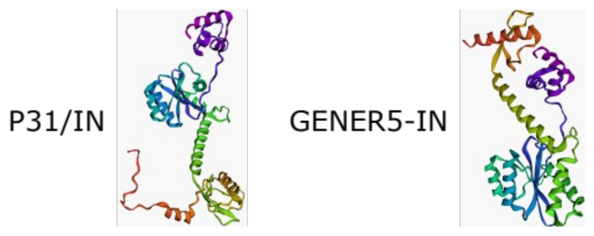{ loading=lazy }

<figcaption markdown="1">

**Figure 20: GENER5-integrase predicted protein structure.**

(Alejandro R. Gener et al. 2021)

</figcaption>
</figure>

<figure markdown="1" id="figure-21" class="book-figure">

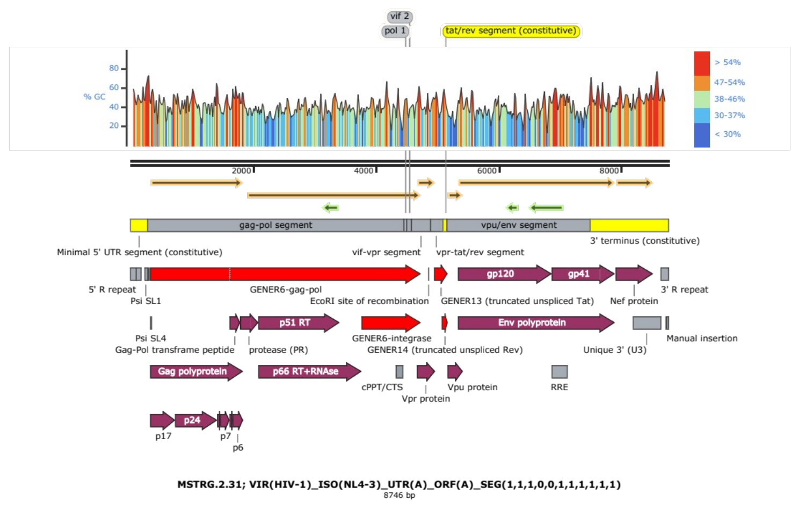{ loading=lazy }

<figcaption markdown="1">

**Figure 21: MSTRG.2.31 (GENER6: IN-vif; GENER13, GENER14).**

(Alejandro R. Gener et al. 2021)

GENER6 is a truncated gag-pol. IN interrupted at @209|210, fused with most of Vif. Same ORF as GENER8.

</figcaption>
</figure>

<figure markdown="1" id="figure-22" class="book-figure">

<figcaption markdown="1">

**Figure 22: GENER6-Gag-Pol amino acid sequence.**

**GENER6 amino acid sequence.**

&gt;HIV-1_NL4-3_GENER6

<u>MGARASVLSGGELDKWEKIRLRPGGKKQYKLKHIVWASRELERFAVNPGLLETSEGCRQILGQLQPSLQTGSEELRSLYNTIAVLYCVHQRIDVKDTKEALDKIEEEQNKSKKKAQQAAADTGNNSQVSQNYPIVQNLQGQMVHQAISPRTLNAWVKVVEEKAFSPEVIPMFSALSEGATPQDLNTMLNTVGGHQAAMQMLKETINEEAAEWDRLHPVHAGPIAPGQMREPRGSDIAGTTSTLQEQIGWMTHNPPIPVGEIYKRWIILGLNKIVRMYSPTSILDIRQGPKEPFRDYVDRFYKTLRAEQASQEVKNWMTETLLVQNANPDCKTILKALGPGATLEEMMTACQGVGGPGHKARVLAEAMSQVTNPATIMIQKGNFRNQRKTVKCFNCGKEGHIAKNCRAPRKKGCWKCGKEGHQMKDCTERQAN</u>FFREDLAFPQGKAREFSSEQTRANSPTRRELQVWGRDNNSLSEAGADRQGTVSFSFPQITLWQRPLVTIKIGGQLKEALLDTGADDTVLEEMNLPGRWKPKMIGGIGGFIKVRQYDQILIEICGHKAIGTVLVGPTPVNIIGRNLLTQIGCTLNFPISPIETVPVKLKPGMDGPKVKQWPLTEEKIKALVEICTEMEKEGKISKIGPENPYNTPVFAIKKKDSTKWRKLVDFRELNKRTQDFWEVQLGIPHPAGLKQKKSVTVLDVGDAYFSVPLDKDFRKYTAFTIPSINNETPGIRYQYNVLPQGWKGSPAIFQCSMTKILEPFRKQNPDIVIYQYMDDLYVGSDLEIGQHRTKIEELRQHLLRWGFTTPDKKHQKEPPFLWMGYELHPDKWTVQPIVLPEKDSWTVNDIQKLVGKLNWASQIYAGIKVRQLCKLLRGTKALTEVVPLTEEAELELAENREILKEPVHGVYYDPSKDLIAEIQKQGQGQWTYQIYQEPFKNLKTGKYARMKGAHTNDVKQLTEAVQKIATESIVIWGKTPKFKLPIQKETWEAWWTEYWQATWIPEWEFVNTPPLVKLWYQLEKEPIIGAETFYVDGAANRETKLGKAGYVTDRGRQKVVPLTDTTNQKTELQAIHLALQDSGLEVNIVTDSQYALGIIQAQPDKSESELVSQIIEQLIKKEKVYLAWVPAHKGIGGNEQVDKLVSAGIRKVL**FLDGIDKAQEEHEKYHSNWRAMASDFNLPPVVAKEIVASCDKCQLKGEAMHGQVDCSPGIWQLDCTHLEGKVILVAVHVASGYIEAEVIPAETGQETAYFLLKLAGRWPVKTVHTDNGSNFTSTTVKAACWWAGIKQEFGIPYNPQSQGVIESMNKELKKIIGQVRDQAEHLKTAVQMAVFIHNFKRKGGIGGYSAGERIVDIIATDIQTKELQKQITKIQNFRVYYRDSRDPVWKGPAKLLWKESAIRNTILGRIVSPRCEYQAGHNKVGSLQYLALAALIKPKQIKPPLPSVRKLTEDRWNKPQKTKGHRGSHTMNGH**\*

&gt;HIV-1_NL4-3_Gag-Pol

<u>MGARASVLSGGELDKWEKIRLRPGGKKQYKLKHIVWASRELERFAVNPGLLETSEGCRQILGQLQPSLQTGSEELRSLYNTIAVLYCVHQRIDVKDTKEALDKIEEEQNKSKKKAQQAAADTGNNSQVSQNYPIVQNLQGQMVHQAISPRTLNAWVKVVEEKAFSPEVIPMFSALSEGATPQDLNTMLNTVGGHQAAMQMLKETINEEAAEWDRLHPVHAGPIAPGQMREPRGSDIAGTTSTLQEQIGWMTHNPPIPVGEIYKRWIILGLNKIVRMYSPTSILDIRQGPKEPFRDYVDRFYKTLRAEQASQEVKNWMTETLLVQNANPDCKTILKALGPGATLEEMMTACQGVGGPGHKARVLAEAMSQVTNPATIMIQKGNFRNQRKTVKCFNCGKEGHIAKNCRAPRKKGCWKCGKEGHQMKDCTERQAN</u>FFREDLAFPQGKAREFSSEQTRANSPTRRELQVWGRDNNSLSEAGADRQGTVSFSFPQITLWQRPLVTIKIGGQLKEALLDTGADDTVLEEMNLPGRWKPKMIGGIGGFIKVRQYDQILIEICGHKAIGTVLVGPTPVNIIGRNLLTQIGCTLNFPISPIETVPVKLKPGMDGPKVKQWPLTEEKIKALVEICTEMEKEGKISKIGPENPYNTPVFAIKKKDSTKWRKLVDFRELNKRTQDFWEVQLGIPHPAGLKQKKSVTVLDVGDAYFSVPLDKDFRKYTAFTIPSINNETPGIRYQYNVLPQGWKGSPAIFQCSMTKILEPFRKQNPDIVIYQYMDDLYVGSDLEIGQHRTKIEELRQHLLRWGFTTPDKKHQKEPPFLWMGYELHPDKWTVQPIVLPEKDSWTVNDIQKLVGKLNWASQIYAGIKVRQLCKLLRGTKALTEVVPLTEEAELELAENREILKEPVHGVYYDPSKDLIAEIQKQGQGQWTYQIYQEPFKNLKTGKYARMKGAHTNDVKQLTEAVQKIATESIVIWGKTPKFKLPIQKETWEAWWTEYWQATWIPEWEFVNTPPLVKLWYQLEKEPIIGAETFYVDGAANRETKLGKAGYVTDRGRQKVVPLTDTTNQKTELQAIHLALQDSGLEVNIVTDSQYALGIIQAQPDKSESELVSQIIEQLIKKEKVYLAWVPAHKGIGGNEQVDKLVSAGIRKVLFLDGIDKAQEEHEKYHSNWRAMASDFNLPPVVAKEIVASCDKCQLKGEAMHGQVDCSPGIWQLDCTHLEGKVILVAVHVASGYIEAEVIPAETGQETAYFLLKLAGRWPVKTVHTDNGSNFTSTTVKAACWWAGIKQEFGIPYNPQSQGVIESMNKELKKIIGQVRDQAEHLKTAVQMAVFIHNFKRKGGIGGYSAGERIVDIIATDIQTKELQKQITKIQNFRVYYRDSRDPVWKGPAKLLWKGEGAVVIQDNSDIKVVPRRKAKIIRDYGKQMAGDDCVASRQDED\*

&gt;HIV-1_NL4-3_Vif

MENRWQVMIVWQVDRMRINTWKRLVKHHMYISRKAKDWFYRHHYESTNPKISSEVHIPLGDAKLVITTYWGLHTGERDWHLGQGVSIEWRKKRYSTQVDPDLADQLIHLHYFDCFSESAIRNTILGRIVSPRCEYQAGHNKVGSLQYLALAALIKPKQIKPPLPSVRKLTEDRWNKPQKTKGHRGSHTMNGH\*

(Alejandro R. Gener et al. 2021)

FASTA naming convention below: virus_strain_orf-protein. Green and Yellow amino acids are conserved. +1 frame. Conserved region in Gag *underlined*. GENER6-integrase in **bold**. Note GENER6 and GENER8 are ORFs which share the same sequences across on different mRNA models. GENER6-integrase (GENER6-IN) is identical to GENER8-integrase (GENER8-IN).

</figcaption>
</figure>

<figure markdown="1" id="figure-23" class="book-figure">

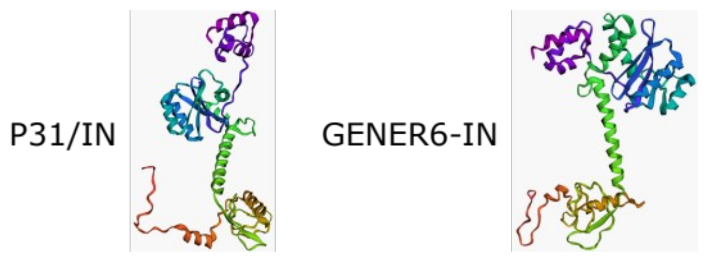{ loading=lazy }

<figcaption markdown="1">

**Figure 23: GENER6-integrase predicted protein structure.**

(Alejandro R. Gener et al. 2021)

</figcaption>
</figure>

<figure markdown="1" id="figure-24" class="book-figure">

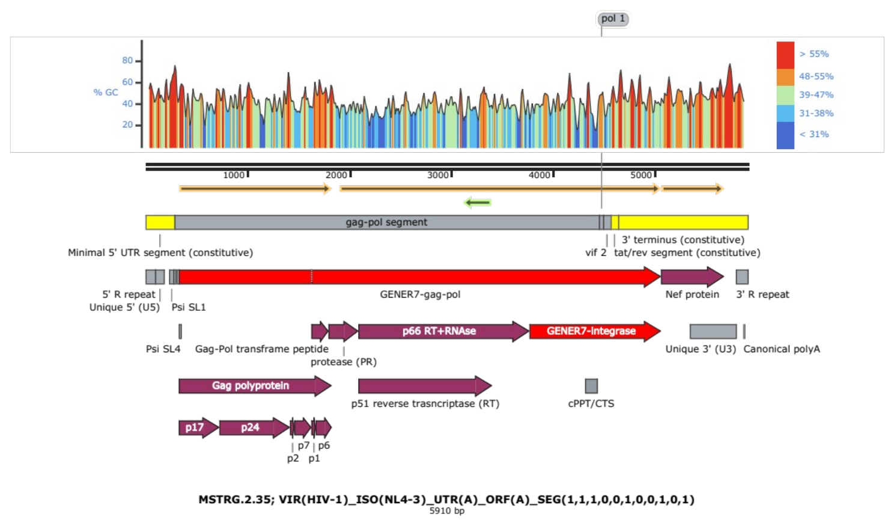{ loading=lazy }

<figcaption markdown="1">

**Figure 24: MSTRG.2.35 (GENER7) IN-vif-novel.**

GENER7 is a gag-pol-env terminal fusion.

(Alejandro R. Gener et al. 2021)

</figcaption>
</figure>

<figure markdown="1" id="figure-25" class="book-figure">

<figcaption markdown="1">

**Figure 25: GENER7-Gag-Pol amino acid sequence.**

&gt;HIV-1_NL4-3_GENER7

<u>MGARASVLSGGELDKWEKIRLRPGGKKQYKLKHIVWASRELERFAVNPGLLETSEGCRQILGQLQPSLQTGSEELRSLYNTIAVLYCVHQRIDVKDTKEALDKIEEEQNKSKKKAQQAAADTGNNSQVSQNYPIVQNLQGQMVHQAISPRTLNAWVKVVEEKAFSPEVIPMFSALSEGATPQDLNTMLNTVGGHQAAMQMLKETINEEAAEWDRLHPVHAGPIAPGQMREPRGSDIAGTTSTLQEQIGWMTHNPPIPVGEIYKRWIILGLNKIVRMYSPTSILDIRQGPKEPFRDYVDRFYKTLRAEQASQEVKNWMTETLLVQNANPDCKTILKALGPGATLEEMMTACQGVGGPGHKARVLAEAMSQVTNPATIMIQKGNFRNQRKTVKCFNCGKEGHIAKNCRAPRKKGCWKCGKEGHQMKDCTERQAN</u>FFREDLAFPQGKAREFSSEQTRANSPTRRELQVWGRDNNSLSEAGADRQGTVSFSFPQITLWQRPLVTIKIGGQLKEALLDTGADDTVLEEMNLPGRWKPKMIGGIGGFIKVRQYDQILIEICGHKAIGTVLVGPTPVNIIGRNLLTQIGCTLNFPISPIETVPVKLKPGMDGPKVKQWPLTEEKIKALVEICTEMEKEGKISKIGPENPYNTPVFAIKKKDSTKWRKLVDFRELNKRTQDFWEVQLGIPHPAGLKQKKSVTVLDVGDAYFSVPLDKDFRKYTAFTIPSINNETPGIRYQYNVLPQGWKGSPAIFQCSMTKILEPFRKQNPDIVIYQYMDDLYVGSDLEIGQHRTKIEELRQHLLRWGFTTPDKKHQKEPPFLWMGYELHPDKWTVQPIVLPEKDSWTVNDIQKLVGKLNWASQIYAGIKVRQLCKLLRGTKALTEVVPLTEEAELELAENREILKEPVHGVYYDPSKDLIAEIQKQGQGQWTYQIYQEPFKNLKTGKYARMKGAHTNDVKQLTEAVQKIATESIVIWGKTPKFKLPIQKETWEAWWTEYWQATWIPEWEFVNTPPLVKLWYQLEKEPIIGAETFYVDGAANRETKLGKAGYVTDRGRQKVVPLTDTTNQKTELQAIHLALQDSGLEVNIVTDSQYALGIIQAQPDKSESELVSQIIEQLIKKEKVYLAWVPAHKGIGGNEQVDKLVSAGIRKVLFLDGIDKAQEEHEKYHSNWRAMASDFNLPPVVAKEIVASCDKCQLKGEAMHGQVDCSPGIWQLDCTHLEGKVILVAVHVASGYIEAEVIPAETGQETAYFLLKLAGRWPVKTVHTDNGSNFTSTTVKAACWWAGIKQEFGIPYNPQSQGVIESMNKELKKIIGQVRDQAEHLKTAVQMAVFIHNFKRKGGIGGYSAGERIVDIIATDIQTKELQKQITKIQNFRVYYRDSRDPVWKGPAKLLWKESAIRNTILGRIVSPRCEYQAGHNK**EEAETATKSSSEQSDSSSFSIKA**<u>THLPIPRGPDRPEGIEEEGGERDRDRSIRLVNGSLALIWDDLRSLCLFSYHRLRDLLLIVTRIVELLGRRGWEALKYWWNLLQYWSQELKNSAVNLLNATAIAVAEGTDRVIEVLQAAYRAIRHIPRRIRQGLERILL</u>\* (Alejandro R. Gener et al. 2021)

&gt;HIV-1_NL4-3_Gag-Pol

<u>MGARASVLSGGELDKWEKIRLRPGGKKQYKLKHIVWASRELERFAVNPGLLETSEGCRQILGQLQPSLQTGSEELRSLYNTIAVLYCVHQRIDVKDTKEALDKIEEEQNKSKKKAQQAAADTGNNSQVSQNYPIVQNLQGQMVHQAISPRTLNAWVKVVEEKAFSPEVIPMFSALSEGATPQDLNTMLNTVGGHQAAMQMLKETINEEAAEWDRLHPVHAGPIAPGQMREPRGSDIAGTTSTLQEQIGWMTHNPPIPVGEIYKRWIILGLNKIVRMYSPTSILDIRQGPKEPFRDYVDRFYKTLRAEQASQEVKNWMTETLLVQNANPDCKTILKALGPGATLEEMMTACQGVGGPGHKARVLAEAMSQVTNPATIMIQKGNFRNQRKTVKCFNCGKEGHIAKNCRAPRKKGCWKCGKEGHQMKDCTERQAN</u>FFREDLAFPQGKAREFSSEQTRANSPTRRELQVWGRDNNSLSEAGADRQGTVSFSFPQITLWQRPLVTIKIGGQLKEALLDTGADDTVLEEMNLPGRWKPKMIGGIGGFIKVRQYDQILIEICGHKAIGTVLVGPTPVNIIGRNLLTQIGCTLNFPISPIETVPVKLKPGMDGPKVKQWPLTEEKIKALVEICTEMEKEGKISKIGPENPYNTPVFAIKKKDSTKWRKLVDFRELNKRTQDFWEVQLGIPHPAGLKQKKSVTVLDVGDAYFSVPLDKDFRKYTAFTIPSINNETPGIRYQYNVLPQGWKGSPAIFQCSMTKILEPFRKQNPDIVIYQYMDDLYVGSDLEIGQHRTKIEELRQHLLRWGFTTPDKKHQKEPPFLWMGYELHPDKWTVQPIVLPEKDSWTVNDIQKLVGKLNWASQIYAGIKVRQLCKLLRGTKALTEVVPLTEEAELELAENREILKEPVHGVYYDPSKDLIAEIQKQGQGQWTYQIYQEPFKNLKTGKYARMKGAHTNDVKQLTEAVQKIATESIVIWGKTPKFKLPIQKETWEAWWTEYWQATWIPEWEFVNTPPLVKLWYQLEKEPIIGAETFYVDGAANRETKLGKAGYVTDRGRQKVVPLTDTTNQKTELQAIHLALQDSGLEVNIVTDSQYALGIIQAQPDKSESELVSQIIEQLIKKEKVYLAWVPAHKGIGGNEQVDKLVSAGIRKVLFLDGIDKAQEEHEKYHSNWRAMASDFNLPPVVAKEIVASCDKCQLKGEAMHGQVDCSPGIWQLDCTHLEGKVILVAVHVASGYIEAEVIPAETGQETAYFLLKLAGRWPVKTVHTDNGSNFTSTTVKAACWWAGIKQEFGIPYNPQSQGVIESMNKELKKIIGQVRDQAEHLKTAVQMAVFIHNFKRKGGIGGYSAGERIVDIIATDIQTKELQKQITKIQNFRVYYRDSRDPVWKGPAKLLWKGEGAVVIQDNSDIKVVPRRKAKIIRDYGKQMAGDDCVASRQDED\*

&gt;HIV-1_NL4-3_Vif

MENRWQVMIVWQVDRMRINTWKRLVKHHMYISRKAKDWFYRHHYESTNPKISSEVHIPLGDAKLVITTYWGLHTGERDWHLGQGVSIEWRKKRYSTQVDPDLADQLIHLHYFDCFSESAIRNTILGRIVSPRCEYQAGHNKVGSLQYLALAALIKPKQIKPPLPSVRKLTEDRWNKPQKTKGHRGSHTMNGH\*

FASTA naming convention below: virus_strain_orf-protein. Green and Yellow amino acids are conserved. Fuchsia are new. +1 frame. Conserved region in Gag *underlined*. <u>Specific to this figure, underlined</u> segment has been seen before. Example: Sequence ID/Genbank accession: AAR05829.1. It is part of *env*. **Bold** is *tat/rev* NA sequence, but in a different frame than NL4-3 *tat* or *rev*. CCD30481.1. The reference (CCD30481.1) incorrectly calls a similar sequence *tat*.

</figcaption>
</figure>

<figure markdown="1" id="figure-26" class="book-figure">

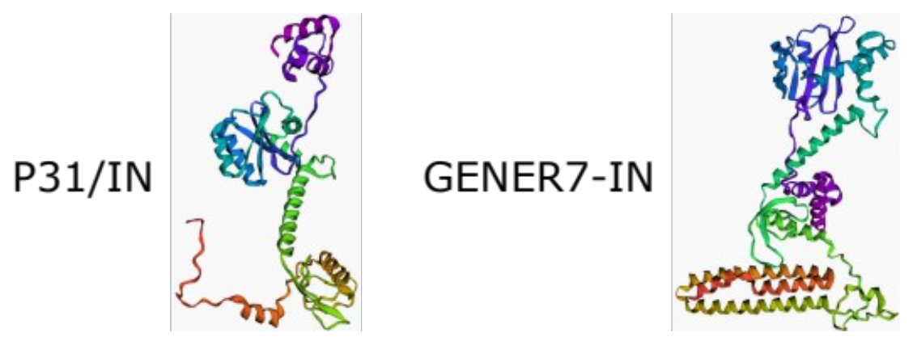{ loading=lazy }

<figcaption markdown="1">

**Figure 26: GENER7-integrase predicted protein structure.**

(Alejandro R. Gener et al. 2021)

</figcaption>
</figure>

<figure markdown="1" id="figure-27" class="book-figure">

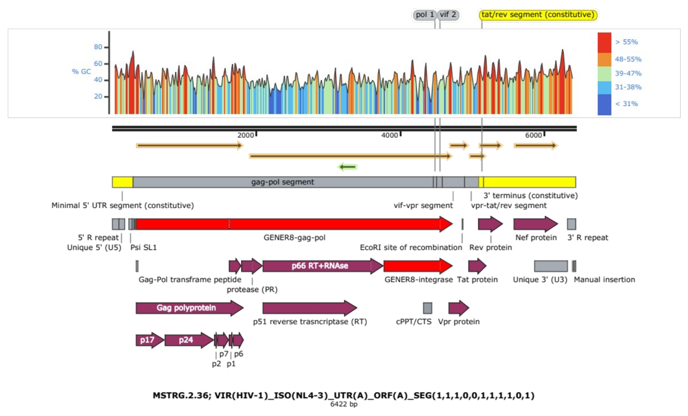{ loading=lazy }

<figcaption markdown="1">

**Figure 27: MSTRG.2.36 (GENER8) = GENER6; IN-vif.**

(Alejandro R. Gener et al. 2021)

GENER8 is a truncated gag-pol. Same ORF as GENER6. MSTRG.2.36 was not supported by pooled mapping. However, this transcript might still be represented in the dataset. Difficulty with mapping repetitive full-length mRNAs has precluded ruling out this from the set of possible HIV-1 NL4-3 mRNAs.

</figcaption>
</figure>

<figure markdown="1" id="figure-28" class="book-figure">

<figcaption markdown="1">

**Figure 28: GENER8-Gag-Pol amino acid sequence.**

**GENER8 amino acid sequence.**

&gt;HIV-1_NL4-3_GENER8

<u>MGARASVLSGGELDKWEKIRLRPGGKKQYKLKHIVWASRELERFAVNPGLLETSEGCRQILGQLQPSLQTGSEELRSLYNTIAVLYCVHQRIDVKDTKEALDKIEEEQNKSKKKAQQAAADTGNNSQVSQNYPIVQNLQGQMVHQAISPRTLNAWVKVVEEKAFSPEVIPMFSALSEGATPQDLNTMLNTVGGHQAAMQMLKETINEEAAEWDRLHPVHAGPIAPGQMREPRGSDIAGTTSTLQEQIGWMTHNPPIPVGEIYKRWIILGLNKIVRMYSPTSILDIRQGPKEPFRDYVDRFYKTLRAEQASQEVKNWMTETLLVQNANPDCKTILKALGPGATLEEMMTACQGVGGPGHKARVLAEAMSQVTNPATIMIQKGNFRNQRKTVKCFNCGKEGHIAKNCRAPRKKGCWKCGKEGHQMKDCTERQAN</u>FFREDLAFPQGKAREFSSEQTRANSPTRRELQVWGRDNNSLSEAGADRQGTVSFSFPQITLWQRPLVTIKIGGQLKEALLDTGADDTVLEEMNLPGRWKPKMIGGIGGFIKVRQYDQILIEICGHKAIGTVLVGPTPVNIIGRNLLTQIGCTLNFPISPIETVPVKLKPGMDGPKVKQWPLTEEKIKALVEICTEMEKEGKISKIGPENPYNTPVFAIKKKDSTKWRKLVDFRELNKRTQDFWEVQLGIPHPAGLKQKKSVTVLDVGDAYFSVPLDKDFRKYTAFTIPSINNETPGIRYQYNVLPQGWKGSPAIFQCSMTKILEPFRKQNPDIVIYQYMDDLYVGSDLEIGQHRTKIEELRQHLLRWGFTTPDKKHQKEPPFLWMGYELHPDKWTVQPIVLPEKDSWTVNDIQKLVGKLNWASQIYAGIKVRQLCKLLRGTKALTEVVPLTEEAELELAENREILKEPVHGVYYDPSKDLIAEIQKQGQGQWTYQIYQEPFKNLKTGKYARMKGAHTNDVKQLTEAVQKIATESIVIWGKTPKFKLPIQKETWEAWWTEYWQATWIPEWEFVNTPPLVKLWYQLEKEPIIGAETFYVDGAANRETKLGKAGYVTDRGRQKVVPLTDTTNQKTELQAIHLALQDSGLEVNIVTDSQYALGIIQAQPDKSESELVSQIIEQLIKKEKVYLAWVPAHKGIGGNEQVDKLVSAGIRKVL**FLDGIDKAQEEHEKYHSNWRAMASDFNLPPVVAKEIVASCDKCQLKGEAMHGQVDCSPGIWQLDCTHLEGKVILVAVHVASGYIEAEVIPAETGQETAYFLLKLAGRWPVKTVHTDNGSNFTSTTVKAACWWAGIKQEFGIPYNPQSQGVIESMNKELKKIIGQVRDQAEHLKTAVQMAVFIHNFKRKGGIGGYSAGERIVDIIATDIQTKELQKQITKIQNFRVYYRDSRDPVWKGPAKLLWKESAIRNTILGRIVSPRCEYQAGHNKVGSLQYLALAALIKPKQIKPPLPSVRKLTEDRWNKPQKTKGHRGSHTMNGH**\*

&gt;HIV-1_NL4-3_Gag-Pol

<u>MGARASVLSGGELDKWEKIRLRPGGKKQYKLKHIVWASRELERFAVNPGLLETSEGCRQILGQLQPSLQTGSEELRSLYNTIAVLYCVHQRIDVKDTKEALDKIEEEQNKSKKKAQQAAADTGNNSQVSQNYPIVQNLQGQMVHQAISPRTLNAWVKVVEEKAFSPEVIPMFSALSEGATPQDLNTMLNTVGGHQAAMQMLKETINEEAAEWDRLHPVHAGPIAPGQMREPRGSDIAGTTSTLQEQIGWMTHNPPIPVGEIYKRWIILGLNKIVRMYSPTSILDIRQGPKEPFRDYVDRFYKTLRAEQASQEVKNWMTETLLVQNANPDCKTILKALGPGATLEEMMTACQGVGGPGHKARVLAEAMSQVTNPATIMIQKGNFRNQRKTVKCFNCGKEGHIAKNCRAPRKKGCWKCGKEGHQMKDCTERQAN</u>FFREDLAFPQGKAREFSSEQTRANSPTRRELQVWGRDNNSLSEAGADRQGTVSFSFPQITLWQRPLVTIKIGGQLKEALLDTGADDTVLEEMNLPGRWKPKMIGGIGGFIKVRQYDQILIEICGHKAIGTVLVGPTPVNIIGRNLLTQIGCTLNFPISPIETVPVKLKPGMDGPKVKQWPLTEEKIKALVEICTEMEKEGKISKIGPENPYNTPVFAIKKKDSTKWRKLVDFRELNKRTQDFWEVQLGIPHPAGLKQKKSVTVLDVGDAYFSVPLDKDFRKYTAFTIPSINNETPGIRYQYNVLPQGWKGSPAIFQCSMTKILEPFRKQNPDIVIYQYMDDLYVGSDLEIGQHRTKIEELRQHLLRWGFTTPDKKHQKEPPFLWMGYELHPDKWTVQPIVLPEKDSWTVNDIQKLVGKLNWASQIYAGIKVRQLCKLLRGTKALTEVVPLTEEAELELAENREILKEPVHGVYYDPSKDLIAEIQKQGQGQWTYQIYQEPFKNLKTGKYARMKGAHTNDVKQLTEAVQKIATESIVIWGKTPKFKLPIQKETWEAWWTEYWQATWIPEWEFVNTPPLVKLWYQLEKEPIIGAETFYVDGAANRETKLGKAGYVTDRGRQKVVPLTDTTNQKTELQAIHLALQDSGLEVNIVTDSQYALGIIQAQPDKSESELVSQIIEQLIKKEKVYLAWVPAHKGIGGNEQVDKLVSAGIRKVLFLDGIDKAQEEHEKYHSNWRAMASDFNLPPVVAKEIVASCDKCQLKGEAMHGQVDCSPGIWQLDCTHLEGKVILVAVHVASGYIEAEVIPAETGQETAYFLLKLAGRWPVKTVHTDNGSNFTSTTVKAACWWAGIKQEFGIPYNPQSQGVIESMNKELKKIIGQVRDQAEHLKTAVQMAVFIHNFKRKGGIGGYSAGERIVDIIATDIQTKELQKQITKIQNFRVYYRDSRDPVWKGPAKLLWKGEGAVVIQDNSDIKVVPRRKAKIIRDYGKQMAGDDCVASRQDED\*

&gt;HIV-1_NL4-3_vif

MENRWQVMIVWQVDRMRINTWKRLVKHHMYISRKAKDWFYRHHYESTNPKISSEVHIPLGDAKLVITTYWGLHTGERDWHLGQGVSIEWRKKRYSTQVDPDLADQLIHLHYFDCFSESAIRNTILGRIVSPRCEYQAGHNKVGSLQYLALAALIKPKQIKPPLPSVRKLTEDRWNKPQKTKGHRGSHTMNGH\*

(Alejandro R. Gener et al. 2021)

FASTA naming convention below: virus_strain_orf-protein. Green and Yellow amino acids are conserved. +1 frame. Conserved region in Gag *underlined*. GENER8-integrase in **bold**. Note GENER6 and GENER8 are ORFs which share the same sequences across on different mRNA models. GENER6-integrase (GENER6-IN) is identical to GENER8-integrase (GENER8-IN).

</figcaption>
</figure>

<figure markdown="1" id="figure-29" class="book-figure">

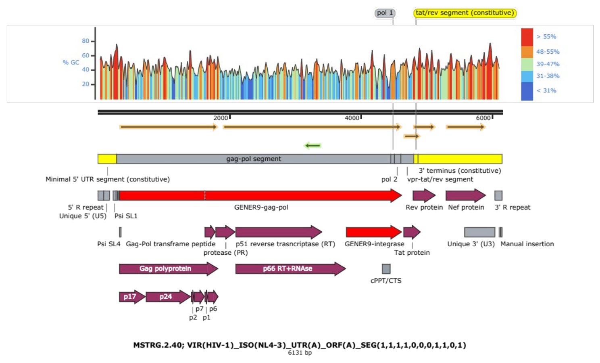{ loading=lazy }

<figcaption markdown="1">

**Figure 29: MSTRG.2.40 (GENER9).**

(Alejandro R. Gener et al. 2021)

</figcaption>
</figure>

<figure markdown="1" id="figure-30" class="book-figure">

<figcaption markdown="1">

**Figure 30: GENER9-Gag-Pol amino acid sequence.**

&gt;HIV-1_NL4-3_GENER9

<u>MGARASVLSGGELDKWEKIRLRPGGKKQYKLKHIVWASRELERFAVNPGLLETSEGCRQILGQLQPSLQTGSEELRSLYNTIAVLYCVHQRIDVKDTKEALDKIEEEQNKSKKKAQQAAADTGNNSQVSQNYPIVQNLQGQMVHQAISPRTLNAWVKVVEEKAFSPEVIPMFSALSEGATPQDLNTMLNTVGGHQAAMQMLKETINEEAAEWDRLHPVHAGPIAPGQMREPRGSDIAGTTSTLQEQIGWMTHNPPIPVGEIYKRWIILGLNKIVRMYSPTSILDIRQGPKEPFRDYVDRFYKTLRAEQASQEVKNWMTETLLVQNANPDCKTILKALGPGATLEEMMTACQGVGGPGHKARVLAEAMSQVTNPATIMIQKGNFRNQRKTVKCFNCGKEGHIAKNCRAPRKKGCWKCGKEGHQMKDCTERQAN</u>FFREDLAFPQGKAREFSSEQTRANSPTRRELQVWGRDNNSLSEAGADRQGTVSFSFPQITLWQRPLVTIKIGGQLKEALLDTGADDTVLEEMNLPGRWKPKMIGGIGGFIKVRQYDQILIEICGHKAIGTVLVGPTPVNIIGRNLLTQIGCTLNFPISPIETVPVKLKPGMDGPKVKQWPLTEEKIKALVEICTEMEKEGKISKIGPENPYNTPVFAIKKKDSTKWRKLVDFRELNKRTQDFWEVQLGIPHPAGLKQKKSVTVLDVGDAYFSVPLDKDFRKYTAFTIPSINNETPGIRYQYNVLPQGWKGSPAIFQCSMTKILEPFRKQNPDIVIYQYMDDLYVGSDLEIGQHRTKIEELRQHLLRWGFTTPDKKHQKEPPFLWMGYELHPDKWTVQPIVLPEKDSWTVNDIQKLVGKLNWASQIYAGIKVRQLCKLLRGTKALTEVVPLTEEAELELAENREILKEPVHGVYYDPSKDLIAEIQKQGQGQWTYQIYQEPFKNLKTGKYARMKGAHTNDVKQLTEAVQKIATESIVIWGKTPKFKLPIQKETWEAWWTEYWQATWIPEWEFVNTPPLVKLWYQLEKEPIIGAETFYVDGAANRETKLGKAGYVTDRGRQKVVPLTDTTNQKTELQAIHLALQDSGLEVNIVTDSQYALGIIQAQPDKSESELVSQIIEQLIKKEKVYLAWVPAHKGIGGNEQVDKLVSAGIRKVLFLDGIDKAQEEHEKYHSNWRAMASDFNLPPVVAKEIVASCDKCQLKGEAMHGQVDCSPGIWQLDCTHLEGKVILVAVHVASGYIEAEVIPAETGQETAYFLLKLAGRWPVKTVHTDNGSNFTSTTVKAACWWAGIKQEFGIPYNPQSQGVIESMNKELKKIIGQVRDQAEHLKTAVQMAVFIHNFKRKGGIGGYSAGERIVDIIATDIQTKELQKQITKIQNFRVYYRDSRDPVWKGPAKLLWKGEGAVVIQDNSDIKVVPRRKAKIIRDYGKQMAELGVDIAE\*

&gt;HIV-1_NL4-3_Gag-Pol

<u>MGARASVLSGGELDKWEKIRLRPGGKKQYKLKHIVWASRELERFAVNPGLLETSEGCRQILGQLQPSLQTGSEELRSLYNTIAVLYCVHQRIDVKDTKEALDKIEEEQNKSKKKAQQAAADTGNNSQVSQNYPIVQNLQGQMVHQAISPRTLNAWVKVVEEKAFSPEVIPMFSALSEGATPQDLNTMLNTVGGHQAAMQMLKETINEEAAEWDRLHPVHAGPIAPGQMREPRGSDIAGTTSTLQEQIGWMTHNPPIPVGEIYKRWIILGLNKIVRMYSPTSILDIRQGPKEPFRDYVDRFYKTLRAEQASQEVKNWMTETLLVQNANPDCKTILKALGPGATLEEMMTACQGVGGPGHKARVLAEAMSQVTNPATIMIQKGNFRNQRKTVKCFNCGKEGHIAKNCRAPRKKGCWKCGKEGHQMKDCTERQAN</u>FFREDLAFPQGKAREFSSEQTRANSPTRRELQVWGRDNNSLSEAGADRQGTVSFSFPQITLWQRPLVTIKIGGQLKEALLDTGADDTVLEEMNLPGRWKPKMIGGIGGFIKVRQYDQILIEICGHKAIGTVLVGPTPVNIIGRNLLTQIGCTLNFPISPIETVPVKLKPGMDGPKVKQWPLTEEKIKALVEICTEMEKEGKISKIGPENPYNTPVFAIKKKDSTKWRKLVDFRELNKRTQDFWEVQLGIPHPAGLKQKKSVTVLDVGDAYFSVPLDKDFRKYTAFTIPSINNETPGIRYQYNVLPQGWKGSPAIFQCSMTKILEPFRKQNPDIVIYQYMDDLYVGSDLEIGQHRTKIEELRQHLLRWGFTTPDKKHQKEPPFLWMGYELHPDKWTVQPIVLPEKDSWTVNDIQKLVGKLNWASQIYAGIKVRQLCKLLRGTKALTEVVPLTEEAELELAENREILKEPVHGVYYDPSKDLIAEIQKQGQGQWTYQIYQEPFKNLKTGKYARMKGAHTNDVKQLTEAVQKIATESIVIWGKTPKFKLPIQKETWEAWWTEYWQATWIPEWEFVNTPPLVKLWYQLEKEPIIGAETFYVDGAANRETKLGKAGYVTDRGRQKVVPLTDTTNQKTELQAIHLALQDSGLEVNIVTDSQYALGIIQAQPDKSESELVSQIIEQLIKKEKVYLAWVPAHKGIGGNEQVDKLVSAGIRKVLFLDGIDKAQEEHEKYHSNWRAMASDFNLPPVVAKEIVASCDKCQLKGEAMHGQVDCSPGIWQLDCTHLEGKVILVAVHVASGYIEAEVIPAETGQETAYFLLKLAGRWPVKTVHTDNGSNFTSTTVKAACWWAGIKQEFGIPYNPQSQGVIESMNKELKKIIGQVRDQAEHLKTAVQMAVFIHNFKRKGGIGGYSAGERIVDIIATDIQTKELQKQITKIQNFRVYYRDSRDPVWKGPAKLLWKGEGAVVIQDNSDIKVVPRRKAKIIRDYGKQMAGDDCVASRQDED\*

(Alejandro R. Gener et al. 2021)

FASTA naming convention below: virus_strain_orf-protein. Green amino acids are conserved. Fuchsia are new. +1 frame. Conserved region in Gag *underlined*. GENER9 shares homology with Pol variant AYX77407.1.

</figcaption>
</figure>

<figure markdown="1" id="figure-31" class="book-figure">

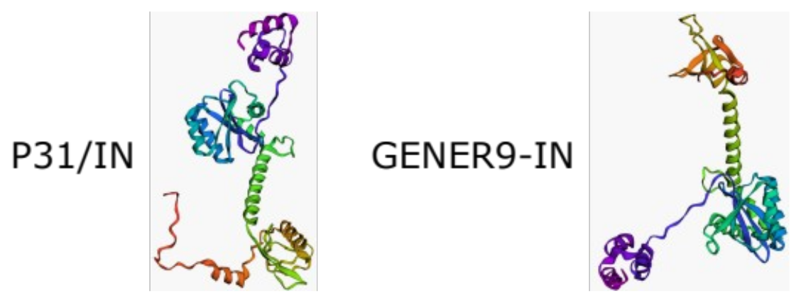{ loading=lazy }

<figcaption markdown="1">

**Figure 31: GENER9-integrase predicted protein structure.**

(Alejandro R. Gener et al. 2021)

</figcaption>
</figure>

### UTR Class B (n=1)

Min5UTR+ pol 1**,** pol 2, vif 2, tat/rev. 1st ORF starts at pol 2.

- MSTRG.2.26

&gt;Class_B_MSTRG.2.26_min5UTR+pol,pol/vif,vif,tat/rev

<u>GGGUCUCUCUGGUUAGACCAGAUCUGAGCCUGGGAGCUCUCUGGCUAACUAGGGAACCCACUGCUUAAGCCUCAAUAAAGCUUGCCUUGAGUGCUCAAAGUAGUGUGUGCCCGUCUGUUGUGUGACUCUGGUAACUAGAGAUCCCUCAGACCCUUUUAGUCAGUGUGGAAAAUCUCUAGCAGUGGCGCCCGAACAGGGACUUGAAAGCGAAAGUAAAGCCAGAGGAGAUCUCUCGACGCAGGACUCGGCUUGCUGAAGCGCGCACGGCAAGAGGCGAGGGGCGGCGACUG</u>GGACAGCAGAGAUCCAGUUUGGAAAGGACCAGCAAAGCUCCUCUGGAAAGGUGAAGGGGCAGUAGUAAUACAAGAUAAUAGUGACAUAAAAGUAGUGCCAAGAAGAAAAGCAAAGAUCAUCAGGGAUUAUGGAAAACAGAUGGCAGAAUCUGCUAUAAGAAAUACCAUAUUAGGACGUAUAGUUAGUCCUAGGUGUGAAUAUCAAGCAGGACAUAACAAGGAAGAAGCGGAGACAGCGACGAAGAGCUCAUCAGAACAGUCAGACUCAUCAAGCUUCUCUAUCAAAGCA

<figure markdown="1" id="figure-32" class="book-figure">

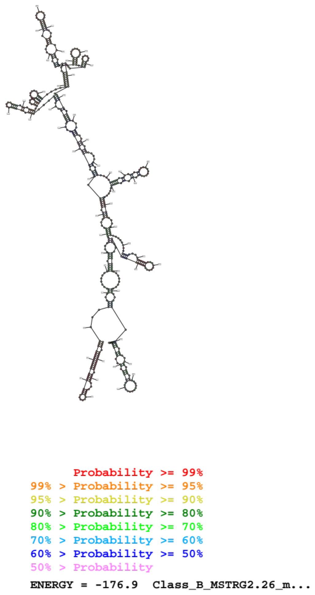{ loading=lazy }

<figcaption markdown="1">

**Figure 32: UTR (B) predicted UTR RNA 2º structure.**

</figcaption>
</figure>

<figure markdown="1" id="figure-33" class="book-figure">

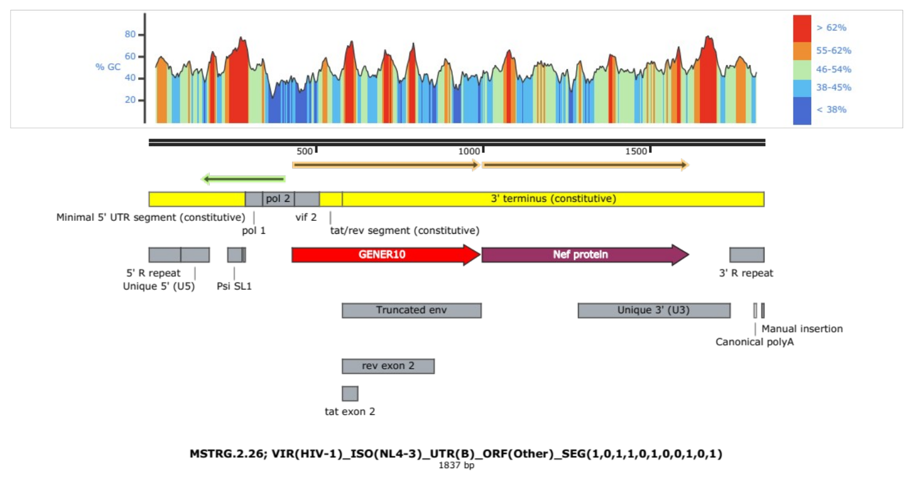{ loading=lazy }

<figcaption markdown="1">

**Figure 33: MSTRG.2.26 (GENER10).**

(Alejandro R. Gener et al. 2021)

</figcaption>
</figure>

<figure markdown="1" id="figure-34" class="book-figure">

<figcaption markdown="1">

**Figure 34: GENER10 amino acid sequence.**

&gt;HIV-1_NL4-3_GENER10

MAESAIRNTILGRIVSPRCEYQAGHNKEEAETATKSSSEQSDSSSFSIKATHLPIPRGPDRPEGIEEEGGERDRDRSIRLVNGSLALIWDDLRSLCLFSYHRLRDLLLIVTRIVELLGRRGWEALKYWWNLLQYWSQELKNSAVNLLNATAIAVAEGTDRVIEVLQAAYRAIRHIPRRIRQGLERILL\*

&gt;HIV-1_NL4-3_Env-gp41

AVGIGALFLGFLGAAGSTMGAASMTLTVQARQLLSDIVQQQNNLLRAIEAQQHLLQLTVWGIKQLQARILAVERYLKDQQLLGIWGCSGKLICTTAVPWNASWSNKSLEQIWNNMTWMEWDREINNYTSLIHSLIEESQNQQEKNEQELLELDKWASLWNWFNITNWLWYIKLFIMIVGGLVGLRIVFAVLSIVNRVRQGYSPLSFQTHLPIPRGPDRPEGIEEEGGERDRDRSIRLVNGSLALIWDDLRSLCLFSYHRLRDLLLIVTRIVELLGRRGWEALKYWWNLLQYWSQELKNSAVNLLNATAIAVAEGTDRVIEVLQAAYRAIRHIPRRIRQGLERILL\*

&gt;HIV-1_NL4-3_Vif

MENRWQVMIVWQVDRMRINTWKRLVKHHMYISRKAKDWFYRHHYESTNPKISSEVHIPLGDAKLVITTYWGLHTGERDWHLGQGVSIEWRKKRYSTQVDPDLADQLIHLHYFDCFSESAIRNTILGRIVSPRCEYQAGHNKVGSLQYLALAALIKPKQIKPPLPSVRKLTEDRWNKPQKTKGHRGSHTMNGH\*

(Alejandro R. Gener et al. 2021)

FASTA naming convention below: virus_strain_orf-protein. Green and Yellow amino acids are conserved. Fuchsia are new. +1 frame. GENER10 is a pol-vif-tat/rev-env splice product.

</figcaption>
</figure>

<figure markdown="1" id="figure-35" class="book-figure">

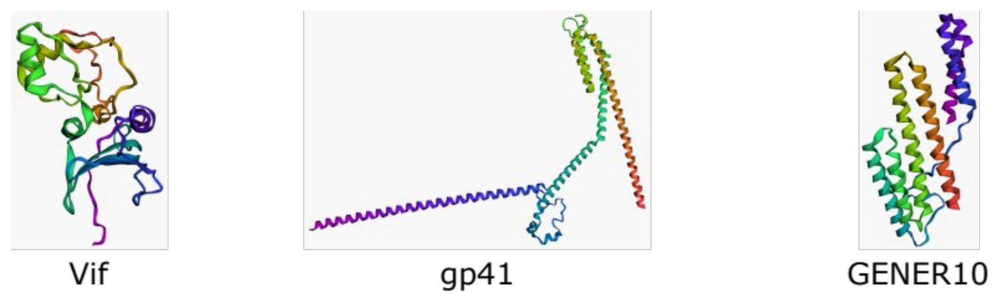{ loading=lazy }

<figcaption markdown="1">

**Figure 35: GENER10 predicted protein structure.**

(Alejandro R. Gener et al. 2021)

GENER10 is the only Vif-containing ORF which disrupts the “grumpy” domain in the most stable trRosetta model.

</figcaption>
</figure>

### UTR Class C (n=3)

Min5UTR+pol 1**,** pol 2, vif 1, vif 2, vif-vpr, tat/rev. 1st ORF starts at pol 2.

- MSTRG.2.5

- MSTRG.2.19

- MSTRG.2.39

&gt;Class_C_MSTRG.2.5_min5UTR+pol,pol/vif

<u>GGGUCUCUCUGGUUAGACCAGAUCUGAGCCUGGGAGCUCUCUGGCUAACUAGGGAACCCACUGCUUAAGCCUCAAUAAAGCUUGCCUUGAGUGCUCAAAGUAGUGUGUGCCCGUCUGUUGUGUGACUCUGGUAACUAGAGAUCCCUCAGACCCUUUUAGUCAGUGUGGAAAAUCUCUAGCAGUGGCGCCCGAACAGGGACUUGAAAGCGAAAGUAAAGCCAGAGGAGAUCUCUCGACGCAGGACUCGGCUUGCUGAAGCGCGCACGGCAAGAGGCGAGGGGCGGCGACUG</u>GGACAGCAGAGAUCCAGUUUGGAAAGGACCAGCAAAGCUCCUCUGGAAAGGUGAAGGGGCAGUAGUAAUACAAGAUAAUAGUGACAUAAAAGUAGUGCCAAGAAGAAAAGCAAAGAUCAUCAGGGAUUAUGGAAAACAGAUGGCAG

<figure markdown="1" id="figure-36" class="book-figure">

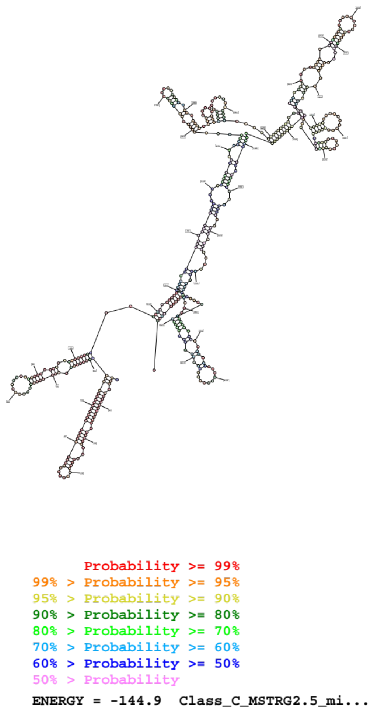{ loading=lazy }

<figcaption markdown="1">

**Figure 36: UTR (C) predicted UTR RNA 2º structure.**

</figcaption>
</figure>

<figure markdown="1" id="figure-37" class="book-figure">

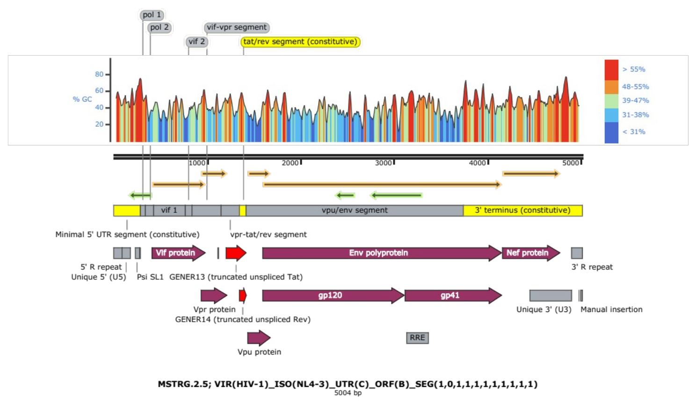{ loading=lazy }

<figcaption markdown="1">

**Figure 37: MSTRG.2.5 (GENER13, GENER14).**

(Alejandro R. Gener et al. 2021)

</figcaption>
</figure>

<figure markdown="1" id="figure-38" class="book-figure">

<figcaption markdown="1">

**Figure 38: GENER13 and GENER14 amino acid sequences.**

&gt;HIV-1_NL4-3_GENER13/Tat-1

MEPVDPRLEPWKHPGSQPKTACTNCYCKKCCFHCQVCFMTKALGISYGRKKRRQRRRAHQNSQTHQASLSKQ\*

&gt;HIV-1_NL4-3_Tat/Tat-2

MEPVDPRLEPWKHPGSQPKTACTNCYCKKCCFHCQVCFMTKALGISYGRKKRRQRRRAHQNSQTHQASLSKQPTSQSRGDPTGPKE\*

&gt;HIV-1_NL4-3_GENER14

MAGRSGDSDEELIRTVRLIKLLYQSSK\*

&gt;HIV-1_NL4-3_rev

MAGRSGDSDEELIRTVRLIKLLYQSNPPPNPEGTRQARRNRRRRWRERQRQIHSISERILSTYLGRSAEPVPLQLPPLERLTLDCNEDCGTSGTQGVGSPQILVESPTVLESGTKE\*

(Alejandro R. Gener et al. 2021)

</figcaption>
</figure>

<figure markdown="1" id="figure-39" class="book-figure">

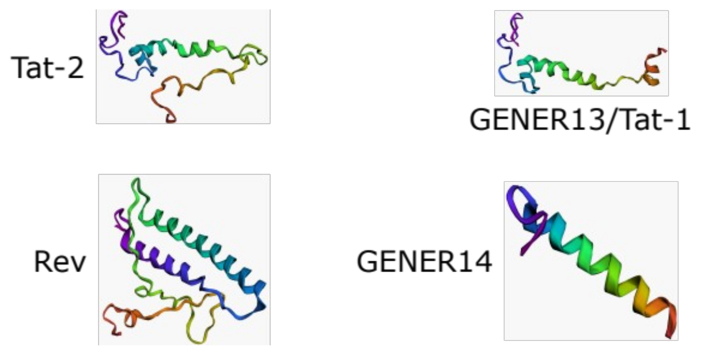{ loading=lazy }

<figcaption markdown="1">

**Figure 39: GENER13 and GENER14 predicted protein structure.**

(Alejandro R. Gener et al. 2021)

</figcaption>
</figure>

<figure markdown="1" id="figure-40" class="book-figure">

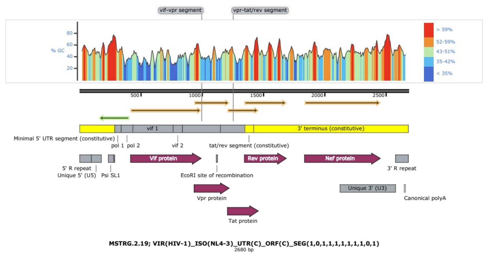{ loading=lazy }

<figcaption markdown="1">

**Figure 40: MSTRG.2.19.**

(Alejandro R. Gener et al. 2021)

</figcaption>
</figure>

<figure markdown="1" id="figure-41" class="book-figure">

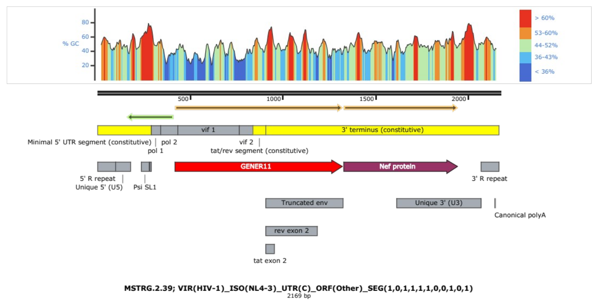{ loading=lazy }

<figcaption markdown="1">

**Figure 41: MSTRG.2.39 (GENER11).**

(Alejandro R. Gener et al. 2021)

</figcaption>
</figure>

<figure markdown="1" id="figure-42" class="book-figure">

<figcaption markdown="1">

**Figure 42: GENER11 amino acid sequence.**

&gt;HIV-1_NL4-3_GENER11

MENRWQVMIVWQVDRMRINTWKRLVKHHMYISRKAKDWFYRHHYESTNPKISSEVHIPLGDAKLVITTYWGLHTGERDWHLGQGVSIEWRKKRYSTQVDPDLADQLIHLHYFDCFSESAIRNTILGRIVSPRCEYQAGHNKEEAETATKSSSEQSDSSSFSIKATHLPIPRGPDRPEGIEEEGGERDRDRSIRLVNGSLALIWDDLRSLCLFSYHRLRDLLLIVTRIVELLGRRGWEALKYWWNLLQYWSQELKNSAVNLLNATAIAVAEGTDRVIEVLQAAYRAIRHIPRRIRQGLERILL\*

&gt;HIV-1_NL4-3_Vif

MENRWQVMIVWQVDRMRINTWKRLVKHHMYISRKAKDWFYRHHYESTNPKISSEVHIPLGDAKLVITTYWGLHTGERDWHLGQGVSIEWRKKRYSTQVDPDLADQLIHLHYFDCFSESAIRNTILGRIVSPRCEYQAGHNKVGSLQYLALAALIKPKQIKPPLPSVRKLTEDRWNKPQKTKGHRGSHTMNGH\*

&gt;HIV-1_NL4-3_Env-gp41

AVGIGALFLGFLGAAGSTMGAASMTLTVQARQLLSDIVQQQNNLLRAIEAQQHLLQLTVWGIKQLQARILAVERYLKDQQLLGIWGCSGKLICTTAVPWNASWSNKSLEQIWNNMTWMEWDREINNYTSLIHSLIEESQNQQEKNEQELLELDKWASLWNWFNITNWLWYIKLFIMIVGGLVGLRIVFAVLSIVNRVRQGYSPLSFQTHLPIPRGPDRPEGIEEEGGERDRDRSIRLVNGSLALIWDDLRSLCLFSYHRLRDLLLIVTRIVELLGRRGWEALKYWWNLLQYWSQELKNSAVNLLNATAIAVAEGTDRVIEVLQAAYRAIRHIPRRIRQGLERILL\*

(Alejandro R. Gener et al. 2021)

FASTA naming convention below: virus_strain_orf-protein. Green and Yellow amino acids are conserved. Fuchsia are new. +1 frame. GENER11 is a pol vif-tat/rev-env splice product.

</figcaption>
</figure>

<figure markdown="1" id="figure-43" class="book-figure">

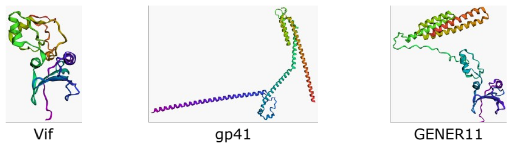{ loading=lazy }

<figcaption markdown="1">

**Figure 43: GENER11 predicted protein structure.**

(Alejandro R. Gener et al. 2021)

</figcaption>
</figure>

### UTR Class D (n=2)

Min5UTR+tat/rev. 1st ORF starts after tat/rev.

- MSTRG.2.1

- MSTRG.2.2

&gt;Class_D_MSTRG.2.1_min5UTR+tat/rev

<u>GGGUCUCUCUGGUUAGACCAGAUCUGAGCCUGGGAGCUCUCUGGCUAACUAGGGAACCCACUGCUUAAGCCUCAAUAAAGCUUGCCUUGAGUGCUCAAAGUAGUGUGUGCCCGUCUGUUGUGUGACUCUGGUAACUAGAGAUCCCUCAGACCCUUUUAGUCAGUGUGGAAAAUCUCUAGCAGUGGCGCCCGAACAGGGACUUGAAAGCGAAAGUAAAGCCAGAGGAGAUCUCUCGACGCAGGACUCGGCUUGCUGAAGCGCGCACGGCAAGAGGCGAGGGGCGGCGACUG</u>GAAGAAGCGGAGACAGCGACGAAGAGCUCAUCAGAACAGUCAGACUCAUCAAGCUUCUCUAUCAAAGCA

<figure markdown="1" id="figure-44" class="book-figure">

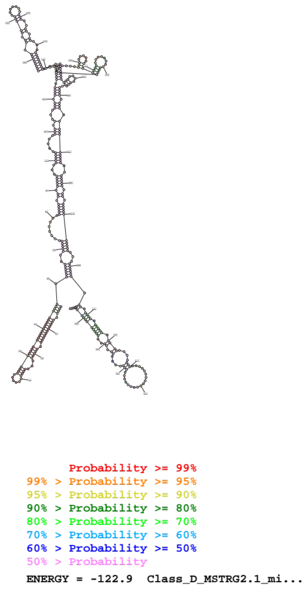{ loading=lazy }

<figcaption markdown="1">

**Figure 44: UTR (D) predicted UTR RNA 2º structure.**

</figcaption>
</figure>

<figure markdown="1" id="figure-45" class="book-figure">

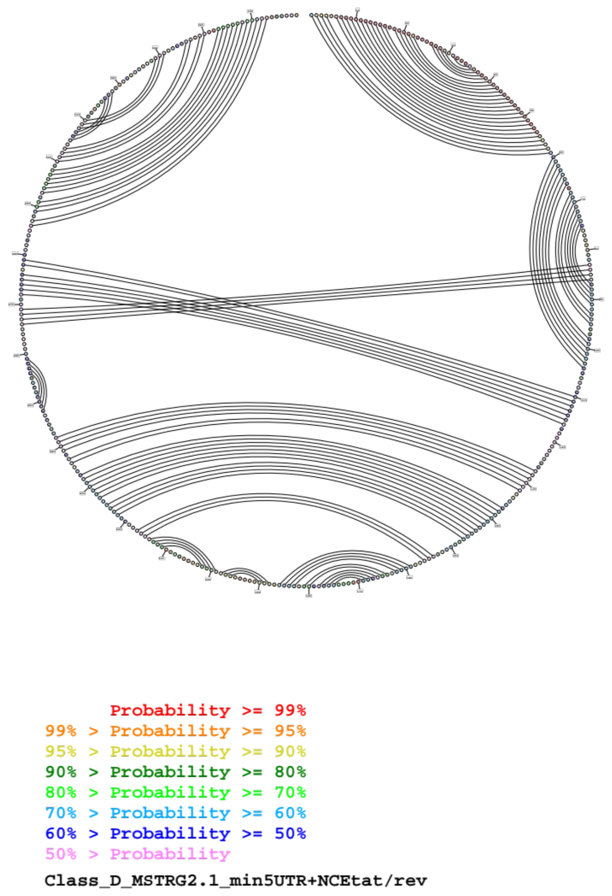{ loading=lazy }

<figcaption markdown="1">

**Figure 45: UTR (D) contains a predicted pseudoknot.**

</figcaption>
</figure>

<figure markdown="1" id="figure-46" class="book-figure">

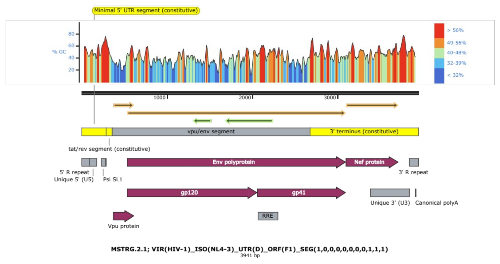{ loading=lazy }

<figcaption markdown="1">

**Figure 46: MSTRG.2.1.**

(Alejandro R. Gener et al. 2021)

</figcaption>
</figure>

<figure markdown="1" id="figure-47" class="book-figure">

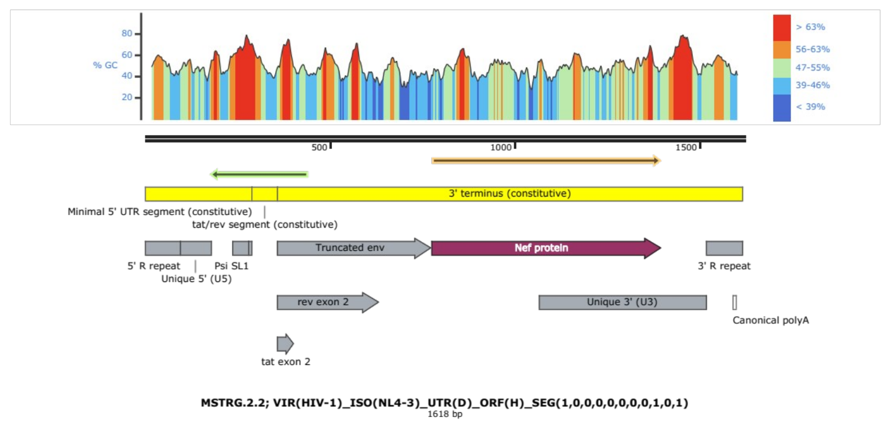{ loading=lazy }

<figcaption markdown="1">

**Figure 47: MSTRG.2.2.**

(Alejandro R. Gener et al. 2021)

</figcaption>
</figure>

### UTR Class E (n=2)

Min5UTR+pol 1**,** vif 2, tat/rev. 1st ORF starts after tat/rev.

- MSTRG.2.9

- MSTRG.2.17

&gt;Class_E_MSTRG.2.9_min5UTR+pol,vif,tat/rev

<u>GGGUCUCUCUGGUUAGACCAGAUCUGAGCCUGGGAGCUCUCUGGCUAACUAGGGAACCCACUGCUUAAGCCUCAAUAAAGCUUGCCUUGAGUGCUCAAAGUAGUGUGUGCCCGUCUGUUGUGUGACUCUGGUAACUAGAGAUCCCUCAGACCCUUUUAGUCAGUGUGGAAAAUCUCUAGCAGUGGCGCCCGAACAGGGACUUGAAAGCGAAAGUAAAGCCAGAGGAGAUCUCUCGACGCAGGACUCGGCUUGCUGAAGCGCGCACGGCAAGAGGCGAGGGGCGGCGACUG</u>GGACAGCAGAGAUCCAGUUUGGAAAGGACCAGCAAAGCUCCUCUGGAAAGAAUCUGCUAUAAGAAAUACCAUAUUAGGACGUAUAGUUAGUCCUAGGUGUGAAUAUCAAGCAGGACAUAACAAGGAAGAAGCGGAGACAGCGACGAAGAGCUCAUCAGAACAGUCAGACUCAUCAAGCUUCUCUAUCAAAGCA

<figure markdown="1" id="figure-48" class="book-figure">

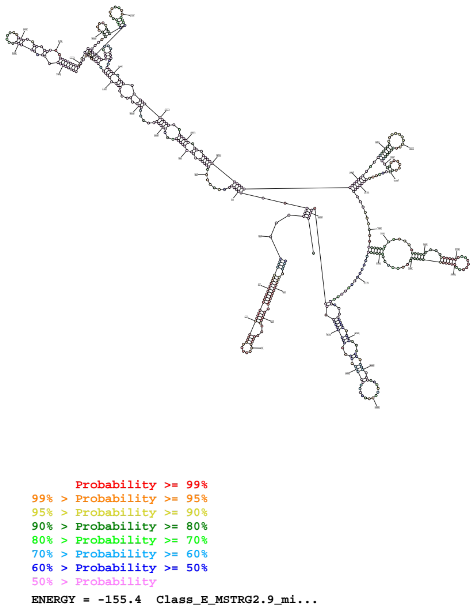{ loading=lazy }

<figcaption markdown="1">

**Figure 48: UTR (E) predicted UTR RNA 2º structure.**

</figcaption>
</figure>

<figure markdown="1" id="figure-49" class="book-figure">

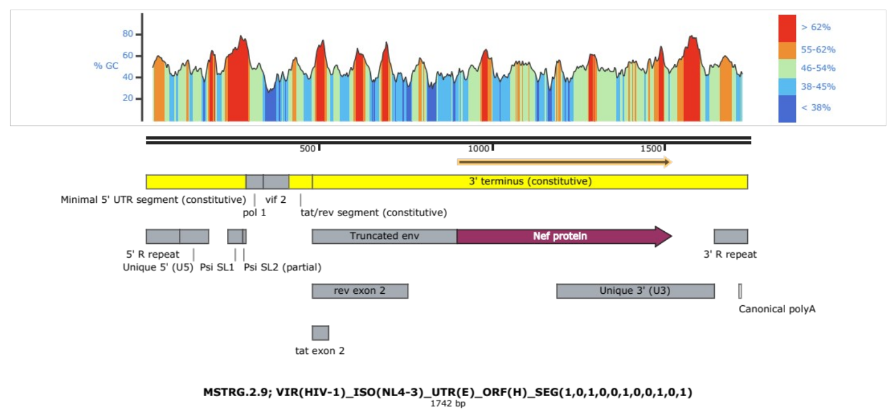{ loading=lazy }

<figcaption markdown="1">

**Figure 49: MSTRG.2.9.**

(Alejandro R. Gener et al. 2021)

</figcaption>
</figure>

<figure markdown="1" id="figure-50" class="book-figure">

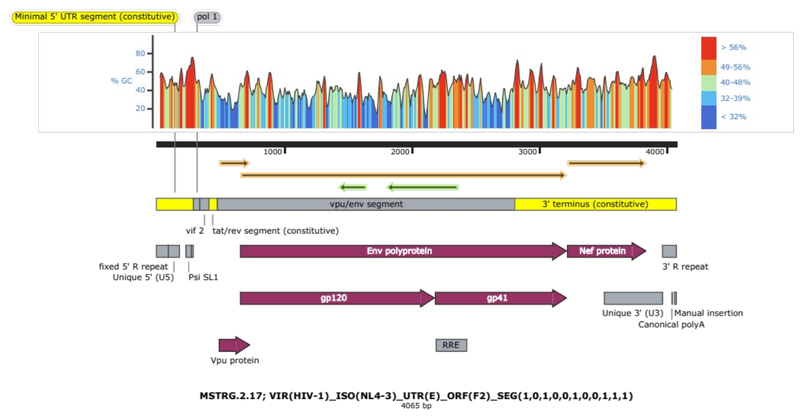{ loading=lazy }

<figcaption markdown="1">

**Figure 50: MSTRG.2.17.**

(Alejandro R. Gener et al. 2021)

</figcaption>
</figure>

### UTR Class F (n=2)

Min5UTR+vif 2, tat/rev. 1st ORF starts after tat/rev.

- MSTRG.2.6

- MSTRG.2.7

&gt;Class_F_MSTRG.2.6_min5UTR+vif,tat/rev

<u>GGGUCUCUCUGGUUAGACCAGAUCUGAGCCUGGGAGCUCUCUGGCUAACUAGGGAACCCACUGCUUAAGCCUCAAUAAAGCUUGCCUUGAGUGCUCAAAGUAGUGUGUGCCCGUCUGUUGUGUGACUCUGGUAACUAGAGAUCCCUCAGACCCUUUUAGUCAGUGUGGAAAAUCUCUAGCAGUGGCGCCCGAACAGGGACUUGAAAGCGAAAGUAAAGCCAGAGGAGAUCUCUCGACGCAGGACUCGGCUUGCUGAAGCGCGCACGGCAAGAGGCGAGGGGCGGCGACUG</u>AAUCUGCUAUAAGAAAUACCAUAUUAGGACGUAUAGUUAGUCCUAGGUGUGAAUAUCAAGCAGGACAUAACAAGGAAGAAGCGGAGACAGCGACGAAGAGCUCAUCAGAACAGUCAGACUCAUCAAGCUUCUCUAUCAAAGCA

<figure markdown="1" id="figure-51" class="book-figure">

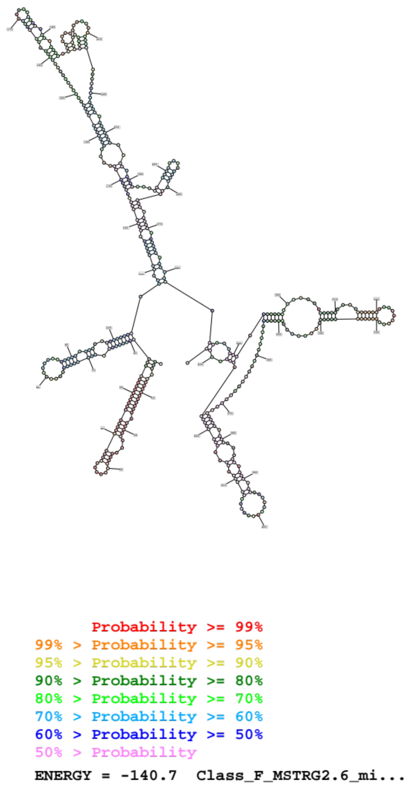{ loading=lazy }

<figcaption markdown="1">

**Figure 51: UTR (F) predicted UTR RNA 2º structure.**

</figcaption>
</figure>

<figure markdown="1" id="figure-52" class="book-figure">

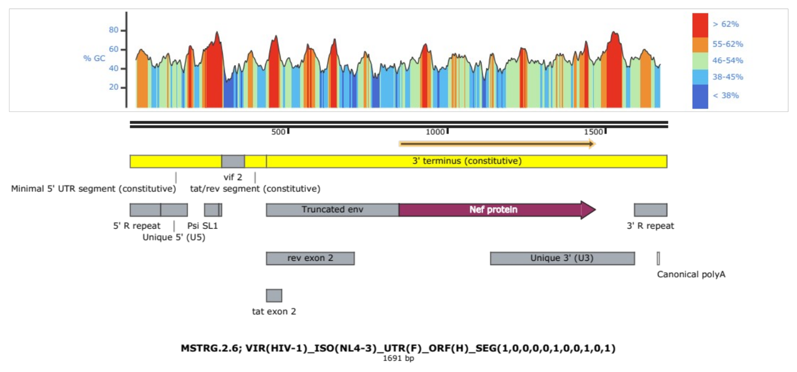{ loading=lazy }

<figcaption markdown="1">

**Figure 52: MSTRG.2.6.**

(Alejandro R. Gener et al. 2021)

</figcaption>
</figure>

<figure markdown="1" id="figure-53" class="book-figure">

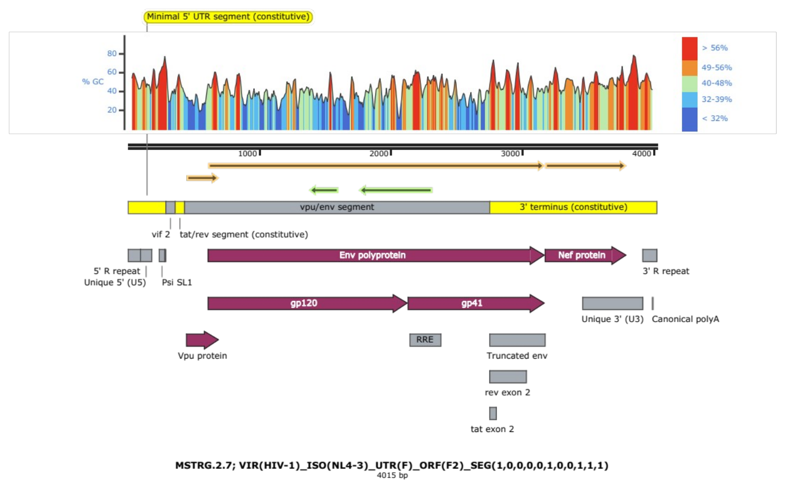{ loading=lazy }

<figcaption markdown="1">

**Figure 53: MSTRG.2.7.**

(Alejandro R. Gener et al. 2021)

</figcaption>
</figure>

### UTR Class G (n=2)

Min5UTR+pol 1, pol 2, vif 2, vpr-tat/rev. 1st ORF starts in vpr-tat/rev.

- MSTRG.2.25

- MSTRG.2.30

&gt;Class_G_MSTRG.2.25_min5UTR+pol,pol/vif,vif,vpr

<u>GGGUCUCUCUGGUUAGACCAGAUCUGAGCCUGGGAGCUCUCUGGCUAACUAGGGAACCCACUGCUUAAGCCUCAAUAAAGCUUGCCUUGAGUGCUCAAAGUAGUGUGUGCCCGUCUGUUGUGUGACUCUGGUAACUAGAGAUCCCUCAGACCCUUUUAGUCAGUGUGGAAAAUCUCUAGCAGUGGCGCCCGAACAGGGACUUGAAAGCGAAAGUAAAGCCAGAGGAGAUCUCUCGACGCAGGACUCGGCUUGCUGAAGCGCGCACGGCAAGAGGCGAGGGGCGGCGACUG</u>GGACAGCAGAGAUCCAGUUUGGAAAGGACCAGCAAAGCUCCUCUGGAAAGGUGAAGGGGCAGUAGUAAUACAAGAUAAUAGUGACAUAAAAGUAGUGCCAAGAAGAAAAGCAAAGAUCAUCAGGGAUUAUGGAAAACAGAUGGCAGAAUCUGCUAUAAGAAAUACCAUAUUAGGACGUAUAGUUAGUCCUAGGUGUGAAUAUCAAGCAGGACAUAACAAGAAUUGGGUGUCGACAUAGCAGAAUAGGCGUUACUCGACAGAGGAGAGCAAGAA

<figure markdown="1" id="figure-54" class="book-figure">

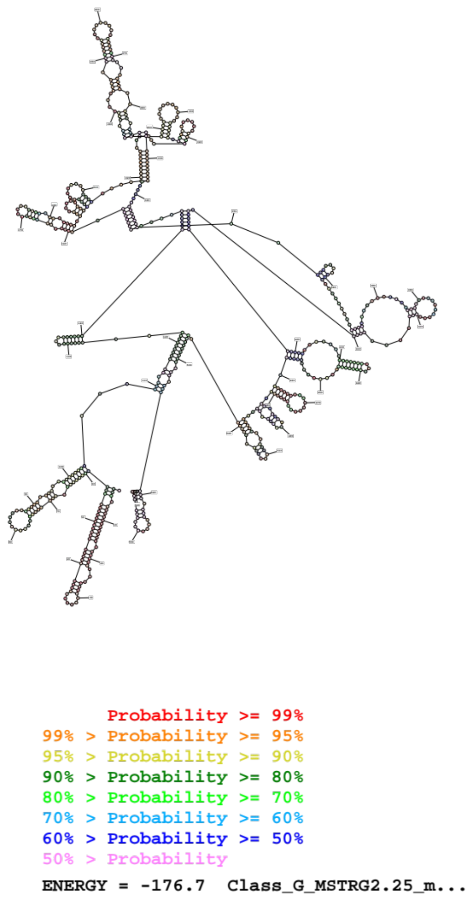{ loading=lazy }

<figcaption markdown="1">

**Figure 54: UTR (G) predicted UTR RNA 2º structure.**

</figcaption>
</figure>

<figure markdown="1" id="figure-55" class="book-figure">

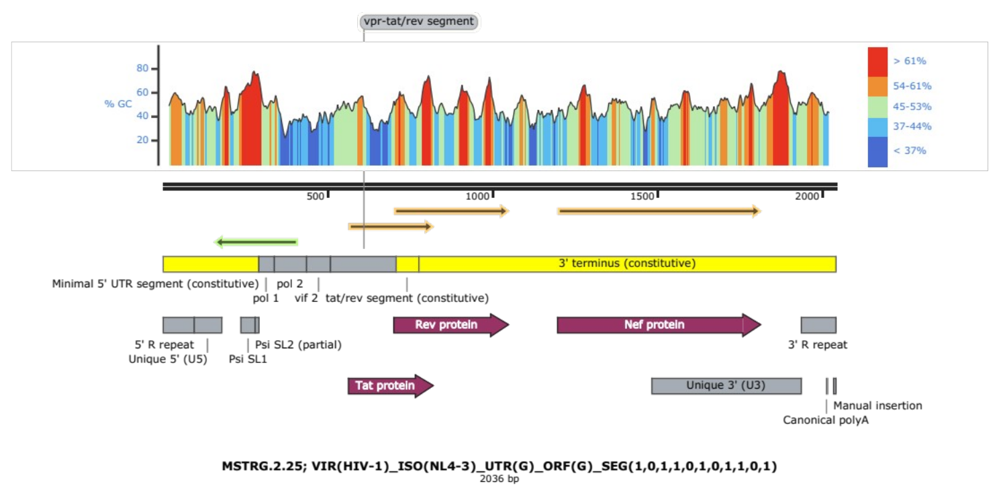{ loading=lazy }

<figcaption markdown="1">

**Figure 55: MSTRG.2.25.**

(Alejandro R. Gener et al. 2021)

</figcaption>
</figure>

<figure markdown="1" id="figure-56" class="book-figure">

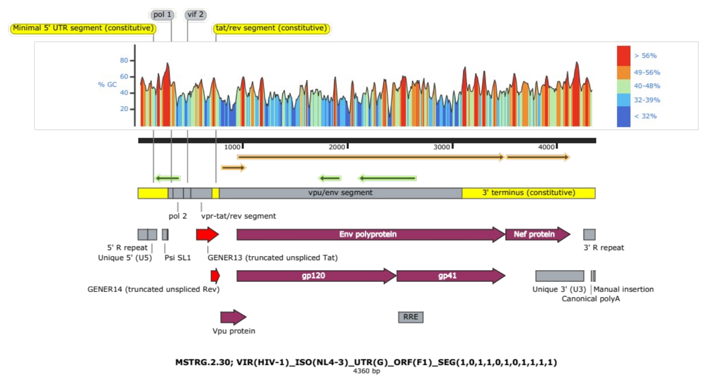{ loading=lazy }

<figcaption markdown="1">

**Figure 56: MSTRG.2.30 (GENER13, GENER14).**

(Alejandro R. Gener et al. 2021)

</figcaption>
</figure>

### UTR Class H (n=2)

Min5UTR+vif 2, vif-vpr. 1st ORF starts in vif-vpr.

- MSTRG.2.3

- MSTRG.2.18

&gt;Class_H_MSTRG.2.3_min5UTR+vif

<u>GGGUCUCUCUGGUUAGACCAGAUCUGAGCCUGGGAGCUCUCUGGCUAACUAGGGAACCCACUGCUUAAGCCUCAAUAAAGCUUGCCUUGAGUGCUCAAAGUAGUGUGUGCCCGUCUGUUGUGUGACUCUGGUAACUAGAGAUCCCUCAGACCCUUUUAGUCAGUGUGGAAAAUCUCUAGCAGUGGCGCCCGAACAGGGACUUGAAAGCGAAAGUAAAGCCAGAGGAGAUCUCUCGACGCAGGACUCGGCUUGCUGAAGCGCGCACGGCAAGAGGCGAGGGGCGGCGACUG</u>AAUCUGCUAUAAGAAAUACCAUAUUAGGACGUAUAGUUAGUCCUAGGUGUGAAUAUCAAGCAGGACAUAACAAG

<figure markdown="1" id="figure-57" class="book-figure">

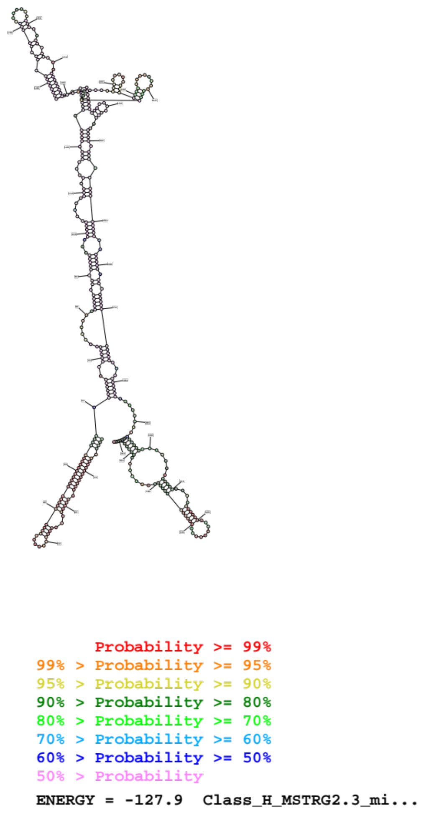{ loading=lazy }

<figcaption markdown="1">

**Figure 57: UTR (H) predicted UTR RNA 2º structure.**

</figcaption>
</figure>

<figure markdown="1" id="figure-58" class="book-figure">

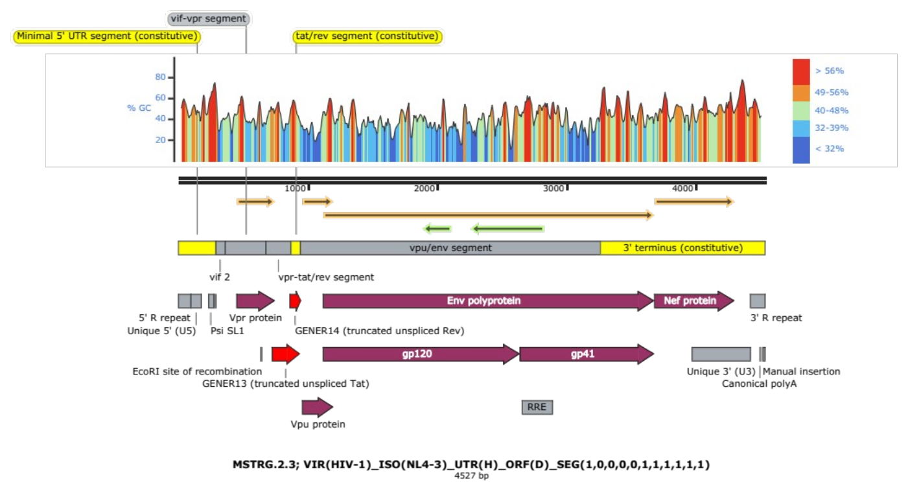{ loading=lazy }

<figcaption markdown="1">

**Figure 58: MSTRG.2.3 (GENER13, GENER14).**

(Alejandro R. Gener et al. 2021)

</figcaption>
</figure>

<figure markdown="1" id="figure-59" class="book-figure">

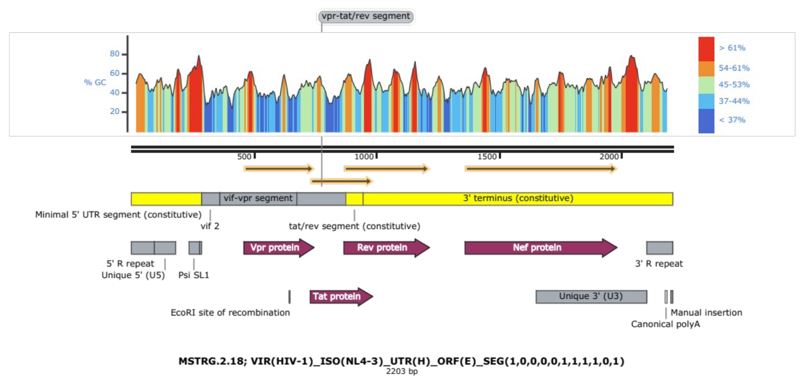{ loading=lazy }

<figcaption markdown="1">

**Figure 59: MSTRG.2.18.**

(Alejandro R. Gener et al. 2021)

</figcaption>
</figure>

### UTR Class I (n=2)

Min5UTR+vif 2, vpr-tat/rev. 1st ORF starts in vpr-tat/rev.

- MSTRG.2.15

- MSTRG.2.24  
  &gt;Class_I_MSTRG.2.15_min5UTR+vif,vpr

<u>GGGUCUCUCUGGUUAGACCAGAUCUGAGCCUGGGAGCUCUCUGGCUAACUAGGGAACCCACUGCUUAAGCCUCAAUAAAGCUUGCCUUGAGUGCUCAAAGUAGUGUGUGCCCGUCUGUUGUGUGACUCUGGUAACUAGAGAUCCCUCAGACCCUUUUAGUCAGUGUGGAAAAUCUCUAGCAGUGGCGCCCGAACAGGGACUUGAAAGCGAAAGUAAAGCCAGAGGAGAUCUCUCGACGCAGGACUCGGCUUGCUGAAGCGCGCACGGCAAGAGGCGAGGGGCGGCGACUG</u>AAUCUGCUAUAAGAAAUACCAUAUUAGGACGUAUAGUUAGUCCUAGGUGUGAAUAUCAAGCAGGACAUAACAAGAAUUGGGUGUCGACAUAGCAGAAUAGGCGUUACUCGACAGAGGAGAGCAAGAA

<figure markdown="1" id="figure-60" class="book-figure">

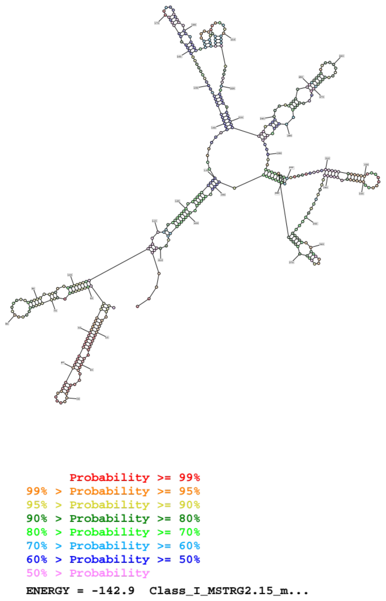{ loading=lazy }

<figcaption markdown="1">

**Figure 60: UTR (I) predicted UTR RNA 2º structure.**

</figcaption>
</figure>

<figure markdown="1" id="figure-61" class="book-figure">

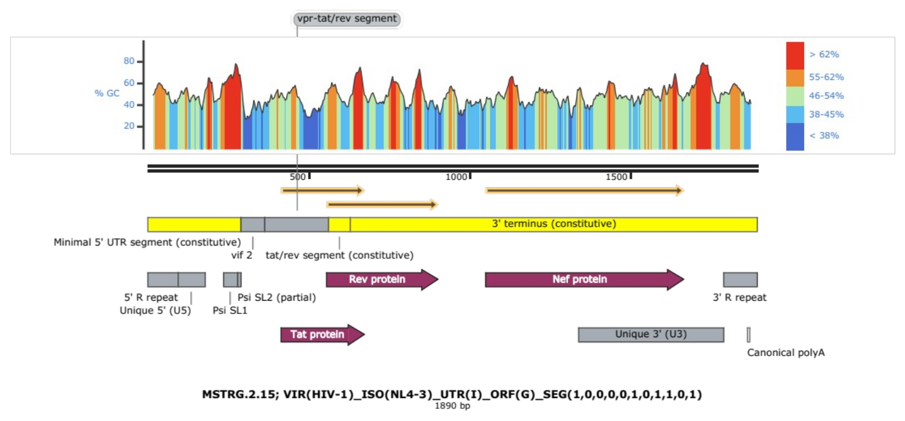{ loading=lazy }

<figcaption markdown="1">

**Figure 61: MSTRG.2.15.**

(Alejandro R. Gener et al. 2021)

</figcaption>
</figure>

<figure markdown="1" id="figure-62" class="book-figure">

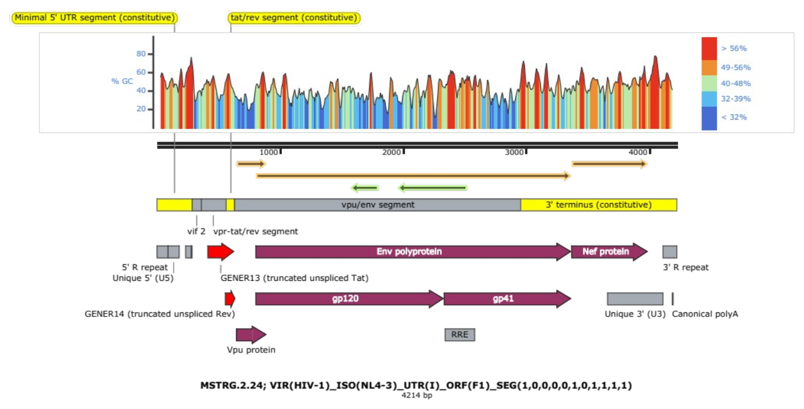{ loading=lazy }

<figcaption markdown="1">

**Figure 62: MSTRG.2.24 (GENER13, GENER14).**

(Alejandro R. Gener et al. 2021)

</figcaption>
</figure>

### UTR Class J (n=2)

Min5UTR+vpr-tat/rev. 1st ORF starts in vpr-tat/rev.

- MSTRG.2.11

- MSTRG.2.14

&gt;Class_J_MSTRG.2.11_min5UTR+vpr

<u>GGGUCUCUCUGGUUAGACCAGAUCUGAGCCUGGGAGCUCUCUGGCUAACUAGGGAACCCACUGCUUAAGCCUCAAUAAAGCUUGCCUUGAGUGCUCAAAGUAGUGUGUGCCCGUCUGUUGUGUGACUCUGGUAACUAGAGAUCCCUCAGACCCUUUUAGUCAGUGUGGAAAAUCUCUAGCAGUGGCGCCCGAACAGGGACUUGAAAGCGAAAGUAAAGCCAGAGGAGAUCUCUCGACGCAGGACUCGGCUUGCUGAAGCGCGCACGGCAAGAGGCGAGGGGCGGCGACUG</u>AAUUGGGUGUCGACAUAGCAGAAUAGGCGUUACUCGACAGAGGAGAGCAAGAA

<figure markdown="1" id="figure-63" class="book-figure">

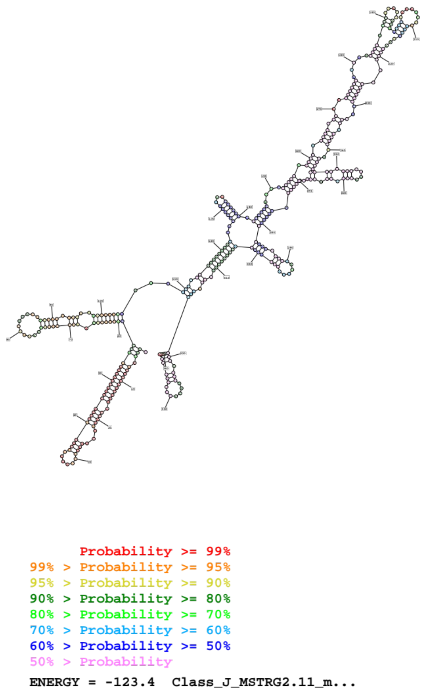{ loading=lazy }

<figcaption markdown="1">

**Figure 63: UTR (J) predicted UTR RNA 2º structure.**

</figcaption>
</figure>

<figure markdown="1" id="figure-64" class="book-figure">

{ loading=lazy }

<figcaption markdown="1">

**Figure 64: MSTRG.2.11.**

(Alejandro R. Gener et al. 2021)

</figcaption>
</figure>

<figure markdown="1" id="figure-65" class="book-figure">

{ loading=lazy }

<figcaption markdown="1">

**Figure 65: MSTRG.2.14 (GENER13, GENER14).**

(Alejandro R. Gener et al. 2021)

</figcaption>
</figure>

### UTR Class K (n=2)

Min5UTR+pol 1, pol 2, vpr-tat/rev. 1st ORF starts in vpr-tat/rev.

- MSTRG.2.23

- MSTRG.2.29

&gt;Class_K_MSTRG.2.23_min5UTR+pol,pol/vif,vpr

<u>GGGUCUCUCUGGUUAGACCAGAUCUGAGCCUGGGAGCUCUCUGGCUAACUAGGGAACCCACUGCUUAAGCCUCAAUAAAGCUUGCCUUGAGUGCUCAAAGUAGUGUGUGCCCGUCUGUUGUGUGACUCUGGUAACUAGAGAUCCCUCAGACCCUUUUAGUCAGUGUGGAAAAUCUCUAGCAGUGGCGCCCGAACAGGGACUUGAAAGCGAAAGUAAAGCCAGAGGAGAUCUCUCGACGCAGGACUCGGCUUGCUGAAGCGCGCACGGCAAGAGGCGAGGGGCGGCGACUG</u>GGACAGCAGAGAUCCAGUUUGGAAAGGACCAGCAAAGCUCCUCUGGAAAGGUGAAGGGGCAGUAGUAAUACAAGAUAAUAGUGACAUAAAAGUAGUGCCAAGAAGAAAAGCAAAGAUCAUCAGGGAUUAUGGAAAACAGAUGGCAGAAUUGGGUGUCGACAUAGCAGAAUAGGCGUUACUCGACAGAGGAGAGCAAGAA

<figure markdown="1" id="figure-66" class="book-figure">

{ loading=lazy }

<figcaption markdown="1">

**Figure 66: UTR (K) predicted UTR RNA 2º structure.**

</figcaption>
</figure>

<figure markdown="1" id="figure-67" class="book-figure">

{ loading=lazy }

<figcaption markdown="1">

**Figure 67: MSTRG.2.23.**

(Alejandro R. Gener et al. 2021)

</figcaption>
</figure>

<figure markdown="1" id="figure-68" class="book-figure">

{ loading=lazy }

<figcaption markdown="1">

**Figure 68: MSTRG.2.29 (GENER13, GENER14).**

(Alejandro R. Gener et al. 2021)

</figcaption>
</figure>

### UTR Class L (n=2)

Min5UTR+pol 1, vpr-tat/rev. 1st ORF starts in vpr-tat/rev.

- MSTRG.2.12

- MSTRG.2.21

&gt;Class_L_MSTRG.2.12_min5UTR+pol,vpr

<u>GGGUCUCUCUGGUUAGACCAGAUCUGAGCCUGGGAGCUCUCUGGCUAACUAGGGAACCCACUGCUUAAGCCUCAAUAAAGCUUGCCUUGAGUGCUCAAAGUAGUGUGUGCCCGUCUGUUGUGUGACUCUGGUAACUAGAGAUCCCUCAGACCCUUUUAGUCAGUGUGGAAAAUCUCUAGCAGUGGCGCCCGAACAGGGACUUGAAAGCGAAAGUAAAGCCAGAGGAGAUCUCUCGACGCAGGACUCGGCUUGCUGAAGCGCGCACGGCAAGAGGCGAGGGGCGGCGACUG</u>GGACAGCAGAGAUCCAGUUUGGAAAGGACCAGCAAAGCUCCUCUGGAAAGAAUUGGGUGUCGACAUAGCAGAAUAGGCGUUACUCGACAGAGGAGAGCAAGAA

<figure markdown="1" id="figure-69" class="book-figure">

{ loading=lazy }

<figcaption markdown="1">

**Figure 69: UTR (L) predicted UTR RNA 2º structure.**

</figcaption>
</figure>

<figure markdown="1" id="figure-70" class="book-figure">

{ loading=lazy }

<figcaption markdown="1">

**Figure 70: MSTRG.2.12.**

(Alejandro R. Gener et al. 2021)

</figcaption>
</figure>

<figure markdown="1" id="figure-71" class="book-figure">

{ loading=lazy }

<figcaption markdown="1">

**Figure 71: MSTRG.2.21 (GENER13, GENER14).**

(Alejandro R. Gener et al. 2021)

</figcaption>
</figure>

### UTR Class M (n=2)

Min5UTR+pol 1, tat/rev. 1st ORF starts after tat/rev.

- MSTRG.2.8

- MSTRG.2.10

&gt;Class_M_MSTRG.2.8_min5UTR+pol,tat/rev

<u>GGGUCUCUCUGGUUAGACCAGAUCUGAGCCUGGGAGCUCUCUGGCUAACUAGGGAACCCACUGCUUAAGCCUCAAUAAAGCUUGCCUUGAGUGCUCAAAGUAGUGUGUGCCCGUCUGUUGUGUGACUCUGGUAACUAGAGAUCCCUCAGACCCUUUUAGUCAGUGUGGAAAAUCUCUAGCAGUGGCGCCCGAACAGGGACUUGAAAGCGAAAGUAAAGCCAGAGGAGAUCUCUCGACGCAGGACUCGGCUUGCUGAAGCGCGCACGGCAAGAGGCGAGGGGCGGCGACUG</u>GGACAGCAGAGAUCCAGUUUGGAAAGGACCAGCAAAGCUCCUCUGGAAAGGAAGAAGCGGAGACAGCGACGAAGAGCUCAUCAGAACAGUCAGACUCAUCAAGCUUCUCUAUCAAAGCA

<figure markdown="1" id="figure-72" class="book-figure">

{ loading=lazy }

<figcaption markdown="1">

**Figure 72: UTR (M) predicted UTR RNA 2º structure.**

</figcaption>
</figure>

<figure markdown="1" id="figure-73" class="book-figure">

{ loading=lazy }

<figcaption markdown="1">

**Figure 73: UTR (M) contains a predicted pseudoknot.**

</figcaption>
</figure>

<figure markdown="1" id="figure-74" class="book-figure">

{ loading=lazy }

<figcaption markdown="1">

**Figure 74: MSTRG.2.8.**

(Alejandro R. Gener et al. 2021)

</figcaption>
</figure>

<figure markdown="1" id="figure-75" class="book-figure">

{ loading=lazy }

<figcaption markdown="1">

**Figure 75: MSTRG.2.10.**

(Alejandro R. Gener et al. 2021)

</figcaption>
</figure>

### UTR Class N (n=1)

Min5UTR+pol 1, vif 2, **vif-vpr**. 1st ORF starts in vif-vpr.

- MSTRG.2.13

&gt;Class_N_MSTRG.2.13_min5UTR+pol,vif,tat/rev

<u>GGGUCUCUCUGGUUAGACCAGAUCUGAGCCUGGGAGCUCUCUGGCUAACUAGGGAACCCACUGCUUAAGCCUCAAUAAAGCUUGCCUUGAGUGCUCAAAGUAGUGUGUGCCCGUCUGUUGUGUGACUCUGGUAACUAGAGAUCCCUCAGACCCUUUUAGUCAGUGUGGAAAAUCUCUAGCAGUGGCGCCCGAACAGGGACUUGAAAGCGAAAGUAAAGCCAGAGGAGAUCUCUCGACGCAGGACUCGGCUUGCUGAAGCGCGCACGGCAAGAGGCGAGGGGCGGCGACUG</u>GGACAGCAGAGAUCCAGUUUGGAAAGGACCAGCAAAGCUCCUCUGGAAAGAAUCUGCUAUAAGAAAUACCAUAUUAGGACGUAUAGUUAGUCCUAGGUGUGAAUAUCAAGCAGGACAUAACAAG

<figure markdown="1" id="figure-76" class="book-figure">

{ loading=lazy }

<figcaption markdown="1">

**Figure 76: UTR (N) predicted UTR RNA 2º structure.**

</figcaption>
</figure>

<figure markdown="1" id="figure-77" class="book-figure">

{ loading=lazy }

<figcaption markdown="1">

**Figure 77: MSTRG.2.13 (GENER13, GENER14).**

(Alejandro R. Gener et al. 2021)

</figcaption>
</figure>

### UTR Class O (n=1)

Min5UTR+pol 1, pol 2, vif 2). 1st ORF starts in pol 2.

- MSTRG.2.28

&gt;Class_O_MSTRG.2.28_min5UTR+NCE (pol,pol/vif,vif)

<u>GGGUCUCUCUGGUUAGACCAGAUCUGAGCCUGGGAGCUCUCUGGCUAACUAGGGAACCCACUGCUUAAGCCUCAAUAAAGCUUGCCUUGAGUGCUCAAAGUAGUGUGUGCCCGUCUGUUGUGUGACUCUGGUAACUAGAGAUCCCUCAGACCCUUUUAGUCAGUGUGGAAAAUCUCUAGCAGUGGCGCCCGAACAGGGACUUGAAAGCGAAAGUAAAGCCAGAGGAGAUCUCUCGACGCAGGACUCGGCUUGCUGAAGCGCGCACGGCAAGAGGCGAGGGGCGGCGACUG</u>GGACAGCAGAGAUCCAGUUUGGAAAGGACCAGCAAAGCUCCUCUGGAAAGGUGAAGGGGCAGUAGUAAUACAAGAUAAUAGUGACAUAAAAGUAGUGCCAAGAAGAAAAGCAAAGAUCAUCAGGGAUUAUGGAAAACAGAUGGCAGAAUCUGCUAUAAGAAAUACCAUAUUAGGACGUAUAGUUAGUCCUAGGUGUGAAUAUCAAGCAGGACAUAACAAG

<figure markdown="1" id="figure-78" class="book-figure">

{ loading=lazy }

<figcaption markdown="1">

**Figure 78: UTR (O) predicted UTR RNA 2º structure.**

</figcaption>
</figure>

<figure markdown="1" id="figure-79" class="book-figure">

{ loading=lazy }

<figcaption markdown="1">

**Figure 79: MSTRG.2.28 (GENER12).**

(Alejandro R. Gener et al. 2021)

</figcaption>
</figure>

<figure markdown="1" id="figure-80" class="book-figure">

<figcaption markdown="1">

**Figure 80: GENER12 amino acid sequence.**

&gt;HIV-1_NL4-3_GENER12

MAESAIRNTILGRIVSPRCEYQAGHNKVGSLQYLALAALIKPKQIKPPLPSVRKLTEDRWNKPQKTKGHRGSHTMNGH\*

&gt;HIV-1_NL4-3_Vif

MENRWQVMIVWQVDRMRINTWKRLVKHHMYISRKAKDWFYRHHYESTNPKISSEVHIPLGDAKLVITTYWGLHTGERDWHLGQGVSIEWRKKRYSTQVDPDLADQLIHLHYFDCFSESAIRNTILGRIVSPRCEYQAGHNKVGSLQYLALAALIKPKQIKPPLPSVRKLTEDRWNKPQKTKGHRGSHTMNGH\*

(Alejandro R. Gener et al. 2021)

FASTA naming convention below: virus_strain_orf-protein. Green amino acids are conserved. Fuchsia are new. +1 frame. GENER12 is a truncated Vif with c-terminus is intact.

</figcaption>
</figure>

<figure markdown="1" id="figure-81" class="book-figure">

{ loading=lazy }

<figcaption markdown="1">

**Figure 81: GENER12 predicted protein structure.**

(Alejandro R. Gener et al. 2021)

</figcaption>
</figure>

### UTR Class P (n=2)

Min5UTR+pol 1, vif 2, vpr-tat/rev. 1st ORF starts in vpr-tat/rev.

- MSTRG.2.20

- MSTRG.2.27

&gt;Class_P_MSTRG.2.20_min5UTR+pol,vif,vpr

<u>GGGUCUCUCUGGUUAGACCAGAUCUGAGCCUGGGAGCUCUCUGGCUAACUAGGGAACCCACUGCUUAAGCCUCAAUAAAGCUUGCCUUGAGUGCUCAAAGUAGUGUGUGCCCGUCUGUUGUGUGACUCUGGUAACUAGAGAUCCCUCAGACCCUUUUAGUCAGUGUGGAAAAUCUCUAGCAGUGGCGCCCGAACAGGGACUUGAAAGCGAAAGUAAAGCCAGAGGAGAUCUCUCGACGCAGGACUCGGCUUGCUGAAGCGCGCACGGCAAGAGGCGAGGGGCGGCGACUG</u>GGACAGCAGAGAUCCAGUUUGGAAAGGACCAGCAAAGCUCCUCUGGAAAGAAUCUGCUAUAAGAAAUACCAUAUUAGGACGUAUAGUUAGUCCUAGGUGUGAAUAUCAAGCAGGACAUAACAAGAAUUGGGUGUCGACAUAGCAGAAUAGGCGUUACUCGACAGAGGAGAGCAAGAA

<figure markdown="1" id="figure-82" class="book-figure">

{ loading=lazy }

<figcaption markdown="1">

**Figure 82: UTR (P) predicted UTR RNA 2º structure.**

</figcaption>
</figure>

<figure markdown="1" id="figure-83" class="book-figure">

{ loading=lazy }

<figcaption markdown="1">

**Figure 83: MSTRG.2.20.**

(Alejandro R. Gener et al. 2021)

</figcaption>
</figure>

<figure markdown="1" id="figure-84" class="book-figure">

{ loading=lazy }

<figcaption markdown="1">

**Figure 84: MSTRG.2.27 (GENER13, GENER14).**

(Alejandro R. Gener et al. 2021)

</figcaption>
</figure>

### UTR Class Q (n=1)

Min5UTR+pol 1, vif 2, vif-vpr. 1st ORF starts in vif-vpr.

- MSTRG.2.22

&gt;Class_Q_MSTRG.2.22_min5UTR+pol,vif

<u>GGGUCUCUCUGGUUAGACCAGAUCUGAGCCUGGGAGCUCUCUGGCUAACUAGGGAACCCACUGCUUAAGCCUCAAUAAAGCUUGCCUUGAGUGCUCAAAGUAGUGUGUGCCCGUCUGUUGUGUGACUCUGGUAACUAGAGAUCCCUCAGACCCUUUUAGUCAGUGUGGAAAAUCUCUAGCAGUGGCGCCCGAACAGGGACUUGAAAGCGAAAGUAAAGCCAGAGGAGAUCUCUCGACGCAGGACUCGGCUUGCUGAAGCGCGCACGGCAAGAGGCGAGGGGCGGCGACUG</u>GGACAGCAGAGAUCCAGUUUGGAAAGGACCAGCAAAGCUCCUCUGGAAAGAAUCUGCUAUAAGAAAUACCAUAUUAGGACGUAUAGUUAGUCCUAGGUGUGAAUAUCAAGCAGGACAUAACAAG

<figure markdown="1" id="figure-85" class="book-figure">

{ loading=lazy }

<figcaption markdown="1">

**Figure 85: UTR (Q) predicted UTR RNA 2º structure.**

</figcaption>
</figure>

<figure markdown="1" id="figure-86" class="book-figure">

{ loading=lazy }

<figcaption markdown="1">

**Figure 86: MSTRG.2.22.**

(Alejandro R. Gener et al. 2021)

</figcaption>
</figure>

### New HIV-1 isoform naming convention (prototype)

The way the Nguyen et al. 2020 group defined their transcripts is not easily adaptable to other HIV-1 strains. They also do not define ORFs or identify putative proteins.

For the time being, we recommend keeping the MSTRG.n.m names for shorthand, where n and m are isoform groups and subgroups. These names are StringTie -merge default outputs and will be distinct if another user applies our method to different data. However, the MSTRG names are ambiguous once one considers isoforms from multiple viral strains or isolates. To redress such ambiguity, we propose a formal mRNA naming convention: HIV-1_NL4-3_UTR-CLASS_ORF-CLASS_segment-string (1 representing if a given segment is expressed; 0 if not)\_variantinfo. E,g., the full-length unspliced isoform (currently MSTRG.2.4) would be:

VIR(HIV-1)\_ISO(NL4-3)\_UTR(A)\_ORF(A)\_(1,1,1,1,1,1,1,1,1,1,1).

This nomenclature provides unambiguous info in a compact name string. Better than "*nef*", which has 4 identical ORFs across 4 distinct mRNAs:

- MSTRG.2.8 (UTR M) 

- MSTRG.2.9 (UTR E) 

- MSTRG.2.6 (UTR F) 

- MSTRG.2.2 (UTR D) 

The *nef* gene is important because it is attached to every complete HIV transcript. Those four *nef*-only mRNAs would be:

- VIR(HIV-1)\_ISO(NL4-3)\_UTR(M)\_ORF(H)\_(1,0,1,0,0,0,0,0,1,0,1)

- VIR(HIV-1)\_ISO(NL4-3)\_UTR(E)\_ORF(H)\_(1,0,1,0,0,1,0,0,1,0,1)

- VIR(HIV-1)\_ISO(NL4-3)\_UTR(F)\_ORF(H) (1,0,0,0,0,1,0,0,1,0,1)

- VIR(HIV-1)\_ISO(NL4-3)\_UTR(D)\_ORF(H)\_(1,0,0,0,0,0,0,0,1,0,1)

These would all make Nef protein.

<figure markdown="1" id="table-1" class="book-table">

<figcaption markdown="1">

**Table 1: HIV-1 NL4-3 transcript models, segment content, UTR and ORF classes, proposed naming convention.**

(Alejandro R. Gener et al. 2021)

</figcaption>

{ loading=lazy }
</figure>

<figure markdown="1" id="figure-87" class="book-figure">

{ loading=lazy }

<figcaption markdown="1">

**Figure 87: HIV-1 NL4-3 UTRs exhibit RNA binding protein motifs.**

(Alejandro R. Gener et al. 2021)

Threshold = 0.8 or 80% (range 0-1 or 0-100%). Returns hits &gt; 0.8 or 80%. <http://rbpdb.ccbr.utoronto.ca/index.php> (Cook et al. 2011). Right now, we don't know if UTRs do anything. This may be updated once further studies are performed. It is important to know what real HIV isoforms look like. These UTRs are the main parts of the HIV-1 mRNAS that help StringTie uses to distinguish between isoforms. Working document “RNA binding protein prediction HIV RNA.xlsx.”

</figcaption>
</figure>

<figure markdown="1" id="figure-88" class="book-figure">

{ loading=lazy }

<figcaption markdown="1">

**Figure 88: HIV-1 mRNAs are polycistronic.**

It is important to consider that HIV-1 mRNAs are polycistronic when attempting transcript profiling. Positional effects may limit the expression of downstream ORFs HIV-1 (e.g., Vpu/Env (S Schwartz et al. 1990) and Tat and Rev/Nef (Schwartz et al. 1992)).

</figcaption>
</figure>

#### FIGURE : Transcript profiling of HIV-1 NL4-3 mRNA with bespoke transcript models

{ loading=lazy }

### Discussion

Five new integrases (GENER4-integrase, GENER5-integrase, GENER6/8-integrase, GENER7-integrase, GENER9-integrase) were identified. In theory, most integrase (IN) antibodies should be able to pick up GENER-Gag-Pols (GENER4-Gag-Pol, GENER5-Gag-Pol, GENER6/8-Gag-Pol, GENER7-Gag-Pol, GENER9-Gag-Pol) or their protease cleavage products GENER4-integrase, GENER5-integrase, GENER6/8-integrase, GENER7-integrase, GENER9-integrase if in infected human cells or samples with sufficient mature virion. Past evidence for new integrases include western blots from AIDS Reagent integrase (IN) antibodies (Nilsen et al. 1996). However, earlier methods such as radio immunoassays lacked the resolving power and dynamic range to detect many products (Gorny et al. 1989). Unfortunately, blots were also often run for lower molecular weights (Gorny et al. 1989). Protein blots (e.g., (Simm et al. 1995)) generally have low resolving power compared to nucleic acid sequencing, but the two are not directly comparable. Protein work is therefore currently limited.

In the following case (Sakai et al. 1991), we might expect to see a signal from Vif, GENER6/8-Gag-Pol, GENER6/8-IN, and GENER12. Considering (**[Supplemental Table 3](#supplemental-table-3): HIV-1 NL4-3 gene product metrics and their predicted locations**), these might have molecular weights of 22.7 kilodalton (kDa), 165.6 kDa, 35.9 kDa, and 8.7 kDa, respectively. These share the **<u>bold underlined</u>** segment:

&gt;GENER6/8-integrase = FLDGIDKAQEEHEKYHSNWRAMASDFNLPPVVAKEIVASCDKCQLKGEAMHGQVDCSPGIWQLDCTHLEGKVILVAVHVASGYIEAEVIPAETGQETAYFLLKLAGRWPVKTVHTDNGSNFTSTTVKAACWWAGIKQEFGIPYNPQSQGVIESMNKELKKIIGQVRDQAEHLKTAVQMAVFIHNFKRKGGIGGYSAGERIVDIIATDIQTKELQKQITKIQNFRVYYRDSRDPVWKGPAKLLWKESAIRNTILGRIVSPRCEYQAGHNKVGSLQYLALAALIKPKQIKPPLPSVRKL**<u>TEDRWNKPQKTKGHR</u>**GSHTMNGH\*

It is also common practice to show only individual bands. For example, in Anti-HIV-1 Vif Antibody (319): sc-69731 <https://datasheets.scbt.com/sc-69731.pdf>, the following sources are cited:

1.  Valera, M.S., de Armas-Rillo, L., Barroso-González, J., Ziglio, S., Batisse, J., Dubois, N., Marrero-Hernández, S., Borel, S., García-Expósito, L., Biard- Piechaczyk, M., Paillart, J.C. and Valenzuela-Fernández, A. 2015. The HDAC6/APOBEC3G complex regulates HIV-1 infectiveness by inducing Vif autophagic degradation. Retrovirology 12: 53.

2.  Augustine, T., Chaudhary, P., Gupta, K., Islam, S., Ghosh, P., Santra, M.K. and Mitra, D. 2017. Cyclin F/FBXO1 interacts with HIV-1 viral infectivity factor (Vif) and restricts progeny virion infectivity by ubiquitination and proteasomal degradation of Vif protein through SCFcyclin F E3 ligase machinery. J. Biol. Chem. 292: 5349-5363.

3.  Evans, E.L., Becker, J.T., Fricke, S.L., Patel, K. and Sherer, N.M. 2018. HIV-1 Vif’s capacity to manipulate the cell cycle is species specific. J. Virol. 92. pii: e02102-e02117.

4.  **Marrero-Hernández, S., Márquez-Arce, D., Cabrera-Rodríguez, R., Estévez- Herrera, J., Pérez-Yanes, S., Barroso-González, J., Madrid, R., Machado, J.D., Blanco, J. and Valenzuela-Fernández, A. 2019. HIV-1 Nef targets HDAC6 to assure viral production and virus infection. Front. Microbiol. 10: 2437**.

Only 1-3 show predicted band. Likely for sake of space, but at expense of any “nonspecific” bands which might be vif-containing HIV-1 protein isoforms. However, occasionally you can find multiple bands. For example, [Figure 6](#figure-6) in Marrero-Hernández et al.

<figure markdown="1" id="table-2" class="book-table">

<figcaption markdown="1">

**Table 2: Predicted protein domains conserved across in new HIV-1 NL4-3 putative open reading frames.**

trRosetta (Yang et al. 2020).

</figcaption>

{ loading=lazy }
</figure>

<figure markdown="1" id="figure-89" class="book-figure">

{ loading=lazy }

<figcaption markdown="1">

**Figure 89: Putative ORFs retain relative synonymous codon usage.**

</figcaption>
</figure>

<figure markdown="1" id="table-3" class="book-table">

<figcaption markdown="1">

**Table 3: HIV-1, SIVcpz, and SIVgor genomic sequences used to evaluate conservation of HIV-1 NL4-3 ORFs.**

(Sievers et al. 2011)

“SnapGene Clustal Omega Conservation Scores (0-100, 100 is perfect).xlsx”

</figcaption>

{ loading=lazy }
</figure>

<figure markdown="1" id="figure-90" class="book-figure">

{ loading=lazy }

<figcaption markdown="1">

**Figure 90: GENER1A-p17 is conserved across HIV-1, SIVcpz, and SIVgor.**

**GENER1A-p17 is conserved across HIV-1, SIVcpz and SIVgor.**

The GENER1A-p17 amino acid sequence was too small to produce a meaningful tree (Katoh et al. 2017). Three A3 sequences were clipped from the above multisequence alignment cartoon because they were incidentally out of frame. This brought the total number of primate immunodeficiency virus sequences down from 94 to 91. The resulting figure summarizes the homogeneity of the sample, evidenced by consistent vertical stripes.

</figcaption>
</figure>

<figure markdown="1" id="figure-91" class="book-figure">

{ loading=lazy }

<figcaption markdown="1">

**Figure 91: GENER2 is conserved across HIV-1, SIVcpz and SIVgor.**

Unrooted tree. Gray bar is substitutions per site (bar length 0.1). Insert represents MSA cartoon. Number of sequences = 94.

</figcaption>
</figure>

<figure markdown="1" id="figure-92" class="book-figure">

{ loading=lazy }

<figcaption markdown="1">

**Figure 92: GENER3 is conserved across HIV-1, SIVcpz and SIVgor.**

</figcaption>
</figure>

<figure markdown="1" id="figure-93" class="book-figure">

{ loading=lazy }

<figcaption markdown="1">

**Figure 93: p31 integrase (IN) is conserved across HIV-1, SIVcpz and SIVgor.**

Three sequences were removed due to a frameshift proximal to the translation initiation site: A2_CD_97, CPZ_CM_98, K_CD_97. C_BR_92 was retained despite a distal frame shift. N=91.

</figcaption>
</figure>

<figure markdown="1" id="figure-94" class="book-figure">

{ loading=lazy }

<figcaption markdown="1">

**Figure 94: GENER4-IN is conserved across HIV-1, SIVcpz and SIVgor.**

</figcaption>
</figure>

<figure markdown="1" id="figure-95" class="book-figure">

{ loading=lazy }

<figcaption markdown="1">

**Figure 95: GENER5-IN is conserved across HIV-1, SIVcpz and SIVgor.**

</figcaption>
</figure>

<figure markdown="1" id="figure-96" class="book-figure">

{ loading=lazy }

<figcaption markdown="1">

**Figure 96: GENER6/8-IN is conserved across HIV-1, SIVcpz and SIVgor.**

</figcaption>
</figure>

<figure markdown="1" id="figure-97" class="book-figure">

{ loading=lazy }

<figcaption markdown="1">

**Figure 97: GENER7-IN is conserved across HIV-1, SIVcpz and SIVgor.**

</figcaption>
</figure>

<figure markdown="1" id="figure-98" class="book-figure">

{ loading=lazy }

<figcaption markdown="1">

**Figure 98: GENER9-IN is conserved across HIV-1, SIVcpz and SIVgor.**

</figcaption>
</figure>

<figure markdown="1" id="figure-99" class="book-figure">

{ loading=lazy }

<figcaption markdown="1">

**Figure 99: GENER10 is conserved across HIV-1, SIVcpz and SIVgor.**

</figcaption>
</figure>

<figure markdown="1" id="figure-100" class="book-figure">

{ loading=lazy }

<figcaption markdown="1">

**Figure 100: GENER11 is conserved across HIV-1, SIVcpz and SIVgor.**

</figcaption>
</figure>

<figure markdown="1" id="figure-101" class="book-figure">

{ loading=lazy }

<figcaption markdown="1">

**Figure 101: GENER12 is conserved across HIV-1, SIVcpz and SIVgor.**

</figcaption>
</figure>

<figure markdown="1" id="figure-102" class="book-figure">

{ loading=lazy }

<figcaption markdown="1">

**Figure 102: GENER13 is conserved across HIV-1, SIVcpz and SIVgor.**

The GENER13 amino acid sequence was too small to produce a meaningful tree (Katoh et al. 2017). The resulting figure summarizes the homogeneity of the sample, evidenced by consistent vertical stripes. The following were removed from the figure because they were out of frame: CPZ_TZ_06_TAN5_JN091691, CPZ_TZ_00_TAN1_AF447763, CPZ_TZ_01_TAN2_EF394357, CPZ_TZ_02_TAN3_1_DQ374658, CPZ_TZ_06_SIVcpzTAN13_JQ768416, CPZ_TZ_09_UG38_JN091690. They were retained for the conservation score reported elsewhere.

</figcaption>
</figure>

<figure markdown="1" id="figure-103" class="book-figure">

{ loading=lazy }

<figcaption markdown="1">

**Figure 103: GENER14 is conserved across HIV-1, SIVcpz and SIVgor.**

The GENER14 amino acid sequence was too small to produce a meaningful tree (Katoh et al. 2017). The resulting figure summarizes the homogeneity of the sample, evidenced by consistent vertical stripes. Rev exon 2 sequence is present in GENER4-Gag-Pol and GENER4-IN.

</figcaption>
</figure>

<figure markdown="1" id="figure-104" class="book-figure">

{ loading=lazy }

<figcaption markdown="1">

**Figure 104: GENER15-PR is conserved across HIV-1, SIVcpz and SIVgor.**

The GENER15-PR amino acid sequence was too small to produce a meaningful tree (Katoh et al. 2017). The resulting figure summarizes the homogeneity of the sample, evidenced by consistent vertical stripes.

</figcaption>
</figure>

<figure markdown="1" id="figure-105" class="book-figure">

{ loading=lazy }

<figcaption markdown="1">

**Figure 105: Gag is conserved across HIV-1, SIVcpz and SIVgor.**

Three A3 sequences and D_TZ_01 were clipped from the above multisequence alignment cartoon because they were incidentally out of frame. This brought the total number of primate immunodeficiency virus sequences down from 94 to 90. Several gorilla sequences have structural variants which are not present in chimpanzee or human.

</figcaption>
</figure>

<figure markdown="1" id="figure-106" class="book-figure">

{ loading=lazy }

<figcaption markdown="1">

**Figure 106: Vif is conserved across HIV-1, SIVcpz and SIVgor.**

</figcaption>
</figure>

<figure markdown="1" id="figure-107" class="book-figure">

{ loading=lazy }

<figcaption markdown="1">

**Figure 107: Vpr is conserved across HIV-1, SIVcpz and SIVgor.**

</figcaption>
</figure>

<figure markdown="1" id="figure-108" class="book-figure">

{ loading=lazy }

<figcaption markdown="1">

**Figure 108: Vpu is conserved across HIV-1, SIVcpz and SIVgor.**

The Vpu amino acid sequence was too small to produce a meaningful tree (Katoh et al. 2017). The resulting figure summarizes the heterogeneity of the sample, evidenced by inconsistent vertical stripes and many gaps. This is unlikely to be the result of frameshifts because upstream (Tat and Rev) and downstream (Env) ORFs are preserved.

</figcaption>
</figure>

<figure markdown="1" id="figure-109" class="book-figure">

{ loading=lazy }

<figcaption markdown="1">

**Figure 109: Env is conserved across HIV-1, SIVcpz and SIVgor.**

Note gaps coincide with known hypervariable regions V1-V5.

</figcaption>
</figure>

<figure markdown="1" id="figure-110" class="book-figure">

{ loading=lazy }

<figcaption markdown="1">

**Figure 110: Nef is conserved across HIV-1, SIVcpz and SIVgor.**

Four sequences were removed from final figure (tree+MSA) because they were out of frame. These were P_FR_09, P_FR_x, GOR_CM_04, and CPZ_US_85.

</figcaption>
</figure>

<figure markdown="1" id="figure-111" class="book-figure">

{ loading=lazy }

<figcaption markdown="1">

**Figure 111: ASP is conserved across HIV-1, SIVcpz and SIVgor.**

Antisense protein (ASP) generally conserved in HIV-1 M B, C, D, F1, F2, G, H, J. This is more apparent in the SnapGene Clustal Omega which uses “\*” for stop codons. The vertical striping and default coloration of MAFFT View

</figcaption>
</figure>

### Discussion (continued)

#### New ORFs supported by “non-specific” bands in old western blots.

See examples above and “**[Supplemental Table 5](#supplemental-table-5): Putative HIV-1 GENER-Gag-Pol-integrase proteins supported in literature.**”

#### Evolutionary comparison supports ORFs

Most of the new ORFs above were about as conserved across the n=94 SIV dataset as the previously described 9 sense-encoded HIV genes: *gag*, *gag-pol*, *vif*, *vpr*, *vpu*, *env*, *nef*, *tat*, and *rev*. These ORFs also had similar relative synonymous codon usages (RCSU), consistent with being from the same regulatory unit (in this case, a virus). However, this may be less informative for shorter amino acids. See Figures above.

#### Bespoke vs. general transcript models

To date, the best long-read sequencing dataset had been the NL4-3 cDNA PCR-barcoded experiments by Nguyen et al. from 2020. However, HIV splicing studies rarely if ever included explicit transcript models, limiting the studies’ utility. Thankfully, new tools such as StringTie (Kovaka et al. 2019; Pertea et al. 2015) can model transcription directly from reads. The accuracy of such models increases with long-read input. We constructed transcript models using empirically determined StringTie settings (Gener et al. 2020) and cross-validated by inspecting mapped reads in IGV. MSTRG.1, MSTRG.3, and MSTRG.4 were removed from the final model because of redundancy with other models and incorporation of shorter reads altering apparent TSS. MSTRG.2.41 and MSTG.2.42 were removed because of incorporation of sequences with homology to host flanking sequence in pNL4-3. Reads mapping to this area cannot be distinguished between pNL4-3 transcripts or host mRNA with similar homology. MSTRG.2.16 was removed because it lacked a full set of constitutive segments (segment numbers 1, 9, and 11). The real start site in NL4-3 is confirmed to be at the beginning of 5’ R, incorporating 3 “G”. This is incorrectly noted in the HXB2 reference K03455.1. MSTRG start and stop sites were modified to include full R elements. Note that the R sequence in NL4-3 differs. NL4-3 is a synthetic recombinant, with NY5 5’ R and LAV/HXB2 3’ R. Final models were not yet adjusted for this as GTF. They were adjusted as .dna. TSS = transcription start site. The resulting bespoke NL4-3 transcript model represents a “plug-and-play” transcript model set as .gtf file that is appropriate for use to aid in mRNA detection and quantification all NL4-3 RNA-seq experiments.

#### Locus Segmentation enables generalizability of models.

Locus segments may be mapped onto non-NL4-3 sequences to create generalized models for a given HIV or HIV-like virus. Inputs for such an endeavor are 1.) HIV-1 NL4-3 mRNA Atlas v1.1’s 11 locus segments as nucleic acid FASTA, and 2.) a target HIV genome assembly. We present these new models as plug-and-play HIV-1 transcript models for future HIV-1 work in the time that deeper complete reference-specific HIV-1 transcript models and validated transcript sets are made. Importantly, NL4-3 systems do should not need further model optimization. However, nuances in experiments (for example, cell type or other experimental conditions) might alter the mRNA profile of an HIV-infected cell, including changing amount of mRNAs described here or creating new mRNAs which may have existed below the currently observed 1/1000 abundance threshold.

#### Untranslated region (UTR) and open reading frames (ORF) classifications define normal HIV-1 NL4-3 transcriptional landscape and elucidate novel ORFs and putative protein products.

Based on our NL4-3 transcript models, we propose two new classification systems. The UTR Classification System includes 17 Classes, UTR Class A-Q (**[Table 1](#table-1): HIV-1 NL4-3 transcript models, segment content, UTR and ORF classes, proposed naming convention**). While there does not yet appear to be a functional distinction between the UTR classes, these define structural features of real HIV-1 mRNA and are used to define transcript models based on most common splice sites. On closer inspection, regions in UTRs appeared modular, only occasionally seeming to interact with neighboring predicted RNA 2º structures (**[Figure 1](#figure-1): UTR (A) predicted UTR RNA 2º structure; [Figure 32](#figure-32): UTR (B) predicted UTR RNA 2º structure; [Figure 36](#figure-36): UTR (C) predicted UTR RNA 2º structure; [Figure 44](#figure-44): UTR (D) predicted UTR RNA 2º structure; [Figure 48](#figure-48): UTR (E) predicted UTR RNA 2º structure; [Figure 51](#figure-51): UTR (F) predicted UTR RNA 2º structure; [Figure 54](#figure-54): UTR (G) predicted UTR RNA 2º structure; [Figure 57](#figure-57): UTR (H) predicted UTR RNA 2º structure; [Figure 60](#figure-60): UTR (I) predicted UTR RNA 2º structure; [Figure 63](#figure-63): UTR (J) predicted UTR RNA 2º structure; [Figure 66](#figure-66): UTR (K) predicted UTR RNA 2º structure; [Figure 69](#figure-69): UTR (L) predicted UTR RNA 2º structure; [Figure 72](#figure-72): UTR (M) predicted UTR RNA 2º structure; [Figure 76](#figure-76): UTR (N) predicted UTR RNA 2º structure; [Figure 78](#figure-78): UTR (O) predicted UTR RNA 2º structure; [Figure 82](#figure-82): UTR (P) predicted UTR RNA 2º structure; [Figure 85](#figure-85): UTR (Q) predicted UTR RNA 2º structure**).

The second, and arguably more interesting classification scheme is the ORF Classification System. This includes fewer classes ORF Class A-H (**[Table 1](#table-1): HIV-1 NL4-3 transcript models, segment content, UTR and ORF classes, proposed naming convention**) and clarifies the past assumption about HIV mRNA being monocistronic. Class A and other are heterogeneous because of splicing downstream of 5’ UTR. Past naming conventions focused on which ORF came first (Nguyen Quang et al. 2020; Ocwieja et al. 2012; Purcell and Martin 1993) when traversing from the 5’ end to the 3’ end. That practice ignored the polycistronic nature of HIV transcripts (**[Figure 88](#figure-88): HIV-1 mRNAs are polycistronic**). We provide the first clear definitions of HIV-1 mRNA transcripts that are easily redeployed to other viruses. Our method elucidated 15 new ORFs which are likely to be made (**[Figure 2](#figure-2): MSTRG.2.4 (unspliced HIV-1 NL4-3 with new ORFs)** into putative proteins which had not been described previously. Both of these new classification systems offer synergistic improvements over splice site detection and/or semiquantitation (Nguyen Quang et al. 2020; Ocwieja et al. 2012; Purcell and Martin 1993) which may have been sensitive, however past methods’ relevance may have been amplified artificially by PCR and observer biases.

Future endeavors may focus on stabilizing these isoforms and cloning new ORFs to determine their function. Two-dimensional polyacrylamide gel electrophoresis on HIV-1 virions offers improvement on traditional one-dimensional western blots. Mass-spec on bands/spots from cells infected with nearly full-length HIV may be performed if care is taken to spare splice junctions during peptide fractionation (Anna Malovannaya, personal communication). Additionally, top-down protease-free mass spec methods are improving and may provide another avenue to validate these new targets. We can now appreciate the rest of HIV-1’s arsenal, and can continue our efforts to dissect, better treat, and maybe one day soon cure HIV infection.

### Article types

Original Research Article

### Permission to reuse and Copyright

##### Creative Commons CC-BY

### Author Contributions

ARG conceived of this project and performed all reanalyses. BTF provided a curated SIV and HIV-1 dataset. ARG, BTF, DPH, and JTK analyzed results. ARG drafted the manuscript. ARG, BTF, DPH, and JTK edited the manuscript. ARG, and JTK provided funding.

### Conflict of Interest

ARG received travel bursaries from Oxford Nanopore Technologies (ONT), Oxford, UK in 2019. The present work was completed independently of ONT. Other authors declare no conflict of interest.

### Funding

This work was funded in part by institutional support from Baylor College of Medicine; private funding by East Coast Oils, Inc., Jacksonville, Florida, and ARG’s own private funding. ARG also received the PFLAG of Jacksonville scholarship for multiple years. The work was also supported in part by NIH grant AI116167 to JTK.

### Data availability

The datasets generated for this study are available in GenBank with the following accessions: MZ242720, MZ242721, MZ242722, MZ242719, MZ242723, MZ242724, MZ242725, MZ242726, MZ242727, MZ242728, MZ242729, MZ242730, MZ242731, MZ242732, MZ242733, MZ242735, MZ242736, MZ242737, MZ242738, MZ242739, MZ242740, MZ242741, MZ242742, MZ242743, MZ242744, MZ242745, MZ242746, MZ242747, MZ242748, MZ242749, MZ242750, MZ242751, MZ242752, MZ242753, MZ242754, MZ242755, MZ242756, MZ242757. Models as .gtf are available. These should be used with pNL4-3 (see Methods). The RefSeq HIV-1 reference NC_001802.1 is being updated to include new annotations.

### Acknowledgments

The authors would like to thank Dr. Mark Landry for carefully reviewing GenBank entries, and Dr. Eneida Hatcher at NCBI/NLM/NIH for help updating RefSeq:NC_001802.

### References

Alluri, Hari. 2018. “Origin Story.” *The Massachusetts Review* 59(4):672–74.

Blumenthal, Thomas. 1998. “Gene Clusters and Polycistronic Transcription in Eukaryotes.” *BioEssays* 20(6):480–87.

Borg, Keith M., Justin P. Favaro, Salvatore J. Arrigo, and Michael Schmidt. 1999. “Activation of a Cryptic Splice Donor in Human Immunodeficiency Virus Type-1.” *Journal of Biomedical Science* 6(1):45–52.

Colombini, S., S. K. Arya, M. S. Reitz, L. Jagodzinski, B. Beaver, and F. Wong-Staal. 1989. “Structure of Simian Immunodeficiency Virus Regulatory Genes.” *Proceedings of the National Academy of Sciences of the United States of America* 86(13):4813–17.

Cook, Kate B., Hilal Kazan, Khalid Zuberi, Quaid Morris, and Timothy R. Hughes. 2011. “RBPDB: A Database of RNA-Binding Specificities.” *Nucleic Acids Research* 39(suppl_1):D301–8.

Davis, J. L. and J. E. Clements. 1989. “Characterization of a CDNA Clone Encoding the Visna Virus Transactivating Protein.” *Proceedings of the National Academy of Sciences of the United States of America* 86(2):414–18.

Foley, Brian T., Thomas Leitner, Dimitrios Paraskevis, and Martine Peeters. 2016. “Primate Immunodeficiency Virus Classification and Nomenclature: Review.” *Infection, Genetics and Evolution : Journal of Molecular Epidemiology and Evolutionary Genetics in Infectious Diseases* 46:150–58.

Gener, Alejandro R., Deborah P. Hyink, Paul E. Klotman, and Jason T. Kimata. 2021. “HIV-1 Segmentation-Based Transcript Models Define 5’ Untranslated Region (UTR) and Open Reading Frame (ORF) Classes, Elucidate Total Viral Protein-Coding Capacity, and Are Summarized by a New HIV-1 MRNA Naming Convention.” P. ePoster in *24th International AIDS Conference (IAS2021)*.

Gener, Alejandro R., Yini Liang, Maliha Jeba, Delmarie M. Rivera Rodríguez, Kirk Niekamp, Lawrence Tan, Ashwarya S. Devason, Mayra Aucapina, Akash Naik, Taneasha Washington, Ying Fan, Gokul C. Das, Weijia Zhang, John Cijiang He, Deborah P. Hyink, and Paul E. Klotman. 2020. “P39 - Insights from Comprehensive Transcript Models of HIV-1.” P. ePoster in *Genome Informatics 2020*.

Gener, Alejandro R, Wei Zou, Brian T. Foley, Deborah P. Hyink, and Paul E. Klotman. 2021. “Reference Plasmid PHXB2_D Is an HIV-1 Molecular Clone That Exhibits Identical LTRs and a Single Integration Site Indicative of an HIV Provirus.” *BioRxiv* 611848.

Gorny, M. K., V. Gianakakos, S. Sharpe, and S. Zolla-Pazner. 1989. “Generation of Human Monoclonal Antibodies to Human Immunodeficiency Virus.” *Proceedings of the National Academy of Sciences of the United States of America* 86(5):1624–28.

Guatelli, J. C., T. R. Gingeras, and D. D. Richman. 1990. “Alternative Splice Acceptor Utilization during Human Immunodeficiency Virus Type 1 Infection of Cultured Cells.” *Journal of Virology* 64(9):4093–98.

Hope, Thomas J. and Didier Trono. 2000. “Structure, Expression, and Regulation of the HIV Genome.” *HIV InSite Knowledge Base Chapter*. Retrieved June 8, 2021 (http://hivinsite.ucsf.edu/InSite?page=kb-02-01-02).

Katoh, Kazutaka, John Rozewicki, and Kazunori D. Yamada. 2017. “MAFFT Online Service: Multiple Sequence Alignment, Interactive Sequence Choice and Visualization.” *Briefings in Bioinformatics* 20(4):1160–66.

Kovaka, Sam, Aleksey V Zimin, Geo M. Pertea, Roham Razaghi, Steven L. Salzberg, and Mihaela Pertea. 2019. “Transcriptome Assembly from Long-Read RNA-Seq Alignments with StringTie2.” *Genome Biology* 20(1):278.

Krummheuer, Jörg, Adam T. Johnson, Ilona Hauber, Susanne Kammler, Jenny L. Anderson, Joachim Hauber, Damian F. J. Purcell, and Heiner Schaal. 2007. “A Minimal UORF within the HIV-1 Vpu Leader Allows Efficient Translation Initiation at the Downstream Env AUG.” *Virology* 363(2):261–71.

Li, Heng. 2018. “Minimap2: Pairwise Alignment for Nucleotide Sequences.” *Bioinformatics* 34(18):3094–3100.

Liu, D. X., D. Cavanagh, P. Green, and S. C. Inglis. 1991. “A Polycistronic MRNA Specified by the Coronavirus Infectious Bronchitis Virus.” *Virology* 184(2):531–44.

Nguyen Quang, Nam, Sophie Goudey, Emmanuel Ségéral, Ammara Mohammad, Sophie Lemoine, Corinne Blugeon, Margaux Versapuech, Jean-Christophe Paillart, Clarisse Berlioz-Torrent, Stéphane Emiliani, and Sarah Gallois-Montbrun. 2020. “Dynamic Nanopore Long-Read Sequencing Analysis of HIV-1 Splicing Events during the Early Steps of Infection.” *Retrovirology* 17(1):25.

Nilsen, B. M., I. R. Haugan, K. Berg, L. Olsen, P. O. Brown, and D. E. Helland. 1996. “Monoclonal Antibodies against Human Immunodeficiency Virus Type 1 Integrase: Epitope Mapping and Differential Effects on Integrase Activities in Vitro.” *Journal of Virology* 70(3):1580–87.

Ocwieja, Karen E., Scott Sherrill-Mix, Rithun Mukherjee, Rebecca Custers-Allen, Patricia David, Michael Brown, Susana Wang, Darren R. Link, Jeff Olson, Kevin Travers, Eric Schadt, and Frederic D. Bushman. 2012. “Dynamic Regulation of HIV-1 MRNA Populations Analyzed by Single-Molecule Enrichment and Long-Read Sequencing.” *Nucleic Acids Research* 40(20):10345–55.

Pertea, G. and M. Pertea. 2020. “GFF Utilities: GffRead and GffCompare \[Version 2; Peer Review: 3 Approved\].” *F1000Research* 9(304).

Pertea, Mihaela, Geo M. Pertea, Corina M. Antonescu, Tsung-cheng Chang, Joshua T. Mendell, and Steven L. Salzberg. 2015. “StringTie Enables Improved Reconstruction of a Transcriptome from RNA-Seq Reads.” 33(3).

Purcell, Damian F. J. and Malcolm A. Martin. 1993. “Alternative Splicing of Human Immunodeficiency Virus Type 1 MRNA Modulates Viral Protein Expression , Replication , and Infectivity.” 67(11):6365–78.

Remm, Maido, Anu Remm, and Mart Ustav. 1999. “Human Papillomavirus Type 18 E1 Protein Is Translated from Polycistronic MRNA by a Discontinuous Scanning Mechanism.” *Journal of Virology* 73(4):3062–70.

Robinson, James T., Helga Thorvaldsdóttir, Wendy Winckler, Mitchell Guttman, Eric S. Lander, Gad Getz1, and Jill P. Mesirov1. 2011. “Integrative Genomics Viewer.” *Nat Biotechnol* 29(1):24–26.

Sakai, K., X. Y. Ma, I. Gordienko, and D. J. Volsky. 1991. “Recombinational Analysis of a Natural Noncytopathic Human Immunodeficiency Virus Type 1 (HIV-1) Isolate: Role of the Vif Gene in HIV-1 Infection Kinetics and Cytopathicity.” *Journal of Virology* 65(11):5765–73.

Schwartz, S, B. K. Felber, E. M. Fenyö, and G. N. Pavlakis. 1990. “Env and Vpu Proteins of Human Immunodeficiency Virus Type 1 Are Produced from Multiple Bicistronic MRNAs.” *Journal of Virology* 64(11):5448 LP – 5456.

Schwartz, S., B. K. Felber, and G. N. Pavlakis. 1991. “Expression of Human Immunodeficiency Virus Type 1 Vif and Vpr MRNAs Is Rev-Dependent and Regulated by Splicing.” *Virology* 183(2):677–86.

Schwartz, S., B. K. Felber, and G. N. Pavlakis. 1992. “Mechanism of Translation of Monocistronic and Multicistronic Human Immunodeficiency Virus Type 1 MRNAs.” *Molecular and Cellular Biology* 12(1):207–19.

Schwartz, Stefan, Barbara K. Felber, Donna M. Benko, Eva-maria Fenyo, and George N. Pavlakis. 1990. “Cloning and Functional Analysis of Multiply Spliced MRNA Species of Human Immunodeficiency Virus Type 1.” *Journal of Virology* 64(6):2519–29.

Sievers, Fabian, Andreas Wilm, David Dineen, Toby J. Gibson, Kevin Karplus, Weizhong Li, Rodrigo Lopez, Hamish McWilliam, Michael Remmert, Johannes Söding, Julie D. Thompson, and Desmond G. Higgins. 2011. “Fast, Scalable Generation of High-Quality Protein Multiple Sequence Alignments Using Clustal Omega.” *Molecular Systems Biology* 7(539).

Simm, M., M. Shahabuddin, W. Chao, J. S. Allan, and D. J. Volsky. 1995. “Aberrant Gag Protein Composition of a Human Immunodeficiency Virus Type 1 Vif Mutant Produced in Primary Lymphocytes.” *Journal of Virology* 69(7):4582–86.

Viglianti, G. A., P. L. Sharma, and J. I. Mullins. 1990. “Simian Immunodeficiency Virus Displays Complex Patterns of RNA Splicing.” *Journal of Virology* 64(9):4207–16.

Yang, Jianyi, Ivan Anishchenko, Hahnbeom Park, Zhenling Peng, Sergey Ovchinnikov, and David Baker. 2020. “Improved Protein Structure Prediction Using Predicted Interresidue Orientations.” *Proceedings of the National Academy of Sciences* 117(3):1496 LP – 1503.

### Supplemental Tables

<figure markdown="1" id="supplemental-table-1" class="book-table">

<figcaption markdown="1">

**Supplemental Table 1: HIV-1 NL4-3 genes and their corresponding transcripts.**

\*There is one transcript model that supports a majority of gag spliced out, resulting in a truncated p17, and abnormal pol, resulting in a truncated protease.

\*\*Transcript models support pol having many integrase adducts.

</figcaption>

| HIV-1 genes, including new from this study | Transcripts supporting mRNA expression                                                                                                                               |
|--------------------------------------------|----------------------------------------------------------------------------------------------------------------------------------------------------------------------|
| *gag\*, gag-pol\*\**                       | MSTRG.2.4, MSTRG.2.16, MSTRG.2.32, MSTRG.2.33, MSTRG.2.38, MSTRG.2.34, MSTRG.2.37, MSTRG.2.31, MSTRG.2.35, MSTRG.2.36, MSTRG.2.40                                    |
| *GENER1A*                                  | MSTRG.2.16                                                                                                                                                           |
| *GENER4-gag-pol\*\**                       | MSTRG.2.34                                                                                                                                                           |
| *GENER5-gag-pol\*\**                       | MSTRG.2.37                                                                                                                                                           |
| *GENER6/8-gag-pol\*\**                     | MSTRG.2.31 (GENER6-gag-pol), MSTRG.2.36 (GENER8-gag-pol)                                                                                                             |
| *GENER7-gag-pol\*\**                       | MSTRG.2.35                                                                                                                                                           |
| *GENER9-gag-pol\*\**                       | MSTRG.2.40                                                                                                                                                           |
| *vif*                                      | MSRG.2.4, MSTRG.2.5, MSTRG.2.19                                                                                                                                      |
| *GENER2*                                   | MSTRG.2.33                                                                                                                                                           |
| *GENER3*                                   | MSTRG.2.38                                                                                                                                                           |
| *GENER11*                                  | MSTRG.2.39                                                                                                                                                           |
| *GENER10*                                  | MSTRG.2.26                                                                                                                                                           |
| *GENER12*                                  | MSTRG.2.28                                                                                                                                                           |
| *vpr*                                      | MSRG.2.4, MSTRG.2.28, MSTRG.2.5, MSTRG.2.19, MSTRG.2.13, MSTRG.2.3, MSTRG.2.22, MSTRG.2.18                                                                           |
| *vpu/env*                                  | MSRG.2.4, MSTRG.2.5, MSTRG.2.13, MSTRG.2.3, MSTRG.2.27, MSTRG.2.10, MSTRG.2.17, MSTRG.2.7, MSTRG.2.30, MSTRG.2.24, MSTRG 2.14, MSTRG.2.29, MSTRG.2.21, MSTRG.2.1     |
| *tat/rev*                                  | MSTRG.2.28, MSTRG.2.19, MSTRG.2.22, MSTRG.2.18, MSTRG.2.10, MSTRG.2.17, MSTRG.2.7, MSTRG.2.1, MSTRG.2.20, MSTRG.2.25, MSTRG.2.15, MSTRG.2.11, MSTRG.2.23, MSTRG.2.12 |
| *GENER13/GENER14*                          | MSTRG.2.4, MSTRG.2.16, MSTRG.2.31, MSTRG.2.5, MSTRG.2.30, MSTRG.2.3, MSTRG.2.24, MSTRG.2.14, MSTRG.2.29, MSTRG.2.21, MSTRG.2.13, MSTRG.2.27                          |
| *nef*                                      | Every complete transcript model contained nef.                                                                                                                       |
</figure>

<figure markdown="1" id="supplemental-table-2" class="book-table">

<figcaption markdown="1">

**Supplemental Table 2: HIV-1 NL4-3 genes and their corresponding products.**

\*There is one transcript model that supports a majority of gag spliced out, resulting in a truncated p17, and abnormal pol, resulting in a truncated protease.

\*\*Transcript models support pol having many integrase adducts.

</figcaption>

<table>
<colgroup>
<col style="width: 34%" />
<col style="width: 35%" />
<col style="width: 29%" />
</colgroup>
<thead>
<tr class="header">
<th>HIV-1 genes, including new from this study</th>
<th>HIV-1 protein, including putative</th>
<th>Select references</th>
</tr>
</thead>
<tbody>
<tr class="odd">
<td><em>gag*</em></td>
<td>Gag prior to virion maturation. p17, p24, p7, p1, p2, p6</td>
<td></td>
</tr>
<tr class="even">
<td><em>GENER1A</em></td>
<td>GENER1A-p17, GENER15</td>
<td>This study.</td>
</tr>
<tr class="odd">
<td><em>gag-pol**</em></td>
<td>Gag-Pol prior to virion maturation. p17, p24, p7, p1, Gag-Pol transframe peptide, protease (PR), p51 and p66 subunits of reverse transcriptase RT, integrase (IN)</td>
<td></td>
</tr>
<tr class="even">
<td><em>GENER4-gag-pol**</em></td>
<td>GENER4-Gag-Pol prior to virion maturation. p17, p24, p7, p1, Gag-Pol transframe peptide, protease (PR), p51 and p66 subunits of reverse transcriptase RT, GENER4-integrase</td>
<td>This study.</td>
</tr>
<tr class="odd">
<td><em>GENER5-gag-pol**</em></td>
<td>GENER5-Gag-Pol prior to virion maturation. p17, p24, p7, p1, Gag-Pol transframe peptide, protease (PR), p51 and p66 subunits of reverse transcriptase RT, GENER5-integrase</td>
<td>This study.</td>
</tr>
<tr class="even">
<td><em>GENER6/8-gag-pol**</em></td>
<td>GENER6/8-Gag-Pol prior to virion maturation. p17, p24, p7, p1, Gag-Pol transframe peptide, protease (PR), p51 and p66 subunits of reverse transcriptase RT, GENER6/8-integrase</td>
<td>This study.</td>
</tr>
<tr class="odd">
<td><em>GENER7-gag-pol**</em></td>
<td>Gag-Pol: p17, p24, p7, p1, Gag-Pol transframe peptide, protease (PR), p51 and p66 subunits of reverse transcriptase RT, GENER7-integrase</td>
<td>This study.</td>
</tr>
<tr class="even">
<td><em>GENER9-gag-pol**</em></td>
<td>Gag-Pol: p17, p24, p7, p1, Gag-Pol transframe peptide, protease (PR), p51 and p66 subunits of reverse transcriptase RT, GENER9-integrase</td>
<td>This study.</td>
</tr>
<tr class="odd">
<td><em>vif</em></td>
<td>Vif</td>
<td>(Schwartz, Felber, and Pavlakis 1991)</td>
</tr>
<tr class="even">
<td><em>GENER2</em></td>
<td>GENER2</td>
<td>This study.</td>
</tr>
<tr class="odd">
<td><em>GENER3</em></td>
<td>GENER3</td>
<td>This study.</td>
</tr>
<tr class="even">
<td><em>GENER11</em></td>
<td>GENER11</td>
<td>This study.</td>
</tr>
<tr class="odd">
<td><em>GENER10</em></td>
<td>GENER10</td>
<td>This study.</td>
</tr>
<tr class="even">
<td><em>GENER12</em></td>
<td>GENER12</td>
<td>This study.</td>
</tr>
<tr class="odd">
<td><em>vpr</em></td>
<td>Vpr</td>
<td>(Schwartz et al. 1991)</td>
</tr>
<tr class="even">
<td><em>vpu</em></td>
<td>Vpu</td>
<td>
(S Schwartz et al. 1990)

(Schwartz et al. 1992)
</td>
</tr>
<tr class="odd">
<td><em>env</em></td>
<td>Env, gp120, gp41</td>
<td>
(S Schwartz et al. 1990)

(Schwartz et al. 1992)
</td>
</tr>
<tr class="even">
<td><em>tat</em></td>
<td>Tat-1/GENER13 if unspliced; Tat-2 (“Tat”) if spliced.</td>
<td>
Tat-1, Tat-2

(Schwartz et al. 1992)

This study.
</td>
</tr>
<tr class="odd">
<td><em>rev</em></td>
<td>GENER14 if unspliced; Rev if spliced.</td>
<td>
(Schwartz et al. 1992)

This study.
</td>
</tr>
<tr class="even">
<td><em>nef</em></td>
<td>Every complete transcript model contained nef.</td>
<td>(Schwartz et al. 1992)</td>
</tr>
</tbody>
</table>
</figure>

<figure markdown="1" id="supplemental-table-3" class="book-table">

<figcaption markdown="1">

**Supplemental Table 3: HIV-1 NL4-3 gene product metrics and their predicted locations.**

Isoelectric point calculator: <https://www.bioinformatics.org/sms2/protein_iep.html>.

(Alejandro R. Gener et al. 2021)

</figcaption>

{ loading=lazy }
</figure>

<figure markdown="1" id="supplemental-table-4" class="book-table">

<figcaption markdown="1">

**Supplemental Table 4: HIV-1 NL4-3 segment to splice donor/acceptor conversion table.**

NL4-3 splice donor/acceptor nomenclature adapted from (Purcell and Martin 1993). Inclusive is denoted by a bracket covering the included segment portion.

</figcaption>

{ loading=lazy }
</figure>

<figure markdown="1" id="supplemental-table-5" class="book-table">

<figcaption markdown="1">

**Supplemental Table 5: Putative HIV-1 GENER-Gag-Pol-integrase proteins supported in literature.**

“HIV-1 NL4-3 protein molecular weights.xlsx”

</figcaption>

{ loading=lazy }
</figure>
