# Chapter 7: Advancing HIV informatics in the RNA space: HIV virion mRNA

## Chapter abstract

**Chapter 7** will include an exploration of **HIV virion-associated mRNA**. This was the first time that nearly full-length HIV-1 mRNA was sequenced natively without cDNA sequencing. It includes direct observations of packaged splice isoforms. The current form of this work is unpublished, however previous versions of the work exist as a preprint and digital poster abstract:

Gener, Alejandro R., Foley, Brian T., Hyink, Deborah P., Klotman, Paul E., Kimata, Jason T. “The Transcriptional Landscape of HIV-1 Virion-Associated mRNA Includes Sense Spliced and Unspliced Transcripts”. In prep.

Gener, Alejandro R. and Jason T. Kimata. 2019. “Full-Coverage Native RNA Sequencing of HIV-1 Viruses.” *BioRxiv* 845610.

Gener, A. and J. T. Kimata. 2020. “LBPEA06 - Reanalysis of Native RNA Sequencing of HIV-1 Supports Spliced HIV MRNA Packaging into Virions as a New Hybrid Segmented Retrovirus Model.” P. ePoster in *23rd International AIDS Conference (AIDS2020)*.

**Chapter 7** closes with a new model of the HIV-1 genome based on our work and others’. We propose considering HIV-1 as a hybrid segmented retrovirus to help HIV researchers appreciate that HIV packages its splice isoforms, and pending further investigation not included in this dissertation, these might be sufficient to enable viral gene expression and be important for HIV replication. This new model defines the HIV genome as the complete set of HIV mRNAs beginning and ending with 5’ and 3’ constitutive segments. We hypothesize that these segments are sufficient for integrase-dependent integration after homogenization of HIV long terminal repeats (LTRs).

## The Transcriptional Landscape of HIV-1 Virion-Associated mRNA Includes Sense Spliced and Unspliced Transcripts

Running header: HIV-1 transcript models and virion mRNAs

**Alejandro R. GENER1,2,3,4\*, Brian T. FOLEY, Deborah P. HYINK2, Jason T. KIMATA5**

1Integrative Molecular and Biomedical Sciences Program, Graduate School of Biomedical Sciences, Baylor College of Medicine, Houston, Texas, USA

2Margaret M. and Albert B. Alkek Department of Medicine, Nephrology, Baylor College of Medicine, Houston, Texas, USA

3Department of Genetics, MD Anderson Cancer Center, Houston, Texas, USA

4School of Medicine, Universidad Central del Caribe, Bayamón, Puerto Rico, USA

5Department of Molecular Virology and Microbiology, Baylor College of Medicine, Houston, Texas, USA

\* Correspondence:  
Alejandro R. Gener

<gener@bcm.edu> ; <itspronouncedhenner@gmail.com>

Keywords: HIV-1, nanopore, native RNA sequencing, direct RNA sequencing, Sibling reference mapping, Context Dependency Variant Classification, transcript model, HIV sequence variability, viral heterogeneity

### Abstract

We recently used new methods on other’s publicly available datasets to define the transcriptional landscape of HIV-1 NL4-3-infected CD4+ T cells, enabling tractable transcript profiling. Prior RNA-seq datasets used cDNA sequencing after reverse transcription, obliterating important sense information, and making it impossible to distinguish between HIV virion and cellular mRNAs. No high-quality HIV virion mRNA dataset was available. Here we performed native (direct) RNA sequencing (RNA-ONT) on virion-associated mRNA from 15 different Group M X4- and R5-tropic HIV-1 strains to define the transcriptional landscape of HIV-1 virions. Our sequencing experiments yielded near full-length unspliced HIV-1 from several isolates. The apparent transcriptional start sites in our native RNA-ONT differed from others’ cDNA-ONT experiments. HIV-1-mapping reads were all forward/sense orientated. Our prior models supported our observations of spliced packaged HIV mRNA. Contrary to secondary polyA sites were observed from others’ cDNA libraries, packaged HIV-1 mRNA lacked secondary polyadenylation. Despite strong 3’ bias, coverage was sufficient to evaluate splice isoforms and putative sequence variants in most isolates, and to assemble HIV-1 genomes directly from viral RNA for NLAD8. Phylogenetic relationships were maintained at the level of contigs and reads. In summary, by generating full-length HIV-1 reads from virion-associated RNA without PCR or cDNA sequencing, native RNA sequencing provided the first direct evidence of packaged HIV splice isoforms.

### Introduction

An understudied source of human immunodeficiency virus type 1 (HIV-1) sequence variability is the virion transcriptional landscape. As such, most effort focuses on cell lysates from HIV-infection models. HIV-1 exhibits complicated splicing behavior (Nguyen Quang et al. 2020; Karen E Ocwieja et al. 2012; Purcell and Martin 1993) which may be strain- (Cuesta et al. 2016) and host cell-dependent (Klotman et al. 2006). Past efforts to characterize HIV-1 splicing focused on establishing the scope of HIV isoforms by cataloguing splice sites. However, the significance of these sites and their relative abundances were often obscured by polymerase chain reaction (PCR) amplification. Despite recent efforts using long-read sequencing from HIV-1 infected cell lysates (Nguyen Quang et al. 2020; Karen E Ocwieja et al. 2012), the transcriptional landscape of HIV-1 is commonly reduced to a model consisting of coding sense/positive strand/forward orientation HIV mRNA. In the case of virion-associated HIV, two full-length and unspliced viral mRNAs are considered genome equivalents (**FIGURE 1 A**). Ambiguity exists between references deposited as virion models (~9.1kb from the beginning of the 5’ R repeat to somewhere near the end of the 3’ long terminal repeat (LTR)) or full-length proviral HIV-1 models (~9.7kb Including full-length 5’ and 3’ LTRs). While full-length HIV mRNA splice isoform models exist as reports of splice donor and acceptor sites, their contribution to protein coding capacity remains unknown (Nguyen Quang et al. 2020; Karen E Ocwieja et al. 2012; Purcell and Martin 1993). Isoforms were commonly named based on their first ORF (Nguyen Quang et al. 2020; Karen E Ocwieja et al. 2012; Purcell and Martin 1993), without regard to the possibility of polycistronic viral transcripts. Additionally, HIV-1 community members noted a recurrent reverse/antisense open reading frame overlapping the *env* segment called the antisense protein (ASP) (Miller 1988) (Cassan et al. 2016). Intriguingly, many investigators reported a high proportion of “defective” HIV-1 integrants when characterizing the proviral landscape with large deletions (gaps in reconstructed sub-genomic HIV-1 amplicons relative to genomic reference) without mentioning HIV-1 mRNA splicing patterns or proposing a mechanism for such integrations (Bruner et al. 2017; Hiener et al. 2017; Ho et al. 2013; Lee et al. 2017; Pollack et al. 2017; Simonetti et al. 2021). We hypothesized that packaged splice isoforms each containing 5’ R, ψ (psi) packaging element, and 3’ R were the source of most of the previously observed deletion integrants.

A hallmark of HIV-1 is its high viral sequence variability, second mainly to highly error-prone reverse transcription during its replication (Cuevas et al. 2015; Preston, Poiesz, and Loeb 1988; Roberts, Bebenek, and Kunkel 1988). However, lack of full-length HIV-1 sequencing data has prevented linked direct observations of HIV-1 sequence variability. In absence of direct observations, variants are either: omitted after arbitrary thresholding, collapsed into single artificial sub-genomic contiguous assemblies (contigs), or less commonly assembled into single artificial genomes. Since most HIV-1 genes overlap, and depending on the context where they occur, variants at single positions can simultaneously alter multiple proteins with unknown functional and/or clinical consequences. Ultimately, abstractions away from linked (phased) variants have limited our understanding of HIV-1 biology.

Past approaches to sequencing the HIV-1 viral genome often used reverse transcription to make double-stranded cDNA, usually followed by PCR amplification, and finally cDNA sequencing (classic RNA-seq (Karen E. Ocwieja et al. 2012)). The observation of alternative splicing of viral mRNAs (Cuesta et al. 2016) is coverage-dependent, often forcing investigators into using PCR to amplify signal at the expense of PCR errors and biases. While others have explored long cDNA-based reads to recover HIV-1 RNA information (Bonsall et al. 2018; Monaco et al. 2020; Nguyen Quang et al. 2020; Karen E. Ocwieja et al. 2012), DNA-based sequencing methods like these cannot disambiguate reads from infectious virion RNA, integrated proviral DNA, and non-integrated forms (Graf et al. 2011). The Oxford Nanopore Technologies (ONT) nanopore sequencers are the only commercially available platforms currently able to directly sequence RNA in its native form without the need for cDNA sequencing or PCR (Workman et al. 2018), and have been used to sequence other important RNA viruses like influenza A virus (Keller et al. 2018) and SARS-CoV-2 (Kim et al. 2020). Direct sequencing of the entire HIV-1 viral RNA genome with one full-length read of native virion-associated RNA has not been described. In the present study, we used MinION Mk1B devices to sequence 15 strains of full-length infectious Group M X4- and R5-tropic HIV-1 (**[Table 1](#table-1)**) to test whether spliced HIV-1 mRNA may be packaged with unspliced full-length HIV-1 mRNA as virion-associated mRNA. To do so we also defined the HIV-1 NL4-3 mRNA space with a tractable bioinformatic method reanalyzing a recent high-quality public long-read cDNA dataset.

<figure markdown="1" id="table-1" class="book-table">

<figcaption markdown="1">

**Table 1: Fifteen HIV-1 strains used in this study.**

All strains are group M. Abbreviations: TCID = Tissue culture Infectious Dose. R5 = CCR5. X4 = CXCR4. NA = not applicable. ND = not done. Contents of “Note” and “Tropism” columns summarized from the NIH AIDS Reagent Program (ARP; <https://aidsreagent.org>). GenBank accessions reported only for strains with complete genomes available. AF033819.3 is an HXB2-like reference sequence used for general mapping. It is an *in silico* model of unspliced HIV viral mRNA.

</figcaption>

| HIV-1 Strain | TCID50/ml | Reference | Tropism | GenBank | ARP | Note |
| :---: | :---: | :---: | :---: | :---: | :---: | --- |
| 89.6 | 2.5 × 105 | (Collman et al. 1992) | R5 and X4 | U39362.2 | 1966 | Passaged molecular clone. |
| 92UG029 | 1.6 × 104 | None | X4 | AY713407.1 | 1650 | Passaged isolate. Subtype A. |
| 92UG038 | 4.2 × 105 | None | X4 | NA | 1744 | Passaged isolate. Subtype D. |
| 97USNG30 | 1.0 × 106 | (Sullivan et al. 1997) | ND | NA | 4115 | Passaged isolate. Subtype C. |
| AD17 | 1.0 × 104 | (Parrish et al. 2013) | R5 | NA | 12423 | Transfected. Transmitted/founder (T/F) HIV-1 Subtype B infectious molecular clone. |
| ADA | 4.1 × 103 | (Gendelman et al. 1988, 1992; Westervelt, Gendelmant, and Ratner 1991) | R5 | NA | 416 | Passaged isolate. Subtype B. |
| BaL | 2.6 × 105 | (Gartner et al. 1986) | R5 | AY713409.1 | 510 | Passaged clone. Subtype B. |
| ELI | 2.6 × 104 | (Alizon et al. 1986) | X4 | K03454.1 | 2521 | Passaged isolate. Subtype D. |
| JR-FL | 2.6 × 105 | (Koyanagi et al. 1987, 1988; O’Brien et al. 1990) | R5 | NA | 395 | Passaged isolate. Subtype B. |
| MN | 1.0 × 103 | (Gallo et al. 1984; Shaw et al. 1984) | X4 | M17449.1 | 317 | Passaged isolate. Subtype B. |
| NLAD8 | 1.0 × 106 | (Freed, Englund, and Martin 1995) | R5 | NA | 11346 | Transfected. NL4-3 with *env* of AD8 (AF004394.1). |
| NL4-3 | 2.6 × 105 | (Adachi et al. 1986) | X4 | AF324493.2 | 114 | Transfected. Chimeric. Source of Pro Virus: NY5 (5′) and LAV (3′) cloned directly from genomic DNA. |
| RHPA | 1 × 103 | (Keele et al. 2008; Ochsenbauer et al. 2012; Salazar-gonzalez et al. 2008, 2009) | R5 | JN944944.1 | 11744 | Transfected. Transmitted/founder (T/F) HIV-1 Subtype B infectious molecular clone. |
| SF162 | 2.6 × 104 | (Cheng-Mayer and Levy 1988) | R5 | NA | 276 | Passaged isolate. Subtype B. |
| SX | 1.0 × 105 | (O’Brien et al. 1990) | R5 | NA | NA | Passaged clone. HIV-1SX is NL4-3 with *env* of JR-FL. |
</figure>

### Methods

#### Transcript Modeling and Profiling (copied from HIV-1 NL4-3 mRNA Atlas)

Data from Nguyen et al. 2020 was used to build HIV-1 transcript models (Gener 2021; Alejandro R. Gener et al. 2021). CD4+ T cells and/or PBMCs infected with VSVG-pseudotyped HIV-1 NL4-3 were sequenced with PCR-barcoded cDNA nanopore sequencing. Reads from CD4+ T cells were aligned with minimap2 -splice (Li 2018). Mapped reads as BAM were fed into StringTie (Kovaka et al. 2019; Pertea et al. 2015), default settings + long reads and -f 0.0001. StringTie was repeated with -merge and -f 0.0001 and -i. MSTRG1, MSTRG3, MSTRG4 were artifacts. MSTRG.2 was a high-confidence real set. The starting point was trimmed to 5’ R, and 3’ R was manually added due to likely technical drop off from mostly polyA reads. The final set of curated merged isoforms model the most frequent HIV-1 transcripts seen in CD4+ T cells and/or PBMCs infected by pseudotyped NL4-3. StringTie output before -merge includes transcript quantification. Merged models were used to perform transcript profiling by repeating StringTie with these new models.

#### HIV-1 viruses

To generate infectious virus from plasmid clones of HIV-1 NL4-3, NLAD8, RHPA, and AD17, we transiently transfected 293T cells using ExtremeGENE 9 according to the manufacturer’s protocol (Roche). After 48hr, supernatants were collected from transfected cultures of cells, passed through 0.45μm-pore-size syringe filters, aliquoted, and saved at -80°C. The amount of infectious virus was determined by limiting dilution on TZMbl cells using a luciferase reporter assay as we have described (Misra et al. 2018).

Other HIV-1 strains used in this study were derived from infectious virus obtained from the NIH AIDS Reagent Program (89.6, SF162, 97USNG30, MN, ADA, 92UG038, 92UG029, ELI, JR-FL, and BaL). In short, peripheral blood mononuclear cells (PBMCs) were isolated from leukopacks of anonymous blood donors purchased from the Gulf Coast Blood Center (Houston, TX) using Lymphocyte Separation Medium (Sigma-Aldrich). Cultures of PBMCs were stimulated with phytohemagglutinin PHA-P and IL-2 (50U/ml) in RPMI1640 complete (supplemented with 10% heat-inactivated fetal bovine serum, 2mM L-glutamine, and 100U/ml penicillin/ 100μg/ml streptomycin) for 2 days prior to inoculation with HIV-1. After infection, PBMCs were cultured for an additional 10-15 days in RPMI complete with 50U/ml IL-2. Virus production was confirmed by testing supernatants for HIV-1 p24 by ELISA (Advanced Bioscience Laboratories). Supernatants were collected from infected cultures of PBMCs, passed through 0.45μm-pore-size syringe filters, aliquoted and saved at -80°C. The amount of infectious virus was determined by limiting dilution titration of the virus stocks on PHA-stimulated PBMCs and assay for infectious virus production after 10-14 days of infection by HIV-1 p24 ELISA.

HIV-SX was generously provided by M.R. Ferguson and W.A. O’Brien (“SX”) of the University of Texas Medical Branch, Galveston, TX.

#### Viral RNA isolation

RNA was extracted using the MagMAX-96 viral RNA isolation kit (Applied Biosystems) with a Kingfisher Flex Purification System (ThermoFisher) described by the manufacturer with the following modifications: 200μl of viral lysate was added to 200μl of freshly prepared Lysis/Binding Solution and allowed to incubate for at least 15min (no more than 1hr). Samples were loaded into 96-well deep well Kingfisher plates and processed following kit instructions. Each sample was eluted into 50ul of Elution Buffer in duplicate into individual DNA LoBind 1.5ml microcentrifuge tubes (Eppendorf) for storage at -80°C until use in sequencing.

#### Long-read native RNA sequencing

Extracted RNA was sequenced across three MinION Mk1B sequencers (Oxford Nanopore Technologies (ONT), Oxford, UK) (**[Figure 1A](#figure-1a)**). Briefly, 9ul of extracted viral RNA eluate was carried over and processed with Direct RNA kit SQK-RNA002 following ONT protocol DRS_9080_v2_revF_22Nov2018, Last updated: 19/07/2019. This protocol recommended 1 round of cDNA "first-strand” synthesis for the purpose of breaking up RNA 2º structure, however these cDNA strands are ultimately not sequenced. The reverse transcriptase kit used: SuperScript IV First Strand Synthesis System (Invitrogen). The ligase used: T4 DNA ligase (NEB). Libraries (except for NL4-3) were loaded onto one of 5 MinION RevD flow cells, pore R9.4.1. and sequencing runs approximating 6 to 11 hours were completed with MinKNOW (v3.5.5). The pilot NL4-3 used a R9.4 RevC flow cell. Runs were stopped manually in MinKNOW based on empirical assessment of HIV-1 sequence coverage while Live Basecalling (ONT) was enabled. Between runs, flow cells were washed with Flow Cell Wash Kit (EXP-WSH003) (Version: WFC_9088_v1_revB_18Sep2019). Flow cells exhibiting increasing failed reads, or abrupt changes in membrane potential (bottoming out at -250mV) were replaced with new flow cells. Flow cell resting potential was set at -180mV at the beginning of each run, and MinKNOW was used to adjust voltage automatically at mux scans every 30min during the runs.

<figure markdown="1" id="figure-1a" class="book-figure">

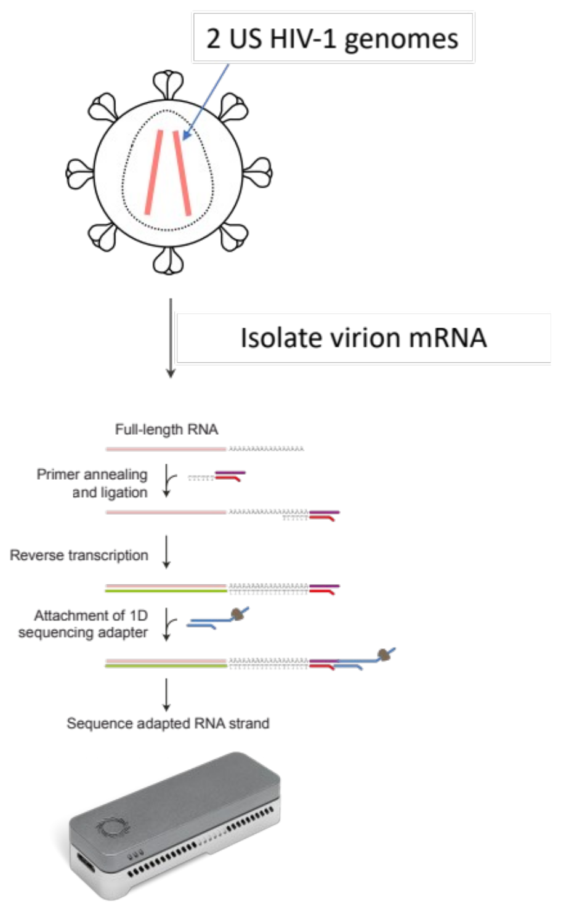{ loading=lazy }

<figcaption markdown="1">

**Figure 1A: Native sequencing of HIV-1 virion mRNA.**

**Figure 1A: Native RNA sequencing of HIV-1.** Native RNA (also called direct RNA sequencing (DRS)) library protocol. To decrease sample variability, neutralized HIV from the supernatant of in vitro infected cells was processed with MagMAX-96 viral RNA isolation kit (Applied Biosystems) on a Kingfisher Flex Purification System (ThermoFisher). The reverse transcription (RT) step increases sequencing throughput. RT is believed to stabilize RNA. Method figure adapted from Oxford Nanopore Technologies, Oxford, UK (<http://nanoporetech.com/>). Salmon denotes forward-oriented reads in all subsequent figures. US = unspliced.

</figcaption>
</figure>

Raw data was basecalled from FAST5 to FASTQ with Guppy high-accuracy model v3.3.0. Passed and failed reads from live basecalling were collapsed with skipped reads (FAST5 which were not basecalled by the end of sequencing runs) into per-sample datasets for this study based on the observation that HIV-mapping reads could be recovered from failed read folders. SAMTOOLS stat and flagstat (Wysoker et al. 2009) were used for mapping stats from BAM files from minimap2 (Li 2018) implemented in Galaxy (Afgan et al. 2016) (usegalaxy.eu or usegalaxy.org). HIV-mapped basecalled reads were fed into Canu v2.1.1 (Walenz et al. 2017), with genomeSize=9k. Contigs from NLAD8 were polished with medaka (Ltd. 2020) with model r941_min_high_g330. SnapGene v5.0.4 was used to manually annotate contigs from Canu. Contigs were interrogated with multisequence alignments (MSAs) with MAFFT (Katoh, Rozewicki, and Yamada 2017) and visualized with Archaeopteryx 0.9921 beta (170712) (**NEW FIGURE**). To verify detected HIV-1 splice isoforms, sample-specific transcript models (as .gtf) were made with StringTie (Kovaka et al. 2019; Pertea et al. 2015), and compared to those seen in the following long-read HIV-1 datasets. Generalized transcript models were made by mapping idealized 89.6 (Karen E. Ocwieja et al. 2012) or NL4-3 (Nguyen Quang et al. 2020) reads to available references (**[Table 1](#table-1)**).

#### HIV-1 reference genome sequences

The general reference sequence of HIV-1 used in **[Figure 2](#figure-2)** was from NCBI, accession number Genbank:AF033819.3. This is a 9,181 base HXB2-like sequence that starts at the 96 bp repeat in the 5’LTR, continues with the 5’UTR (U5), extends past the 3’UTR (U3) to the end of the 96 bp repeat in 3’LTR, with one SNV at the *vpu* start codon aTg to aCg at position AF033819.3:560 or K03455.1:6063 (Alejandro R Gener et al. 2021). Sample-specific references were used when available (**[Table 1](#table-1)**).

<figure markdown="1" id="figure-2" class="book-figure">

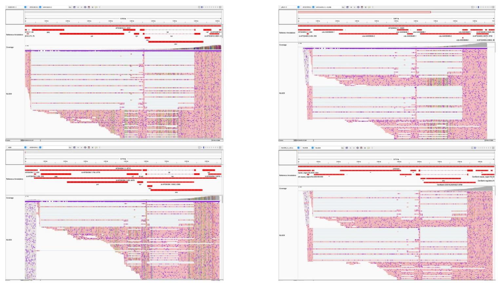{ loading=lazy }

<figcaption markdown="1">

**Figure 2: Native HIV-1 virion mRNAs mapped to general reference AF033819.3 and sample-specific references.**

With splice-aware minimap2, differentially spliced introns and exons become evident. Spliced HIV-1-mapping reads occurred at higher frequency than individual host transcripts (not shown; **Supplemental Table 1**). Reads are colored based on orientation relative to reference. Salmon: forward. Lavender: reverse. All HIV-mapping reads observed occurred in the forward orientation. HIV genome modeled near the transcription start site (TSS) to end of the repeat in the 3’LTR. The packaging element ψ occurs downstream of the TSS, between the end of the 5’LTR and beginning of *gag*. Most recovered HIV-1 reads lacked the packaging (ψ) element. This may have been due to degraded RNA and/or breaks in the DNA-RNA heteroduplex, RNA secondary structure. Compare to **Figure 4**. Portions of NLAD8, HIV1-SX, and NL4-3 partially matched AF324493.2 (absence of green (A)/blue (C)/yellow (G)/red (T/U)) stipes in reads) (**Supplement**).

For NLAD8, Full-length coverage (9,166/9,181~99.8%) achieved. Visualized in Integrative Genomics Viewer . Coverage over *env* sufficient for cladistics (**Figure 5**). Top left: general mapping. Top right, bottom row: Strain-specific reference mapping. Top right: pNL4-3. Bottom left: AD8. Bottom right: in silico NLAD8 based on information from AIDS Reagent Program. NLAD8 complete genome was not available from NCBI. Gray in coverage plot indicates per-base consensus accuracy ≥ 80%. Note that NLAD8 is a chimera between NL4-3 (all minus portion of *env*) and AD8 (portion of *env*) (used as a reference here). The reference sequence for NL4-3 is a complete plasmid sequence, pNL4-3. Note the difference in scales. Visualized in Integrative Genomics Viewer .

</figcaption>
</figure>

#### Statistics

After basecalling, read lengths and mean quality scores are reported by MinKNOW. Graphing was done with GraphPad Prism 8 for macOS v8.3.0. As samples were not compared directly to each other, additional statistics were not calculated.

### Results

#### Coverage

HIV-1-mapping reads were recovered in all (n=15) experiments (**[Figure 1](#figure-1a), [Figure 2](#figure-2)**). Three out of 15 strains had full coverage, defined as read length spanning from the canonical TSS (5’ R repeat) to the 3’ R repeat and mapped to AF033819.3. These were: 89.6 (9,166/9,181~99.8%), AD17 (9,164/9,181~99.8%), and NLAD8 (9,166/9,181~99.8%). Seven out of 15 strains had majority coverage, defined as &gt; 50% relative to AF033819.3. These were: 97USNG30 (6,992/9,181~76.2%), BaL (8,597/9,181~93.6%), ELI (6,987/9,181~76.1%), MN (5,995/9,181~65.3%), NL4-3 (4,715/9,181~51.4%), RHPA (4,745/9,181~51.7%), and HIV1-SX (5,561/9,181~60.6%). Three out of 15 strains had moderate coverage &lt;50% and &gt;25% relative to AF033819.3. These were: 92UG038 (3,678/9,181~40.1%), JR-FL (2,814/9,181~30.7%), and SF162 (2,601/9,181~28.3%). Two out of 15 strains had lower coverage &lt;25% relative to AF033819.3. These were: 92UG029 (2,007/9,181~21.9%), and ADA (1,981/9,181~21.6%).

<figure markdown="1" id="figure-1b" class="book-figure">

{ loading=lazy }

<figcaption markdown="1">

**Figure 1B: Read lengths for HIV-1-mapping reads sequenced in this study.**

**Figure 1B: Read lengths for HIV-1-mapping reads sequenced in this study.** Violin plot of read length. Log2-scaled. Median (big dash) and quartiles (little dash). All native RNA reads are longer than most short DNA-seq reads. Note: Reads from multiple runs either live-basecalled or skipped reads basecalled afterward were concatenated. For **Figures 1B and 1C:** after basecalling, read length and mean quality score are reported in a sequencing_symmary.txt file in MinKNOW. For skipped reads (reads not basecalled by timed or forced end of sequencing runs), basecalling in standalone Guppy provides the same sequencing_symmary.txt information. For HIV-1-mapping reads, this information is provided in Figure 1. To pull this information, unique read IDs aligning to Genbank:AF033819.3 (with minimap2) were concatenated into a master list and used as follows (with example file names): egrep -f MASTERLIST.txt sequencing_symmary.txt &gt; HIV-mapping_sequencing_symmary.txt. Data was wrangled in Microsoft Excel for Mac version 16.29.1.

</figcaption>
</figure>

<figure markdown="1" id="figure-1c" class="book-figure">

{ loading=lazy }

<figcaption markdown="1">

**Figure 1C: Read mean quality scores for HIV-1-mapping reads sequenced in this study.**

**Figure 1C: Read mean quality scores for HIV-1-mapping reads sequenced in this study.** Violin plot of mean quality score. Median (big dash) and quartiles (little dash). Note: Reads from multiple runs either live-basecalled or skipped reads basecalled afterward were concatenated.

</figcaption>
</figure>

In general, higher titer (TCID50/ml) samples (**[Table 1](#table-1)**) were more likely to produce more and longer reads. To maximize the number of processed samples, flow cells were reused until exhausted. As such, an exact comparison between titer and throughput was not appropriate. Reads mapped well regardless of whether HXB2-like or sample-specific references were used (**[Figure 1D](#figure-1a), [Figure 2](#figure-2), Supplemental Table 1**). We deferred analysis of sparce human-mapping RNA.

#### Apparent transcription start site (TSS), and alternative TSS

For samples with 5’ R-spanning reads, apparent TSS were evaluated (**[Figure 5](#figure-5)).** 20/33 reads support most common TSS_NLAD8 is GGTT|AGACC 454+12=466^454+13=467 (HXB2/89.6 coordinates), with “A” being the first base. For 89.6, 2/3 reads support most common TSS_89.6 is GGTT|AGACC 454+12=466^454+13=467 (HXB2/89.6 coordinates), with “A” being the first base. 7/11 reads support most common TSS_AD17 is GGTT|AGACC 454+12=466^454+13=467 (HXB2/89.6 coordinates), with “A” being the first base. 2/3 reads support most common TSS_ELI is GGTT|AGACC 454+12=466^454+13=467 (HXB2/89.6 coordinates), with “A” being the first base. For SX, 1/1 read support TSS_SX is GGT|TAGACC 454+11=465^454+12=466 (HXB2/89.6 coordinates), with “T” being the first base. For NL4-3, 1/1 read support TSS_NL4-3 is GGTT|AGACC 454+12=466^454+13=467 (HXB2/89.6 coordinates), with “A” being the first base.

<figure markdown="1" id="figure-5" class="book-figure">

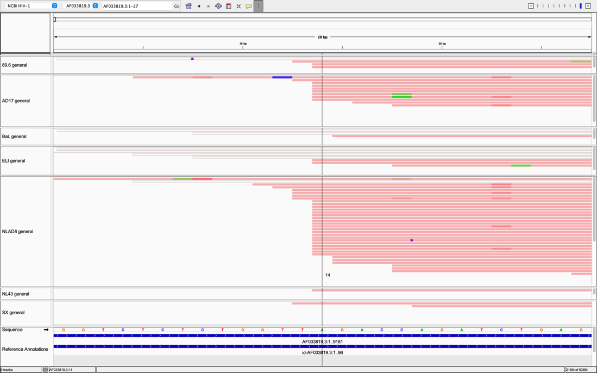{ loading=lazy }

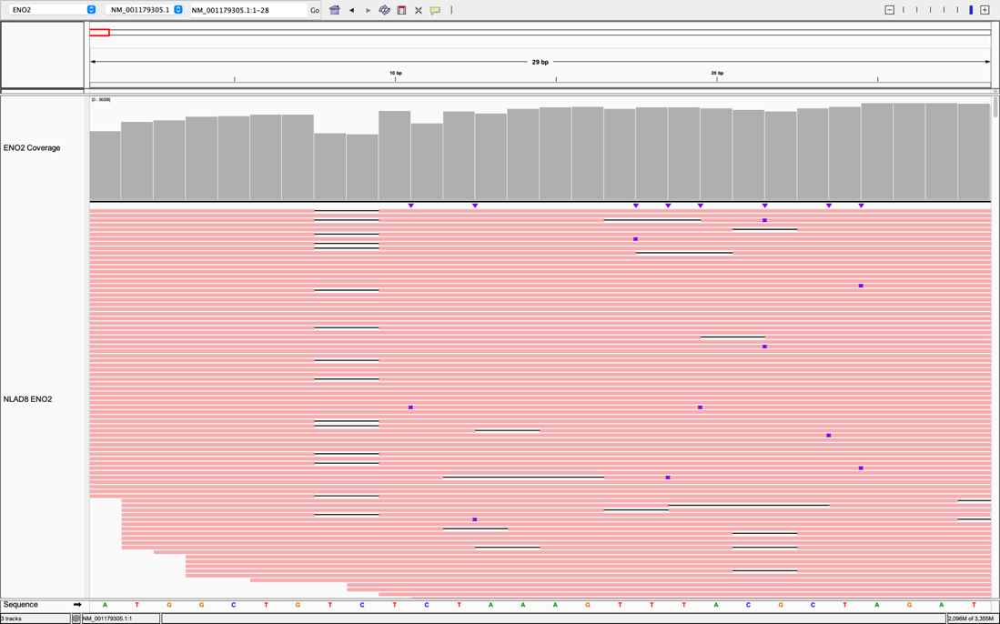{ loading=lazy }

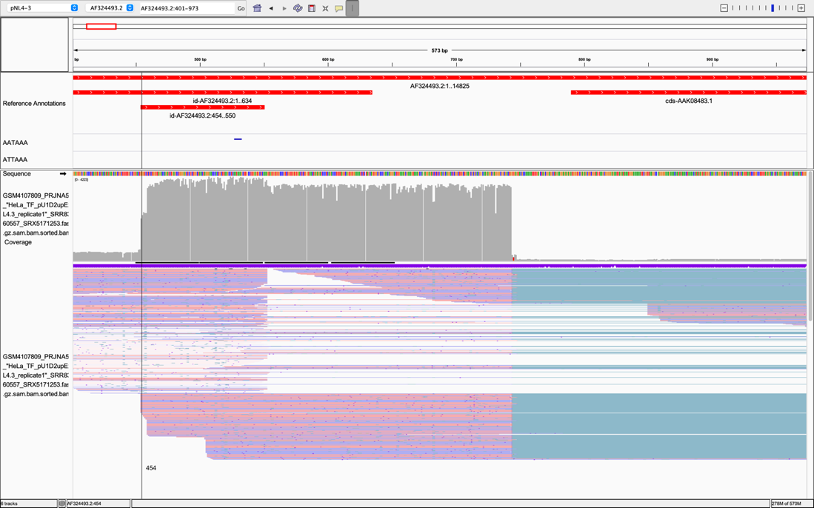{ loading=lazy }

<figcaption markdown="1">

**Figure 5: Ambiguity at 5’ end of native mRNA reads.**

Top: HIV-1 apparent TSS most often occurs at the 14th base in the 5’ R repeat. However, this is likely not the true start of the transcript. We present these results to make viral sequencing community members aware of this native (direct) RNA sequencing artifact. Note uracil (U) in mRNA is converted arbitrarily to thymidine (T) in most references. This convention was maintained in this figure.

Middle: control ENO2 RNA appears to be able to cover 5’. However, this is not the start of the transcript. Assemblies ~22 bp upstream of the above “ATG” were recovered by assembling the NLAD8 basecalled reads with canu and genome size set to 1.4k (not shown). It remains unknown how long the control templates (ENO2 mRNA that was sequenced) actually were.

Bottom: cDNA with most reads starting at beginning of R. Some reads lacked portions of TAR.

</figcaption>
</figure>

We compared our TSS results above to the only other relevant work, which included cDNA ONT sequencing of NL4-3-infected primary CD4+ T cells(Nguyen Quang et al. 2020). Most HIV-mapping cDNA reads started at the beginning of the R repeat. Our uncorrected transcript models based on Nguyen et al.’s cDNA datasets supported actual TSS occurring before R, with small leader sequence “GTACT” upstream of the R’s G triplet. However, the read data supports actual TSS at the first G in R’s G triplet (**[Figure 5](#figure-5)**).

There was a class of reads which started downstream of R start. These occurred with both forward and reverse cDNA strands, suggesting that these were not an artifact of reverse-transcription during library preparation.

Another class of reads was noted, corresponding to early terminating gag-spanning reads which seemed to stall before reaching pol. These started at the HIV main TSS noted above and occurred independently of polyA sequences or alternative polyA signals (AATAAA; see below). Another potential stall point occurred in the middle of vpu, however this site was “A” rich, and may have been selected by polyA library prep. A second TSS seemed to occur downstream of gag ORF, around position 850-1130 relative to AF324493.2. It is not spliced with other HIV-1 segments, and the significance of this feature remains unknown.

#### Antisense protein and/or Antisense mRNA

While coverage over HIV-1 was sufficient to recover sense HIV-1 in all 15 samples, we did not recover any antisense HIV-1 transcripts in virion-associated mRNA (**[Figure 2](#figure-2), Supplemental Table 1**).

#### 3’ bias

All experiments demonstrated strong 3’ coverage bias over HIV-1 (**[Figure 2](#figure-2)**). This was also seen in control ENO2 mRNA (**Supplemental Figure 1**). Recovered read lengths from the control template exhibited consistent decay. Evaluating the reduction in coverage across samples at positions 1,200 and 200 yielded an average loss of 65.55% (SD = 10.71.%) of recovered transcripts per 1kb. (**Supplemental Table 2**). Furthermore, when we removed the outlier NL4-3 sequencing run from the analysis, which was completed with previously used but still functional R9.4 RevC flow cells and RNA002, the average loss was 68.41% (SD = 0.9685%).

The coverage profile of HIV-mapping reads from native RNA data exhibited a decrescendo pattern, with coverage diminishing as one advanced further from the main 3’ LTR. This was different than the patterns seen in NL4-3 cDNA ONT(Nguyen Quang et al. 2020) (**[Figure 4](#figure-4): cDNA ONT vs. native ONT** ). In that study, it was clear that several internal polyA sites were activated. These represent a potential new source of HIV transcripts.

<figure markdown="1" id="figure-4" class="book-figure">

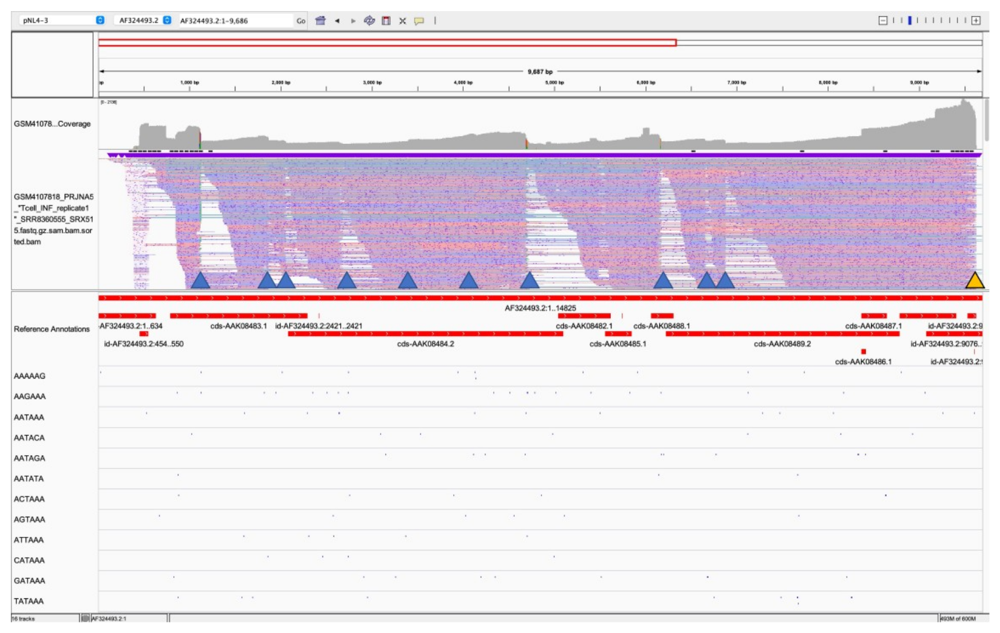{ loading=lazy }

<figcaption markdown="1">

**Figure 4: cDNA ONT vs. native ONT.**

The saw-toothed pattern observed in cDNA PCR-barcoded ONT cannot be fully explained by ONT RT adapter ligation (polyA selection), nor are peaks otherwise coincident with incidental polyA-rich sequences. Data from Nguyen et al. 2020 from HIV-1 CD4+ T cells from peripheral blood mononuclear cells (PBMCs). Mapped to pNL4-3. Blue arrows point to stark changes in coverage coincident with polyA signals (annotations tracks below Reference Annotations in red). The yellow arrow is the canonical HIV-1 NL4-3 polyA signal. Note both forward and reverse oriented reads from double-stranded cDNA amplicons. This pattern was consistent across replicates. The consequence of premature polyadenylation may be truncated pol with activated protease. Compare to **Figure 2**, where 15 HIV-1s exhibit a single “tooth”, or coverage peak at 3’ polyA site followed by decay. PolyA motifs: https://academic.oup.com/bioinformatics/article/28/1/127/219620.

</figcaption>
</figure>

#### Splicing vs. ONT artifacts vs. other biological phenomena

We observed reads with large deletions relative to reverence AF033819.3 in higher coverage experiments using default ONT minimap2 settings (e.g., NLAD8 in **[Figures 2M](#figure-2)**). These deletions occurred near splice sites (Sertznig et al. 2018) found in other HIV-1 strains (Bruner et al. 2017; Hiener et al. 2017; Ho et al. 2013; Lee et al. 2017; Pollack et al. 2017; Simonetti et al. 2021), including 89.6(Karen E. Ocwieja et al. 2012). We reanalyzed our datasets with splice-aware settings and observed HIV splice isoforms in 10 out of 15 virion samples (**[Figure 2](#figure-2)**). Of the samples with full-length HIV viral genomes recovered, spliced reads were observed in 89.6 0.7% (1 out of 139; numerators based on generic or specific reference mapping in **Supplemental Table 1**), AD17 1.7% (16/633), and NLAD8 7.5% (77/1021). Spliced reads were also observed in 97USNG30 0.9% (2/225), BaL 0.6% (3/479), ELI 2.4,% (4/150), MN 3.7% (2/54), NL4-3 6.3% (3/48), RHPA 4.2% (1/24), and SX 1.6% (4/247) when mapped to their respective references or AF033819.3. RHPA’s isoform and one from AD17 are interesting ones which support the stability of a gag and gag-pol product spliced to downstream elements, respectively. Some false positives were seen when BaL reads were mapped to another HIV reference, pNL4-3 (Gener and Kimata 2020). These reads partially mapped to pNL4-3 5’LTR while also mapping to its 3’LTR (distinct from a supplementary alignment) and are minimap2 artifacts of read errors in LTRs, in contrast to true positives which also exhibited conserved smaller exons (Sertznig et al. 2018). Besides lacking ψ (psi) packaging element (necessary), 3’LTR (necessary), and RRE (sufficient), false positives are likely too short to be packaged (e.g., very few randomly distributed small human mRNAs were recovered (**Supplemental Table 1**). Other experiments either did not have as many transcriptional features or lacked coverage sufficient to observe splicing.

We compared our sequencing coverage profiles with those from Ocwieja et al. and Nguyen et al. While ours exhibited a decrescendo pattern (from higher coverage to lower coverage) as one progressed further from the adaptor ligation point, Nguyen et al.’s exhibited a saw-toothed pattern (**[Figure 4](#figure-4): cDNA ONT vs. native ONT**).

#### Bespoke vs. general transcript models

To date, the best long-read sequencing dataset had been the NL4-3 cDNA PCR-barcoded experiments by Nguyen *et alia* from 2020. However, HIV splicing studies rarely if ever include explicit transcript models, limiting the studies’ utility. Thankfully, new tools such as StringTie (Kovaka et al. 2019; Pertea et al. 2015) can model transcription directly from long reads. We constructed transcript models using empirically determined StringTie settings, cross-validated by inspecting mapped reads in IGV. The resulting bespoke NL4-3 transcript model represents a “plug-and-play” transcript model set as .gtf file that is appropriate for use to aid in mRNA detection and quantification all NL4-3 RNA-seq experiments. Ocwieja et al. in 2012 used competing long-read DNA sequencing technology (PacBio) to provide a high-quality long cDNA amplicon dataset from total mRNA from lysed HIV-1 89.6-infected cells (Karen E. Ocwieja et al. 2012). While coverage in our present study was insufficient to model most transcripts directly, the robustness of long-read mapping as seen above in our results supported the use of the PacBio HIV-1 89.6 dataset for use as an approximate template to make generalizable HIV-1 transcript models. We mapped Ocwieja et al.’s data onto general and specific HIV-1 references used in our study. We considered our deepest dataset: NLAD8. NLAD8’s transcription start site (TSS) was at position ~468; transcription end site (TES) ~9,628 (coverage at least 10). NLAD8 mRNA length was therefore 9,628-468=9,160, which is approximate to AF033819.3’s length of 9,181. We adapted transcript models made with these start and end coordinates. These actual (NL4-3) and approximate hybrid HIV-1 transcript models support all the native spliced reads reported here. We present these new models as plug-and-play HIV-1 transcript models for future HIV-1 work in the time that deeper complete reference-specific HIV-1 transcript models and validated transcript sets are made.

#### Putative SNV calls

Samples with available reference genomes as GenBank accessions were manually evaluated for putative SNVs (pSNVs), including small insertions and deletions, under the conditions: 1) that there were at least 10 reads at a given locus; and 2) that the reference allele occurred less than or equal to 50% of the time. See **Supplemental Table 3** for a list of pSNVs directly called from native RNA-seq. Combined, the average (putative) total mutation rate (excluding SX) was 0.008684598, 0.8684598% (SD = 0.007424836). The average (putative) non-redundant mutation rate (excluding SX) was 0.004649196, 0.4649196% (SD = 0.004564091). **Supplemental Figures 2, 5-7** include pSNVs, small insertions, deletions. Polishing reduced the amount of pSNVs near homopolymers and dimer runs. A small deletion was observed in a region of NLAD8 outside of *env* (**Supplemental Figure 2**). This small deletion was apparent when mapped to AD8 AF004394.1, but absent in pNL4-3 AF324493.2, and had a different coverage profile compared to homopolymer runs (**Supplemental Figure 3**). Nguyen et al. 2020’s CD4+ T cell ONT cDNA data did not have clear pSNVs outside of ONT problem areas.

#### Comparative transcriptomics

HIV-1-mapped (AF033819.3) reads from 89.6, 97USNG30, AD17, BaL, ELI, HIV1-SX, MN, and NLAD8 (**Supplemental Figures 9 and 10**) were assembled into contigs with Canu, a leading *de novo* long read genome assembler (Walenz et al. 2017). For sequences with GenBank accessions with complete genomes, the contigs’ phylogenetic tree resembled their references’ by maintaining tight clustering (**[Figure 6](#figure-6)**). Even with sub-genomic contigs, general relationships (such as similarity to NL4-3 in the cases of NLAD8 and HIV-SX) were maintained. By mapping reads to references we observed that phasing (the ability to tie variants to individual viral genome equivalents (also called chromosomes and/or haplotypes) was possible with native RNA reads (**Supplemental Figure 7**). We wanted to test whether this could be leveraged to study viral transcript heterogeneity directly. All FASTQ were converted to FASTA, concatenated, made into a MSAs, and visualized as a tree (**[Figure 6](#figure-6)**). Surprisingly, sample relationships were maintained despite per-read noise. Note neither contigs nor reads were polished.

<figure markdown="1" id="figure-6" class="book-figure">

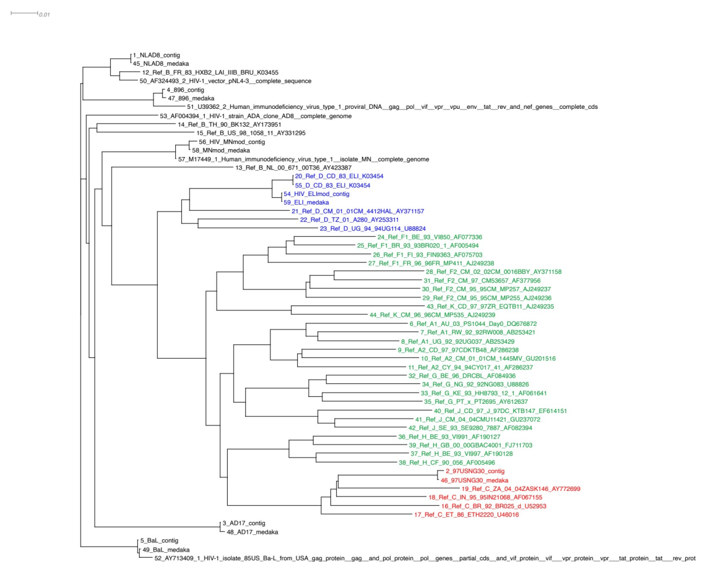{ loading=lazy }

<figcaption markdown="1">

**Figure 6: ONT native RNA + Canu de novo assembly sufficient for comparative transcriptomics.**

</figcaption>
</figure>

### Discussion

#### First complete full-length sequences from infectious HIV-1 strains

In this study we were able to completely (Ladner et al. 2014) sequence the genomes of three HIV-1 strains from virion-associated RNA (**[Figure 1](#figure-1a) and 2**). Here, we defined complete or full-coverage of full-length HIV-1 viral RNA as the region capable of sustaining viral replication with reverse transcription and integrase activity (Hu and Hughes 2012). This corresponds to the region from the 5’LTR-mediated transcriptional start site (TSS) and the repeat region after the end of 3’ U3. These dimensions are different than the dimensions of HIV-1 provirus (Gener 2019). To our knowledge, this is the first time the HIV-1 virus has been natively sequenced from the TSS to end of 3’LTR. As reported for HIV-1 in a DNA context (Gener 2019), ONT surpassed the read length limitations of short read RNA-seq. Data were sufficient for putative SNV detection over regions with coverage ≥10 reads, as well as direct *de novo* assembly from native RNA reads, with a maximal assembly length of 97% from strain NLAD8.

#### Mapping

High sequence variability across HIV isolates between and within patients and historically lower per-read accuracy represent two hypothetical challenges to detecting native HIV reads. Interestingly, newer long-read mappers such as minimap2 were robust to references used (Mapping quality &gt;50). We saw slightly more recovered reads when we mapped our reads to sample-specific references with greater homology (**[Figures 2A](#figure-2), 2B, 2G, 2H**, **2K, 2L, 2M, and 2N (these were moved to supplement)**). These observations enabled informed use of others’ public long-read HIV-1 data to create tentative reference-anchored HIV-1 transcript models in the time that bespoke long-read transcript data is generated for each reference strain or clinical isolate.

#### Apparent transcription start site (TSS)

The HIV-1 TSS is one of the most well-studied/characterized viral RNA structures. Many have assumed that the TSS includes full-length R repeat sequence. This was not the case in any of the sequences with 5’ coverage. Our observations support the first base of HIV-1 being the 14th nucleotide of the 5’ R repeat, starting with the “A” in U11-U12 | A13-G14. This may have been obscured in the past because TSS occurs in the R repeats, 96 bp repeats within the larger ~654 bp LTR repeat. 5’ capping in the context of mRNA was reported to be problematic for ONT (Parker et al. 2020). On closer inspection, there was no left clipping in the 5’-spanning HIV-1 reads (NEW FIGURE). Full-length control ENO2 RNA reads were recovered when mapped to coding ENO2. However, that mapping strategy did not include ENO2’s 5’ UTR. We took basecalled reads from NLAD8 and assembled with canu and genome size 1.4k. We recovered multiple samples approximately 22 bp upstream of the ENO2 “ATG”. Another group had already performed the ideal experiments to identify the TSS (s) HIV-1 mRNA, albeit from cell lysate. They used cDNA sequencing, followed by PCR barcoding to minimize PCR bias, and their HIV transcripts map the full span of HIV-1, with slight variability. We conclude that virion-associated/packaged mRNA is still best modeled from the beginning of the R repeat, and community members should be aware of the difference between apparent and actual TSS between ONT’s native RNA (direct RNA) and cDNA sequencing.

#### Coverage

These experiments represent a proof-of-concept demonstrating ONT’s ability to cover HIV mRNA completely (**[Figures 2A](#figure-2), 2E, and 2M (moved to supplement)**), roughly dependent on the titer of viruses used for library prep (**[Table 1](#table-1)**). The amount of starting material used (by TCID) across these 23 sequencing runs as 15 experiments is approximately consistent (within an order of magnitude) with viral loads of 500-1,000 copies/mL (Marozsan et al. 2004). Neither cDNA ONT nor cDNA PCR ONT libraries were evaluated in the present study. Coverage as total number of bases sequenced divided by reference length was not informative due to strong 3’ bias and target length of complete HIV-1 viral mRNA.

#### 3’ bias

We were able to recover full-length HIV RNA reads from three samples. This was in part due to strong 3’ bias inherent to the RNA002 library. The first adapter used by the RNA002 kit, RTA, selects for polyA (Workman et al. 2018) (**[Figure 1A](#figure-1a)**). There was relatively consistent coverage loss presenting as a decrescendo pattern (with coverage decreasing distal from RTA ligation point), except near areas of known complex 2º RNA structure (Anon n.d.). The first strand cDNA step is supposed to ameliorate 2º RNA, but these might not be completely abrogated—for example, the region around the *rev* response element in higher-coverage experiments exhibited slight changes in average loss of recovered transcripts per 1,000 bases (**[Figure 2](#figure-2))**. However, a useful consequence of the 3’ bias is easier phasing between 5’ and 3’LTR regions, which is difficult or impossible to tell apart using classic RNA-seq (short-read DNA-seq (Gener 2019)) (**Supplemental Figure 12**). There were no reads spanning full-length 5’LTR in any of our native RNA experiments; these occurred in HIV PCR + DNA ONT experiments (Gener 2019).

Included in the RNA002 library kit is control RNA. By determining the percent loss per 1kb, at least 2,500x coverage over the 3’LTR may be necessary to guarantee observation of full-length unspliced HIV reads (~9kb) at a depth sufficient to call SNVs at the 5’ end of transcripts (with the recommended ~60x coverage for Canu). At current sequencing throughput, this is equivalent to about one MinION RevD flow cell, with possibly multiple technical replicates of individual libraries. Higher-titer virus stocks were associated with higher coverage, although the sequencing time was not held constant.

#### Splicing

NLAD8 (**[Figure 2M](#figure-2)**) had high enough coverage toward the middle of HIV to easily see deletions in reads relative to reference. Without prior information, these read deletions might be artifacts from library prep (with T4 DNA ligase), or from transcription of previously observed HIV-1 deletion-prone proviruses (Bruner et al. 2017; Hiener et al. 2017; Ho et al. 2013; Lee et al. 2017; Pollack et al. 2017), or splicing. Evidence supporting splicing includes our observations of splicing events from analyzing a short-read virion (cDNA) RNA-seq experiment (collected by Siarhei Kharytonchyk and submitted by Matthew Eckwahl) (**Supplemental Figure 12)**. This incompletely published experiment most likely used pNL4-3, a commonly used synthetic lab-adapted clone of HIV-1. Another group used competing long-read technology (PacBio) to provide a high-quality long PCR dataset from HIV cDNA on HIV-1 89.6 (Karen E. Ocwieja et al. 2012), but they did not enrich for virion. Instead, they isolated total mRNA from lysed infected cells. Mapping peaks in our data occurred at sites of known exons. On closer inspection, these reads exhibited clipping indicating their being part of a spliced read. Selecting the “splicing”-aware option in minimap2 instead of the default ONT option allowed us to see many more spliced mRNAs (**[Figure 2](#figure-2)**). Finding so many spliced HIV mRNAs in samples enriched for virions supported our hypothesis that spliced viral mRNAs are normally packaged into HIV virion, with interesting implications for HIV pathogenesis. This is in line with previous observations by others (Bruner et al. 2017; Hiener et al. 2017; Ho et al. 2013; Lee et al. 2017; Pollack et al. 2017; Simonetti et al. 2021) who noted integration of replication-deficient HIV sequences (including sequences with large gaps). Our work fundamentally changes our understanding of how HIV might introduce information into cells, augmenting HIV’s ability to cause cytopathic effects after infection. A new model of HIV virion mRNA would represent a shift in the understanding of the HIV genome, from a ~9kb integrating retrovirus to a ~9kb + splice variant hybrid segmented retrovirus (**[Figure 7](#figure-7a)**). Acknowledging this shift would improve detection of retroviral sequences so that we may follow the virus better as newer tools become available.

<figure markdown="1" id="figure-7a" class="book-figure">

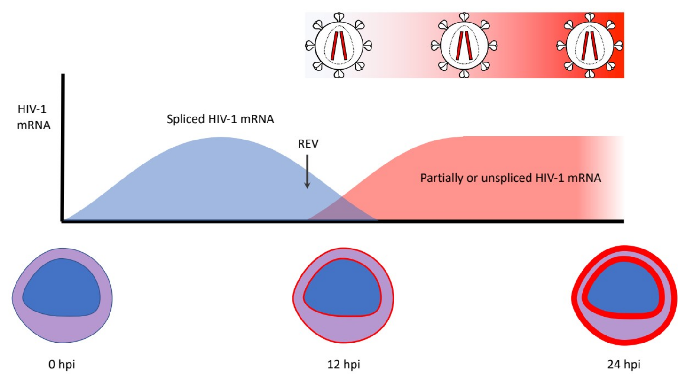{ loading=lazy }

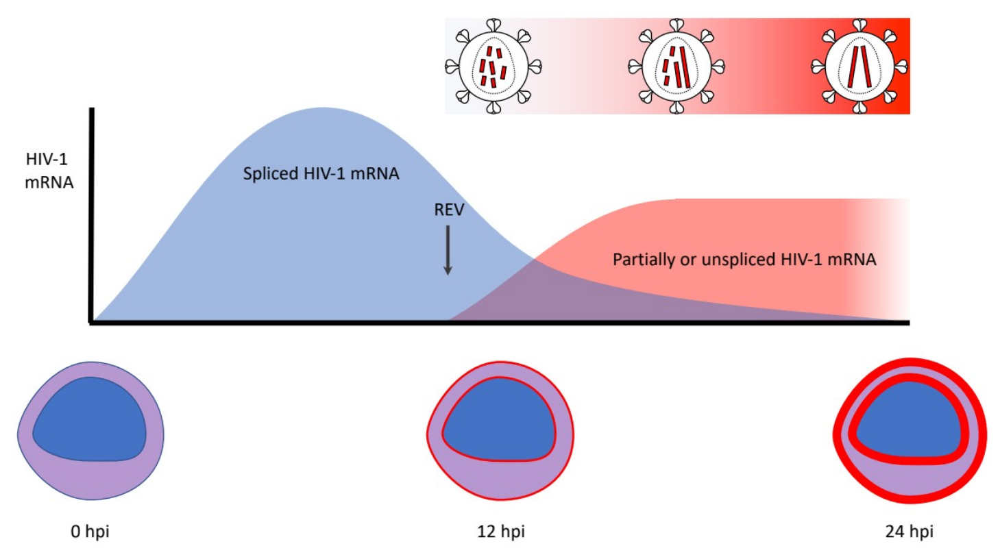{ loading=lazy }

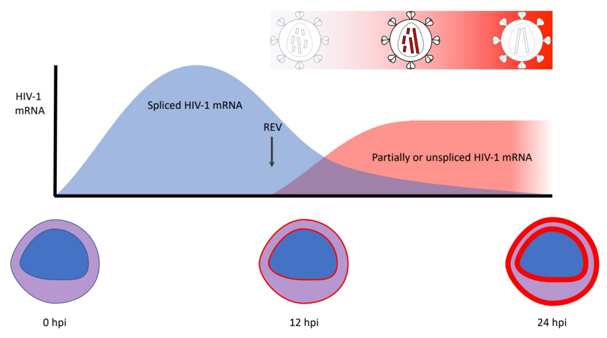{ loading=lazy }

<figcaption markdown="1">

**Figure 7A: Model: HIV-infected cells shift between more to less spliced mRNA.**

</figcaption>
</figure>

<figure markdown="1" id="figure-7b" class="book-figure">

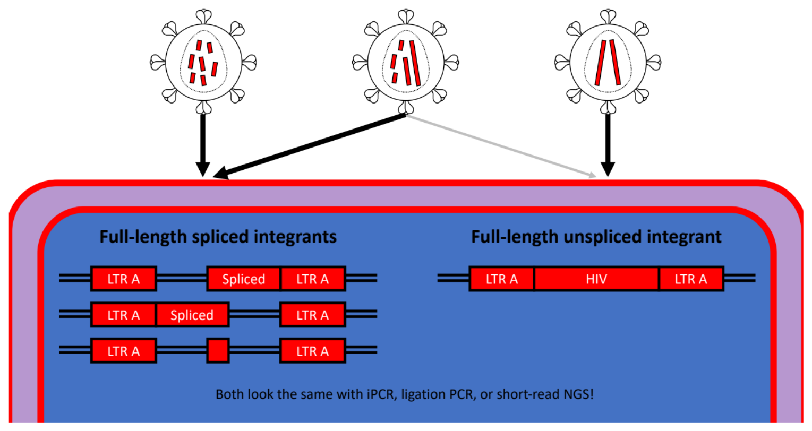{ loading=lazy }

<figcaption markdown="1">

**Figure 7B: Model: HIV virion contents fall along a spectrum, with consequences for resultant integrants.**

We observed that HIV-1 virions had a range of packaged splice isoforms (**Supplemental Table 1**).

20:1 “defective” vs full-length unspliced integrants (many sources)

Many “defective” integrants are full-length splice integrants

Minimal integration elements are: R-U5-HIV (variable)-U3-R (mRNA)

R-U5-HIV (variable)-U3-R (mRNA) -&gt; U3-R-U5-HIV (variable)-U3-R-U5 (cDNA)

2 kb pieces would replicate 3-4x faster than 9kb US

4 kb pieces would replicate 2x faster than 9 kb US

</figcaption>
</figure>

#### pSNV calls from ONT Native RNA

Strain-specific reference mapping was performed on 89.6, 92UG029, BaL, ELI, MN, NL4-3, and NLAD8 (**[Figure 3](#figure-3) (moved to supplement)**). Abundance of coverage allowed us to evaluate pSNVs, as well as small insertions and deletions, in areas with ≥ 10x coverage (minimum recommended by Canu documentation). The average mutation rate across sequenced samples (**Supplemental Table 3**) was estimated to be 0.00698528. This meant that for each full-length HIV-1 virion (say with respect to the HIV-1 reference AF033819.3) one would expect 0.00698528 x 9,181bases= ~64 pSNVs, possibly contributing to altered protein products (Gener 2019). We introduce Context Dependency Variant Classification (**Supplemental Information**) as new nomenclature to emphasize that variants occurring in information-dense regions can have complex context-dependent effects.

<figure markdown="1" id="figure-3" class="book-figure">

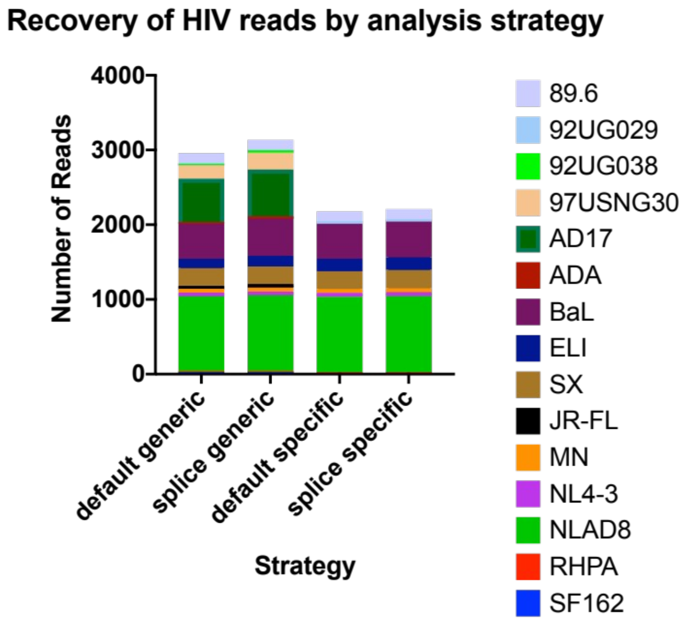{ loading=lazy }

<figcaption markdown="1">

**Figure 3: Summary of recovered reads.**

Colors are arbitrary and for contrast. Using splice-aware mapping and/or mapping to a more specific HIV-1 reference (when available) led to a slight increase in recovered reads. 92UG038, 97USNG30, AD17, ADA, JR-FL, SF162 did not have off-the-shelf references to enable sample-specific mapping. See **Supplemental Table 1** for read counts by sample.

</figcaption>
</figure>

What was demonstrated for HIV in its DNA form (Gener 2019) also applies for HIV in its RNA form: variation happens. Sequencing the viral strains and cloned constructs used for experiments in each laboratory remains important, because what is reported in a reference database for a given virus may not necessarily be the same as the viruses propagated in a laboratory. We recommend using sample-specific references for mapping when possible together with sequence-verifying constructs used to make viruses in each lab to catch any lurking putative SNVs (Gener 2019).

#### Reference HIV-1 viruses are variable.

Up until 2020, HIV was the most studied human pathogen, and yet we found 167-35 redundant = 132 non-redundant pSNVs across 9 HIV-1 reference strains. Some occurred in previously camouflaged repetitive LTRs, but most occurred in gene bodies, some contributing to alterations in protein-coding potential. In this work we leveraged sequencing multiple related strains with mapping to their predecessors to simulate true positive variants, which supported our use of single references to evaluate SNVs. Long read native RNA sequencing on the ONT MinION with R9.4.1 RevD flow cells was robust and sufficient to detect real sequence variability at the single-molecule level, except for at areas in and around homopolymers. While not a complete solution yet, long read native RNA sequencing offers the ability to tie SNVs together, to define segments of HIV haplotypes directly, and to move away from the concept of quasispecies (Lauring and Andino 2010; Pandit and Boer 2014) toward defining real viral haplotypes. An extension of this capability is the ability to perform comparative transcriptomics almost immediately after sample acquisition (**[Figure 5](#figure-5)**), including determining drug resistance profiles based on existing public databases (Rhee et al. 2003; Shafer 2006) (**Supplemental Figure 11**).

#### Homopolymers

As previously reported (Gener 2019; Loman, Quick, and Simpson 2015) for DNA ONT, per-read variability in native RNA ONT data was higher near homopolymers (runs of the same base) (**Supplemental Figure 3)**. ONT is also known for lower per-base accuracy compared to short-read next generation sequencing platforms. These may be overcome by evaluating neighbor SNVs (**Supplemental Figure 4**). New developments include improved basecalling models and a new double-header R10.3 nanopore, which has been showing improved handling of homopolymers, with slight drop in per-read accuracy. When comparing sequences, the errors at homopolymers are observed consistently across reads, and become negligible when comparing similarly processed samples. For the first time, we were able to compare individual reads from mostly incomplete virion genomes with simple cladistics and saw that reads successfully grouped based on sample identity (**[Figure 5](#figure-5)**).

#### Suitability of ONT for HIV sequencing

Comparing classic RNA-seq to native RNA-seq, each technology has its pros and cons. Classic RNA-seq, usually cDNA synthesis optionally followed by PCR, can be sensitive, specific, and cheaper with newer high-throughput sequencers (example: Illumina, BGI) and higher fidelity PCR. While PCR enhances sensitivity (to this day, it is important for detecting viral sequences at low copy numbers (Worobey et al. 2016; Yamaguchi et al. 9000)), a downside is that information can be lost if PCR is used during library prep (**Supplemental Figure 12**). Direct (PCR-free) cDNA, or using long-read DNA sequencing (PacBio (Karen E. Ocwieja et al. 2012), ONT (Nguyen Quang et al. 2020)), can also recuperate sequence information from samples with relatively higher throughput than native RNA-seq currently. It will be important to address sequencing throughput and sequence biases when developing this nascent technology. At present, it is possible to sequence and compare viral isolates as contigs and for the first time as individual virus genomes as individual reads (**[Figure 5](#figure-5)**), as well as to determine drug resistance profiles from contigs (**Supplemental Figure 11**) or individual reads. A benefit that is unique to native RNA sequencing on ONT devices is the ability to detect base modifications as well. Work is ongoing to evaluate the raw signal from these experiments, and to evaluate new ONT RNA tools for use with HIV.

#### Closing the distance on HIV-1 with longer reads

Current limitations of the approaches used in the present work to study HIV-1 RNA are similar to those reported for HIV-1 DNA (Gener 2019), and include: 1) the cost of long-read sequencing, compared to the cheaper short-read DNA-seq (classic RNA-seq); 2) long RNA extraction methods in diseased tissue; and 3) lower per-base accuracy (mid 90’s vs. 98-99%), including difficulty near small repeats such as homopolymers (**Supplemental** **[Figure 3](#figure-3)**). Furthermore, a unique major limitation to native RNA sequencing is 4): 3’ bias. For all nucleic acid sequencing: full coverage does not necessarily mean even coverage. As the price of long-read sequencing continues to decrease, and as the technology improves, the cost of obtaining usable data from native RNA long-read sequencing will become negligible compared to the ability to answer new questions. Classic RNA-seq had a problem with 3’ bias, but the issue was eventually overcome (Sheng et al. 2017). Future work will advance toward higher coverage complete observations of HIV viral mRNAs, including virion genomes in *in vivo* HIV models and from patient samples. Long-read sequencing is an important emerging tool defining the post-scaffold transcriptomic era, allowing for the characterization of these previously obscured functional units at the intersection between host and pathogen transcriptomes.

### Article types

Original Research Article

### Permission to reuse and Copyright

##### Creative Commons CC-BY

### Author Contributions

ARG conceived of this project and performed all experiments. ARG, BTF, DPH, PEK, and JTK analyzed results. ARG drafted the manuscript. ARG, BTF, DPH, PEK, and JTK edited the manuscript. ARG, PEK, and JTK provided funding.

### Conflict of Interest

ARG received travel bursaries from Oxford Nanopore Technologies (ONT), Oxford, UK. The present work was completed independently of ONT. Other authros declare no conflict of interest.

### Funding

This work was funded in part by institutional support from Baylor College of Medicine; private funding by East Coast Oils, Inc., Jacksonville, Florida, and ARG’s own private funding, including Student Genomics (manuscripts in prep). ARG also received the PFLAG of Jacksonville scholarship for multiple years. The work was also supported in part by NIH grant AI116167 to JTK.

### Acknowledgments

The authors would like to thank Dr. Sue Ellen Crawford for earlier involvement and Victoria Rose Tenge for advice, technical assistance, and critical reading of the manuscript.

This work was funded in part by institutional support from Baylor College of Medicine; the Human Genome Sequencing Center, BCM; private funding by East Coast Oils, Inc., Jacksonville, Florida, and ARG’s own private funding, including Student Genomics (manuscripts in prep). Compute resources from the Computational and Integrative Biomedical Research Center at BCM (“sphere” cluster managed by Dr. Steven Ludtke) and the Department of Molecular and Human Genetics at BCM (“taco” cluster managed by Mr. Tanner Beck, Mr. Christopher Michael Holder, and Dr. Charles Lin) greatly facilitated the completion of this work. ARG has also received the PFLAG of Jacksonville scholarship for multiple years. The authors would like to thank Dr. David Raul Murdock in Dr. Brendan Lee’s Laboratory and Mr. Alexander Robert Kneubehl in Dr. Job E. Lopez’s Laboratory for making their MinION devices available. The authors would like to thank the Mary K. Estes Laboratory at BCM for making available their Kingfisher instrument for viral RNA isolation. This work was also supported in part by NIH grant AI116167 to JTK.

Infectious virus stocks of HIV-1 (SF162, 97USNG30, MN, ADA, 92UG038, 92UG029, ELI, JR-FL, and BaL) or molecular clones (NL4-3, NLAD8, RHPA, AD17) were obtained from M. Martin, R. Collman, E.O. Freed, B. Hahn, G. Shaw, J. Levy, D. Ellenberger, ,P. Sullivan, R.B. Lal, R.C. Gallo, H. Gendleman, I.S.Y. Chen, S. Gartner, M. Popovic, and the UN AIDS Network for HIV Isolation and Characterization and DAIDS, NIAID via the NIH AIDS Reagent and Reference Program. HIV1-SX (SX) was provided by M.R. Ferguson and W.A. O’Brien.

ARG would like to thank members of the Paul E. Klotman Laboratory at Baylor College of Medicine, including Taneasha Washington, and former members Dr. Gokul C. Das and Alexander Batista. This work is dedicated to the memory of Dr. James “Jim” E. Maruniak, an outstanding virologist, educator, family man, role-model, and friend.

### References

Afgan, Enis, Dannon Baker, Marius van den Beek, Daniel Blankenberg, Dave Bouvier, Martin Čech, John Chilton, Dave Clements, Nate Coraor, Carl Eberhard, Björn Grüning, Aysam Guerler, Jennifer Hillman-Jackson, Greg Von Kuster, Eric Rasche, Nicola Soranzo, Nitesh Turaga, James Taylor, Anton Nekrutenko, and Jeremy Goecks. 2016. “The Galaxy Platform for Accessible, Reproducible and Collaborative Biomedical Analyses: 2016 Update.” *Nucleic Acids Research* 44(W1):W3–10.

Anon. n.d. “HIV-1 RNA Structures Index.” *HIV Sequence Database*. Retrieved (https://www.hiv.lanl.gov/content/sequence/STRUCTURE/RNA.HTML).

Bonsall, D., T. Golubchik, B. Kosloff, M. Limbada, M. de Cesare, A. Schaap, M. Hall, C. Wymant, G. Macintyre-Cockett, A. Brown, M. A. Ansari, S. Floyd, R. Hayes, H. Ayles, S. Fidler, and C. Fraser. 2018. “THAA0101 - HIV Genotyping and Phylogenetics in the HPTN 071 (PopART) Study: Validation of a High-Throughput Sequencing Assay for Viral Load Quantification, Genotyping, Resistance Testing and High-Resolution Transmission Networking.” P. Oral Abstract in *22nd International AIDS Conference (AIDS2018)*.

Bruner, Katherine M., Alexandra J. Murray, Ross A. Pollack, Mary G. Soliman, B. Sarah, Adam A. Capoferri, Jun Lai, Matthew C. Strain, Steven M. Lada, Ya-chi Ho, Douglas D. Richman, Steven G. Deeks, Janet D. Siliciano, and Robert F. Siliciano. 2017. “Defective Proviruses Rapidly Accumulate during Acute HIV-1 Infection.” *Nature Medicine* 22(9):1043–49.

Cassan, Elodie, Anne-Muriel Arigon-Chifolleau, Jean-Michel Mesnard, Antoine Gross, and Olivier Gascuel. 2016. “Concomitant Emergence of the Antisense Protein Gene of HIV-1 and of the Pandemic.” *Proceedings of the National Academy of Sciences - PNAS* 113(41):11537–42.

Cuesta, Isabel, Ana Mari, Antonio Ocampo, Celia Miralles, Sonia Pérez-castro, and Michael M. Thomson. 2016. “Sequence Analysis of In Vivo -Expressed HIV-1 Spliced RNAs Reveals the Usage of New and Unusual Splice Sites by Viruses of Different Subtypes.” 1–24.

Cuevas, José M., Ron Geller, Raquel Garijo, José López-Aldeguer, and Rafael Sanjuán. 2015. “Extremely High Mutation Rate of HIV-1 In Vivo.” *PLOS Biology* 13(9):e1002251.

Gener, A. and J. T. Kimata. 2020. “LBPEA06 - Reanalysis of Native RNA Sequencing of HIV-1 Supports Spliced HIV MRNA Packaging into Virions as a New Hybrid Segmented Retrovirus Model.” P. ePoster in *23rd International AIDS Conference (AIDS2020)*.

Gener, Alejandro R. 2019. “Full-Coverage Sequencing of HIV-1 Provirus from a Reference Plasmid.” *BioRxiv* 611848.

Gener, Alejandro R. 2021. “Chapter 6 - Advancing HIV Informatics in the RNA Space: HIV MRNA Models.” Baylor College of Medicine.

Gener, Alejandro R., Deborah P. Hyink, Paul E. Klotman, and Jason T. Kimata. 2021. “HIV-1 Segmentation-Based Transcript Models Define 5’ Untranslated Region (UTR) and Open Reading Frame (ORF) Classes, Elucidate Total Viral Protein-Coding Capacity, and Are Summarized by a New HIV-1 MRNA Naming Convention.” P. ePoster in *24th International AIDS Conference (AIDS2021)*.

Gener, Alejandro R, Wei Zou, Brian T. Foley, Deborah P. Hyink, and Paul E. Klotman. 2021. “Reference Plasmid PHXB2_D Is an HIV-1 Molecular Clone That Exhibits Identical LTRs and a Single Integration Site Indicative of an HIV Provirus.” *BioRxiv* 611848.

Graf, Erin H., Angela M. Mexas, Jianqing J. Yu, Farida Shaheen, Megan K. Liszewski, Michele Di Mascio, Stephen A. Migueles, Mark Connors, and Una O’Doherty. 2011. “Elite Suppressors Harbor Low Levels of Integrated HIV DNA and High Levels of 2-LTR Circular HIV DNA Compared to HIV+ Patients on and off HAART.” *PLoS Pathogens* 7(2).

Hiener, Bonnie, Bethany A. Horsburgh, John Sebastian Eden, Kirston Barton, Timothy E. Schlub, Eunok Lee, Susanne von Stockenstrom, Lina Odevall, Jeffrey M. Milush, Teri Liegler, Elizabeth Sinclair, Rebecca Hoh, Eli A. Boritz, Daniel Douek, Rémi Fromentin, Nicolas Chomont, Steven G. Deeks, Frederick M. Hecht, and Sarah Palmer. 2017. “Identification of Genetically Intact HIV-1 Proviruses in Specific CD4+ T Cells from Effectively Treated Participants.” *Cell Reports* 21(3):813–22.

Ho, Ya-Chi, Liang Shan, Nina N. Hosmane, Jeffrey Wang, Sarah B. Laskey, Daniel I. S. Rosenbloom, Jun Lai, Joel N. Blankson, Janet D. Siliciano, and Robert F. Siliciano. 2013. “Replication-Competent Noninduced Proviruses in the Latent Reservoir Increase Barrier to HIV-1 Cure.” *Cell* 155(3):540–51.

Hu, Wei-Shau and Stephen H. Hughes. 2012. “HIV-1 Reverse Transcription.” *Cold Spring Harbor Perspectives in Medicine* 2(10).

Katoh, Kazutaka, John Rozewicki, and Kazunori D. Yamada. 2017. “MAFFT Online Service: Multiple Sequence Alignment, Interactive Sequence Choice and Visualization.” *Briefings in Bioinformatics* 20(4):1160–66.

Keller, Matthew W., Benjamin L. Rambo-Martin, Malania M. Wilson, Callie A. Ridenour, Samuel S. Shepard, Thomas J. Stark, Elizabeth B. Neuhaus, Vivien G. Dugan, David E. Wentworth, and John R. Barnes. 2018. “Direct RNA Sequencing of the Coding Complete Influenza A Virus Genome.” *Scientific Reports* 8(1):14408.

Kim, Dongwan, Joo Yeon Lee, Jeong Sun Yang, Jun Won Kim, V. Narry Kim, and Hyeshik Chang. 2020. “The Architecture of SARS-CoV-2 Transcriptome.” *Cell* 181(4):914-921.e10.

Klotman, ME, S. Kim, A. Buchbinder, A. DeRossi, D. Baltimore, and F. Wong-Staal. 2006. “Kinetics of Expression of Multiply Spliced RNA in Early Human Immunodeficiency Virus Type 1 Infection of Lymphocytes and Monocytes.” *Proc Natl Acad Sci U S A* 88:5011–15.

Kovaka, Sam, Aleksey V Zimin, Geo M. Pertea, Roham Razaghi, Steven L. Salzberg, and Mihaela Pertea. 2019. “Transcriptome Assembly from Long-Read RNA-Seq Alignments with StringTie2.” *Genome Biology* 20(1):278.

Ladner, Jason T., Brett Beitzel, Patrick S. G. Chain, Matthew G. Davenport, Eric Donaldson, Matthew Frieman, Jeffrey Kugelman, Jens H. Kuhn, Jules O’Rear, Pardis C. Sabeti, David E. Wentworth, Michael R. Wiley, Guo-Yun Yu, Shanmuga Sozhamannan, Christopher Bradburne, and Gustavo Palacios. 2014. “Standards for Sequencing Viral Genomes in the Era of High-Throughput Sequencing.” *MBio* 5(3):e01360-14.

Lauring, Adam S. and Raul Andino. 2010. “Quasispecies Theory and the Behavior of RNA Viruses.” *PLoS Pathogens* 6(7).

Lee, Guinevere Q., Nina Orlova-Fink, Kevin Einkauf, Fatema Z. Chowdhury, Xiaoming Sun, Sean Harrington, Hsiao Hsuan Kuo, Stephane Hua, Hsiao Rong Chen, Zhengyu Ouyang, Kavidha Reddy, Krista Dong, Thumbi Ndung’U, Bruce D. Walker, Eric S. Rosenberg, Xu G. Yu, and Mathias Lichterfeld. 2017. “Clonal Expansion of Genome-Intact HIV-1 in Functionally Polarized Th1 CD4+ T Cells.” *Journal of Clinical Investigation* 127(7):2689–96.

Li, Heng. 2018. “Minimap2: Pairwise Alignment for Nucleotide Sequences.” *Bioinformatics* 34(18):3094–3100.

Loman, Nicholas J., Joshua Quick, and Jared T. Simpson. 2015. “A Complete Bacterial Genome Assembled de Novo Using Only Nanopore Sequencing Data.” *Nature Methods* 12(8):733–35.

Ltd., Oxford Nanopore Technologies. 2020. “Medaka.”

Marozsan, Andre J., Erika Fraundorf, Awet Abraha, Heather Baird, Dawn Moore, Ryan Troyer, Immaculate Nankja, and Eric J. Arts. 2004. “Relationships between Infectious Titer, Capsid Protein Levels, and Reverse Transcriptase Activities of Diverse Human Immunodeficiency Virus Type 1 Isolates.” *Journal of Virology* 78(20):11130–41.

Miller, R. H. 1988. “Human Immunodeficiency Virus May Encode a Novel Protein on the Genomic DNA plus Strand.” *Science (New York, N.Y.)* 239(4846):1420–22.

Misra, Anisha, Emile Gleeson, Weiming Wang, Chaobaihui Ye, Paul Zhou, and Jason T. Kimataa. 2018. “Glycosyl-Phosphatidylinositol-Anchored Anti HIV Env Single-Chain Variable Fragments Interfere with HIV-1 Env Processing and Viral Infectivity.” *Journal of Virology* 92(7):1–15.

Monaco, Daniela C., Lucas Zapata, Eric Hunter, Horacio Salomon, and Dario A. Dilernia. 2020. “Resistance Profile of Human Immunodeficiency Virus 1 (HIV-1) Quasispecies in Patients Under Treatment Failure Using Single Molecule, Real-Time (SMRT) Sequencing.” *Aids* Publish Ah.

Nguyen Quang, Nam, Sophie Goudey, Emmanuel Ségéral, Ammara Mohammad, Sophie Lemoine, Corinne Blugeon, Margaux Versapuech, Jean-Christophe Paillart, Clarisse Berlioz-Torrent, Stéphane Emiliani, and Sarah Gallois-Montbrun. 2020. “Dynamic Nanopore Long-Read Sequencing Analysis of HIV-1 Splicing Events during the Early Steps of Infection.” *Retrovirology* 17(1):25.

Ocwieja, Karen E, Scott Sherrill-Mix, Rithun Mukherjee, Rebecca Custers-Allen, Patricia David, Michael Brown, Susana Wang, Darren R. Link, Jeff Olson, Kevin Travers, Eric Schadt, and Frederic D. Bushman. 2012. “Dynamic Regulation of HIV-1 MRNA Populations Analyzed by Single-Molecule Enrichment and Long-Read Sequencing.” *Nucleic Acids Research* 40(20):10345–55.

Ocwieja, Karen E., Scott Sherrill-Mix, Rithun Mukherjee, Rebecca Custers-Allen, Patricia David, Michael Brown, Susana Wang, Darren R. Link, Jeff Olson, Kevin Travers, Eric Schadt, and Frederic D. Bushman. 2012. “Dynamic Regulation of HIV-1 MRNA Populations Analyzed by Single-Molecule Enrichment and Long-Read Sequencing.” *Nucleic Acids Research* 40(20):10345–55.

Pandit, Aridaman and Rob J. De Boer. 2014. “Reliable Reconstruction of HIV-1 Whole Genome Haplotypes Reveals Clonal Interference and Genetic Hitchhiking among Immune Escape Variants.” 1–15.

Parker, Matthew T., Katarzyna Knop, Anna V Sherwood, Nicholas J. Schurch, Katarzyna Mackinnon, Peter D. Gould, Anthony J. W. Hall, Geoffrey J. Barton, and Gordon G. Simpson. 2020. “Nanopore Direct RNA Sequencing Maps the Complexity of Arabidopsis MRNA Processing and M6A Modification” edited by Y. Wan and C. S. Hardtke. *ELife* 9:e49658.

Pertea, Mihaela, Geo M. Pertea, Corina M. Antonescu, Tsung-cheng Chang, Joshua T. Mendell, and Steven L. Salzberg. 2015. “StringTie Enables Improved Reconstruction of a Transcriptome from RNA-Seq Reads.” 33(3).

Pollack, Ross A., R. Brad Jones, Mihaela Pertea, Erika Benko, Robert F. Siliciano, and Ya-chi Ho. 2017. “Defective HIV-1 Proviruses Are Expressed and Can Be Recognized by Cytotoxic T Lymphocytes, Which Shape the Proviral Landscape.” *Cell Host and Microbe* 21(4):494-506.e4.

Preston, Bradley D., Bernard J. Poiesz, and Lawrence A. Loeb. 1988. “Fidelity of HIV-1 Reverse Transcriptase.” *Science* 242(4882):1168–71.

Purcell, Damian F. J. and Malcolm A. Martin. 1993. “Alternative Splicing of Human Immunodeficiency Virus Type 1 MRNA Modulates Viral Protein Expression , Replication , and Infectivity.” 67(11):6365–78.

Rhee, Soo-yon, Matthew J. Gonzales, Rami Kantor, Bradley J. Betts, Jaideep Ravela, and Robert W. Shafer. 2003. “Human Immunodeficiency Virus Reverse Transcriptase and Protease Sequence Database.” 31(1):298–303.

Roberts, J. D., K. Bebenek, and T. A. Kunkel. 1988. “The Accuracy of Reverse Transcriptase from HIV-1.” *Science (New York, N.Y.)* 242(4882):1171–73.

Sertznig, Helene, Frank Hillebrand, Steffen Erkelenz, Heiner Schaal, and Marek Widera. 2018. “Behind the Scenes of HIV-1 Replication: Alternative Splicing as the Dependency Factor on the Quiet.” *Virology* 516:176–88.

Shafer, Robert W. 2006. “Rationale and Uses of a Public HIV Drug-Resistance Database.” 94305:51–58.

Sheng, Kuanwei, Wenjian Cao, Yichi Niu, Qing Deng, and Chenghang Zong. 2017. “Effective Detection of Variation in Single-Cell Transcriptomes Using MATQ-Seq.” *Nature Methods* 14:267.

Simonetti, Francesco R., Hao Zhang, Garshasb P. Soroosh, Jiayi Duan, Kyle Rhodehouse, Alison L. Hill, Subul A. Beg, Kevin McCormick, Hayley E. Raymond, Christopher L. Nobles, John K. Everett, Kyungyoon J. Kwon, Jennifer A. White, Jun Lai, Joseph B. Margolick, Rebecca Hoh, Steven G. Deeks, Frederic D. Bushman, Janet D. Siliciano, and Robert F. Siliciano. 2021. “Antigen-Driven Clonal Selection Shapes the Persistence of HIV-1–Infected CD4+ T Cells in Vivo.” *The Journal of Clinical Investigation* 131(3).

Walenz, Brian P., Sergey Koren, Nicholas H. Bergman, Adam M. Phillippy, Jason R. Miller, and Konstantin Berlin. 2017. “Canu: Scalable and Accurate Long-Read Assembly via Adaptive k -Mer Weighting and Repeat Separation.” *Genome Research* 27(5):722–36.

Workman, Rachael E., Alison D. Tang, Paul S. Tang, Miten Jain, John R. Tyson, Philip C. Zuzarte, Timothy Gilpatrick, Roham Razaghi, Joshua Quick, Norah Sadowski, Nadine Holmes, Jaqueline Goes de Jesus, Karen L. Jones, Terrance P. Snutch, Nicholas Loman, Benedict Paten, Matthew Loose, Jared T. Simpson, Hugh E. Olsen, Angela N. Brooks, Mark Akeson, and Winston Timp. 2018. “Nanopore Native RNA Sequencing of a Human Poly(A) Transcriptome.” *BioRxiv* 459529.

Worobey, Michael, Thomas D. Watts, Richard A. McKay, Marc A. Suchard, Timothy Granade, Dirk E. Teuwen, Beryl A. Koblin, Walid Heneine, Philippe Lemey, and Harold W. Jaffe. 2016. “1970s and ‘Patient 0’ HIV-1 Genomes Illuminate Early HIV/AIDS History in North America.” *Nature* 539:98.

Wysoker, A., T. Fennell, G. Marth, G. Abecasis, J. Ruan, H. Li, R. Durbin, N. Homer, and B. Handsaker. 2009. “The Sequence Alignment/Map Format and SAMtools.” *Bioinformatics* 25(16):2078–79.

Yamaguchi, Julie, Carole McArthur, Ana Vallari, Larry Sthreshley, Gavin A. Cloherty, Michael G. Berg, and Mary A. Rodgers. 9000. “Complete Genome Sequence of CG-0018a-01 Establishes HIV-1 Subtype L.” *JAIDS Journal of Acquired Immune Deficiency Syndromes* Publish Ah.

### Supplemental Material

See Supplemental Digital Content.

### Data Availability Statement

The datasets generated for this study will be made available after publication.
