# Chapter 8: Advancing HIV informatics in the RNA space: On “transductions”

## Chapter abstract

In **Chapter 8** we use LTR phasing from **Chapter 5** to complete careful analysis of Nguyen et al.’s datasets, as well as our own native/direct RNA virion sequences. Our findings support precursor spliced mRNA products derived from producer cells are predominant virion cargo. Few RT products were generated between 12-24 hours after infection of CD4+ T cells with pseudotyped HIV-1 NL4-3 or after transfection with pNL4-3 in HeLa. These findings support a shift away from the notion that HIV virion mRNA is predominantly unspliced and suggests packaged HIV splice isoforms play a dominant role in acute infections.

## Transductions ≤ Transfections: HIV-1_NL4-3 R repeat phasing reveals R 97delT, indicating transductions approximate transfections with pseudotyped and passaged virions.

Alejandro R. GENER1,2,3,4§, Deborah P. HYINK2

1Integrative Molecular and Biomedical Sciences Program, Baylor College of Medicine, Houston, Texas, USA

2Margaret M. and Albert B. Alkek Department of Medicine, Nephrology, Baylor College of Medicine, Houston, Texas, USA

3Department of Genetics, MD Anderson Cancer Center, Houston, Texas, USA

4School of Medicine, Universidad Central del Caribe, Bayamón, Puerto Rico, USA

§Corresponding author: Alejandro R. Gener

One Baylor Plaza

Mail Stop 710

Houston, Texas, 77030, USA

9045715562

<gener@bcm.edu> ; <itspronouncedhenner@gmail.com>

**Keywords:** HIV-1, reagent verification, nanopore cDNA sequencing, direct RNA sequencing, native RNA sequencing, provirus, plasmid, sequence variability, resequencing, LTR phasing

### Abstract

**Objective:** Plasmid pNL4-3 is a synthetic HIV-1 proviral construct which we recently confirmed has distinct long terminal repeats (LTRs). NL4-3 LTRs are expected to homogenize upon infection, whereby the 5’ NY5 LTR copies itself during reverse transcription within hours of infecting a new cell. However, this has not been demonstrated directly. We compared NL4-3 LTRs during acute *in vitro* infection to follow LTR homogenization.

**Design:** We completed retrospective analysis of long-read cDNA data from HIV1-NL43-infected CD4+ T cells GEO:GSE138425 (Nguyen Quang et al. 2020), and native/direct RNA sequencing (manuscript in prep).

**Methods:** Previously basecalled data was mapped to pNL4-3 reference (GenBank:AF324493.2) with minimap2 -splice in Galaxy and locally and visualized the results in the Integrative Genomics Viewer. We sorted reads per base at position AF324493.2:9,624; base 1).

**Results:** LTRs were phased incidentally using reads longer than ~654 bases (the length of the NL4-3 LTRs). A minority of reads mapping to the 3’ LTR exhibited the expected 98 base-long 5’ R. This ratio did not change over the time course evaluated. Native RNA had fewer homogenized reads before and after infection.

**Conclusions:** LTR phasing revealed that LTR homogenization did not happen often. A possible explanation is that primary transcripts from pNL4-3 were packaged, and that these represented most HIV-mapping reads at evaluated timepoints. Our observation demonstrates the utility of long-read sequencing to advance the study of HIV biology, and the need to question past assumptions about experimental models.

### Introduction

The study of HIV is tied to the production of HIV-1 virions. Investigators assume that virions from producer cell lines like 293T can sustain the full viral replication cycle. Part of that cycle involves transcription of full-length unspliced HIV-1, from the transcription start site of the 5’ LTR to a termination point in the 3’ LTR, followed by processing and packaging of these full-length unspliced HIV-1 genome equivalents into budding virions. Supernatant from transfected producer cell lines is collected and used for transduction (*in vitro* infection) of susceptible cells, such as primary CD4+ T cells enriched from fresh peripheral mononuclear cells.

Details of what happens during the production of HIV-1 virions have been obscured by the complex HIV replication cycle (<https://viralzone.expasy.org/5096>). HIV replication is often modeled following reverse transcription of single-stranded forward/positive/coding/sense virion-packaged mRNA to generate presumably identical double-stranded cDNA intermediates (**[Figure 1B](#figure-1b): HIV-1 virion is modeled as a virus particle with 2 full-length genome equivalents**). This cDNA complex with viral and host proteins forms a preintegration complex. This complex is transported to the infected cell’s nucleus across the host cell microtubule network. Viral integrase catalyzes cDNA end processing and strand transfer, successfully ending with integration of HIV cDNA and establishment of HIV provirus.

<figure markdown="1" id="figure-1b" class="book-figure">

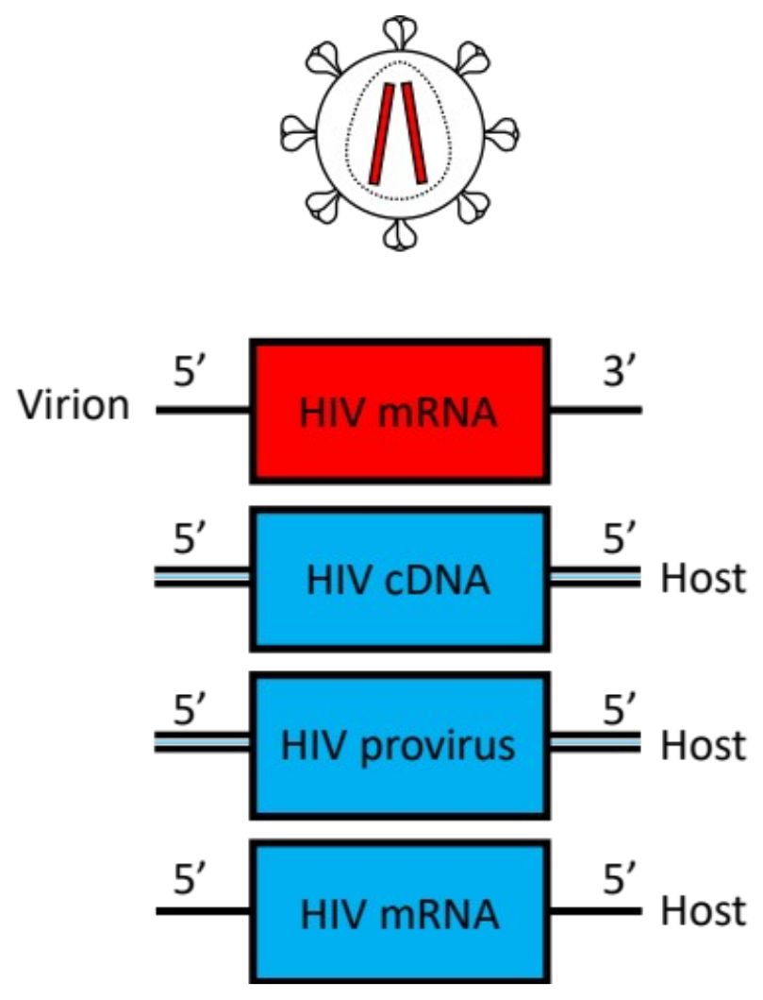{ loading=lazy }

<figcaption markdown="1">

**Figure 1B: HIV-1 virion is modeled as a virus particle with 2 full-length genome equivalents.**

Red is pNL4-3 sequence. Blue sequence simplifies expected change. Compare to **Figure 4**. For simplicity, circularized cDNA is not displayed.

</figcaption>
</figure>

Until recently, sequencing technology had been unable to provide longer direct observations of HIV-1 nucleic acid intermediates, obscuring events of reverse transcription (Hu and Hughes 2012). We recently demonstrated Oxford Nanopore’s long-read sequencing’s ability to distinguish variants between HIV-1’s long terminal repeats (LTRs), also called LTR phasing (Alejandro R Gener et al. 2021). While virion mRNA does not include full-length LTRs, virion mRNA does encode segments of LTR: U3, R repeats, and U5. The most common lab strain of HIV-1 is NL4-3 (**[Figure 1A](#figure-1a): Long terminal repeats are proviral features**). This is a synthetic chimera between NY5 on the 5’ side and LAV/HXB2 on the 3’ side (hence “NL…”). NL4-3 as a provirus template may be modeled as: (U3A-RA-U5A)NY5-HIV-(U3B-RB-U5B)LAV/HXB2. As HIV-1 mRNA, LTRs are split as 5’R-U5-HIV-U3-3’R. In our earlier work we confirmed that NL4-3 had distinct 5’ U3 and 3’ U3, as well as 5’ R and 3’ R segments (**[Figure 3](#figure-3): pNL4-3 imbues pNL4-3 transcripts with distinct R repeats**). Nguyen et al. recently published in vitro experiments on CD4+ T and HeLa cells infected with pseudotyped NL4-3 viral supernatants. We expected to be able to observe LTR homogenization in other’s cDNA Oxford Nanopore long-read (ONT) datasets, as well as in our native/direct ONT. This would mean 100% of LTRs would become (U3B-RA-U5A) ([Figure 2](#figure-2): HIV-1 reverse transcription and LTR homogenization (copying)).

<figure markdown="1" id="figure-1a" class="book-figure">

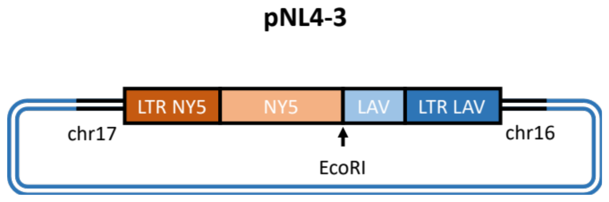{ loading=lazy }

<figcaption markdown="1">

**Figure 1A: Long terminal repeats are proviral features.**

Figure adapted from Gener et al. 2021. *BioRxiv*. pNL4-3 is a plasmid encoding NL4-3 sequence. This plasmid is used to generate pseudotyped NL4-3. pNL4-3 is an important molecular biology tool used widely. A search in Addgene (addgene.org) on 7/13/21 for “lenti” returned 11,443 plasmid hits, many of which contained modified NL4-3 sequence.

</figcaption>
</figure>

<figure markdown="1" id="figure-3" class="book-figure">

<figcaption markdown="1">

**Figure 3: pNL4-3 imbues pNL4-3 transcripts with distinct R repeats.**

CLUSTAL format alignment by MAFFT (v7.481)

5_R_from_NY5 gggtctctctggttagaccagatctgagcctgggagctctctggctaactagggaaccca

3_R_from_LAV gggtctctctggttagaccagatctgagcctgggagctctctggctaactagggaaccca

\*\*\*\*\*\*\*\*\*\*\*\*\*\*\*\*\*\*\*\*\*\*\*\*\*\*\*\*\*\*\*\*\*\*\*\*\*\*\*\*\*\*\*\*\*\*\*\*\*\*\*\*\*\*\*\*\*\*\*\*

5_R_from_NY5 ctgcttaagcctcaataaagcttgccttgagtgctc-a

3_R_from_LAV ctgcttaagcctcaataaagcttgccttgagtgcttca

\*\*\*\*\*\*\*\*\*\*\*\*\*\*\*\*\*\*\*\*\*\*\*\*\*\*\*\*\*\*\*\*\*\*\*. \*

Plasmid pNL4-3 (GenBank:AF324493.1) was used to make pseudotyped NL4-3 (Nguyen Quang et al. 2020). gRNA contained in such pseudotyped viruses is expected to be primary mRNA derived from host transcription from the plasmid template. These virions are then used for subsequent transductions. Reverse-transcribed NL4-3 cDNA sequence should have homogenized 5’ and 3’ LTRs, such that each 3’ LTR converts into the 5’ sequence. Figure method: Above sequences were input into MAFFT online server (https://mafft.cbrc.jp/alignment/software/), which implemented the following commands: mafft --reorder --auto input. L-INS-i method was automatically selected (Katoh et al. 2005). The 5’ and 3’ U5 regions of pNL4-3 are identical and so cannot be used for LTR phasing.

</figcaption>
</figure>

<figure markdown="1" id="figure-2" class="book-figure">

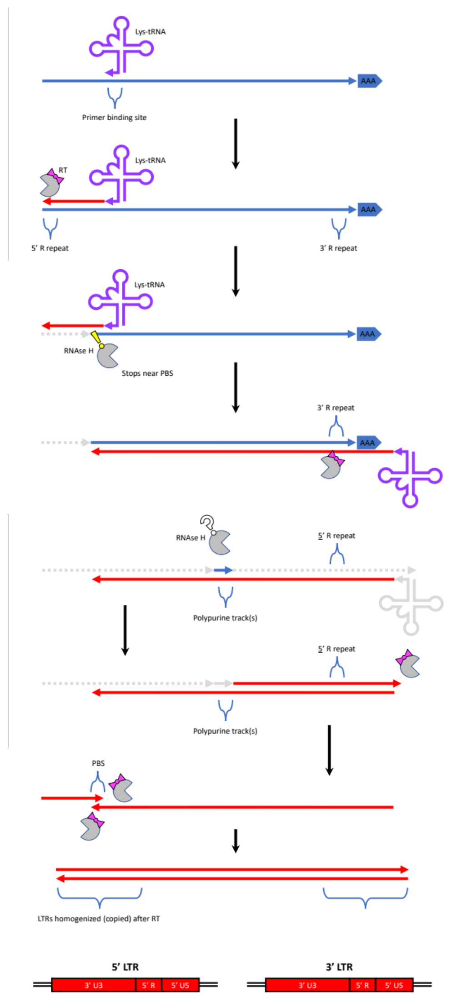{ loading=lazy }

<figcaption markdown="1">

**Figure 2: HIV-1 reverse transcription and LTR homogenization (copying).**

R repeats are expected to homogenize along with LTRs. R repeats are features of both HIV mRNA and DNA. Full-length LTRs are only features of HIV DNA. Blue/red coloring in this figure is arbitrary and is meant to distinguish between RNA template and cDNA. Adapted from (SIB Swiss Institute of Bioinformatics n.d.).

</figcaption>
</figure>

### Methods

#### Datasets, reference, and bioinformatics

Data from (Nguyen Quang et al. 2020) were reanalyzed as follows. Long-read cDNA ONT datasets from HeLa and primary CD4+ T cells (GEO:GSE138425; BioProject:PRJNA511009) were mapped to pNL4-3 reference (GenBank:AF324493.2) with Minimap2 (Li 2018) -splice in Galaxy (usegalaxy.org) (Afgan et al. 2016) or locally. Alignments (sorted .bam and .bai files) were visualized individually in the Integrative Genomics Viewer (Robinson et al. 2011). Aligned reads were grouped in IGV at base AF324493.1:9,624, corresponding to the R variant 97delT (97 based on first base in G triplet defining HIV TSS (Alejandro R. Gener et al. 2021; Gener 2021) and thus beginning of each R). Per (Nguyen Quang et al. 2020), “INF” coded for infection/transduction. “TF” coded for transfection. Cells were either transduced with VSVg-pseudotyped NL4-3 virus-containing supernatant, or transfected with pNL4-3, and subsequently lysed after 12-24 hours post infection (hpi) or hours post transfection. The authors reported that their virus preps included a DNAse step prior to transduction. For their time course experiment, the authors used SMART-Seq v4 Ultra Low Input RNA kit (Clontech) for cDNA synthesis. Sequencing data was collected with MinKNOW software (v 3.3.2), and basecalling was performed with Guppy (v 3.1.5). Their non-time course data was made with SQK-LSK108 and EXP-PBC001 kits, sequencing data was collected with MinKnow (v 1.10.23 and 1.11.5), and basecalling was performed with Albacore (v 2.1.10 and 2.2.7).

Data from our native/direct RNA sequencing is discussed elseware (Alejandro R. Gener et al. 2021; Gener 2021; Gener and Kimata 2019).

#### Statistics

Chi-squared (Χ2) testing was performed with GraphPad Prism 9 Version 9.1.2 (225), May 21, 2021 to compare the observed to expected values. P values are reported in **[Table 1](#table-1): CD4+ T cell allele count at AF324493.2:9,624; [Table 2](#table-2): HeLa cell allele count at AF324493.2:9,624; [Table 3](#table-3): Virion allele count at AF324493.2:9,624 from native/direct RNA**.

<figure markdown="1" id="table-1" class="book-table">

<figcaption markdown="1">

**Table 1: CD4+ T cell allele count at AF324493.2:9,624.**

Total does not include INDEL. All allele frequencies (as percent) significantly different than expected whether 1% or 2% error cutoff used (\*\*\*\* p&lt;.0001).

</figcaption>

|  | Rep 1 | Rep 2 | Rep 3 | 12 hpi (%) | 14 hpi | 16 hpi | 20 hpi | 24 hpi |
| :---: | --- | --- | --- | --- | --- | --- | --- | --- |
| **A** | 5 (2) | 3 (1) | 2 (0) | 6 (3) | 9 (2) | 16 (2) | 14 (3) | 8 (1) |
| <mark>**C**</mark> | <mark>29 (13)</mark> | <mark>67 (19)</mark> | <mark>70 (17)</mark> | <mark>30 (15)</mark> | <mark>92 (22)</mark> | <mark>200 (25)</mark> | <mark>131 (26)</mark> | <mark>108 (20)</mark> |
| **G** | 12 (5) | 10 (3) | 4 (1) | 1 | 4 (1) | 13 (2) | 0 | 6 (1) |
| **T** | 184 (80) | 267 (77) | 331 (81) | 165 (82) | 315 (75) | 584 (72) | 359 (71) | 414 (77) |
| **DEL** | 0 | 1 | 4 | 6 | 14 | 21 | 19 | 20 |
| **IN** | 3 | 8 | 9 | 1 | 7 | 12 | 9 | 8 |
| **total** | 230 | 347 | 407 | 202 | 420 | 813 | 504 | 536 |
</figure>

<figure markdown="1" id="table-2" class="book-table">

<figcaption markdown="1">

**Table 2: HeLa cell allele count at AF324493.2:9,624.**

Total does not include INDEL. All allele frequencies (as percent) significantly different than expected whether 1% or 2% error cutoff used (\*\*\*\* p&lt;.0001).

</figcaption>

|  | TF Rep 1 | TF Rep 2 | INF Rep 2* | TF pU1 Rep 1 | TF pU1 Rep 2 | TF pU1 Rep 3 | TF pU1D2upEx Rep 1 | TF pU1D2upEx Rep 2 | TF pU1D2upEx Rep 3 |
| :---: | --- | --- | --- | --- | --- | --- | --- | --- | --- |
| **A** | 33 (2) | 34 (2) | 3 (1) | 63 (2) | 22 (2) | 7 (1) | 38 (2) | 22 (2) | 18 (3) |
| <mark>**C**</mark> | <mark>259 (15)</mark> | <mark>249 (15)</mark> | <mark>63 (25)</mark> | <mark>459 (17)</mark> | <mark>172 (16)</mark> | <mark>91 (16)</mark> | <mark>313 (14)</mark> | <mark>154 (14)</mark> | <mark>83 (15)</mark> |
| **G** | 83 (15) | 71 (4) | 2 (1) | 124 (4) | 67 (6) | 33 (6) | 99 (4) | 45 (4) | 27 (5) |
| **T** | 1387 (79) | 1262 (78) | 183 (73) | 2128 (77) | 801 (75) | 433 (77) | 1868 (81) | 868 (80) | 431 (77) |
| **DEL** | 13 | 15 | 1 | 12 | 1 | 3 | 22 | 6 | 1 |
| **IN** | 5 | 3 | 5 | 7 | 3 | 0 | 5 | 2 | 3 |
| **total** | 1762 | 1616 | 251 | 2774 | 1062 | 564 | 2318 | 1089 | 559 |
</figure>

<figure markdown="1" id="table-3" class="book-table">

<figcaption markdown="1">

**Table 3: Virion allele count at AF324493.2:9,624 from native/direct RNA.**

Total does not include INDEL. All allele frequencies (as percent) significantly different than expected whether 1% or 2% error cutoff used (\*\*\*\* p&lt;.0001).

</figcaption>

|  | NL4-3 | NLAD8 | HIV-SX |
| :---: | --- | --- | --- |
| **A** | 0 (0) | 0 (0) | 0 (0) |
| <mark>**C**</mark> | <mark>0 (0)</mark> | <mark>3 (1)</mark> | <mark>1 (5)</mark> |
| **G** | 0 (0) | 1 (0) | 1 (5) |
| **T** | 15 (100) | 202 (98) | 19 (90) |
| **DEL** | 0 | 1 | 0 |
| **IN** | 0 | 2 | 0 |
| **total** | 15 | 206 | 20 |
</figure>

### Results

#### LTRs do not homogenize between 12-24 hours post infection (hpi)

Lack of homogenization was independent of whether the sample pertained to a transduction or transfection, and independent of cell line (CD4+ T cell vs. HeLa). **[Table 1](#table-1): CD4+ T cell allele count at AF324493.2:9,624; [Table 2](#table-2): HeLa cell allele count at AF324493.2:9,624**. Reads were generally sufficiently long to obviate read filtering **([Figure 4](#figure-4): Example HIV-1 NL4-3 cDNA from CD4+ T cells 12 hours post-infection).** No single nucleotide variants (SNVs) were immediately apparent when viewing mapped. The ends of the R repeats do not contain homopolymers, dimer or trimer repeats which are known to be problematic for unpolished and/or unassembled ONT sequences, here called reads. While many 3’ reads were truncated upstream of AF324493.2:9,624/R 97delT, there were hundreds of reads available to be able to accumulate a robust number of observations. Reads were truncated past the canonical polyA site, suggesting the sequences did not derive directly from contaminating plasmid. Splice patterns were commonly seen. However, coverage depth was not sufficient to appreciate many full-length spliced isoforms which were also homogenized. Homogenized signal was most likely derived from transcription off nascent HIV-1 NL4-3 cDNA or new proviral integrants in infected cells. The former is more likely, given that relative amount of homogenized R did not change across 12-24 hpi.

<figure markdown="1" id="figure-4" class="book-figure">

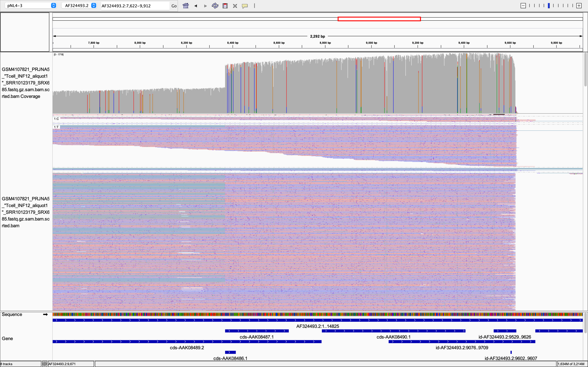{ loading=lazy }

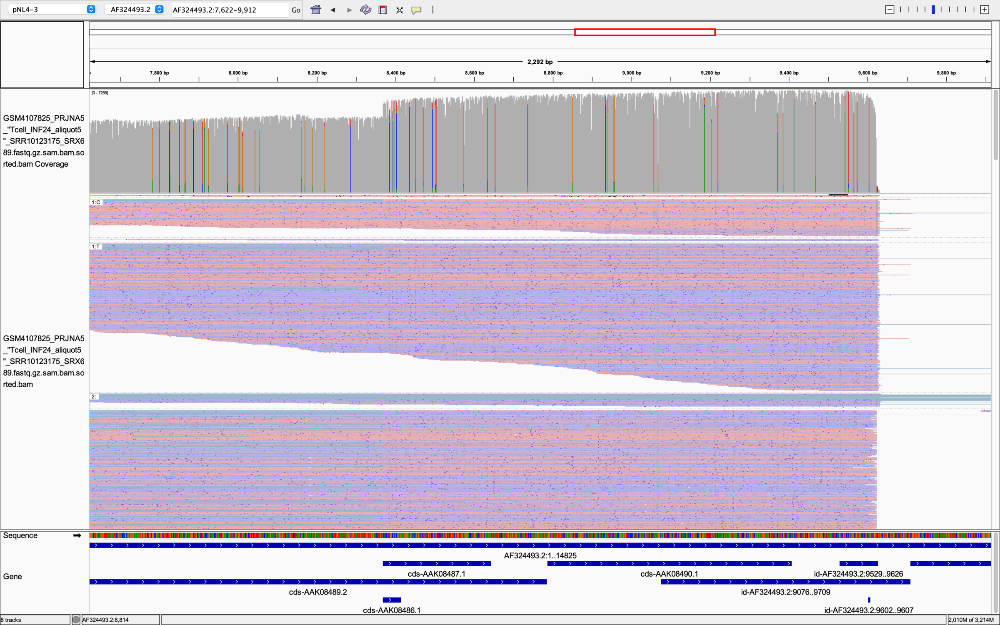{ loading=lazy }

<figcaption markdown="1">

**Figure 4: Example HIV-1 NL4-3 cDNA from CD4+ T cells 12 hours post-infection.**

This IGV snapshot is from CD4+ T cells infected at 12 (top) and 24 (bottom) hours post infection.

</figcaption>
</figure>

Our native virion sequencing experiments included 3 virions based on NL4-3: NLAD8, which had very high coverage, NL4-3 which had low to moderate coverage, both derived from only pNL4-3 (as opposed to pseudotyped pNL4-3 NL4-3). A third virion dataset, HIV-SX, was believed to be made in a similar way as our NL4-3 and NLAD8, however exact details were not available (**[Table 3](#table-3): Virion allele count at AF324493.2:9,624 from native/direct RNA; [Figure 5](#figure-5): Native RNA (my datasets from Chapter 7)).** None of these virion preps exhibited effectively any LTR homogenization. This is consistent with virions made from primary transcripts and prior to RT in the infected cells.

<figure markdown="1" id="figure-5" class="book-figure">

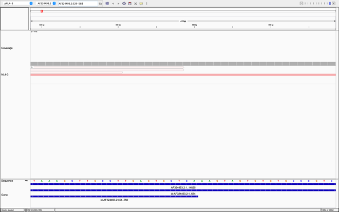{ loading=lazy }

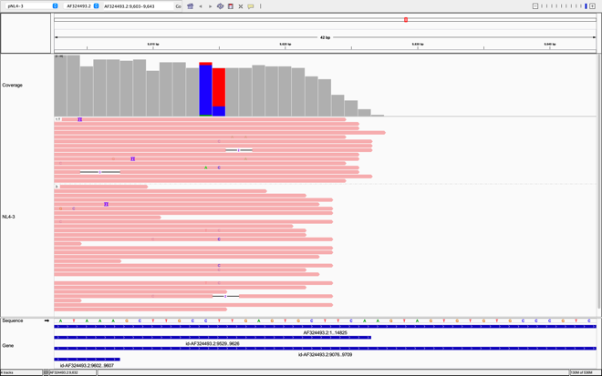{ loading=lazy }

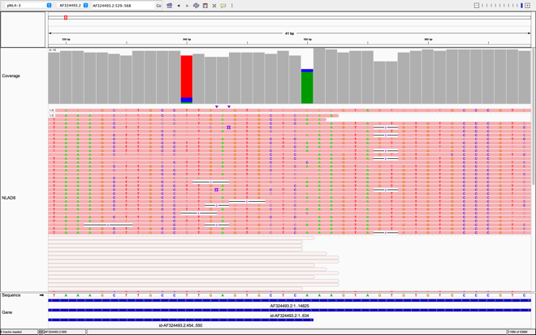{ loading=lazy }

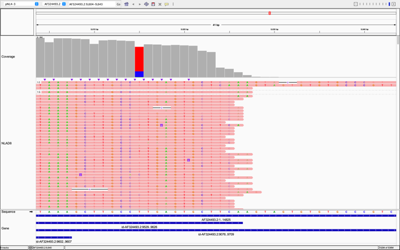{ loading=lazy }

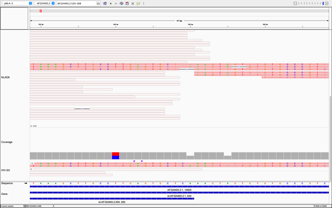{ loading=lazy }

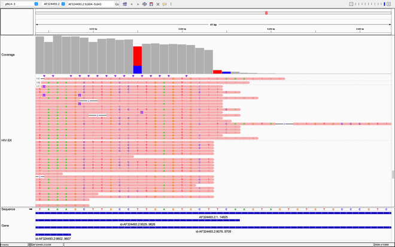{ loading=lazy }

<figcaption markdown="1">

**Figure 5: Native RNA (my datasets from Chapter 7).**

**Example native RNA (NLAD8 dataset from Chapter 7)**

Native RNA sequencing (also called direct RNA sequencing) captures sequence information from mRNA directly without the need for cDNA sequencing. NLAD8 virion (top) was produced by transfecting 293T cells with a pNLAD8 AIDS Reagent Program number ARP-11346 (method (Gener et al. n.d.)). NLAD8 is a strain of virus with NL4-3 backbone and *env* from AD8 (GenBank:AF004394.1). Supernatant was collected 48 hours post infection. HIV-SX/SX (bottom) virion was produced by infecting/transducing cultured peripheral blood mononuclear cells (PBMCs) with HIV-SX, which is a strain of virus with NL4-3 backbone and *env* from JR-FL. Supernatant was collected over 10-15 days post infection. These virion preps are from supernatant of transfected producer cells (NLAD8) before infection, or infected peripheral blood mononuclear cells (HIV-SX/SX) after infection, so we expect minimal to no RT products in fresh virion lysates (as opposed to acutely infected cell lysates), and therefore no R homogenization. LTR homogenization was expected in cell lysates during acute infection. Spliced HIV in virions and predominant mRNA in infected cell lysates was not expected long after infection.

</figcaption>
</figure>

### Discussion

Reverse transcription is believed to occur within 8-12 hours post-infection of host cell (Iordanskiy et al. 2006). cDNA from RT is detectable within 4 hours post infection (hpi) (Hu and Hughes 2012). So, it was reasonable to detect homogenized sequence within 12-24 hpi.

#### R repeat coordinate change

The HIV-1 NL4-3 R repeats are occasionally noted to start at the second G in the G triplet. However, high-quality long-read cDNA sequencing by Nguyen et al. 2020 and our preliminary work Gener et al. 2021 (bioRxiv) verifying NL4-3 LTR sequence support reassignment of the R repeat as including the full G triplet. Nguyen et al.’s datasets were generated with PCR barcoded ONT. The ONT PCR adapter would add an A tail, resulting in either an A or a T on the sequenced strand. This would increase the lengths of the 5’ HIV-1 M B NY5 R to 98 from 97, and the 3’ HIV-1 M B LAV to 99 to

#### Pseudotyped lentiviral preps support Hybrid Segmented Retrovirus model

Nguyen et al. extracted total mRNA from was infected CD4+ T cells and recovered mostly spliced HIV-mapping reads. These reads were almost identical to mapped segments of *in silico* pNL4-3 reference genome sequence. The relative lack of error in Nguyen et al.’s cDNA datasets speaks to the accuracy of the host 293T producer cell transcriptional machinery. Although we did see that some RT products are spliced, most sequences were likely not reverse transcribed in the CD4+ T cells. This matches work by another French group reporting spliced products participating in RT. Together, this supports an idea of HIV virion packaging splice isoforms. Future work may include virion prepared from producer cells lines with stably integrated HIV-1 as opposed to pseudotyped plasmid-derived lentiviral preps.

R repeats withing LTRs are normally identical in natural infections after RT. NL4-3’s distinct Rs make it a valuable tool to be able to follow LTR homogenization. In the future, there will be a need for more long-read data from cell lines latently infected with NL4-3 HIV. Otherwise LTR homogenization dynamics may remain unknown as one will not be able to see differences between LTRs.

### Conclusions

HIV researchers and others using lentiviral vectors assume that the lentiviruses they make during virus prep are in fact “HIV virion.” A rampant assumption about these virions is that they package two copies of full-length unspliced virus genomes or engineered templates. The results of our reanalyses of others’ high-quality HIV-1 NL4-3 cDNA datasets challenge these assumptions. We found that the majority of traceable ONT cDNA reads were in fact pNL4-3 transcripts likely made in producer cells (**[Figure 6](#figure-6): HIV-1 virions exist along a spectrum, and most mRNA in acute infection system comes from producer cell BEFORE infection**). These were in fact mostly spliced forms of pNL4-3 mRNAs. Additionally, our results support the view that HIV-1 virions may regularly package HIV-1 splice isoforms. This is consistent with our observations of splice isoforms in virion-associated mRNA (Alejandro R. Gener et al. 2021; Gener 2021; Gener and Kimata 2020). Taken together, it seems best to recalibrate our understanding of pseudotyped lentiviral vectors as more like transfections from the primary plasmid sequence used rather than prior assumed transductions with full-length viral genome equivalents or templates.

<figure markdown="1" id="figure-6" class="book-figure">

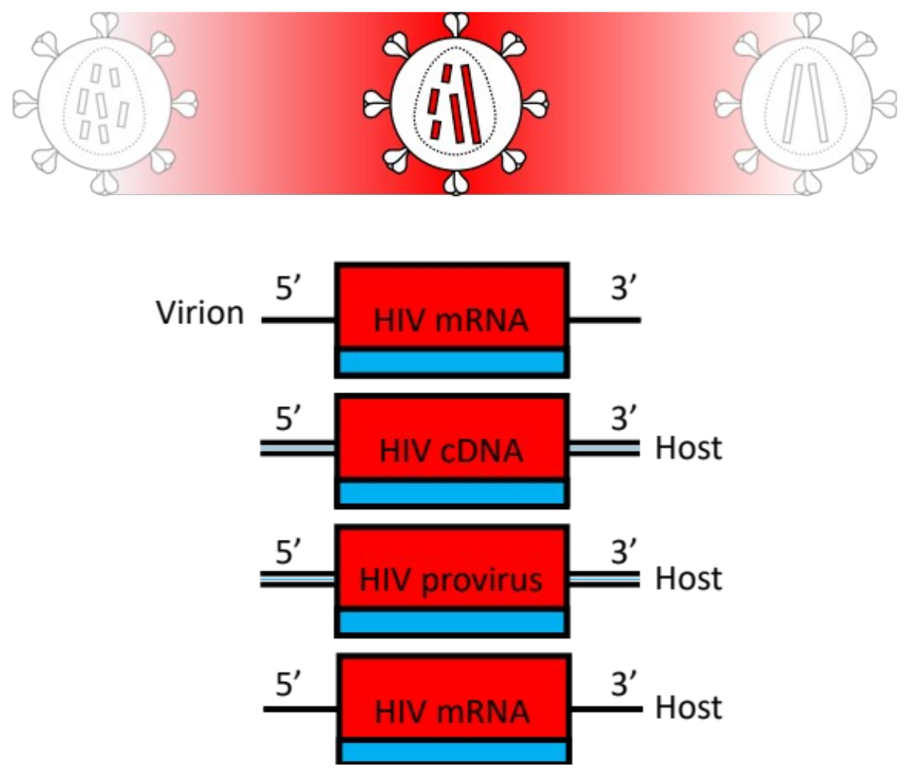{ loading=lazy }

<figcaption markdown="1">

**Figure 6: HIV-1 virions exist along a spectrum, and most mRNA in acute infection system comes from producer cell BEFORE infection.**

**HIV-1 virions exist along a spectrum.**

Red is pNL4-3 sequence. Blue sequence simplifies expected change. Compare to **Figure 1B**. Details of virion mRNA are discussed separately (Gener, AR. 2021. *HIV Informatics.* Chapter 7.; manuscript in prep). For simplicity, circularized cDNA is not displayed.

</figcaption>
</figure>

Future work should determine whether LTRs homogenize at a higher efficiency when virus is prepared from cell lines with sequence-verified and stably integrated NL4-3. As a part of sequence verification, it will be important to determine HIV copy number integration site location, and to define the internal structure of each integration site in those systems. This work has broad implications for retroviral research, as well as for use of lentiviral vectors. Long-read sequencing has become an important tool providing new insights into decades-old experimental procedures.

### Declarations

**List of Abbreviations**

> HIV-1, human immunodeficiency virus.
>
> PCR, polymerase chain reaction.
>
> ONT, Oxford Nanopore Technologies; nanopore sequencing.
>
> RNA-seq, usually refers to cDNA sequencing, unless otherwise specified (e.g., native RNA-seq is not cDNA sequencing).
>
> cDNA, reverse-transcribed “copy” DNA from single-stranded RNA templates. cDNA is usually double-stranded DNA.
>
> DNA-seq, DNA sequencing.
>
> LTR, long terminal repeat.
>
> R, R repeat (An ~97 bp region in the LTR. This work uses new lengths for NY5 and LAV Rs, 98 bp and 99 bp).
>
> DNA, deoxyribonucleic acid.
>
> RNA, ribonucleic acid.
>
> SNV, single nucleotide variant.
>
> BCM, Baylor College of Medicine.
>
> IGV, Integrative Genomics Viewer.
>
> bp, bases long.
>
> Kb, kilobases long.
>
> RRE, rev-response element.
>
> LANL, Los Alamos National Laboratory.
>
> Χ2, Chi-squared

**Ethics Approval**

This work did not include human or animal subjects.

**Consent to publish**

All authors give their consent to publish the current work, pending peer review and acceptance.

**Availability of data and materials.**

As this was a reanalysis, no new data was generated for this work.

**Competing interests**

ARG received travel bursaries from Oxford Nanopore Technologies (ONT). The present work was completed independently of ONT. Other authors declare no conflicts of interest.

**Funding**

This work was funded in part by institutional support from Baylor College of Medicine; private funding by Bob Ostendorf, CEO of East Coast Oils, Inc., Jacksonville, Florida; ARG’s own private funding. ARG has also received the PFLAG of Jacksonville scholarship for multiple years.

**Authors’ contributions**

ARG conceived of this project, reanalyzed results, and drafted the manuscript. All authors discussed data and edited the manuscript. ARG and PK provided funding.

**Acknowledgements**

### References

Afgan, Enis, Dannon Baker, Marius van den Beek, Daniel Blankenberg, Dave Bouvier, Martin Čech, John Chilton, Dave Clements, Nate Coraor, Carl Eberhard, Björn Grüning, Aysam Guerler, Jennifer Hillman-Jackson, Greg Von Kuster, Eric Rasche, Nicola Soranzo, Nitesh Turaga, James Taylor, Anton Nekrutenko, and Jeremy Goecks. 2016. “The Galaxy Platform for Accessible, Reproducible and Collaborative Biomedical Analyses: 2016 Update.” *Nucleic Acids Research* 44(W1):W3–10.

Gener, A. and J. T. Kimata. 2020. “LBPEA06 - Reanalysis of Native RNA Sequencing of HIV-1 Supports Spliced HIV MRNA Packaging into Virions as a New Hybrid Segmented Retrovirus Model.” P. ePoster in *23rd International AIDS Conference (AIDS2020)*.

Gener, Alejandro R. 2021. “Chapter 7 - Advancing HIV Informatics in the RNA Space: HIV Virion MRNA.” Baylor College of Medicine.

Gener, Alejandro R., Brian T. Foley, Deborah P. Hyink, Paul E. Klotman, and Jason T. Kimata. 2021. “The Transcriptional Landscape of HIV-1 Virion-Associated MRNA Includes Sense Spliced and Unspliced Transcripts.” *In Prep.*

Gener, Alejandro R., Deborah P. Hyink, Paul E. Klotman, and Jason T. Kimata. n.d. “First Native RNA Sequencing of HIV-1 Detects Spliced HIV MRNA in Virions.” *In Prep.*

Gener, Alejandro R. and Jason T. Kimata. 2019. “Full-Coverage Native RNA Sequencing of HIV-1 Viruses.” *BioRxiv* 845610.

Gener, Alejandro R, Wei Zou, Brian T. Foley, Deborah P. Hyink, and Paul E. Klotman. 2021. “Reference Plasmid PHXB2_D Is an HIV-1 Molecular Clone That Exhibits Identical LTRs and a Single Integration Site Indicative of an HIV Provirus.” *BioRxiv* 611848.

Hu, Wei-Shau and Stephen H. Hughes. 2012. “HIV-1 Reverse Transcription.” *Cold Spring Harbor Perspectives in Medicine* 2(10).

Iordanskiy, Sergey, Reem Berro, Maria Altieri, Fatah Kashanchi, and Michael Bukrinsky. 2006. “Intracytoplasmic Maturation of the Human Immunodeficiency Virus Type 1 Reverse Transcription Complexes Determines Their Capacity to Integrate into Chromatin.” *Retrovirology* 3:4.

Katoh, Kazutaka, Kei-ichi Kuma, Hiroyuki Toh, and Takashi Miyata. 2005. “MAFFT Version 5: Improvement in Accuracy of Multiple Sequence Alignment.” *Nucleic Acids Research* 33(2):511–18.

Li, Heng. 2018. “Minimap2: Pairwise Alignment for Nucleotide Sequences.” *Bioinformatics* 34(18):3094–3100.

Nguyen Quang, Nam, Sophie Goudey, Emmanuel Ségéral, Ammara Mohammad, Sophie Lemoine, Corinne Blugeon, Margaux Versapuech, Jean Christophe Paillart, Clarisse Berlioz-Torrent, Stéphane Emiliani, and Sarah Gallois-Montbrun. 2020. “Dynamic Nanopore Long-Read Sequencing Analysis of HIV-1 Splicing Events during the Early Steps of Infection.” *Retrovirology* 17(1):1–24.

Robinson, James T., Helga Thorvaldsdóttir, Wendy Winckler, Mitchell Guttman, Eric S. Lander, Gad Getz1, and Jill P. Mesirov1. 2011. “Integrative Genomics Viewer.” *Nat Biotechnol* 29(1):24–26.

SIB Swiss Institute of Bioinformatics. n.d. “SsRNA(RT) Replication/Transcription.” *ViralZone*. Retrieved June 14, 2021 (https://viralzone.expasy.org/1937).
