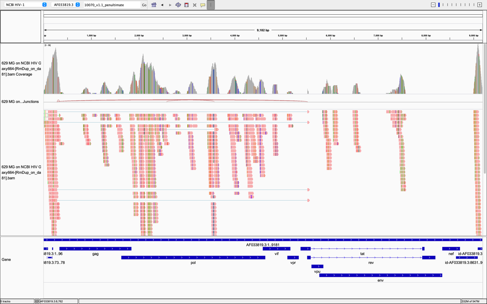
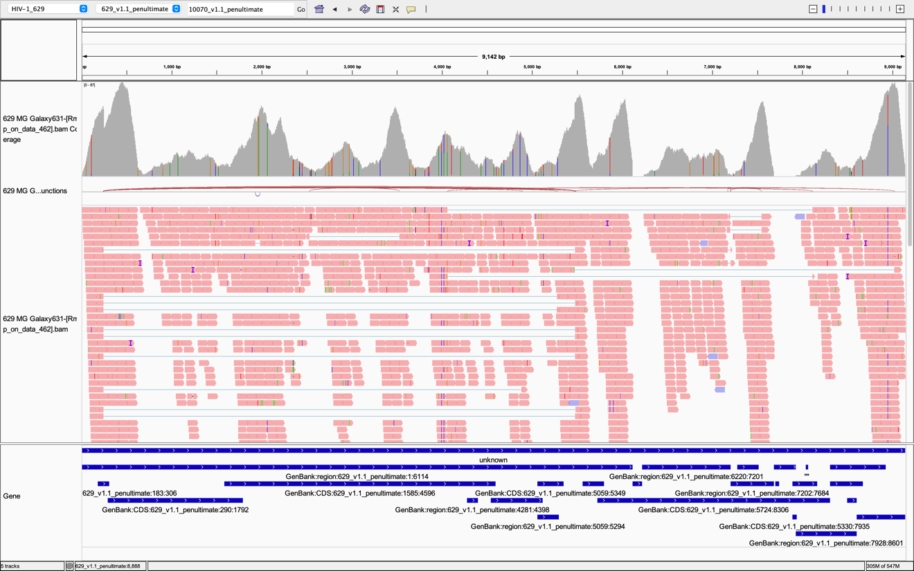
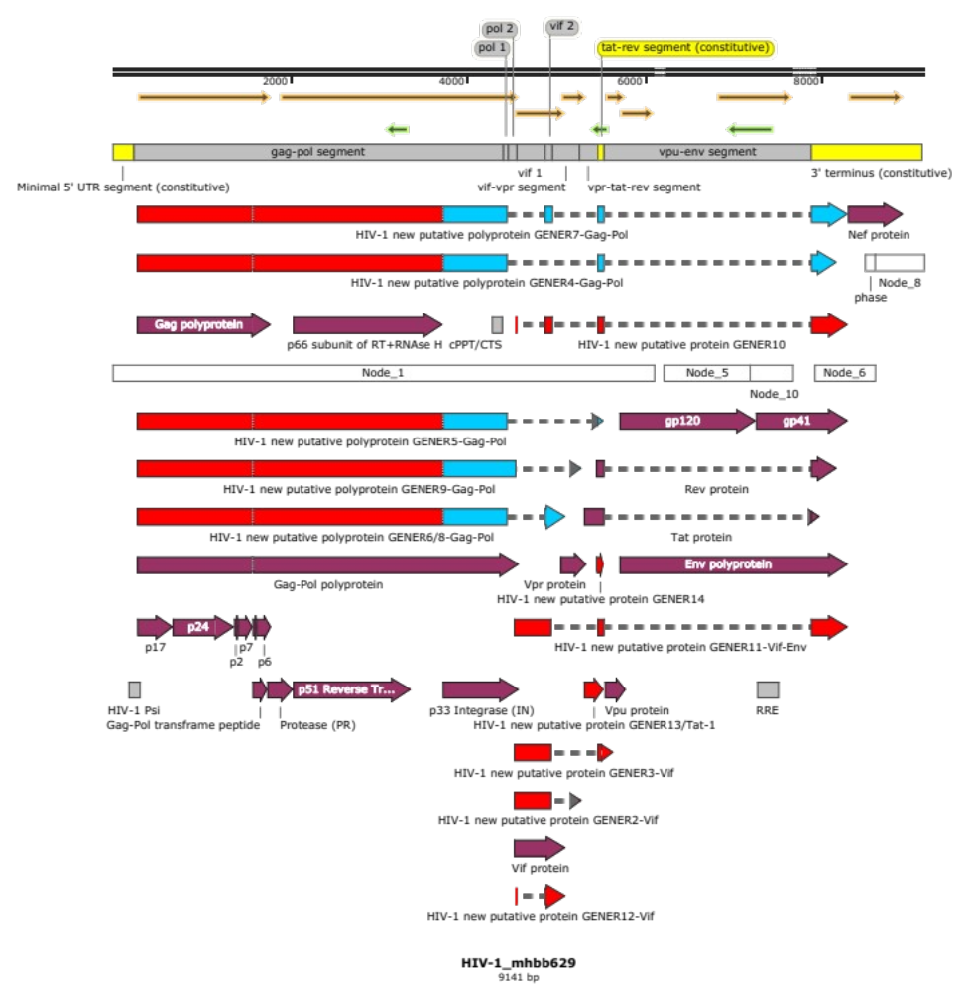
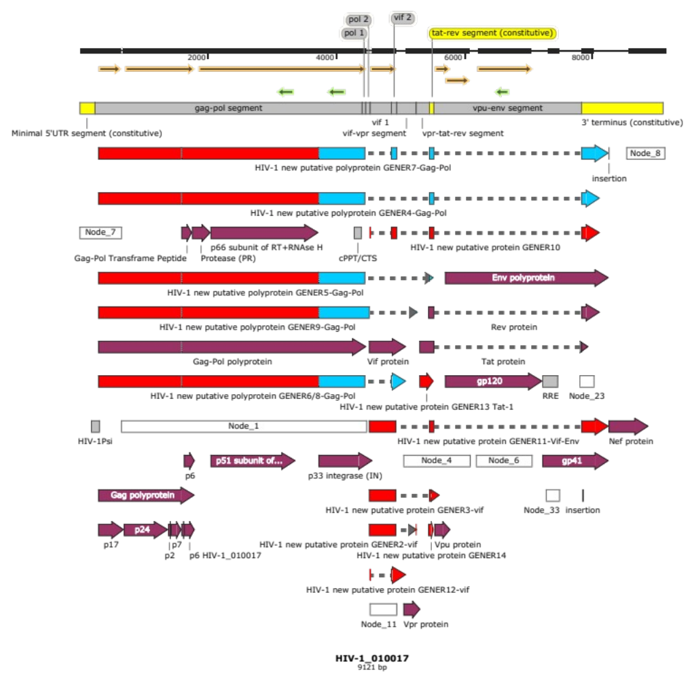
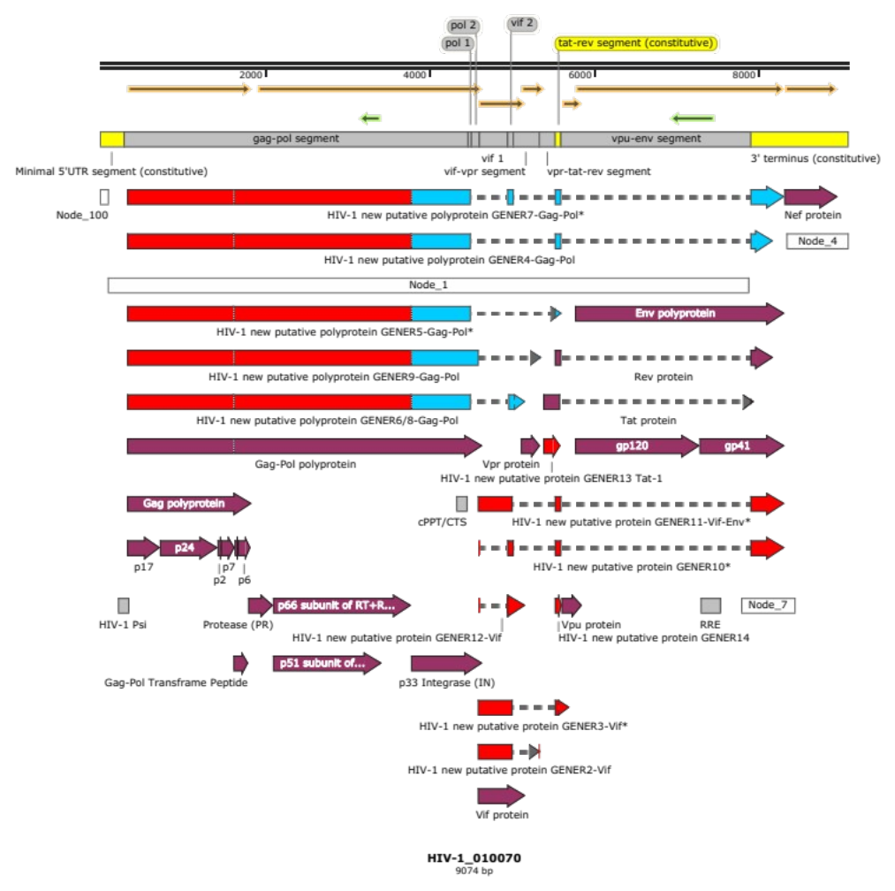
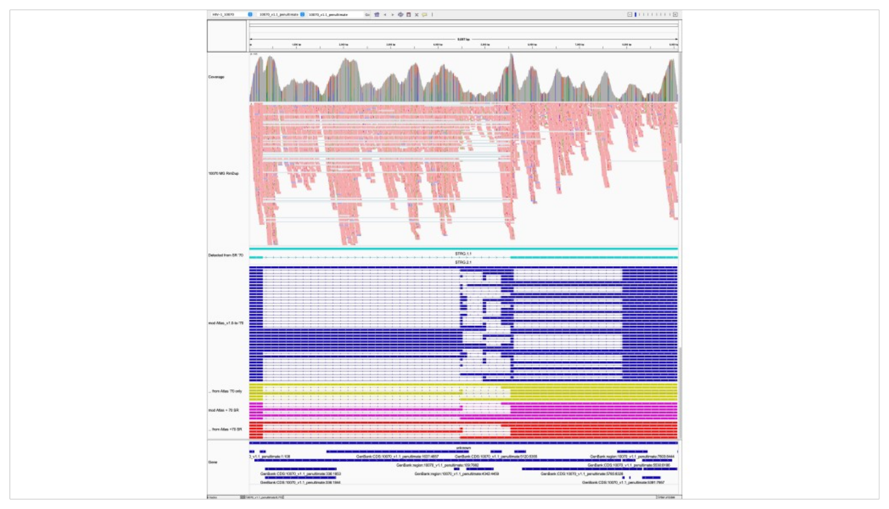
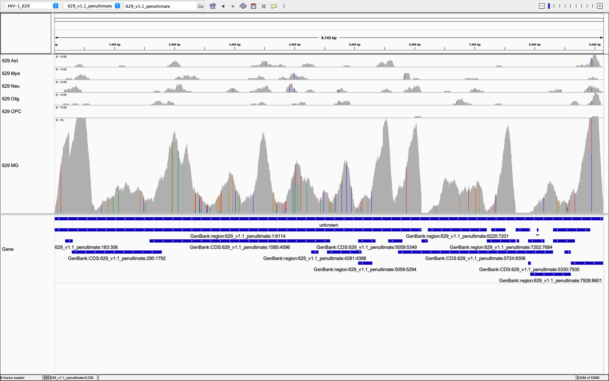

# Chapter 9: Maximizing HIV sequence information from heterogeneous samples

## Chapter Abstract

In the previous chapters, I summarized our historical progress revisiting HIV through the HIV Informatics framework. We began our journey by sequence-verifying pHXB2_D, a key historical reagent, salvaging this resource from the dustbin of history. We didn’t just sequence-verify it. We compared new long-read nanopore DNA sequencing with the closest thing to a gold standard for HIV plasmid verification, single-end sequencing. The Center for Computational & Integrative Biology DNA Core at Massachusetts General Hospital we used in **Chapter 5** used single-end 150 bp sequencing, and this was the “best” verification reported in the AIDS Reagent Program. Our approach enabled unambiguous long terminal repeat (LTR) phasing, which clarified the HXB2 record. It also enabled LTR phasing in a control NL4-3-based plasmid. This incidental finding has broad implications. pNL4-3 has distinct LTRs, specifically R repeats. Using long-read sequencing on high-quality NL4-3 long-read data from Nguyen et al. 2020, it was possible to phase LTRs. Remarkably, our reanalyses revealed that most of the mRNA in CD4+ T cells transduced with VSV-pseudotyped HIV-1 NL4-3 between 12-24 hours post-infection (hpi) derived from primary pNL4-3 transcripts from the producer 293T cell lines. Only about 20% of transcripts were reverse-transcribed, evinced by having completed LTR homogenization or copying of the 5’ R to the 3’ side. This raises interesting points to consider when designing all future lentiviral transduction experiments. Antiviral sensing pathways might be artifactually stimulated by such transfections, instead of transductions. Our reanalyses also draw into question the very nature of transductions with lentiviral vectors. Did these ever behave like we thought they did?

By sequencing HIV virion mRNA without PCR, we were able to recapitulate splicing patterns seen historically and in new high-quality long-read datasets. Our experiments also deviated from other’s cDNA datasets in several important ways. First, our transcription start sites (TSS) differed from other’s cDNA experiments. This was an artifact of native RNA sequencing and was important to demonstrate for HIV samples. We now have an excellent understanding of how the HIV genome might appear in control DNA and RNA samples, serving as a fortified foundation for assessing HIV information in more complex samples. In this chapter, we will explore HIV sequence variability from natural human infections. Post-mortem brain specimens from patients with HIV encephalopathy (HIVE) from the Manhattan Brain Bank were evaluated.

## Introduction

HIV is well-known to infect brain tissues after HIV infection. While the brain has been recognized as a discreet compartmentalization (Korber et al. 1994), the exact cell(s) making up the HIV reservoir(s) in the brain remain undefined. It remains unknown whether infected brain cells can serve as reservoir, sustaining full viral replication cycle.

HIV reservoirs are populations of cells capable of sustaining the full HIV replication cycle. Two classic examples are CD4+ T cells and macrophages. In a generic HIV reservoir population, one would expect to see 3 things with RNA-seq: HIV mapping reads, signatures of HIV splicing, and distinct sequence variability as evidence of compartmentalization (e.g., SNVs, small in-frame SVs) between patients and between sampled sites (if reservoir) within the same patient.

Evidence of HIV replication may take the form of HIV mRNA in the case of gene expression as a function of mRNA abundance. In addition to HIV coverage as read depth, signatures of spliced HIV reads may be construed as indirect evidence of full replication, and HIV virion is historically modeled as unspliced HIV. Therefore, splice HIV must then come from activated integrated provirus or active unintegrated HIV cDNA.

Retroviruses like HIV-1 have high mutation rates (1/10,000 to 1/100,000) (Menéndez-Arias 2009). If HIV replication were happening, we would expect to see HIV variability cluster by cell type. For example, new acquired variants might occur in neurons if HIV made it inside that hypothetical reservoir and continued to replicate within that population of cells. Sequence divergence in a compartment would be evidence for virus evolution, supporting a given tissue’s reservoir status.

Based on other’s observations, we hypothesized that Mφ/MG cells would express the highest amount of HIV relative to the other cell types assayed. We hypothesized that astrocytes would have lower levels of HIV gene expression, suggesting incomplete or inefficient HIV replication. We hypothesized that neurons, oligodendrocytes, and OPCs would have low or no HIV gene expression. We hypothesized that mapping to pan-HIV reference may increase recovery of HIV sequences compared to mapping to HXB2 (GenBank:K03455.1) or HXB2-like (GenBank:AF033819.3) HIV-1 reference genomes. We hypothesized that mapping to bespoke (sample-specific) assemblies will be higher than mapping to HXB2 (GenBank:K03455.1) or HXB2-like (GenBank:AF033819.3) HIV-1 reference genomes.

## Methods

### Brain biopsy source

Cadaveric brain biopsy from patients who died from HIV encephalopathy were obtained by Dr. Susan Morgello at the Manhattan Brain Bank under appropriate institutional supervision.

### Tissue processing

Flow sorting was used to enrich for pools of macrophages/microglia (Mφ) expressing Irf8, neurons expressing NeuN, oligodendrocytes expressing Oligo2, and triple-negative cells were considered astrocytes mixed with small amounts of other cell types. Ensemble (pooled) RNA-seq was performed on these pools.

Single-cell RNA-seq (scRNA-seq) was adapted for single nuclear isolation and sequencing. gene expression signatures were used to cluster reads into microglia (MG or Mφ), Myeloid cells (monocytes/macrophages), neurons (Neu), oligodendrocytes (Olig), oligodendrocytes precursor cells (OPC), and astrocytes (Ast).

### Bespoke (sample-specific) assemblies

Human (hg38) reads mapped with STAR (Dobin et al. 2013) were excluded from downstream HIV assemblies and mapping. Filtered non-human reads were assembled into scaffolds with metaSPAdes (Bankevich et al. 2012) in Galaxy (Afgan et al. 2016). Scaffolds were mapped to the HXB2-like HIV-1 reference sequence AF033819.3 with minimap2 20% (Li 2018) in Galaxy and/or locally. Minimap2 --splice was also evaluated with negligible performance increases. Forward-oriented scaffolds were pasted sequentially into new SnapGene files \[source\]. Any reverse-oriented scaffolds relative to AF033819.3 (like NC_001802.1) were pasted into temporary SnapGene files and “flipped” to assume forward orientation, and then brought into the working manual assembly. Gaps were filled as bridges with sequences from AF033819.3. Clipped areas from mapping were cut from SnapGene segments. Round 1 manual assemblies were checked by aligning relevant scaffold “nodes” to evaluate for appropriate manual clipping. Features were imported from AF033819.3 with fuzzy mapping (e.g., “Find similar DNA sequences” and “allow a mismatch or gap/insertion every 10-4 bases”), and adjusted based on open reading frames (ORFs) identified by SnapGene. At this point, ORFs approximated most imported features. Sequences were saved as .dna (SnapGene proprietary format) and .fasta as v1.n assemblies, where n is the number of haplotypes resulting from distinct scaffolds.

For visualization of bespoke assemblies in the Integrative Genomics Viewer (IGV) (Robinson et al. 2011), .fasta files and .gff3 files were used. At the time of this work, feature export as .gff3 was not supported by SnapGene. To make gff3, .dna with annotations were saved as “GenBank – Standard” formatted files. These were converted in Galaxy with “GenBank to GFF3 converter (Galaxy Version 1.1).” The output file’s first/leftmost column contained the phrase “Expected”. This was replaced with the chromosome number (text after “&gt;” in fasta header, ending in space), to be able to visualize annotations in IGV.

Data was mapped to new v1.n assemblies to evaluate coverage improvement, and to modify bridges where sample sequences diverged from AF033819.3. HISAT2 (Kim, Langmead, and Salzberg 2015) was used to map HIV-1 reads to bespoke assemblies.

## Results

We tested several approaches to retrieve HIV information from samples. In order of relative total yield, we tried 1.) mapping reads to HXB2 (GenBank:K03455.1 which is a single linear reference as a single FASTA file), then 2.) mapping reads to a pan-HIV genome concatenated multi-FASTA, and lastly 3.) assembling HIV genomes de novo from Mφ/MG cells, and then re-mapping input reads onto the new bespoke references to assess minor allele frequencies which were not incorporated into each bespoke reference. The later returned the highest yields, including increasing detection of spliced reads. Default SPAdes failed to produce assemblies. We think this is because natural HIV reads are very noise. The tuning of SPAdes in metaSPAdes was able to handle the natural HIV sequence heterogeneity.

### Mapping

We assessed HIV-1 coverage by mapping (HISAT2 (Kim et al. 2015) or Minimap2 (Li 2018)) non-human (hg38) cell-sorted ensemble RNA-seq reads to HIV-1 HXB2 K03455.1. Ensemble RNA-seq samples were heterogeneous, with high background. As such, HIV-1 genome assembly was deferred for these samples. We next assessed HIV-1 coverage by mapping non-human (hg38) single-nucleus RNA-seq reads to HIV-1 HXB2 K03455.1. Microglial cells had the highest HIV burden. Mapping to HIV pan-genome failed. Instead, reads would map to parts of sequences, leaving many split reads across references. We found that supplying one reference was better than many at once.

***Assembly***

Coverage against HIV-1 HXB2 K03455.1 was too low to assemble HIV-1. *De novo* genome assembly was attempted with all non-human (hg38) single-nucleus RNA-seq reads, per sample. MetaSPAdes (Bankevich et al. 2012) implemented in Galaxy (Afgan et al. 2016) was successful at assembling HIV-1 genomes in high coverage microglial samples. We were able to assemble three complete HIV-1 genomes from 3 different post-mortem HIV encephalopathy cases (**[Figure 2](#figure-2): HIV-1_mhbb629, a complete HIV-1 genome assembled from a patient who died of HIV encephalopathy (HIVE); [Figure 3](#figure-3): HIV-1_010017, a complete HIV-1 genome assembled from a patient who died of HIV encephalopathy (HIVE); [Figure 4](#figure-4): HIV-1_010070, a complete HIV-1 genome assembled from a patient who died of HIV encephalopathy (HIVE)).**

<figure markdown="1" id="table-1" class="book-table">

<figcaption markdown="1">

**Table 1: Mapping to bespoke or sample-specific reference as opposed to an off-the-shelf HIV-1 reference increases number of reads by 2-4x.**

**Mapping to bespoke or sample-specific reference as opposed to an off-the-shelf HIV-1 reference increases number of HIV-1 reads by 2-4x**

RmDup = removing artifactual polymerase chain reaction (PCR) duplicates based on start/stop coordinates with RmDup tool (Samtools (Wysoker et al. 2009), Galaxy (Afgan et al. 2016)). Paired-end reads treated as “single” ignore read name ID.

</figcaption>

| Experiment | Sample | Cell type | Reference | No RmDup HISAT2 summary aligned once | No RmDup total reads | No RmDup x times improvement |
| --- | ---: | --- | --- | ---: | ---: | ---: |
| scRNA-seq | 629 | Astrocyte | 629\_v1.1\_penultimate.fa | 75 | 65708 | 3.75 |
| scRNA-seq | 629 | MG | 629\_v1.1\_penultimate.fa | 5483 | 189060 | 3.729931973 |
| scRNA-seq | 629 | Mye | 629\_v1.1\_penultimate.fa | 53 | 18680 | 2.789473684 |
| scRNA-seq | 629 | Neu | 629\_v1.1\_penultimate.fa | 111 | 663426 | 2.094339623 |
| scRNA-seq | 629 | Olig | 629\_v1.1\_penultimate.fa | 69 | 53794 | 4.6 |
| scRNA-seq | 629 | OPC | 629\_v1.1\_penultimate.fa | 3 | 14948 | 3 |
| scRNA-seq | 629 | Astrocyte | AF033819.3\_HIV-1\_complete\_genome.fasta | 20 | 65708 |  |
| scRNA-seq | 629 | MG | AF033819.3\_HIV-1\_complete\_genome.fasta | 1470 | 189060 |  |
| scRNA-seq | 629 | Mye | AF033819.3\_HIV-1\_complete\_genome.fasta | 19 | 18680 |  |
| scRNA-seq | 629 | Nue | AF033819.3\_HIV-1\_complete\_genome.fasta | 53 | 663426 |  |
| scRNA-seq | 629 | Olig | AF033819.3\_HIV-1\_complete\_genome.fasta | 15 | 53794 |  |
| scRNA-seq | 629 | OPC | AF033819.3\_HIV-1\_complete\_genome.fasta | 1 | 14948 |  |
| scRNA-seq | 10017 | Astrocyte | 10017v1\_penultimate.fa | 24 | 38638 | 2.181818182 |
| scRNA-seq | 10017 | MG | 10017v1\_penultimate.fa | 2229 | 100520 | 2.373801917 |
| scRNA-seq | 10017 | Mye | 10017v1\_penultimate.fa | 849 | 18952 | 2.2109375 |
| scRNA-seq | 10017 | Nue | 10017v1\_penultimate.fa | 217 | 937220 | 2.148514851 |
| scRNA-seq | 10017 | Olig | 10017v1\_penultimate.fa | 429 | 373658 | 2.584337349 |
| scRNA-seq | 10017 | OPC | 10017v1\_penultimate.fa | 32 | 45364 | 2.909090909 |
| scRNA-seq | 10017 | Astrocyte | AF033819.3\_HIV-1\_complete\_genome.fasta | 11 | 38638 |  |
| scRNA-seq | 10017 | MG | AF033819.3\_HIV-1\_complete\_genome.fasta | 939 | 100520 |  |
| scRNA-seq | 10017 | Mye | AF033819.3\_HIV-1\_complete\_genome.fasta | 384 | 18952 |  |
| scRNA-seq | 10017 | Nue | AF033819.3\_HIV-1\_complete\_genome.fasta | 101 | 937220 |  |
| scRNA-seq | 10017 | Olig | AF033819.3\_HIV-1\_complete\_genome.fasta | 166 | 373658 |  |
| scRNA-seq | 10017 | OPC | AF033819.3\_HIV-1\_complete\_genome.fasta | 11 | 45364 |  |
| scRNA-seq | 10070 | Astrocyte | 10070\_v1.1\_penultimate.fa | 29 | 83738 | 1.380952381 |
| scRNA-seq | 10070 | MG | 10070\_v1.1\_penultimate.fa | 11323 | 372040 | 2.169157088 |
| scRNA-seq | 10070 | Mye | 10070\_v1.1\_penultimate.fa | 1 | 2076 | 1 |
| scRNA-seq | 10070 | Nue | 10070\_v1.1\_penultimate.fa | 119 | 137108 | 1.983333333 |
| scRNA-seq | 10070 | Olig | 10070\_v1.1\_penultimate.fa | 425 | 718722 | 1.995305164 |
| scRNA-seq | 10070 | OPC | 10070\_v1.1\_penultimate.fa | 45 | 91006 | 2.5 |
| scRNA-seq | 10070 | Astrocyte | AF033819.3\_HIV-1\_complete\_genome.fasta | 21 | 83738 |  |
| scRNA-seq | 10070 | MG | AF033819.3\_HIV-1\_complete\_genome.fasta | 5220 | 372040 |  |
| scRNA-seq | 10070 | Mye | AF033819.3\_HIV-1\_complete\_genome.fasta | 1 | 2076 |  |
| scRNA-seq | 10070 | Nue | AF033819.3\_HIV-1\_complete\_genome.fasta | 60 | 137108 |  |
| scRNA-seq | 10070 | Olig | AF033819.3\_HIV-1\_complete\_genome.fasta | 213 | 718722 |  |
| scRNA-seq | 10070 | OPC | AF033819.3\_HIV-1\_complete\_genome.fasta | 18 | 91006 |  |
</figure>

<figure markdown="1" id="figure-1" class="book-figure">

{ loading=lazy }

{ loading=lazy }

<figcaption markdown="1">

**Figure 1: Mapping strategies matter.**

The choice of which reference is used is important when considering maximizing the recovery of HIV sequence information from clinical samples. Patients are infected with viruses distinct from HXB2. Top: Mapping to an off-the-shelf HIV-1 reference AF033819.3 enabled the recovery of some information from cells with microglial signatures in sample 629. This assembly is as full-length unspliced HIV-1 mRNA, and so has split LTRs which are easier for short-read mapping studies. Bottom: Mapping to a bespoke assembly increased the amount of total HIV-1 mapping reads by 3.72x. **See Table 1: Mapping to bespoke or sample-specific reference as opposed to an off-the-shelf HIV-1 reference increases number of reads by 2-4x.** Note that scRNA-seq approximates single-end sequencing.

</figcaption>
</figure>

<figure markdown="1" id="figure-2" class="book-figure">

{ loading=lazy }

<figcaption markdown="1">

**Figure 2: HIV-1_mhbb629, a complete HIV-1 genome assembled from a patient who died of HIV encephalopathy (HIVE).**

Number of nodes: 5. Gaps filled with the number of Ns equal to the corresponding gaps from HXB2 (K03455.1) mapping in IGV. Locus segmentation is implemented as a track at the top of the figure. Color coding is as follows. Yellow segments (n=3) are constitutive; always present in a complete HIV-1 mRNA. Gray segments (n=8) are differentially expressed, depending on the mRNA. Previously described HIV-1 open reading frames (ORFs) are maroon. New putative ORFs are red, and druggable protease products are blue. Nodes from metaSPAdes are white. Miscellaneous mRNA structures are gray. Antisense protein ORF omitted. Figure made in SnapGene. (HIV-1_mhbb629 BankIt2469166). Annotations derived from HIV-1 NL4-3 mRNA Atlas v1.1 (MSTRG.2.16 removed, so no GENER1A, GENER1B, GENER15). This updates information from work presented at IAS2021 (Gener et al. 2021).

</figcaption>
</figure>

<figure markdown="1" id="figure-3" class="book-figure">

{ loading=lazy }

<figcaption markdown="1">

**Figure 3: HIV-1_010017, a complete HIV-1 genome assembled from a patient who died of HIV encephalopathy (HIVE).**

Number of nodes: 8. Gaps filled with the number of Ns equal to the corresponding gaps from HXB2 (K03455.1) mapping in IGV. Locus segmentation is implemented as a track at the top of the figure. Color coding is as follows. Yellow segments (n=3) are constitutive; always present in a complete HIV-1 mRNA. Gray segments (n=8) are differentially expressed, depending on the mRNA. Previously described HIV-1 open reading frames (ORFs) are maroon. New putative ORFs are red, and druggable protease products are blue. Nodes from metaSPAdes are white. Miscellaneous mRNA structures are gray. Antisense protein ORF omitted. Figure made in SnapGene. (HIV-1_010017 BankIt2469183). Annotations derived from HIV-1 NL4-3 mRNA Atlas v1.1 (MSTRG.2.16 removed, so no GENER1A, GENER1B, GENER15). This updates information from work presented at IAS2021 (Gener et al. 2021).

</figcaption>
</figure>

<figure markdown="1" id="figure-4" class="book-figure">

{ loading=lazy }

<figcaption markdown="1">

**Figure 4: HIV-1_010070, a complete HIV-1 genome assembled from a patient who died of HIV encephalopathy (HIVE).**

Number of nodes: 4. Compared to HIV-1_mhbb629 and HIV-1_010017, coverage was sufficient to obviate gap-filling. Asterisks (\*) in GENER7, GENER11, GENER3, and GENER10 ORFs denote a variant TGA (a stop codon), compared to TCA in HIV-1_mhbb629 and TCC in HIV-1_010017. Note: We are working with GenBank and LANL on a way to handle these for new HIV assemblies. See email on 7/13/21. Locus segmentation is implemented as a track at the top of the figure. Color coding is as follows. Yellow segments (n=3) are constitutive; always present in a complete HIV-1 mRNA. Gray segments (n=8) are differentially expressed, depending on the mRNA. Previously described HIV-1 open reading frames (ORFs) are maroon. New putative ORFs are red, and druggable protease products are blue. Nodes from metaSPAdes are white. Miscellaneous mRNA structures are gray. Antisense protein ORF omitted. Figure made in SnapGene. (HIV-1_010070 BankIt2468818). Annotations derived from HIV-1 NL4-3 mRNA Atlas v1.1 (MSTRG.2.16 removed, so no GENER1A, GENER1B, GENER15). This updates information from work presented at IAS2021 (Gener et al. 2021).

</figcaption>
</figure>

<figure markdown="1" id="figure-5" class="book-figure">

{ loading=lazy }

<figcaption markdown="1">

**Figure 5: High coverage after removing PCR duplicates enabled detection of novel HIV isoforms in brain.**

Tracks from top to bottom (color): Coverage (gray); Reads (salmon); transcript models detected by StringTie only without a supplied transcript model (teal); HIV-1 NL4-3 Atlas v1.1 modified to 10070 using locus segmentation (dark blue) (Gener et al. 2021); mRNAs detected using modified (mod) Atlas above (gold); mod Atlas + allowing for detection of models supported by short-read (SR) data too (fuchsia); mRNAs detected using both mod mod Atlas and SR (red). SR data provides limited information, effectively recapitulating mRNA models MSTRG.2.4 and MSTRG.2.1 (See Chapter 6 (Gener 2021)). Samples 629 and 10017 did not have high enough coverage to produce mRNA models supported by the v1.0 Atlas (Gener et al. 2021). Note that red and gold tracks are identical. Gold track model names from top to bottom: MSTRG.2.4, MSTRG.2.14, MSTRG.2.10, MSTRG.2.37, MSTRG.2.1, and MSTRG.2.5. MSTRG.2.37 encodes a novel ORF GENER5-Gag-Pol and therefore GENER5-integrase. Uses only short reads and coverage to predict models. These are not seen in higher-quality long-read datasets (Gener et al. 2021; Nguyen Quang et al. 2020; Ocwieja et al. 2012). Reference: bespoke from sample 10017. Dataset: scRNA-seq microglia (MG).

</figcaption>
</figure>

<figure markdown="1" id="figure-6" class="book-figure">

{ loading=lazy }

<figcaption markdown="1">

**Figure 6: Variants detected AFTER maximizing HIV information supports limited viral evolution in non-microglial cells.**

Variants were noted after maximizing HIV information by mapping reads to bespoke assemblies. Variants found in non-microglial cells but absent in microglial (MG) cells support independent evolution. However, absence of additional coverage and splice signals suggest that replication stops shortly after reverse transcription. Human-mapping data was filtered prior to analysis, and each integration occurs pseudorandomly, so incidental integration site analyses are not possible. Our model is like the Trojan horse proposed by others (e.g., Jay A. Levy) whereby infected microglia may produce high amounts of HIV, infecting neighboring cells. Neighboring cells may not be able to support HIV replication much beyond RT.

</figcaption>
</figure>

### Remapping

Repeat mapping (remapping) against bespoke sample-specific assembly references increase mapping by 2-4x. Splice junctions we much more obvious when mapping to bespoke reference. Minor variants in microglial samples were retained, as evidenced by fewer read variability compared to when mapping against HXB2. Coverage in non-microglial cells was too low to assemble, and usually didn’t recuperate splice junctions. Despite low coverage in non-microglial cells, coverage sufficient to detect variants unique to each non-microglial compartment. This supports at least abortive infection of these cells during acute HIVE.

## Discussion and Conclusion

Natural infections are distinct from *in vitro* infections in that natural patient/community-acquired HIV-1 sequences have long since diverged from HXB2-like sequences. We developed a strategy to efficiently make reference-quality and patient-specific bespoke HIV-1 genomes from cells expected to exhibit high HIV gene expression. Coverage was too low to attempt transcript modeling, however there was clearly evidence of splicing after reads were remapped to their bespoke assemblies. Future work may evaluate long-read approaches to recover isoform information from brain. Long-read approaches may be combined with

## Acknowledgements

Amara Plaza-Jennings (supervised by her thesis advisor Dr. Schahram Akbarian at Icahn School of Medicine, New York, New York) performed wet lab experiments including library preparation from post-mortem brain biopsy tissues and upstream analyses, including filtering human reads from single-cell RNA-seq data. Alejandro Rafael Gener performed downstream analyses including mapping optimization, HIV genome assembly, and manual variant calling.

## References

Afgan, Enis, Dannon Baker, Marius van den Beek, Daniel Blankenberg, Dave Bouvier, Martin Čech, John Chilton, Dave Clements, Nate Coraor, Carl Eberhard, Björn Grüning, Aysam Guerler, Jennifer Hillman-Jackson, Greg Von Kuster, Eric Rasche, Nicola Soranzo, Nitesh Turaga, James Taylor, Anton Nekrutenko, and Jeremy Goecks. 2016. “The Galaxy Platform for Accessible, Reproducible and Collaborative Biomedical Analyses: 2016 Update.” *Nucleic Acids Research* 44(W1):W3–10.

Bankevich, Anton, Sergey Nurk, Dmitry Antipov, Alexey A. Gurevich, Mikhail Dvorkin, Alexander S. Kulikov, Valery M. Lesin, Sergey I. Nikolenko, Son Pham, Andrey D. Prjibelski, Alexey V Pyshkin, Alexander V Sirotkin, Nikolay Vyahhi, Glenn Tesler, Max A. Alekseyev, and Pavel A. Pevzner. 2012. “SPAdes: A New Genome Assembly Algorithm and Its Applications to Single-Cell Sequencing.” *Journal of Computational Biology* 19(5):455–77.

Dobin, Alexander, Carrie A. Davis, Felix Schlesinger, Jorg Drenkow, Chris Zaleski, Sonali Jha, Philippe Batut, Mark Chaisson, and Thomas R. Gingeras. 2013. “STAR: Ultrafast Universal RNA-Seq Aligner.” *Bioinformatics (Oxford, England)* 29(1):15–21.

Gener, Alejandro R. 2021. “Chapter 6 - Advancing HIV Informatics in the RNA Space: HIV MRNA Models.” Baylor College of Medicine.

Gener, Alejandro R., Deborah P. Hyink, Paul E. Klotman, and Jason T. Kimata. 2021. “HIV-1 Segmentation-Based Transcript Models Define 5’ Untranslated Region (UTR) and Open Reading Frame (ORF) Classes, Elucidate Total Viral Protein-Coding Capacity, and Are Summarized by a New HIV-1 MRNA Naming Convention.” P. ePoster in *24th International AIDS Conference (IAS2021)*.

Kim, Daehwan, Ben Langmead, and Steven L. Salzberg. 2015. “HISAT : A Fast Spliced Aligner with Low Memory Requirements.” 12(4).

Korber, B. T., K. J. Kunstman, B. K. Patterson, M. Furtado, M. M. McEvilly, R. Levy, and S. M. Wolinsky. 1994. “Genetic Differences between Blood- and Brain-Derived Viral Sequences from Human Immunodeficiency Virus Type 1-Infected Patients: Evidence of Conserved Elements in the V3 Region of the Envelope Protein of Brain-Derived Sequences.” *Journal of Virology* 68(11):7467–81.

Li, Heng. 2018. “Minimap2: Pairwise Alignment for Nucleotide Sequences.” *Bioinformatics* 34(18):3094–3100.

Menéndez-Arias, Luis. 2009. “Mutation Rates and Intrinsic Fidelity of Retroviral Reverse Transcriptases.” *Viruses* 1(3):1137–65.

Nguyen Quang, Nam, Sophie Goudey, Emmanuel Ségéral, Ammara Mohammad, Sophie Lemoine, Corinne Blugeon, Margaux Versapuech, Jean-Christophe Paillart, Clarisse Berlioz-Torrent, Stéphane Emiliani, and Sarah Gallois-Montbrun. 2020. “Dynamic Nanopore Long-Read Sequencing Analysis of HIV-1 Splicing Events during the Early Steps of Infection.” *Retrovirology* 17(1):25.

Ocwieja, Karen E., Scott Sherrill-Mix, Rithun Mukherjee, Rebecca Custers-Allen, Patricia David, Michael Brown, Susana Wang, Darren R. Link, Jeff Olson, Kevin Travers, Eric Schadt, and Frederic D. Bushman. 2012. “Dynamic Regulation of HIV-1 MRNA Populations Analyzed by Single-Molecule Enrichment and Long-Read Sequencing.” *Nucleic Acids Research* 40(20):10345–55.

Robinson, James T., Helga Thorvaldsdóttir, Wendy Winckler, Mitchell Guttman, Eric S. Lander, Gad Getz1, and Jill P. Mesirov1. 2011. “Integrative Genomics Viewer.” *Nat Biotechnol* 29(1):24–26.

Wysoker, A., T. Fennell, G. Marth, G. Abecasis, J. Ruan, H. Li, R. Durbin, N. Homer, and B. Handsaker. 2009. “The Sequence Alignment/Map Format and SAMtools.” *Bioinformatics* 25(16):2078–79.
