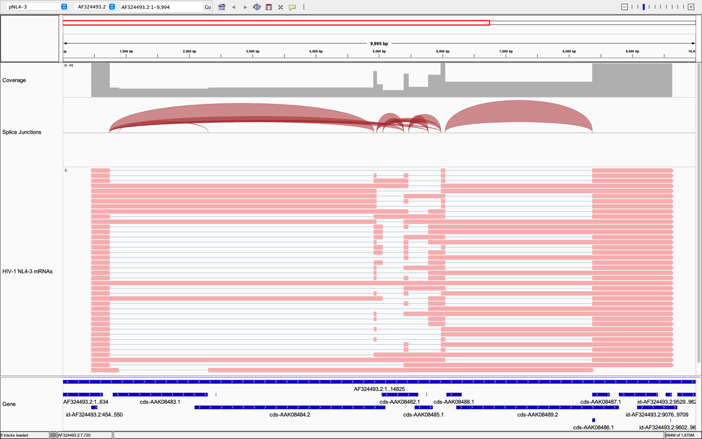
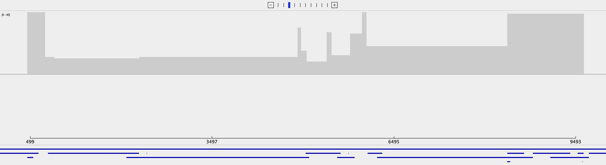
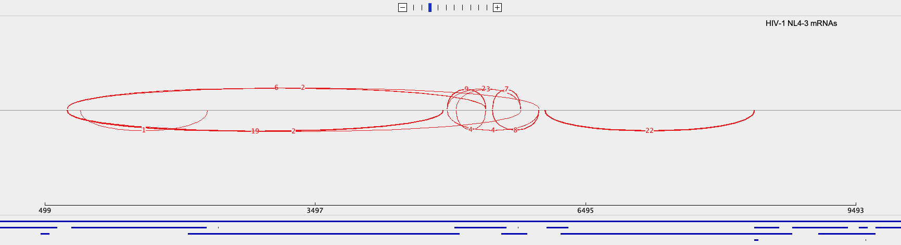
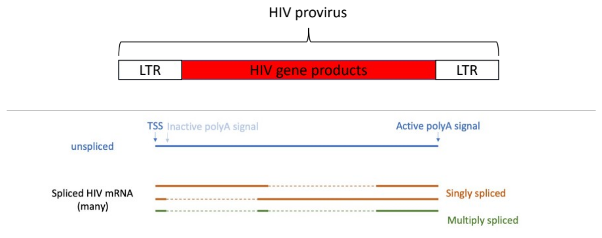
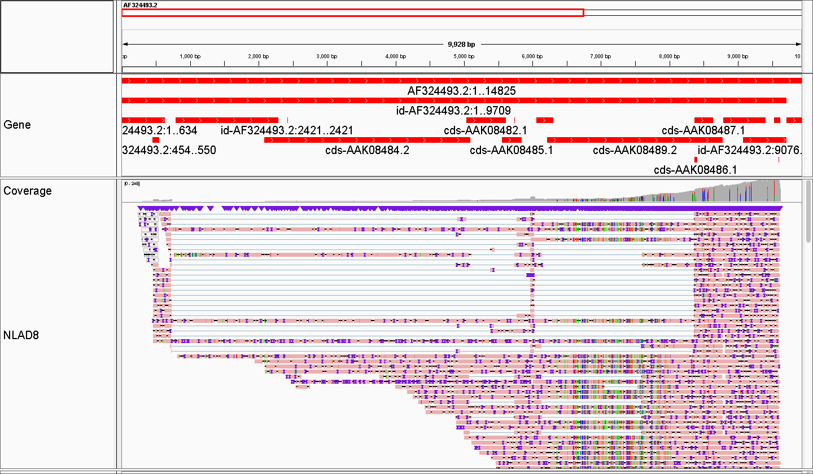
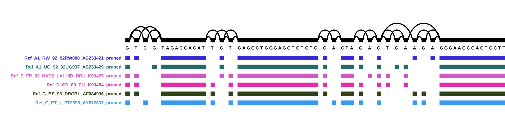
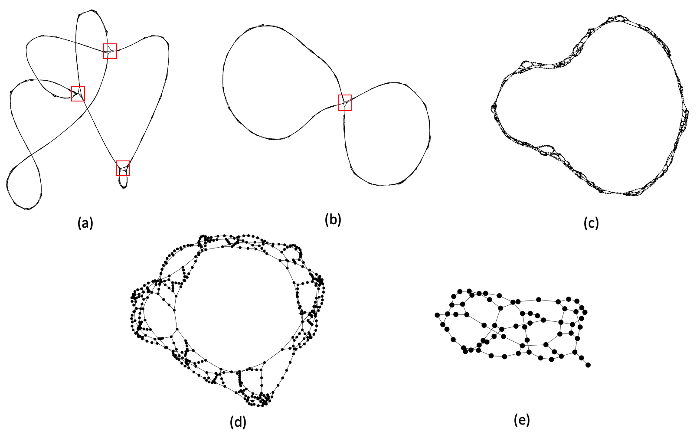
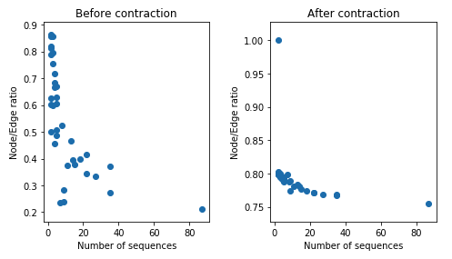

# Chapter 10: Conclusions and future directions

## Abstract

Resequencing key HIV reagents as DNA and RNA enabled us to determine the suitability of current short- and long-read sequencing methods for recovering HIV sequence information from progressively more variable HIV systems. We were also able to begin informed work in clinical samples. Future directions of previous work and/or recommendations based on said work are proposed. I anticipate the need to consider making sense of HIV information from more complex biological systems with HIV graph genomes and provide some examples of early work in this space. Broader implications of HIV Informatics are addressed, including a 5th dimension: bioethical considerations important for collecting and using HIV information responsibly.

### Passing the baton back to the HIV research community

The work in this dissertation was observational. If 2020 was the Year of Hindsight, in 2021 we now have foresight. Many new questions and hypotheses may come from revisiting the fundamental assumptions about the human immunodeficiency viruses. For example, while we validated HIV-1 NL4-3 virion mRNA with others’ infected cell lysate samples and historical accounts, community members may continue to evaluate the accuracy of our transcript models in NL4-3 and systems based on NL4-3.

The most obvious first next question should be to determine whether the open reading frames identified in Chapter 6 (Alejandro R. Gener 2021a) encode real proteins. While existing antibodies may be used to detect novel isoforms with conserved domains (for example, GENER-integrases should all be recognized by antibodies recognizing the shared n-terminal), mass spectrometry approaches may be used to validate new putative HIV-1 NL4-3 proteins unambiguously. “Bottom-up” approaches rely on proteolytic cleavage, often using the protease trypsin to make peptides for downstream mass spectrometry (spec). However, we cannot use trypsin as in common protocols because of common co-occurrence of lysine residues at splice junctions. Trypsin cleaves at lysine, which leads to decreased representation of peptides overlapping splice junctions in samples (personal communication with Dr. Anna Malovannaya). A simple fix to this limitation is to modify these protocols to include cleavage away from the splice junctions. The predicted protein sequences in Chapter 6 (Alejandro R. Gener 2021a) are essential to select appropriate proteases for this approach. Another approach to mass spec is “top-down” (Holt, Wang, and Young 2021). In this top-down, investigators ionize undigested proteins in their entirety. Again, predicted protein sequences are essential to be able to analyze resulting data. The predicted protein sequences make up a target database which is important for mass spec regardless of whether bottom-up or top-down approaches are chosen. Coincidentally, new protein sequencing methods leveraging nanopores are becoming available which might have utility for GENER validations (Alfaro et al. 2021).

Another question is whether different tissues will exhibit different transcriptional profiles when considering for the first time what relevant HIV mRNAs look like. We have seen how different tissues may express different isoforms (Bruggeman et al. 1994; Klotman et al. 2006), but we have not yet had the opportunity to catalogue and quantify those isoforms comprehensively. We now have the tools and methods to do so. We need not be the only lab to pursue such efforts. Indeed, as we learn more about HIV’s tropisms, it seems preferable that multiple labs with expertise across many target tissues should approach this work in parallel. Organs do not function in isolation; neither should HIV science moving forward.

It remains to be seen whether LTR homogenization can be demonstrated to occur by traversing the complete HIV replication cycle with long-read sequencing. So far we have seen zero homogenization prior to infection (Alejandro R. Gener 2021b; Gener and Kimata 2019, 2020), and low levels of homogenization between 12 and 24 hours post infection (our reanalysis (Alejandro R. Gener 2021c) of Nguyen Quang et al.’s 2020 dataset (Nguyen Quang et al. 2020)). Two experiments which may be done are establishing new cell line(s) with stably integrated NL4-3. It is important to use NL4-3 because prior datasets such as our transcript models (Alejandro R. Gener 2021a) are based on NL4-3. Additionally, NL4-3 is a synthetic chimera, as such it carries with it variants between the 5’ R repeat and 3’ R repeat which allow for LTR phasing and observation of LTR homogenization, which is a proxy for reverse transcription efficiency. Recall however that the special distinct NL4-3 5’ and 3’ Rs homogenize to 5’ R sequences after RT, so Rs may not yet be followed through successive rounds of HIV replication.

### New annotations offer a chance to… actually use annotations!

As I worked with Dr. Mark Landree (National Center for Biotechnology Information (NCBI) GenBank), Dr. Brian T. Foley (Los Alamos National Laboratory (LANL) HIV Sequence Database), and Dr. Eneida Hatcher (NCBI RefSeq) to implement the new HIV-1 NL4-3 annotations into both GenBank and RefSeq, I realized that the two major sources of HIV reference genomic information, LANL and RefSeq, existed in two flavors: K03455.1 and NC_001802.1. These two closely related reference genomes were well-annotated, for the most part. The NCBI reference included *gag-pol* as a gene, whereas LANL’s K03455.1 treated *gag* and *pol* separately. LANL did however include information about the ribosomal slippage site between *gag* and *pol* in additional metadata as part of the HIV-1 Gene Map resource (Los Alamos National Laboratories 2017a), and additional information is included elsewhere (Los Alamos National Laboratories 2017b) and related HIV Genome Browser in development (Los Alamos National Laboratories 2016). In addition to that, I noticed from [Chapter 7 Table 1](07-rna-space-virion-mrna.md#table-1) (Alejandro R. Gener 2021b) that other HIV-1 reference genomes were inconsistently annotated. Many whole HIV genomes available through LANL and GenBank lacked annotation altogether. While I do not attempt to redress that gap in my dissertation, the evolutionary analyses in Chapter 6 (Alejandro R. Gener 2021a) serves as proof-of-concept of how the new annotations may be implemented across available HIV whole genomes easily. For example, I used this approach to annotate 3 new HIV-1 assemblies from scRNA-seq short-read data from post-mortem brain tissue in Chapter 9 (Alejandro R. Gener 2021d). However, it is important to validate these transcripts as occurring in more distantly related simian immunodeficiency and primate immunodeficiency viruses. The availability of these annotations in peer-reviewed public databases will enable the next several years of HIV basic science and may hopefully lead to improvements in HIV care and toward sterilizing, not just functional cure.

### Moving away from gene models toward transcript profiling

The concept of a HIV gene models has historically biased HIV gene expression analyses. Gene models are never real, yet they are still used to measure mRNA expression. Put simply, a read mapping to an HIV gene is used to approximate the abundance of said gene. This was done because of lack of available transcript models. This was in part because direct observation of full-length HIV mRNAs has been expensive, despite decreasing cost. Using gene models instead of transcript models for HIV mRNA abundance can work for monocistronic and/or non-alternatively spliced mRNA. However, this approach fails spectacularly for the polycistronic AND alternatively splice mRNAs seen in HIV. The work in Chapter 6 (Alejandro R. Gener 2021a) enables HIV researchers to appreciate which transcripts can make which ORFs. Now that we have an idea of what transcripts can be, the previous studies tying transcripts to ORF expression should be repeated. This should be done on the same plasmid backgrounds in the same cells. Ideally, clinically relevant cell lines should be used. As immortalized cell lines introduce artifactual responses, primary cell lines should be used when possible. Also, transcripts from plasmid-bound isoforms might be additionally spliced after transfection. Therefore, thought should be given to stabilizing isoforms. One way to do this might be to make isoform mutants with synonymous mutations which may inactivate splice junctions while retaining RNA structure and/or protein-coding capacity.

### HIV mRNA Atlas version 2.0

During our analyses we noted differences between the coverage profiles of HIV cDNA cell lysate and HIV virion native RNA sequencing. While these two are not directly comparable, we noticed differences between the loss of coverage from adaptor ligation sites. Cell lysate cDNA exhibited saw-toothed patterns, while virion native RNA exhibited peak coverage at adaptor ligation site and smooth loss of coverage as read length increased. Coverage peaks in both datasets corresponded to the canonical or primary polyA site in the 3’ LTR, irrespective of upstream splicing. The cDNA dataset’s saw teeth appeared to correspond to possible secondary internal polyA sites. If true, secondary polyA may contribute to HIV mRNA heterogeneity, and subsequently to HIV gene expression. A next step would be to complement each existing cDNA or native RNA dataset with their cognate native RNA or cDNA set for direct comparison.

Another set of HIV mRNA transcripts occurred with irregular splice junctions. These were most apparent in our NLAD8 native RNA dataset, which had the highest coverage of the 15 virions sequenced (Alejandro R. Gener 2021a; Gener and Kimata 2019, 2020). Because of their irregular splicing and lack of duplicate coverage, this heterogeneous class of transcripts were not detected by StringTie. However, as these were detected regularly, future thought should be put toward evaluating these irregular HIV transcripts and their potential for coding for novel putative HIV proteins.

### From a singular HIV-1 linear reference to multiple HIV-1 reference genomes

The experiments performed in Chapters 5-8 were done on control reference samples. In Chapter 9 (Alejandro R. Gener 2021d) I attempted to recover HIV information from naturally infected cadaveric brain tissue. With difficulty, this was achieved from microglia, cells with higher expected HIV burden. While the short-read sequencing used precluded extensive haplotyping, variants were detected after re-mapping reads to their own assemblies. There remain at least two distinct applications where retaining this variability may be useful. The first is more basic, to summarize available reference-quality HIV-1 genomes as a single pangenome. Another is to retain the variability inherent withing a patient when performing HIV genotyping. I completed early work with collaborators exploring graph genome implementation for HIV sequence across several NCBI-sponsored codeathons (Mahmoud et al. 2020; Martí-Carreras et al. 2020; Mc Cartney et al. 2021). At the time of the completion of this dissertation, there remained challenges with implementing graph genomes for HIV reference genomes. Before we had HIV transcript models available (**[Figure 1](#figure-1): 40 HIV-1 NL4-3 mRNA models;** **[Figure 2](#figure-2): Sashimi plot of synthetic HIV-1 NL4-3 approximates a transcript graph**), we worked out that having criteria for pruning input sequences improved approximate k-mer graphs (**[Figure 4](#figure-4): Native RNA sequencing established TSS-3’ R as canonical virion genome**; **[Figure 5](#figure-5): Nucleobase Graph Reference Genomes with pruned HIV-1 references**; **[Figure 6](#figure-6): Approximate k-mer Graph Reference Genomes of HIV**). HIV is relatively small and information-dense, so nucleobase graphs will probably be more useful for summarizing information without losing information (**[Table 1](#table-1): Newer bioinformatics methods like Graph Reference Genomes keep more biological information, while modeling multiple real sequences**). Future work may include implementing HIV graph reference genomes considering HIV structural variability like in-frame insertions and deletions seen during HIV genome assembly from naturally infected tissues (Alejandro R. Gener 2021d) in addition to splicing vs. non-splicing.

<figure markdown="1" id="figure-1" class="book-figure">

{ loading=lazy }

<figcaption markdown="1">

**Figure 1: 40 HIV-1 NL4-3 mRNA models.**

Adapted from Chapter 6 (Alejandro R. Gener 2021a). Coverage in gray. Maximum coverage = 40, for 40 HIV-1 NL4-3 mRNA models. Synthetic reads in forward orientation. Spliced out (removed) segments are represented as gaps with teal-spanning thin lines. MSTRG.2.16 was later removed to yield n=39 Atlas v1.1. This corresponds to the splice junction seen over *gag*.

</figcaption>
</figure>

<figure markdown="1" id="figure-2" class="book-figure">

{ loading=lazy }

{ loading=lazy }

<figcaption markdown="1">

**Figure 2: Sashimi plot of synthetic HIV-1 NL4-3 approximates a transcript graph.**

Coverage in gray. Maximum coverage = 40, for 40 HIV-1 NL4-3 mRNA models. Edges (splice junctions) are represented in red. MSTRG.2.16 was later removed to yield n=39 Atlas v1.1. This corresponds to the splice junction seen over *gag*.

</figcaption>
</figure>

<figure markdown="1" id="figure-3" class="book-figure">

{ loading=lazy }

<figcaption markdown="1">

**Figure 3: HIV linear reference genomes deposited as provirus, transcript.**

HXB2 (1st HIV reference) is deposited as LTR-to-LTR. Newer HIV LRGs describe structures closer to HIV mRNA. These LTR repeats can be problematic for graph applications. Linear references also ignore other splice isoforms. As such canonical transcript is assumed to represent the HIV genomes. Source: (Gener et al. 2020). Singly- and doubly-spliced is now outdated. There is no clear preference for which introns are spliced out or which exons are retained and when. The use of “singly-” and “doubly-” often prioritized either *gag-pol* or *env* segments being spliced out or retained. HIV has much more complex splice patterns (Gener et al. 2021, n.d.; Nguyen Quang et al. 2020; Ocwieja et al. 2012; Purcell and Martin 1993)

</figcaption>
</figure>

<figure markdown="1" id="figure-4" class="book-figure">

{ loading=lazy }

<figcaption markdown="1">

**Figure 4: Native RNA sequencing established TSS-3’ R as canonical virion genome.**

Many cDNA libraries exist which support above, however short-read sequencing usually has problems with LTRs. LTRs are longer than short reads. Source: (Gener et al. 2020).

</figcaption>
</figure>

<figure markdown="1" id="figure-5" class="book-figure">

{ loading=lazy }

<figcaption markdown="1">

**Figure 5: Nucleobase Graph Reference Genomes with pruned HIV-1 references.**

Made with vg (information below). Note that this process is memory intensive. Of 39 (M group (A-K, without recombinants)) subtype references annotated as full genomes in curated alignments, 6 had full-length sequences from TSS to end of R in 3’ LTR. Excess sequence was “pruned” manually in Genious. First 64 nucleotides are shown above. We used these to attempt approximate k-mer graphs with our developing tool SWIGG. Source: (Gener et al. 2020).

</figcaption>
</figure>

<figure markdown="1" id="figure-6" class="book-figure">

{ loading=lazy }

{ loading=lazy }

<figcaption markdown="1">

**Figure 6: Approximate k-mer Graph Reference Genomes of HIV.**

Made with SWIGG. We improved on the first implementation. Contraction (Table) is useful to tune when adding more sequences. There’s diminishing returns to adding more sequences, which is useful for knowing how many sequences may be representative (between 50-100). There is also a cost when adding sequences which are not closely related (not shown). Work in ongoing to tie approximate k-mer space to nucleobase space and known HIV-1 features. (Note range in axes in left figures are not same!). Source: (Gener et al. 2020).

</figcaption>
</figure>

<figure markdown="1" id="table-1" class="book-table">

<figcaption markdown="1">

**Table 1: Newer bioinformatics methods like Graph Reference Genomes keep more biological information, while modeling multiple real sequences.**

Source: (Gener et al. 2020).

</figcaption>

<table>
<colgroup>
<col style="width: 17%" />
<col style="width: 12%" />
<col style="width: 14%" />
<col style="width: 14%" />
<col style="width: 16%" />
<col style="width: 24%" />
</colgroup>
<thead>
<tr class="header">
<th><strong>Reference type</strong></th>
<th><strong>Real?</strong></th>
<th><strong>Number of sequences needed to make</strong></th>
<th><strong>Claims to represent:</strong></th>
<th><strong>Represents:</strong></th>
<th><strong>Computational burden for mapping reads</strong></th>
</tr>
</thead>
<tbody>
<tr class="odd">
<td>(Linear) Reference Genome (LRG)</td>
<td>Yes</td>
<td>1</td>
<td>All</td>
<td>1*</td>
<td>Smallest</td>
</tr>
<tr class="even">
<td>Consensus sequence**</td>
<td>No</td>
<td>Few to many</td>
<td>All</td>
<td>As many used to make consensus. Averages out potentially meaningful information.</td>
<td>Small</td>
</tr>
<tr class="odd">
<td>Multi Sequence Alignment (MSA) of multiple LRG</td>
<td>Yes***</td>
<td>Few to many</td>
<td>As many in MSA</td>
<td>As many in MSA. Bad for structural variants.</td>
<td>Scales poorly (multiples of single LRG)</td>
</tr>
<tr class="even">
<td>Nucleobase graph reference genome (NGRG)</td>
<td>Yes****</td>
<td>Few to many</td>
<td>As many in NGRG</td>
<td>As many in nucleobase GRG</td>
<td>Scales well (manages redundant info <u>without</u> loss)</td>
</tr>
<tr class="odd">
<td>Approximate k-mer graph reference genome (KGRG)</td>
<td>No*****</td>
<td>Few to many</td>
<td>As many in KGRG</td>
<td>As many in nucleobase GRG</td>
<td>Not applicable (k-mer ≠ nucleobase space). Allows users to focus on k-mers for future nucleobase space work.</td>
</tr>
<tr class="even">
<td colspan="6">
*Note that references are usually historical, and do not directly address the heterogeneity which might exist within similar sequences.

**It is not appropriate to include consensus sequences in most downstream applications. A consensus sequence’s purpose is to summarize closely related sequences and is an end-product. This leads to high loss of information. Its utility diminishes by inclusion of distantly related sequences.

***Assuming MSA does not contain consensus sequences.

****NGRG are based on real sequences and maintain all information from sequencing space.

*****KGRG are based on real sequences, but users may tune the amount of data in them (to maximize signal-to-noise ratio for their applications).
</td>
</tr>
</tbody>
</table>
</figure>

### Prediction: HIV Informatics will inform HIV diagnosis, treatment, and monitoring/surveillance

As sequencing gets cheaper, the biomedical community will shift away from using differential diagnoses to bias diagnostic testing and instead use unbiased omics. There might already be a need to clinically validate omics to determine which specific tests can be swapped out for such unbiased approaches. Tests which might not be able to be easily adapted are ones which detect dilute analytes. Limiting factors include bioinformatic infrastructure, including the availability of bioinformaticians familiar with medicine and infectious disease, as well as integrating omics into the medical record. An untapped resource from unbiased sequencing-based diagnostic approaches may be human genomic information, which may have non-HIV related information that can be archived in patients’ medical records for future use. Another externality is the ability to make this information accessible for biomedical research without violating principles like confidentiality and informed consent.

### Bioethical implications of HIV information

As we were learning about AIDS and HIV, mistakes were made with long-lasting implications. A seminal cluster study (Auerbach et al. 1984) perpetuated a typo. The authors replaced “patient O” for “<u>O</u>ut-of-California” with “patient 0” (zero). That was picked up by media, including the 1987 book *And the Band Played O*n by Randy Shilts (Johnson 2019). “Patient zero” was interpreted to mean the first HIV case in the US, being responsible for the infections of the other patients in the cluster, and even the cause of the modern HIV epidemic. This perpetuated stigma against minoritized communities, stigma which affected communities are still combating today. In a 2016 Nature paper, Mr. Gaëtan Dugas, HIV-1’s “patient 0”, was finally exonerated (Worobey et al. 2016). Molecular epidemiological studies revealed that HIV was circulating in the US before Mr. Dugas, and that older HIV sequences were distinct from his HIV’s sequence (Worobey et al. 2016). His exoneration was a case where the use of informed informatics helped to redress past mistakes. People living with HIV/AIDS (PLWHA) still suffer from neglect and stigma. HIV informaticians must learn from past mistakes to be able to help PLWHA.

An important bioethical consideration in the clinical application of HIV Informatics is to design systems such that patients will be aware of how their information is stored, who may access it, and how it may be used. Ideally, patients should be able to give informed consent to avoid use of patient information without consent. As communities affected by HIV have been simultaneously historically neglected and exploited, practitioners of HIV Informatics must realize that with great power often comes a need for informed consent and respect.

## References

Alfaro, Javier Antonio, Peggy Bohländer, Mingjie Dai, Mike Filius, Cecil J. Howard, Xander F. van Kooten, Shilo Ohayon, Adam Pomorski, Sonja Schmid, Aleksei Aksimentiev, Eric V Anslyn, Georges Bedran, Chan Cao, Mauro Chinappi, Etienne Coyaud, Cees Dekker, Gunnar Dittmar, Nicholas Drachman, Rienk Eelkema, David Goodlett, Sébastien Hentz, Umesh Kalathiya, Neil L. Kelleher, Ryan T. Kelly, Zvi Kelman, Sung Hyun Kim, Bernhard Kuster, David Rodriguez-Larrea, Stuart Lindsay, Giovanni Maglia, Edward M. Marcotte, John P. Marino, Christophe Masselon, Michael Mayer, Patroklos Samaras, Kumar Sarthak, Lusia Sepiashvili, Derek Stein, Meni Wanunu, Mathias Wilhelm, Peng Yin, Amit Meller, and Chirlmin Joo. 2021. “The Emerging Landscape of Single-Molecule Protein Sequencing Technologies.” *Nature Methods* 18(6):604–17.

Auerbach, David M., William W. Darrow, Harold W. Jaffe, and James W. Curran. 1984. “Cluster of Cases of the Acquired Immune Deficiency Syndrome: Patients Linked by Sexual Contact.” *The American Journal of Medicine* 76(3):487–92.

Bruggeman, L. A., M. M. Thomson, P. J. Nelson, J. B. Kopp, J. Rappaport, P. E. Klotman, and M. E. Klotman. 1994. “Patterns of HIV-1 MRNA Expression in Transgenic Mice Are Tissue-Dependent.” *Virology* 202(2):940–48.

Gener, A., N. Cooley, C. S. Kirby, Z. Liu, R. Sethi, Y. Qiu, B. S. Chrisman, J. P. Buchmann, E. Biederstedt, C. S. Chin, and B. Busby. 2020. “PEA0009 - HIV-1 Graph Reference Genome Implementation Informed by CDNA and Native RNA Sequencing of HIV-1 Virion.” in *23rd International AIDS Conference (AIDS2020)*. Vol. ePoster.

Gener, A. and J. T. Kimata. 2020. “LBPEA06 - Reanalysis of Native RNA Sequencing of HIV-1 Supports Spliced HIV MRNA Packaging into Virions as a New Hybrid Segmented Retrovirus Model.” P. ePoster in *23rd International AIDS Conference (AIDS2020)*.

Gener, Alejandro R. 2021a. “Chapter 6 - Advancing HIV Informatics in the RNA Space: HIV MRNA Models.” Baylor College of Medicine.

Gener, Alejandro R. 2021b. “Chapter 7 - Advancing HIV Informatics in the RNA Space: HIV Virion MRNA.” Baylor College of Medicine.

Gener, Alejandro R. 2021c. “Chapter 8 - Advancing HIV Informatics in the RNA Space: On ‘Transductions’.” Baylor College of Medicine.

Gener, Alejandro R. 2021d. “Chapter 9 - HIV Sequence Information in Heterogeneous Samples.” Baylor College of Medicine.

Gener, Alejandro R., Deborah P. Hyink, Paul E. Klotman, and Jason T. Kimata. 2021. “HIV-1 Segmentation-Based Transcript Models Define 5’ Untranslated Region (UTR) and Open Reading Frame (ORF) Classes, Elucidate Total Viral Protein-Coding Capacity, and Are Summarized by a New HIV-1 MRNA Naming Convention.” P. ePoster in *24th International AIDS Conference (IAS2021)*.

Gener, Alejandro R. and Jason T. Kimata. 2019. “Full-Coverage Native RNA Sequencing of HIV-1 Viruses.” *BioRxiv* 845610.

Gener, Alejandro Rafael, Deborah P. Hyink, Paul E. Klotman, and Jason T. Kimata. n.d. “HIV-1 Transcript Models Supported by Long-Read Sequencing Bridge Viral and Proviral Genomic States.” in *London Calling 2021*. London, UK.

Holt, Matthew V, Tao Wang, and Nicolas L. Young. 2021. “Expeditious Extraction of Histones from Limited Cells or Tissue Samples and Quantitative Top-Down Proteomic Analysis.” *Current Protocols* 1(2):e26.

Johnson, Brian D. 2019. “How a Typo Created a Scapegoat for the AIDS Epidemic.” *Maclean’s*.

Klotman, ME, S. Kim, A. Buchbinder, A. DeRossi, D. Baltimore, and F. Wong-Staal. 2006. “Kinetics of Expression of Multiply Spliced RNA in Early Human Immunodeficiency Virus Type 1 Infection of Lymphocytes and Monocytes.” *Proc Natl Acad Sci U S A* 88:5011–15.

Los Alamos National Laboratories. 2016. “HIV Genome Browser.” *HIV Sequence Database*. Retrieved (https://www.hiv.lanl.gov/content/sequence/genome_browser/browser.html).

Los Alamos National Laboratories. 2017a. “HIV-1 Gene Map.” *HIV Sequence Database*. Retrieved (https://www.hiv.lanl.gov/content/sequence/HIV/MAP/landmark.html).

Los Alamos National Laboratories. 2017b. “HXB2 Genome Annotation Spreadsheet.”

Mahmoud, M., A. R. Gener, M. M. Khayat, A. C. English, A. Balaji, A. Zhou, A. Hehn, A. Fungtammasan, B. S. Chrisman, C. S. Chin, C. F. Lin, C. H. Lo, C. Liao, C. M. B. Carvalho, C. Diesh, D. E. Symer, D. Kalra, D. Albin, E. Aliyev, E. T. Dawson, E. Venner, F. Foertter, G. Bae, H. Du, J. Daw, J. Wang, K. Akagi, L. Phan, M. Jochum, M. Edrisi, N. N. Shah, Q. Wang, R. Fullem, R. Zheng, S. E. Kalla, S. Mitra, T. J. Treangen, V. Mahaganapathy, V. S. Malladi, V. K. Menon, Y. Fu, Y. Yin, Y. Feng, T. Hefferon, F. J. Sedlazeck, and B. Busby. 2020. “Methods Developed during the First National Center for Biotechnology Information Structural Variation Codeathon at Baylor College of Medicine \[Version 1; Peer Review: 1 Approved with Reservations\].” *F1000Research* 9(1141).

Martí-Carreras, Joan, Alejandro Rafael Gener, Sierra D. Miller, Anderson F. Brito, Christiam E. Camacho, Ryan Connor, Ward Deboutte, Cody Glickman, David M. Kristensen, Wynn K. Meyer, Sejal Modha, Alexis L. Norris, Surya Saha, Anna K. Belford, Evan Biederstedt, J. Rodney Brister, Jan P. Buchmann, Nicholas P. Cooley, Robert A. Edwards, Kiran Javkar, Michael Muchow, Harihara Subrahmaniam Muralidharan, Charles Pepe-Ranney, Nidhi Shah, Migun Shakya, Michael J. Tisza, Benjamin J. Tully, Bert Vanmechelen, Valerie C. Virta, Jake L. Weissman, Vadim Zalunin, Alexandre Efremov, and Ben Busby. 2020. “NCBI’s Virus Discovery Codeathon: Building the ‘ FIVE ’ -- Federated Index of Viral Experiments API Database.” *Viruses* 12(12):1424.

Mc Cartney, A. M., M. Mahmoud, M. Jochum, D. P. Agustinho, B. Zorman, A. Al Khleifat, F. Dabbaghie, R. K Kesharwani, M. Smolka, M. Dawood, D. Albin, E. Aliyev, H. Almabrazi, A. Arslan, A. Balaji, S. Behera, K. Billingsley, D. L Cameron, J. Daw, E. T. Dawson, W. De Coster, H. Du, C. Dunn, R. Esteban, A. Jolly, D. Kalra, C. Liao, Y. Liu, T. Y. Lu, J. M Havrilla, M. M Khayat, M. Marin, J. Monlong, S. Price, A. Rafael Gener, J. Ren, S. Sagayaradj, N. Sapoval, C. Sinner, D. C. Soto, A. Soylev, A. Subramaniyan, N. Syed, N. Tadimeti, P. Tater, P. Vats, J. Vaughn, K. Walker, G. Wang, Q. Zeng, S. Zhang, T. Zhao, B. Kille, E. Biederstedt, M. Chaisson, A. English, Z. Kronenberg, T. J. Treangen, T. Hefferon, C. S. Chin, B. Busby, and F. J Sedlazeck. 2021. “An International Virtual Hackathon to Build Tools for the Analysis of Structural Variants within Species Ranging from Coronaviruses to Vertebrates \[Version 1; Peer Review: 3 Approved with Reservations\].” *F1000Research* 10(246).

Nguyen Quang, Nam, Sophie Goudey, Emmanuel Ségéral, Ammara Mohammad, Sophie Lemoine, Corinne Blugeon, Margaux Versapuech, Jean-Christophe Paillart, Clarisse Berlioz-Torrent, Stéphane Emiliani, and Sarah Gallois-Montbrun. 2020. “Dynamic Nanopore Long-Read Sequencing Analysis of HIV-1 Splicing Events during the Early Steps of Infection.” *Retrovirology* 17(1):25.

Ocwieja, Karen E., Scott Sherrill-Mix, Rithun Mukherjee, Rebecca Custers-Allen, Patricia David, Michael Brown, Susana Wang, Darren R. Link, Jeff Olson, Kevin Travers, Eric Schadt, and Frederic D. Bushman. 2012. “Dynamic Regulation of HIV-1 MRNA Populations Analyzed by Single-Molecule Enrichment and Long-Read Sequencing.” *Nucleic Acids Research* 40(20):10345–55.

Purcell, Damian F. J. and Malcolm A. Martin. 1993. “Alternative Splicing of Human Immunodeficiency Virus Type 1 MRNA Modulates Viral Protein Expression , Replication , and Infectivity.” 67(11):6365–78.

Worobey, Michael, Thomas D. Watts, Richard A. McKay, Marc A. Suchard, Timothy Granade, Dirk E. Teuwen, Beryl A. Koblin, Walid Heneine, Philippe Lemey, and Harold W. Jaffe. 2016. “1970s and ‘Patient 0’ HIV-1 Genomes Illuminate Early HIV/AIDS History in North America.” *Nature* 539:98.
